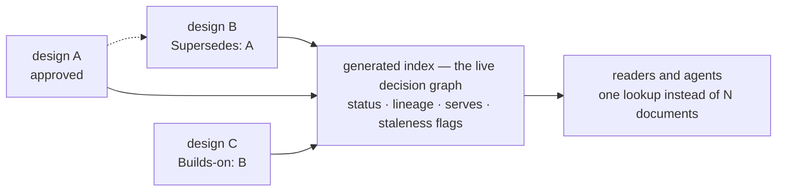

# Tech-design conventions — evolution, traceability, index, and template

| Field | Value |
|---|---|
| **Status** | Draft → Approved *(currently Draft v0.1, in review; merge is the freezing event)* |
| **Owner** | @mdarabi |
| **Approver(s)** | @mdarabi (operator — document-system surface) |
| **Date** | 2026-07-06 |
| **Relevant-when** | authoring or superseding a technical design; implementing `docgate`'s design-doc verbs (v2 scope); wiring PRD→design traceability; deciding where a decision record lives or how its lifecycle works |
| **Scope** | Conventions for `docs/tech-design/`: the closed header schema (incl. `Supersedes` and `Serves`), the evolution model, the generated index, the instantiable template, and the future gate scope. **Not** in scope: PRD conventions (settled by the amendment model), `docs/ux-design/` (reserved, §3.6), `techspec.md` timing (rule 3 stands), `docgate` v1 scope (approved as-is). |
| **Tracking** | filed with the introducing PR |
| **Builds-on** | `docs/tech-design/prd-amendment-model.md` (generalizes its projection and declared-supersession lessons to the design class) |
| **Supersedes** | — |
| **Serves** | — (document-system infrastructure) |
| **Security/privacy impact** | none — document-system conventions only |
| **Template version** | tech-design-template/v1 |

## 1. Problem

The PRD class has a complete system — template, typed evolution,
generated projection, designed gate. The tech-design class has a prose
convention (AGENTS.md rule 7), one live document, and four gaps:

1. **No instantiable template.** Every author re-derives the factory header
   and section conventions from rule 7's prose — exactly what templates
   exist to prevent, and the gap `docgate` cannot lint against.
2. **No current-state view.** With N designs, "which decisions are live,
   which are superseded, which governs X?" is answered by reading
   everything. The corpus's own answer to this (KNOW-2's routing menu) is
   described but not mechanized; `techspec.md` — the eventual per-subsystem
   rollup — is rightly forbidden until code ships (rule 3).
3. **No requirement-level traceability.** The pipeline compiles "PRD +
   designs + DoD" together (stage 6) and VNEXT-3 demands requirement →
   design-decision tracing, but nothing on a design names the PRD anchors
   it serves — the compiler has no join key.
4. **No CI gate.** INV-41 promises CI-level immutability for designs too;
   today it is prompt-side only.

The moment is the same one the `tech-design` rename exploited: **one** design
document exists. Every convention decided now costs nothing to adopt;
every one decided later costs a migration.

## 2. Decision — decision-delta supersession, projected by an index

**Decision:** Technical designs remain **whole-document immutable decision
records** — one decision per document (RW-5) — whose evolution is
**supersession declared by the new document**, never row-level amendments.
The `Builds-on`/`Supersedes` chain *is* this class's ledger; its projection
is a **generated index**, not an effective-document fold.

The reasoning, stated once: the PRD ledger earned its amendment machinery
from what a PRD is — a contract of anchored, row-granular units that change
piecemeal. A design is a narrative argument; it has no rows. "Amending part
of a decision" is simply *making a new decision*, and the decision-delta
model already handles that at the correct granularity. Forcing the
amendment fold onto narratives would manufacture anchors where none exist.

What "one decision" means, precisely: one **independently-revisable
question**. Subordinate choices that would only ever change together ride
inside the same document (§3 subsections, `**Decision:**` callouts);
choices that could be revisited separately get separate documents. The
document boundary **is** the supersession boundary — a document should
contain exactly the set of choices that change together. That coupling is
the rule's reason, not tidiness: bundle two independent decisions and
superseding one later forces re-approving the other, or spawns a partial
override that leaves two "live" documents in tension.

This document is itself one decision at the **class level**: how
`docs/tech-design/` evolves, routes, and becomes traceable. The header
schema, the index, and the v2 gate scope are subordinate mechanics of that
one convention — they would only ever change together with it. A future
change to any mechanic that proves independently revisable supersedes this
document or splits that mechanic into its own design; the convention is
not an exception to RW-5, and saying so here is what keeps it that way.

Supersession is **whole-document in v1** — `Supersedes` retires its target
entirely. A successor that revises only part of a prior design has two
honest shapes: supersede wholly, carrying forward what remains valid (the
v2-model pattern), or use `Builds-on` with prose that narrows the
predecessor — which leaves the target live and is exactly the R5 tension,
tolerated rarely and visible in the index. The boundary between the two is
**contradiction**: `Builds-on` narrowing is legal only while both
documents can be simultaneously true — if the new decision makes **any
binding statement** of a live design false, it must supersede it. Two
live designs never disagree. Scoped supersession (`<slug#anchor>`
targets) is deliberately reserved for a future superseding convention;
until then the index never retires part of a document.

Three mechanics carry the model, each inherited from a paid-for lesson:

1. **Supersession is declared by the successor.** The new document carries
   `Supersedes: <slug>`; the old document is never edited — not even to
   gain a marker (the lesson that killed the PRD base's `Amended-by` row).
   Live-vs-superseded status is *computed* by the index from the inverse.
2. **The projection is generated, never authored** (AP-10). The index has
   no hand-maintained interim form: it is born with the tool that generates
   it (§3.2) — a hand-curated "generated" file is the drift pattern this
   repo exists to kill.
3. **Merge is the freezing event** — same rule as amendments: drafts are
   editable while their PR is open; a merged design changes only by
   supersession.

## 3. The design

### 3.1 Header schema (closed)

The factory header plus the design-class rows, all parsed closed once the
gate exists:

| Field | Rule |
|---|---|
| **Status** | `Draft …` → `Approved` at merge. *Superseded* is never written here — it is computed by the index. A merged design carrying `Draft` is a gate error (v2). |
| **Owner / Date / Relevant-when / Scope / Tracking / Builds-on** | unchanged from rule 7; `Relevant-when` follows the routing-surface fill formula |
| **Approver(s)** | who must approve before merge — named individuals or roles; a **named reviewer is mandatory** when `Security/privacy impact` is `yes` or the surface is data/infra/governance. Approval *authority* is the merge review record — the header names the bar, the PR record proves it. |
| **Supersedes** | slug(s) this document replaces, or `—`. Declaring it is what retires the target in the index. |
| **Serves** | the requirement anchors this design implements, **typed**: `prd:<feature>/FR-3` (resolvable PRD anchors) · `corpus:VNEXT-8` (the placeholder requirement corpus, until real PRDs absorb it) · `design:<slug>` (serving another design's mechanism) · `doc:<path#anchor>` (external/legacy). `—` only under the infrastructure rule below. The stage-6 compiler's join key (VNEXT-3). |
| **Security/privacy impact** | `none`, or `yes — 
 · reviewer: <named>`. **Yes is mandatory** when the design touches identity, permissions, secrets, user data, network boundaries, model/provider egress, billing, or production controls — and it pairs with the mandatory `Security & privacy` subsection, which must agree with this row (header `none` ⇒ subsection `none — <reason>`). Lint-checked at v2, as a pair. |
| **Template version** | `tech-design-template/v1` — recorded at instantiation, never edited after. |

Traceability is one-directional by construction: designs cite PRDs; PRDs
never cite designs (they precede them — and their approved bases are
immutable). Backlinks appear only in generated artifacts — the design
index and, later, the PRD source map — never hand-written into either side.

The requirement↔design join is **many-to-many and accumulates**. One
design serves many anchors; one requirement collects designs over its
life — a semantics decision, an implementation shape, a later revision —
each a separate document with overlapping `Serves`. *Adding* a decision
for a requirement is a new document with `Builds-on` lineage; *changing*
one is a new document with `Supersedes`. The index provides the inverse
view — requirement → every design serving it — so "which decisions touch
FR-3?" is one lookup, not archaeology.

**`Builds-on` vs `Supersedes`, mechanically crisp:** `Builds-on` means
depends-on-or-extends and **never changes the target's liveness**;
`Supersedes` means replaces and **always retires the target** in the
index. A document may build on one design and supersede another; naming
the same target in both requires an explicitly stated boundary and is a
v2 gate warning.

**`design:` refs do not duplicate `Builds-on`.** `Serves: design:<slug>`
is legal only when the target design defines a mechanism this document
implements support for; dependency or reasoning lineage is `Builds-on` —
never both for the same relationship. `design:<slug>` means the whole
design; prefer a stable anchor (`design:<slug>#A-1`,
`design:<slug>#DINV-1`, `design:<slug>#3.2`) when the dependency is
narrower.

**`—` in `Serves` is restricted** (decides Q1): legal only for
document-system, governance, or infrastructure convention work that
implements no product anchor; every other design carries at least one
typed anchor — enforced at v2.

**Slugs are permanent IDs.** Lowercase kebab-case, globally unique within
`docs/tech-design/`, never reused. A merged design's filename never
changes: a rename is a successor document if the decision changed, or —
before the gate exists — a one-time operator migration with a full
citation sweep (precedent: the `docs/design` → `docs/tech-design` move).

**Template versions are compatibility contracts.** Every design records
the version it instantiated; the v2 gate validates each document against
its **declared** version (grandfathering, generalized); template evolution
is additive within a version line, and a breaking header change requires a
superseding conventions design — never a silent template bump.

**Grandfathering:** documents merged before this convention
(`prd-amendment-model.md`) are immutable and cannot gain the new rows. The
index treats a missing `Supersedes`/`Serves` as `—`; nothing is
retro-edited.

### 3.2 The generated index — this class's projection

`docs/tech-design/index.md` **and** `docs/tech-design/index.json`: one fold
over all design headers, two faces (AP-6) — the human routing surface and
the machine one, both part of the projection from day one (decides Q2;
machine readability is the point, or the future compiler is back to
parsing markdown). The index is not a routing table; it is the factory's
**live decision graph**, and it must answer: which designs are live · what
each superseded · which requirements each serves · which `Serves` anchors
have gone stale · which live designs build on superseded assumptions ·
which binding elements govern a given implementation task. Sole writer is
the tool; GENERATED banners; byte-verified like every projection
(`verify-generated` widens to cover both faces at v2).

Machine face, minimum fields (exact schema golden-pinned at v2; additive
evolution): `schema_version` · `generated_by` · per design: status
(`live`/`superseded`) · `template_version` · `relevant_when` ·
`builds_on[]` · `supersedes[]` · `superseded_by[]` (the **direct** edge) ·
`current_successor` (the **transitive tip** of a supersession chain) ·
`serves[]` · `tracking` · `owner` · `approvers[]` · computed flags · a
**binding block** (decision-callout anchors, `DINV-n` invariant IDs, `A-n`
acceptance IDs — the elements stage 6 compiles) and the `R-n`/`Q-n`
inventories — plus the **requirements inverse map**
(`prd:payments/FR-4` → the designs serving it): the stage-6 join,
precomputed. Chained supersession is computed, never repeated: with
A ← B ← C, A's `superseded_by` is B, its `current_successor` is C, and
status renders as "superseded by C (through B)".

Graph rules, enforced at generation (fail closed):

| Rule | Violation |
|---|---|
| the supersession graph is acyclic | cycle → gate error |
| `Supersedes`/`Builds-on` targets resolve to existing slugs (typed `doc:` externals exempt) | dangling target → gate error |
| under whole-document supersession, a design has **at most one live successor** | second successor → gate error, until scoped supersession is introduced by a later convention |

Computed flags — surfaced, not fatal: **`stale-builds-on`**, a live design
whose `Builds-on` target has since been superseded (its foundation moved;
a review prompt, because a live design built on a superseded assumption
may need one); **`stale-serves`**, a live design serving a PRD anchor the
ledger has superseded or retired — the design stays live but carries the
flag until a successor or an explicit review re-anchors it. A design must
not silently remain attached to dead intent.

**Decision:** the index (both faces) is born with `docgate` v2 — no
hand-maintained interim. With two documents the directory is readable by
eye, and a hand-curated file wearing a GENERATED badge is the exact
artifact class this repo's machinery exists to reject.

### 3.3 The template

`docs/templates/tech-design-template.md`, version `tech-design-template/v1`,
lands with this design. It canonizes the skeleton this document itself
uses: §1 Problem · §2 Decision · §3 The design (subsections `3.x` — the
one section that grows, append-only) · §4 Alternatives considered ·
§5 Risks · §6 Acceptance · §7 Open questions · unnumbered `## Principles`
last — deliberately unnumbered: it is the cross-document footer contract,
located by name (rule 7 and the factory tooling grep `## Principles`),
identical in every design and consistent with the grandfathered exemplar;
a number would buy it an anchor it does not need. Decision/Acceptance callouts; guidance italics deleted at
instantiation; one decision per document — an author who needs two §2s is
writing two documents. Acceptance, risks, and open questions are
**structured tables**, and invariants carry stable IDs (`A-n` / `R-n` /
`Q-n` / `DINV-n` — all per-document; cite externally as `<slug>#R1`,
`<slug>#DINV-1`; `DINV` because `INV-n` is the domain registry and `I1…`
the incident registry): acceptance carries verify method + required
evidence + traced anchors; risks carry impact + the verification that the
mitigation *exists* (a mitigation without verification is intent); open
questions carry owner + what they block + status + resolution. Two §3
subsections are **mandatory by name** in every design — position free,
located by heading like `## Principles`: **Observability** (AP-5:
designed in, never bolted on; `none — <reason>` is a legal fill for
designs with no runtime surface) and **Security & privacy** (which must
agree with the header row — a lintable pair). Pre-convention documents
are grandfathered. The template further prompts, without mandating, the
recurring concerns — boundaries/non-goals and invariants (nearly
universal; `DINV-n`, graduating to the domain INV registry when
load-bearing), failure modes, migration/rollback, performance/cost.

**Design prose is not uniformly binding.** `**Decision:**` callouts,
invariants, and acceptance rows **bind** implementation; alternatives,
rationale, and risks explain the decision and create no obligation unless
an acceptance row or invariant references them. This is what makes a
design both things at once: a *decision record* in its lifecycle, and an
*implementation contract* through its binding elements — which are exactly
what stage 6 compiles. Without the distinction, agents treat every
explanatory paragraph as binding, or worse, binding constraints as
optional prose.

### 3.4 Gate — docgate v2 scope, named but not designed here

`docgate` v1 ships exactly as approved (PRDs only). The v2 increment this
convention creates, to be designed when v1 is proven: `lint-structure`
generalized to design headers (closed schema, template-version pin);
presence of the mandatory-by-name subsections and the security
header↔subsection agreement; `check-immutable` generalized to
`docs/tech-design/` (add-only post-merge — INV-41's CI half for designs);
resolution checks (`Supersedes`/`Builds-on` targets exist; `Serves`
anchors resolve against PRD projections, flagging anchors that went
stale); `index` generation + `verify-generated` over it. One binary, one
predicate, wider fence (AP-11).

### 3.5 What deliberately does not change

`techspec.md` stays forbidden until code ships — the index is a card
catalog (what exists, what is live, what serves what), not a state rollup
(how the system currently works). `system-design.md` remains the
hand-maintained *narrative* map; the index removes only its mechanical
burden (currency bookkeeping), not its judgment.

### 3.6 UX-design — reserved, deliberately undecided

`docs/ux-design/` (freed by the rename) faces the same four columns:
template, evolution, projection, gate. Its natural anchor is the PRD's
§4.3 flows (`F-n`) — a UX document *deepens* flows the PRD already anchors
— and its real questions (fidelity conventions, design-file linking,
eval-heavy acceptance) are answerable only against a concrete UI-bearing
feature. **Decision:** this document does **not** define UX-design
conventions — it only reserves the namespace, and no tech-design rule
governs `docs/ux-design/` by assumption. Conventions are decided at the
first UI-bearing feature; nothing here presumes the answer.

### 3.7 Observability

none — this convention has no runtime surface; the generated index's
health is `docgate` v2's observability concern, specified at that design.

### 3.8 Security & privacy

none — matches the header row: document-system conventions only; no
identity, secret, data, or egress surface.

## 4. Alternatives considered

| Alternative | Why rejected |
|---|---|
| **Full ledger/projection (row amendments) for designs** | granularity mismatch — narratives have no anchored rows; every "partial amendment" is really a new decision; the machinery would manufacture anchors to feed itself |
| **Hand-maintained index now, generated later** | a hand-curated file wearing a GENERATED badge is the drift pattern itself; two documents don't need an index |
| **Designs live inside the PRD ledger directory** | designs are frequently cross-cutting (this one; engine state; process shape) — `Serves` is the join, not co-location |
| **`Superseded-by` marker edited into the old doc** | violates immutability; the `Amended-by` lesson replayed — status is computed by the projection, never written into frozen documents |
| **Status ladder with review stages (PRD-style gates)** | designs already have exactly one gate that matters — approval of the introducing PR; importing tiered gates adds ceremony without a failure mode to prevent |

## 5. Risks

| ID | Risk | Impact | Mitigation | Verification / evidence |
|---|---|---|---|---|
| R1 | Header creep — three new rows on every design | authoring friction | rows default `—`/`none`; closed schema keeps them cheap; `Serves` pays for itself the day the compiler exists | template review now; v2 header lint |
| R2 | `Serves` anchors go stale when the PRD ledger supersedes a cited row | designs silently serve dead requirements | the PRD source map records supersession; docgate v2's resolution check flags dangling anchors; until then, amendment `diff` output names affected designs | v2 fixture: dangling `Serves` → red |
| R3 | No index until docgate v2 while designs accumulate | navigation cost grows with the count | `Relevant-when` headers keep the directory greppable (KNOW-2 fallback); growth past comfort is pressure to build v2, not to hand-maintain | directory size watched at design reviews |
| R4 | Convention drift before any gate exists | inconsistent corpus | the template is the enforcement surface for now (authors copy-fill rather than re-derive); same transitional posture the amendment template runs under | template diffs reviewed; v2 lint retroactively checks headers |
| R5 | Bundled "model" documents pay at revision time — a single-knob change forces a wholesale v2 supersession or a partial-override follow-up leaving two live docs in tension | churn, or two "live" docs giving conflicting guidance | split independently-revisable questions at authoring; tolerate rare wholesale v2s for true founding models; treat *frequent* partial overrides as evidence this convention needs anchored-section supersession — revisited by superseding design, never improvisation | partial-override frequency is visible in the index's lineage view |

## 6. Acceptance

| ID | Acceptance criterion | Verify | Required evidence | Traces to |
|---|---|---|---|---|
| A-1 | the template exists, carries `tech-design-template/v1`, and instantiates cleanly (meta card + callouts recognized) | Inspection | render check output | §3.3 |
| A-2 | this document conforms to the schema it introduces (`Approver(s)` / `Supersedes` / `Serves` / `Security/privacy impact` / `Template version` rows, exact names; structured §5–§7 tables) | Inspection | this document's header and tables | §2, §3.1 |
| A-3 | AGENTS.md rule 7 and the layout table reference the template rather than re-describing the header | Inspection | AGENTS.md diff | §3.3 |
| A-4 | the grandfathering rule is stated — no retro-edit of `prd-amendment-model.md` | Inspection | §3.1 text; unchanged predecessor doc | §3.1 |
| A-5 | docgate v2's scope is enumerated precisely enough that its future design starts from a list, not archaeology | Inspection | §3.4 | §3.4 |
| A-6 | the index's graph rules (acyclicity, target resolution, single live successor), staleness flags, and machine-face minimum fields are defined | Inspection | §3.2 | §3.2 |
| A-7 | binding vs explanatory prose is distinguished, and the template instructs authors accordingly | Inspection | §3.3; template §0 | §3.3 |
| A-8 | Observability and Security & privacy are mandatory-by-name §3 subsections with `none — <reason>` escapes; the security subsection pairs with the header row; this document self-conforms | Inspection | template §3.4–3.5; this document §3.7–3.8 | §3.3 |

## 7. Open questions

| ID | Question | Owner | Blocks | Status | Resolution |
|---|---|---|---|---|---|
| Q1 | Once real per-feature PRDs exist, does `—` stay legal in `Serves` for non-infrastructure designs, or does the gate require a resolvable anchor? | operator | — | resolved (in review) | `—` restricted to document-system/governance/infrastructure work; typed anchors required otherwise (§3.1) |
| Q2 | Does `index.json` ship beside `index.md`, and with what schema? | implementation | — | resolved (in review) | both faces are the projection from day one; minimum fields fixed in §3.2, exact schema golden-pinned at v2 |
| Q3 | Should the index surface *proposed* (open-PR drafts) alongside live/superseded? | operator | nothing | open | deferred — it would make the index reflect unmerged state; revisit on demonstrated routing need |

## Principles

- **AP-7 / INV-33 — honored.** Designs stay immutable decision records; supersession is a new document citing the old; the rationale trail is never rewritten. The new rows mechanize the citation, they do not weaken the contract.
- **AP-10 — honored.** The index is generated code output, never prompt discipline — and it does not exist until the generator does.
- **AP-13 — honored (at v2).** "This design is live" becomes a verifiable artifact — the index byte-verified against the recomputation — never a claim.
- **AP-5 / INV-42 — honored.** `Serves` is the requirement→design edge VNEXT-3's chain needs; backlinks live in generated artifacts only.
- **AP-6 / INV-32 — honored.** The header is closed, contractual data; unknown fields are errors once the gate exists.
- **AP-11 / INV-30 — honored.** The gate remains one binary, one predicate — v2 widens the fence rather than growing a twin.
- **AP-24 — honored.** The index is derived from human-approved documents and governs nothing; the documents remain the sole authority.
- **AP-19 — honored.** Steady-state cost is zero tokens: routing reads headers; the index is deterministic output.
- **AP-23 — honored.** Flat slugs, append-only sections, and declared-by-successor supersession keep parallel design authors collision-free.
- **RW-5 — honored.** One decision per document — this document decides the conventions and nothing else; the template enforces the same on its instances.
- **Deviation:** none.
