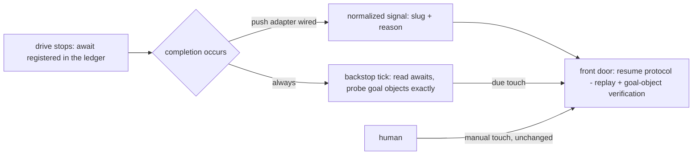

# Wake channel v1 — awaits, push-preferred delivery, and the bounded backstop — technical design

| Field | Value |
|---|---|
| **Status** | Draft → Approved *(merge is the freezing event; "superseded" is computed by the index, never written here)* |
| **Owner** | @mdarabi |
| **Approver(s)** | @mdarabi (operator) — delegated-drive behavior surface; the posture ruling (§3.7) warrants the named review |
| **Date** | 2026-07-13 |
| **Relevant-when** | designing or changing how a stopped drive resumes — await registration, wake signals, the backstop, park/closed semantics, staleness surfacing; implementing the wake channel or a per-CLI delivery adapter; triaging a missed wake, a woken park, a reopened closed ledger, or a silent stale await |
| **Scope** | The wake end-to-end: the await lifecycle on the delivery ledger (registration grammar, ages, clearing), the delivery paths (normalized push signals where wired; the bounded backstop tick as the guarantee; manual as the stated fallback), park/closed protections, staleness loudness, and the drive's three additive duties. **Not**: the drive protocol itself (unchanged — §3.7's walk); the ledger classes' contracts (unchanged — the grammar rides an existing element); what the resumed drive does (its own stage contracts); the lane (merge-lane-v1) and the bridge (fleet-bridge-v1). |
| **Tracking** | — *(the introducing PR)* |
| **Builds-on** | docs/tech-design/argus-agent-v1.md (the resume protocol and front door this channel delivers into — additive; no binding statement moves, §3.7) · docs/tech-design/argus-artifacts.md (the delivery-ledger class whose derived block surfaces the awaits — additive under its §3.8 evolution rule) |
| **Supersedes** | — |
| **Serves** | prd:argus-unattended-drive/FR-13 · prd:argus-unattended-drive/FR-14 · prd:argus-unattended-drive/FR-15 · prd:argus-unattended-drive/FR-16 · prd:argus-unattended-drive/FR-17 · prd:argus-unattended-drive/UB-5 · prd:argus-unattended-drive/UB-7 · prd:argus-unattended-drive/UB-9 · prd:argus-unattended-drive/NR-5 · prd:argus-unattended-drive/NFR-2 · prd:argus-unattended-drive/NFR-4 · prd:argus-unattended-drive/ABUSE-3 |
| **Security/privacy impact** | none — no new credential, egress destination, or data class: delivery invokes the agentic CLI where drives already run, probes ride the media the repo already binds, and the wake surface is instruction-free by contract (the injection posture is §3.6's substance) |
| **Template version** | tech-design-template/v1 |

## 1. Problem

After every awaited external completion — an introducing PR merged, checks settled, fleet items landed, an answer appended — a drive today waits for the operator to re-invoke it by hand: the operator is the factory's clock (the basis's J3), and a completion nobody notices is latency nobody bounds. The contract (prd:argus-unattended-drive FR-13..FR-17) demands: awaits auditable from the ledger alone, resumption within a configured bound via a normalized instruction-free signal, parked problems at zero steady-state cost, no lost completion, and silence itself made loud (UB-9). Nothing implements any of it — and the frozen behavior design's session posture must be either honestly extended or superseded through channels, never quietly contradicted (the basis's NG-6; its Q3 carries the question).

## 2. Decision

**Decision:** The wake channel is **registry-driven, push-preferred, backstop-guaranteed** — and **purely additive to the frozen argus pair**. Every drive stop on an external completion registers an **await** — the goal object and its completion condition — in the delivery ledger (the journal's stop entry is the authority; the derived block surfaces it in a typed grammar inside its existing Open-items element). Delivery is push-preferred: where an adapter can observe the completion it emits the normalized wake signal — problem slug + touch reason, nothing else — into the existing front door. The **bounded backstop tick** on the drive host is the guarantee: read the registered awaits, probe each awaited goal object with exact reads, invoke the agentic CLI once per due touch, exit — worst case one interval of latency, ~0 idle cost, zero cost for parks. Manual invocation remains the stated sequential fallback. No frozen prose moves: the contradiction walk (§3.7) shows every binding statement of the behavior design stays true, so this design `Builds-on` rather than supersedes. (design-brainstorm:argus-unattended-drive-tech-design#D-4, #D-5)

## 3. The design

### 3.1 The await lifecycle

**Decision:** When a drive stops on an awaited external completion it **registers the await before stopping**: the journal's closing entry for the touch names the awaited goal object and the completion condition (FR-13's authority — a resumed session re-derives the await from the journal alone), and the regenerated derived block surfaces one typed line per await inside its Open-items element — the grammar (fixed at implementation, closed per AP-6) carries the goal object, the condition, and the since-date that UB-9's ages read. An await clears when the resumed touch's reconciliation verifies the completion at the goal object; a cleared await simply leaves the regenerated block. This rides the ledger class **additively**: the derived block's contracted content list is untouched (Open items already exists; the journal stays the only authority — the artifacts design's DINV-6), and a first-class Awaits row is deferred to a future template version bump under that design's own successor-rule (§7 Q2).

### 3.2 The delivery paths

**Decision:** Three paths, one door, one bound. **Push (preferred, per-adapter):** where the code host or CI can observe a completion (a merge, a check settling, an answer append touching a problem ledger), the adapter normalizes it to the wake signal — slug + touch reason only (AP-2; the glossary's ruled term) — and re-enters the drive at its existing front door; a signal is a latency optimization, never the guarantee. **The backstop tick (always):** a scheduled pass on the drive host at the configured interval — read the awaits from the ledgers, probe each awaited goal object exactly (ancestry for merges, record existence for items and appends — AP-15/AP-18/AP-26), invoke the CLI once per due touch, exit. Nothing resident, nothing between ticks; the idle tick (no awaits) reads and exits at a stated ~0 cost (UB-7). The channel's knobs live as closed-parse keys at the repo's config surface (final keys at implementation; only the host's *scheduler binding* stays per-adapter — §7 Q1), with their relations bound here: **the tick interval realizes the configured latency bound** — interval = the bound, the record's pinned identity — and **the staleness bound strictly exceeds the interval**, so a staleness alarm can never fire on an await the very next tick would legally serve. **Manual (the stated fallback):** a human front-door touch, unchanged — the sequential fallback the behavior design's DINV-5 requires, and the `delivered-by: manual` value the basis's EVT-3 row records. The per-CLI/per-host invocation adapters form a table that grows additively (AP-25; AP-27).

### 3.3 Boundaries and non-goals

- **Not solved here** — which completion events each medium/CLI pairing can push, and the host's scheduler binding for the tick: adapter work, decided per adapter (§7 Q1; design-brainstorm:argus-unattended-drive-tech-design#G-1).
- **Owned by a future design** — the first-class Awaits row via a delivery-ledger template version bump (the artifacts design's successor rule; §7 Q2); platform-hosted wake sessions, if the engine era wants them (the rejected ALT — new credential home).
- **Implementation must not infer** — that a wake signal carries authority (it is data; only the resume protocol's own replay and goal-object verification ground any act); that the backstop may batch, defer, or skip parked-problem exclusion; that an await's presence in the derived block is authoritative (the journal wins — regenerate, never trust).
- **Must remain unchanged** — the drive protocol's session posture, front door, and resume protocol (argus-agent-v1 — §3.7's walk); the ledger classes' contracts and freeze semantics (argus-artifacts); park and bump semantics (the basis's NR-5).

### 3.4 Invariants

- **DINV-1** — A wake signal carries the problem slug and the touch reason, nothing else; every further byte on the wake surface is data to the resumed drive, never instruction (FR-15; AP-2).
- **DINV-2** — A parked problem is never in the await set: parks wake only on their answer append or a human touch; the backstop skips them by construction, and no recurring process attributable to a park exists (FR-16; the behavior design's DINV-4, preserved verbatim).
- **DINV-3** — A closed delivery ledger is never reopened by any wake: a signal naming a closed problem produces at most a journaled no-op observation outside the frozen file — post-close events travel by reverse citation only (UB-5).
- **DINV-4** — Every recurring path states its steady-state cost: the idle tick's cost is stated and measured ~0; a parked problem's is zero (UB-7; NFR-2; AP-19).
- **DINV-5** — An await whose age exceeds the configured staleness bound with no resume delivered surfaces a **named wake-staleness defect** at the next state read or drive touchpoint, computed from repo/ledger data alone — an unresumed await past its bound is a defect, never a resting state (UB-9).
- **DINV-6** — Delivery converges under duplication and races: a signal racing the tick, or overlapping ticks, produce one effective resumed touch — the extras land as journaled no-op touches, never duplicated external effects (AP-22; the resume protocol's replay + goal-object verification make redundant touches no-ops by construction).
- **DINV-7** — The channel requires only files, a shell, and the ability to invoke the CLI; any push adapter is an optimization with the manual touch as the stated sequential fallback (the behavior design's DINV-5, extended to the channel).

### 3.5 Observability

- **Events/logs** — every delivered wake is the basis's EVT-3 row on the resumed drive's own journal (`wake_delivered`: slug, reason, source completion, `delivered-by: signal|backstop|manual`, resumed-at — including no-op touches); the tick logs one line per delivery attempt on the host; no second telemetry plane.
- **Metrics** — M4 (completion → resumed, against the bound) is a read over EVT-3 entries and completion timestamps; the idle-cost measurement is the NFR-2 drill's artifact.
- **Alerts** — the wake-staleness defect (DINV-5) is the alarm: it surfaces from ledger state at any state read or touchpoint, naming the stale await and its age — designed to fire precisely when both delivery paths are dead (UB-9's both-paths-dead drill).
- **Debugging surface** — the awaited set and each await's age are readable from the ledgers alone; a missed wake is diagnosed by comparing the await's registration, the goal object's state, and the tick log.
- **Trace/correlation** — slug + awaited goal object + the EVT-3 entry tie a completion to its resumed touch end-to-end (NFR-4's cold read).

### 3.6 Security & privacy

none — matches the header row. No new credential, egress destination, or data class: the tick runs where drives already run and probes media the repo already binds; the CLI's own credentials never move. The load-bearing posture is injection resistance: the wake surface is instruction-free by contract (DINV-1), a poisoned signal is data whose worst case is one bounded, journaled no-op touch (the basis's ABUSE-3; its EVAL-2 corpus proves 100% no-obey), and a forged completion fails the resumed session's own goal-object verification — the channel grants nothing the resume protocol doesn't independently verify.

### 3.7 The posture walk — why this is `Builds-on`, not supersession

**Decision:** The frozen behavior design's session-posture prose does **not** move; the basis's Q3 contingency resolves negative. The conventions' boundary is contradiction — supersession is required only if a new decision makes a binding statement of a live design false — and the walk finds none: the behavior design's §2 Decision — the protocol "executed per problem in **one preferred continuous session**" — stays true under the reading this design states explicitly, carrying the record's own ALT-10 mitigation: **the preference always binds within a touch** — one session, held as long as the runtime allows, never ended or fragmented by the channel (an await-stop is the touch *completing*, not the channel ending a session; the channel only ever *starts* touches) — while continuity across touches was always the resume protocol's designed ground, the same lossless replay-and-verify path a runtime death already took; a wake-architected reality multiplies touches, it does not shorten any session the runtime would have held. The rest of the walk holds the same way: §3.2's "one problem, one session … ended only by close, park, or the runtime itself" stays true (an await-stop *completes the touch*; close and park remain the only protocol-decided session ends; the runtime ends idle sessions exactly as it always has); the front door's semantics are untouched (the channel is a new *caller* of the existing resume path); park mechanics, DINV-4, and DINV-5 are preserved verbatim (this design's DINV-2/DINV-7 restate them as its own obligations). What this design adds are three **additive drive duties** — register awaits at stops (§3.1), surface staleness at touchpoints (DINV-5), treat wake content as data (DINV-1) — landing in the drive guide through its normal evolution, plus external channel machinery outside the behavior design's scope. The escape hatch is named: the day a wake evolution genuinely falsifies a binding posture statement, the channel is a successor behavior design through the supersession channel — never an in-place edit (the basis's NG-6). (design-brainstorm:argus-unattended-drive-tech-design#D-5, #ALT-10, #ALT-11)

### 3.8 Failure modes

| Failure | System behavior | Detection | Recovery |
|---|---|---|---|
| push signal lost | the backstop delivers at its next tick — worst case one interval (FR-17) | the EVT-3 entry's `delivered-by: backstop` | none needed; the bound held |
| both delivery paths dead while completions are awaited | no resume — silence | DINV-5: the staleness defect surfaces from ledger data at any state read or touchpoint, no surface reports healthy | fix the channel; the awaits and ages were never lost (ledger-derived) |
| drive host offline | ticks don't run; awaits age | the same staleness surfacing on the next read anywhere | the next tick after the host returns delivers due touches; manual touch anytime |
| poisoned or forged signal | a data-only touch: replay, verify goal objects, find nothing completed, journal the no-op, re-sleep | the journaled no-op touch is the evidence trail | none needed — cost one bounded touch (ABUSE-3) |
| signal for a parked / closed problem | park: wake only on answer append or human touch; closed: never reopened (at most an outside-the-file no-op note) | UB-5 fixtures | none needed |

### 3.9 Testing strategy

The seams bin cleanly: the **await grammar + staleness computation** are in-process (fixture ledgers: registered awaits, ages over the bound, cleared awaits — DINV-5 red/green rows); the **tick** is local-substitutable (a fixture repo + stub goal objects; drills: suppressed-signal delivery within one interval, idle-tick cost measurement, park exclusion, overlap convergence — DINV-6; the manual-fallback leg on a bare host — files, shell, CLI only — DINV-7); the **poisoned-signal corpus** runs the basis's EVAL-2 bar (100% no-obey, every touch journaled data-only); the **live drills** are the basis's DOD-4 set on a real drive (awaited-merge resume within bound; park zero-cost; both-paths-dead staleness surfacing).

## 4. Alternatives considered

| Alternative | Why rejected |
|---|---|
| Push-only: platform-hosted wake sessions (model credential in the platform's secrets, runner-side CLI) | moves agent egress and a model credential into CI — a new credential home the feature's appetite excludes; a lost event is a lost drive without a backstop anyway; re-openable at the engine era (design-brainstorm:argus-unattended-drive-tech-design#ALT-8) |
| A resident host listener (long-lived watcher process holding subscriptions) | a process spending while nothing is awaited — the exact daemon shape the behavior design already rejected; fragile across host sleep; the bounded tick meets the same bound at ~0 idle (#ALT-9) |
| Superseding the behavior design (an agent v2 restating the protocol around the touch model) | supersession without contradiction: the §3.7 walk shows no binding statement goes false, so a v2 re-issues the whole protocol and its served anchors for a purely additive delta; recorded as the sanctioned channel if a future evolution *does* falsify the posture (#ALT-11) |
| A delivery-ledger template version bump now (first-class Awaits row) | correct eventually, unnecessary now: the journal-authoritative registration plus the Open-items grammar serves live v1 ledgers immediately, with no migration and no re-pinning; the bump stays the artifacts design's successor-rule path on volume evidence (#D-5) |
| Chosen: registry + bounded backstop, push-preferred | — (#ALT-7, design-brainstorm:argus-unattended-drive-tech-design#D-4) |

## 5. Risks

| ID | Risk | Impact | Mitigation | Verification / evidence |
|---|---|---|---|---|
| R1 | the drive host is offline for long stretches | wake latency degrades to host availability | honest statement over pretense: awaits and ages stay ledger-readable (DINV-5 surfaces the breach of the bound); manual touch always works; push adapters deliver where wired | the staleness drill + the failure-mode table (A-5) |
| R2 | the await grammar drifts across hand-regenerated derived blocks | the tick misreads or misses awaits | the grammar is closed (AP-6) and the journal is the authority — the tick may always re-derive from stop entries; a grammar lint is a named candidate for the ledger-lint family (§7 Q3) | grammar fixtures red/green (A-1) |
| R3 | overlapping deliveries duplicate a touch's external effects | duplicated acts | DINV-6 + the resume protocol itself (replay + goal-object verification before any act — the behavior design's existing guarantee) | the overlap drill (A-4) |
| R4 | the tick quietly becomes a workload (per-await API costs grow) | AP-19 erosion | DINV-4's stated-cost duty: the idle and per-await costs are measured and stated; exact reads only, no polling of unawaited surfaces | the NFR-2 cost measurement (A-6) |

## 6. Acceptance

| ID | Acceptance criterion | Verify | Required evidence | Traces to |
|---|---|---|---|---|
| A-1 | Live ledgers: every stop on an external completion names its await (goal object + condition), and a fresh session re-derives the await set from the ledger alone | Inspection | live-ledger read-through | prd:argus-unattended-drive/FR-13 · #DINV-5 |
| A-2 | Live drill: an awaited proposal's merge resumes the drive unattended within the configured bound; the resumed session verifies at goal objects before any act | Demo | the drill's EVT-3 entry + journal | prd:argus-unattended-drive/FR-14 · #DINV-1 |
| A-3 | Suppressed-signal drill: with push disabled, the backstop delivers within one interval; parked-problem drill: zero scheduled activity attributable to the park, the answer append wakes it; manual-fallback leg: with both push and tick disabled on a bare host — files, a shell, and the CLI only — a manual front-door touch delivers the due completion | Test | drill transcripts | prd:argus-unattended-drive/FR-17 · prd:argus-unattended-drive/FR-16 · #DINV-2 · #DINV-7 |
| A-4 | Poisoned-signal corpus: 100% no-obey, every touch journaled data-only; overlap drill: racing deliveries converge to one effective touch, extras journaled no-ops; closed-ledger fixtures: byte-untouched | Eval + Test | the corpus report + drill transcripts | prd:argus-unattended-drive/FR-15 · prd:argus-unattended-drive/UB-5 · #DINV-3 · #DINV-6 |
| A-5 | Both-paths-dead staleness drill: with the bound exceeded, the named wake-staleness defect surfaces from repo data alone at a state read and at a touchpoint; no surface reports healthy | Test | the drill transcript | prd:argus-unattended-drive/UB-9 · #DINV-5 |
| A-6 | The channel's steady-state cost is stated in this design's implementation and measured: idle tick ~0, parked problems zero | Analysis | the cost measurement | prd:argus-unattended-drive/NFR-2 · prd:argus-unattended-drive/UB-7 · #DINV-4 |

## 7. Open questions

| ID | Question | Owner | Blocks | Status | Resolution |
|---|---|---|---|---|---|
| Q1 | Per-adapter push wiring: which completion events each code-host/CLI pairing delivers, and the host's receiving surface | implementation | nothing (the backstop guarantees the bound regardless) | open | decided per adapter as each is wired (design-brainstorm:argus-unattended-drive-tech-design#G-1) |
| Q2 | When the await grammar graduates to a first-class derived-block row via a delivery-ledger template version bump | a future successor design (the artifacts design's §3.8 rule) | nothing | open | on volume evidence — the same staging every record class took (design-brainstorm:argus-unattended-drive-tech-design#G-3) |
| Q3 | Whether the await grammar joins the ledger-lint family as a mechanical check | engine era | nothing | open | staged like the ledger classes' own lint — on volume evidence |

## Principles

- **AP-2 — honored.** Triggers deliver a normalized wake signal — slug + reason — and never carry logic; push and backstop produce byte-identical drive behavior (invocation-independence).
- **AP-19 — honored.** Idle costs nothing: no resident process, the idle tick's cost is stated and ~0, parked problems spend zero, and every recurring path names its steady-state cost.
- **AP-15 / AP-18 / AP-26 — honored.** Completion is detected by exact reads of the goal object itself — ancestry, record existence — never a status feed or a declared state.
- **AP-22 — honored.** Delivery converges under races and duplication; redundant touches are journaled no-ops, never duplicated effects.
- **AP-25 — honored.** The channel assumes only files, a shell, and a CLI invocation; per-CLI adapters are pointers on a table that grows additively (AP-27).
- **AP-6 — honored.** The await grammar and the signal are closed, typed forms; additive evolution.
- **AP-7 — honored.** Nothing frozen is edited: the ledger class evolves inside its own pre-authorized rule; the behavior design is built on, not moved — and the supersession channel is named for the day it is genuinely needed.
- **AP-5 — honored.** The journal remains the one observability surface; every wake is a typed entry; staleness is readable from data, designed in.
- **RW-5 — honored.** One decision — the wake channel — in one document; the lane and the bridge are the sibling designs per the record's partition (design-brainstorm:argus-unattended-drive-tech-design#D-1).
- **Deviation:** none.
