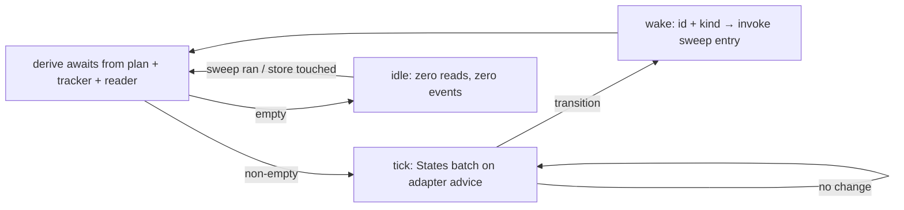

# Wake watch v1 — the watch verb, the in-process wake loop, and the status verb — technical design

| Field | Value |
|---|---|
| **Status** | Approved *(operator approval via the introducing PR's review — the merge is the freezing event)* |
| **Owner** | @mdarabi |
| **Approver(s)** | @mdarabi (operator) — a user-facing runtime surface invoking the executor |
| **Date** | 2026-07-30 |
| **Relevant-when** | designing or changing how a running watch notices proposal transitions and re-invokes the sweep, the watch verb's lifecycle, the status verb's rendering and wait ages, staleness thresholds, the wake-events file, or the reserved push slot; implementing or absorbing the watch (the feature drive's future host decision); triaging a drive that did not continue, a silent dead checker, a false ⚠, or a woken-but-idle loop |
| **Scope** | The watch verb (await derivation, the in-process cadence loop, sweep invocation), the status verb (rendering, wait kinds and ages, ⚠ semantics), the staleness-threshold config keys, the local wake-events file, and the reserved push-slot contract. **Not**: the reads themselves or the write budget (state-reader-v1); feature-lifecycle semantics — ownership, feature branches, e2e (the feature drive's future ground); any change to executor internals; the argus wake stack (wake-channel-v1, untouched). |
| **Tracking** | — *(the introducing PR)* |
| **Builds-on** | docs/tech-design/state-reader-v1.md (the batched reads and events hook this loop consumes) · docs/tech-design/wake-channel-v1.md (scoped to the shared primitives: the wake-signal grammar and the staleness predicate — one implementation in `internal/wake`, imported, never copied) · docs/tech-design/implement-now.md (the executor's public sweep entry the watch invokes; its one-sweep semantics unchanged) |
| **Supersedes** | — |
| **Serves** | prd:self-drive-wake/FR-4 · prd:self-drive-wake/FR-5 · prd:self-drive-wake/FR-6 · prd:self-drive-wake/FR-7 · prd:self-drive-wake/FR-10 · prd:self-drive-wake/FR-11 · prd:self-drive-wake/FR-12 · prd:self-drive-wake/UB-1 · prd:self-drive-wake/UB-3 · prd:self-drive-wake/UB-4 · prd:self-drive-wake/UB-5 · prd:self-drive-wake/NR-1 · prd:self-drive-wake/NFR-2 · prd:self-drive-wake/NFR-3 · prd:self-drive-wake/NFR-4 |
| **Security/privacy impact** | none — no network input in v1 (the loop is timer + local file-watch; the push slot is contract-only and hint-shaped); wake signals are instruction-free by closed schema; the verb invokes the executor under the caller's existing local authority; no new credential or egress |
| **Template version** | tech-design-template/v1 |

## 0. Read to rule — the human reviewer's section (~4 min)

*The body is the contract; this section only routes attention — on any conflict the body governs; machines ignore it.*

**Judge these**

| # | The call | Could have gone | If you disagree |
|---|---|---|---|
| 1 | **A thin shipped watch verb hosts the loop** — the promise ships now; FID inherits or replaces later | library-plus-proof-harness (design-brainstorm:self-drive-wake-tech-design#ALT-8) or the argus tick (#ALT-9) | the proof runs on an unshipped path (the hermetic-fakes class), or the argus stack reopens → §2, §3.1 |
| 2 | **One staleness brain** — the predicate imported from `internal/wake`, parametrized by config | a second staleness implementation beside the argus one (#ALT-1's cost) | the twin-predicate drift class returns (research §3.4) → §3.8, #DINV-7 |
| 3 | **Two staleness surfaces, one predicate** — the status verb ⚠-renders a missed check at > 1 cadence; the defect event fires at the configured bound (default 3×) | one threshold serving both (either flappy alarms or a slow ⚠) | either the FR-12 drill fails or every hiccup alarms → §3.6, §3.8 |
| 4 | **A wake is a schedule hint; the sweep re-derives everything** | acting on wake/read payloads directly | a stale claim advances a DAG (the I2/AP-26 class) → #DINV-2, #DINV-3 |
| 5 | **Wake events land in a separate local, gitignored file; the committed artifact is the proof-run report** | the shared executor stream, or committing raw ticks | debugging noise in the shared stream, or 86k lines/day in git → §3.4, Q1 flags the basis-§5.4 reading |
| 6 | **Carina watches by stdlib 1 s mtime scan; GitHub by ≈10 s advice** — cadence is adapter-advised, no knob | fsnotify (#D-7's rejected dep) or a uniform 10 s (withdrawn — broke the frozen ≤ 1 s bound) | a supply-chain add for unpromised speed, or a contract amendment for symmetry → §3.1, #DINV-6 |
| 7 | **Thresholds are closed-parse config keys with shipped defaults** | fixed constants (the displaced recommendation in #D-5) | four knobs exist that constants would have avoided — the authority chose tunability → §3.8 |

**Sanity-check the numbers** — transition→wake p95 ≤ 15 s GitHub (at the ≈10 s advice) · ≤ 1 s Carina (A-1); idle hour: zero medium calls, zero check events (A-2); ⚠ on the checker at > 1 missed cadence, defect event at 3× cadence default (A-7); threshold defaults: review 2 h · CI 30 m · worker 2 h (§3.8); a stuck ready frontier never hot-loops (A-12); a completed plan exits 0 (A-13).

**The author's open questions** — Q1: whether basis §5.4's "existing events surface" admits the separate local file (flagged, with the one-row amend fallback) → §7; Q2: per-kind wait-age start timestamps, fixed at implementation → §7; Q3: FID's absorb-or-replace call when it merges → §7.

**Skip the rest** — header/schema/structure → docgate lint; substance, reuse, shape → the unmanned `tech-design-review`; implementation defects → codegate; rationale → §4.

## 1. Problem

The reads exist (state-reader-v1) but nothing runs them: no shipped process notices "task 3's proposal landed" and continues a feature, and no command answers "what is the factory waiting on, and for how long?" The intended lifecycle owner — the feature integration drive — is an unmerged draft, so waiting for it strands the merged contract's promise (basis M1: zero re-invocations) behind an unbuilt feature, and proving the promise on a test harness is the exact green-double-over-unshipped-path failure the corpus records (research §3.7; the operator's own hermetic-fakes lesson). The cheapest honest host is the smallest shipped one.

## 2. Decision

**Decision:** A thin **watch verb** ships with this feature and hosts the loop: it derives the awaited set from a frozen plan's tasks and their proposals, runs an **in-process cadence loop** (adapter-advised: Carina ≈ 1 s scan, GitHub ≈ 10 s batch read) that consumes state-reader-v1, and on each observed awaited transition emits the normalized wake — await id + transition kind, nothing else — whose only effect is invoking the executor's existing public sweep entry. While nothing is awaited the loop does nothing at all. A **status verb** renders the same derived state read-only: per task — state, waiting-on, wait age, a ⚠ past the wait-kind's threshold — plus the checker's own last-check age. Staleness is computed by the **one shared predicate** in `internal/wake` (imported, never copied), parametrized by closed-parse config keys with shipped defaults. Wake events append to a **separate local, gitignored JSONL file**; the committed artifact is the proof-run report distilled from it. The feature drive, when it merges, inherits or replaces the verb by its own contract. (design-brainstorm:self-drive-wake-tech-design#D-1, #D-3, #D-5, #D-7, #D-9; ALT-7)

## 3. The design

### 3.1 The watch loop

**Decision:** One goroutine-owned loop inside the verb's process (context-cancelled, no daemon):

1. **Derive awaits** — from durable state only: the frozen plan's task list × the tracker/proposal state (via the reader) ⇒ the awaited set, three kinds: **open proposals** (awaiting landing/checks/review), **claimed tasks without a proposal yet** (awaiting the worker's proposal — the worker-wait kind), and **ready-but-unclaimed tasks** (awaiting nothing — they trigger a sweep). An empty awaited set therefore means every task is closed: a DAG with nothing in flight, nothing claimed, and nothing ready is complete (any incomplete DAG has a ready root or an in-flight blocker). No await state survives the process (DINV-5); restart re-derives (basis UB-3).
2. **Tick** — while the awaited set is non-empty, call `States(refs, cursor)` on the adapter's advised cadence; the advice comes from the adapter (Carina 1 s scan, GitHub ≈ 10 s — sized so notice lands inside the 15 s promise); no user cadence knob exists (basis FR-6/NG-6).
3. **Wake** — an awaited transition (landed · checks settled · new comment) emits the wake signal — the `internal/wake` grammar: await id + transition kind, closed schema (DINV-1) — and the loop invokes the executor's public sweep entry once per wake burst (coalescing: N transitions in one tick ⇒ one sweep — the sweep re-derives the whole frontier anyway, DINV-3). **Sweep invocation is state-edge-triggered** (DINV-9): the ready-task trigger fires once per distinct derived state; when a sweep produces no state change (the next derivation is identical — e.g. every ready task fails pre-claim on a missing backend), re-invocation drops to cadence pace and the affected tasks' worker-wait ages accrue toward the ⚠ bound — a stuck frontier surfaces as staleness, never as a hot loop (AP-16/AP-19).
4. **Idle** — awaited set empty ⇒ no reads, no events, block on the next derivation trigger (a sweep just ran, or the Carina scan's cheap directory mtime gate) (basis FR-5).
5. **Completion** — a derivation finding every plan task closed renders the completion summary (tasks landed, wakes delivered, elapsed) and exits 0 — the watch ends with the feature (the proof run's own end state).
6. **Exit** — ctx-cancel (Ctrl-C) stops the loop; claims and worktrees are the executor's to release per its own contract; the verb owns nothing durable.

### 3.2 Boundaries and non-goals

- **Not solved here** — the reads, budgets, and adapters (state-reader-v1); feature-lifecycle semantics — exclusive ownership, feature branches, candidate-merge e2e, final delivery (the feature drive's future contract; design-brainstorm:self-drive-wake-tech-design#O-2); multi-machine coordination (basis NG-5); any always-on background program (basis NG-1).
- **Owned by a future design** — the feature drive's host decision (absorb or replace the verb — Q3); push-channel adapters filling the §3.7 slot (basis WR-1); the argus stack's own evolution (#O-1).
- **Implementation must not infer** — that a wake carries authority (it schedules; the sweep decides — DINV-2); that the loop may hold claims, merge, or advance tracker state itself (DINV-4); that reader-claimed `landed` proves mainline ancestry (consumers verify at goal objects per their contracts; the sweep's own exact probes are that verification here — AP-26).
- **Must remain unchanged** — the executor's one-sweep semantics and its suites (basis NR-1); wake-channel-v1's stack and semantics (D-1); the plan/tracker projection contracts (plan-new-v1's ground).

### 3.3 Invariants

- **DINV-1** — The wake signal carries the await id and the transition kind, nothing else; the schema parses closed — an extra field is a parse defect, never forwarded (basis FR-10).
- **DINV-2** — A wake's only effect is scheduling: the sweep it invokes re-derives the frontier from exact fresh reads; no dispatch, claim, close, or tracker write keys off the wake's or the reader's payload directly.
- **DINV-3** — The loop is level-triggered: duplicate, lost, or coalesced wakes converge to the same outcome as one wake (basis UB-4); correctness never depends on delivery.
- **DINV-4** — The verb holds no claims, opens no proposals, merges nothing, and writes no tracker state; every mutation belongs to the executor it invokes (basis NR-1; NG-4's merge line).
- **DINV-5** — No await state survives the process: every derivation starts from the durable plan + tracker + proposal state alone (basis UB-3).
- **DINV-6** — Cadence is adapter-advised; no user-facing cadence configuration exists (basis FR-6).
- **DINV-7** — Staleness is computed by exactly one predicate — the `internal/wake` implementation shared with the argus stack — parametrized by this design's config; no second implementation exists in this feature's code (D-1).
- **DINV-8** — Every check and every wake **attempts** a typed event append before its effect proceeds; effects never block on the sink, and an unwritable sink degrades **loudly** — the status surface renders a named cannot-verify-liveness defect, because the last-check age FR-12's detection reads comes from this sink (basis FR-12; §3.9).
- **DINV-9** — Sweep invocation is state-edge-triggered: identical consecutive derived states never produce consecutive immediate invocations; re-invocation under an unchanged frontier is cadence-paced, and its accruing wait surfaces at the worker-wait bound.

### 3.4 Observability

- **Events/logs** — a **separate local wake-events file** (JSONL, typed kinds: check-ran, wake-delivered, read-unknown, budget-deferred, stale-flagged), gitignored, size-rotated; the reader/budget event hook (state-reader-v1 §3.4) wires here. The executor's own stream additionally gains the sweep-start `initiator`/`scope` properties (additive — basis EVT-6) so operator-vs-wake invocations are distinguishable for M1.
- **Metrics** — the **proof-run report** — the committed artifact (AP-28's teaching distillation): M1 re-invocation count, transition→wake p95 per medium, rate-limit trip count, distilled by merging the wake-events file with the executor stream by timestamp. Raw ticks are never committed (D-9).
- **Alerts** — the stale-flagged defect event (per-await, and for the checker itself) at the configured bounds; surfaced by the status verb and readable by any consumer of the file; no push notification surface in v1.
- **Debugging surface** — the status verb is the primary surface (§3.6); the wake-events file is the raw local trail ("why did it wake at 14:02?" is one grep).
- **Trace/correlation** — wake events carry the await id; the invoked sweep's run id is recorded on the wake event, joining the two streams.

### 3.5 Security & privacy

none — matches the header row: v1 accepts no network input (the loop is a timer plus local file mtimes; NFR-4's inspection is the proof); the push slot is a contract for *hints* only (§3.7) and ships empty; wake signals are instruction-free by closed schema (DINV-1 — the basis's poisoned-signal eval class has nothing to carry); the verb runs under the caller's existing local authority and mints nothing.

### 3.6 The status verb

**Decision:** Read-only, one pass, renders from the same derivation the loop uses (one code path — AP-11): per task — state (landed ✓ / waiting-on-review / checks-running / checks-red / blocked / unknown-with-reason), the wait's age, and ⚠ when the age exceeds the wait-kind's configured threshold; a footer line with the checker's own last-check age and next-check due. Two ⚠ semantics, one predicate (DINV-7): the **display** flags a checker whose last-check age exceeds one cadence (a check was missed — render the truth); the **defect event** fires at the configured staleness bound (default 3× cadence) so alarms don't flap on a single hiccup. Wait-kind derivation: waiting-on-review = open + checks green + no approving review; checks-running/red from per-context states; blocked from the plan DAG; the age's start timestamp per kind is fixed at implementation against fixtures (Q2 — the kinds and thresholds bind here; the timestamps are mechanics). The last-check age reads from the wake-events file — the checker's liveness surface; an absent, stale, or unwritable file renders the named **cannot-verify-liveness** defect (never a healthy footer — DINV-8). Degraded rendering per the basis's F2 states: unknowns render with reasons, never omitted; offline renders the last observation marked stale; exit status distinguishes rendered-stale from cannot-render.

### 3.7 The push slot (reserved, empty)

**Decision:** One narrow interface, shipped with a stub-only implementation in v1: `Deliver(hint)` — a push adapter may only advance the next check to *now*; it carries no state, no payload the loop reads beyond "check now", and its absence or death changes nothing but latency (basis FR-11). The kit's stub drill (kill the stub mid-run ⇒ byte-identical timer behavior) is the conformance bar for every future adapter (basis WR-1's slot).

### 3.8 Staleness thresholds

**Decision:** Closed-parse config keys on the repo config surface, shipped defaults (D-5): `wake.stale.review` (2 h) · `wake.stale.ci` (30 m) · `wake.stale.worker` (2 h) · `wake.stale.checker` (3× the adapter cadence). Unknown keys are errors (AP-8); an absent file or section means the defaults; the primitive relation inherited from wake-channel-v1 holds — a staleness bound strictly exceeds the cadence that would serve it, so an alarm can never fire on an await the next tick would legally satisfy. The predicate evaluating these is the shared `internal/wake` implementation (DINV-7); this design contributes only the parameter set and the wait-kind mapping.

### 3.9 Failure modes

| Failure | System behavior | Detection | Recovery |
|---|---|---|---|
| Medium unreachable / rate-limited | reads resolve unknown (reader's DINV-2); loop keeps cadence with bounded backoff; no false state | status shows unknown-with-reason; read-unknown events | next successful check reconciles (level-triggered) |
| Checker dies (loop bug, process wedged) | checks stop; events stop | last-check age > 1 cadence renders ⚠ (display); defect event at 3× | operator restarts the verb; derivation is stateless (DINV-5) |
| Process killed mid-await (laptop closed) | nothing runs; nothing lost | — (by design; basis's D-2 posture) | next `watch` re-derives and continues; no duplicate proposals (executor FR-14) |
| Two watchers on one plan | duplicate wakes; sweeps race | claims arbitrate (executor's lease layer); coalescing visible in events | none needed — converges (DINV-3); basis UB-4's drill proves it |
| Threshold config malformed | refuse to start, naming the key (closed parse) | verb exit with the named defect | fix the key; defaults by deleting it |
| Wake-events file unwritable | loop continues its effects (never blocks on the sink); a stderr warning per rotation window | the status verb renders the named cannot-verify-liveness defect (the file is the liveness surface — DINV-8); the warning | fix perms; rotation recreates; liveness rendering resumes on first append |

### 3.10 Testing strategy

The loop is **in-process** with an injected clock and a fake reader (drive every DINV as a table test: coalescing, idle-zero, restart re-derivation, closed-schema rejection); the executor entry is **remote-but-owned** (invoke the real sweep against fixture plans in the drill suite — the kill/restart and two-watchers drills run here); the push slot is exercised via the stub (its only v1 adapter — deliberately: one adapter is a hypothetical seam, and this one is *contractually* hypothetical until WR-1); the media are covered by state-reader-v1's kit; the **proof run** (basis DOD-4) is the deployment-context pass — the real verb, a real 6-task plan, both media, the committed report (AP-14).

## 4. Alternatives considered

| Alternative | Why rejected |
|---|---|
| Library + proof harness; FID hosts later (design-brainstorm:self-drive-wake-tech-design#ALT-8) | proves the promise on an unshipped path (the I11/hermetic-fakes class); M1 stays fictional for users until FID merges (D-3) |
| The argus backstop tick hosts task-watching (#ALT-9) | reopens D-1's untouched-stack ruling; ties the 15 s promise to a parked-problem clock; grows a design whose session just closed its shapes (D-3) |
| One generalized wake-v2 for both stacks (#ALT-2) | supersedes a frozen, partially-built design without any falsified statement — ceremony; forces one shape over two genuinely different runtimes (D-1) |
| A second staleness implementation local to this feature (#ALT-1's cost) | the twin-predicate drift class (research §3.4); the shared primitive costs one import (D-1) |
| fsnotify for Carina (#D-7's rejected dep) | a supply-chain entry buying ~990 ms below an already-met bound, plus platform event edge cases whose standard mitigation is the poll we already have (D-7) |
| Fixed threshold constants (#D-5's displaced recommendation) | the authority chose per-repo tunability; the keys ride the existing closed-parse config discipline (D-5) |
| Committing raw wake events to git | AP-28's own carve-out: routine ticks are not fuel; the teaching artifact is the distilled proof report (D-9) |

## 5. Risks

| ID | Risk | Impact | Mitigation | Verification / evidence |
|---|---|---|---|---|
| R1 | The watch verb accretes lifecycle semantics and becomes a shadow feature-drive | two owners for one lifecycle when FID merges | DINV-4's hard perimeter (no claims, no merges, no tracker writes); §3.2's must-not-infer; Q3 names the absorption decision | inspection at review; A-10 |
| R2 | The checker dies silently and self-drive quietly reverts to operator-clocked | the predecessor's #1 failure, recurred | DINV-8 + two-surface staleness (§3.6); the kill drill is blocking | A-7 |
| R3 | Wake-burst coalescing hides a transition the sweep then misses | a task stalls until the next transition | the sweep re-derives the *whole* frontier (DINV-2/3) — coalescing loses nothing by construction; drill asserts it | A-5 |
| R4 | The basis-§5.4 events-surface reading is judged stricter than D-9's | a one-row amendment needed | flagged openly (Q1); the amend path is named, cheap, and blocks nothing else | Q1's resolution |
| R5 | Two watchers double-invoke sweeps at scale | wasted worker spawns | claims arbitrate (existing lease layer); losers exit ≈ free (AP-19); the two-watcher drill measures | A-6 |

## 6. Acceptance

| ID | Acceptance criterion | Verify | Required evidence | Traces to |
|---|---|---|---|---|
| A-1 | Live drill both media: an awaited landing/comment/check transition is followed by a wake and a sweep invocation within the bound — GitHub p95 ≤ 15 s at the ≈10 s advice, Carina p95 ≤ 1 s | Test + Demo | drill timings in the proof report | prd:self-drive-wake/FR-4 · prd:self-drive-wake/NFR-2 |
| A-2 | One idle hour (no awaits): zero medium calls, zero check events | Test | event-file + adapter-call assertions | prd:self-drive-wake/FR-5 |
| A-3 | No cadence knob exists on any config surface; each adapter declares its advice; the loop consumes it | Inspection + Test | config-schema check + kit | prd:self-drive-wake/FR-6 · #DINV-6 |
| A-4 | The status fixture set (waiting-review / CI-running / blocked / stale / dead-checker / unknown / offline) renders every column, flags exactly the seeded rows, performs zero writes | Test + Demo | fixture renders | prd:self-drive-wake/FR-7 · prd:self-drive-wake/UB-5 |
| A-5 | Poisoned/extra-field wake fixtures are rejected at parse; a coalesced burst (N transitions, one tick) produces one sweep that starts every newly-ready task | Test | schema + coalescing fixtures | prd:self-drive-wake/FR-10 · #DINV-1 · #DINV-3 |
| A-6 | Two concurrent watchers over one fixture plan: zero duplicate task dispatches; kill-one drill converges | Test | two-watcher drill | prd:self-drive-wake/UB-4 |
| A-7 | Kill-the-checker drill: the status verb renders the stale last-check ⚠ within one cadence; the defect event fires at the configured bound | Test | kill-drill output | prd:self-drive-wake/FR-12 · prd:self-drive-wake/UB-5 · #DINV-8 |
| A-8 | Kill/restart mid-await on both media: the restarted watch re-derives and continues; zero duplicate proposals | Test | restart drill | prd:self-drive-wake/UB-3 · #DINV-5 |
| A-9 | Stub push adapter: a delivery only advances the next check; killing the stub mid-drill leaves behavior byte-identical at timer cadence | Test | stub drill | prd:self-drive-wake/FR-11 |
| A-10 | Existing executor suites pass unchanged; inspection finds no claim/merge/tracker-write path in the verb | Test + Inspection | suites + review note | prd:self-drive-wake/NR-1 · #DINV-4 |
| A-11 | Threshold keys parse closed (unknown key = named error); absent config yields the shipped defaults; the shared predicate consumes them | Test | config fixtures | §3.8 · #DINV-7 |
| A-12 | A permanently-failing ready frontier (no-backend fixture) never hot-loops: after the first no-change sweep, re-invocations are cadence-paced and the worker-wait ⚠ accrues | Test | stuck-frontier drill | #DINV-9 · §3.1 |
| A-13 | A fixture plan driven to completion ends the watch: completion summary rendered, exit 0, no further reads or events | Test | completion drill | §3.1 · prd:self-drive-wake/FR-5 |

## 7. Open questions

| ID | Question | Owner | Blocks | Status | Resolution |
|---|---|---|---|---|---|
| Q1 | Does basis §5.4's "the repo's event stream (existing events surface)" admit the separate local wake-events file (D-9's sink-class reading)? If review reads it stricter: a one-row `/prd-amend`. | @mdarabi | nothing (the amend path is named) | open | — |
| Q2 | Per-wait-kind age start timestamps (e.g. review-wait from checks-green vs last-push) — fixed at implementation against the A-4 fixtures | @mdarabi | implementation | open | — |
| Q3 | When the feature drive merges: does it absorb the watch verb or replace it (and the verb's name then)? | @mdarabi | nothing (FID's own contract decides) | open | — |
| Q4 | GitHub cadence advice fine-tuning (≈10 s) against the measured proof-run p95 — adjusted inside the adapter's advice only, never a user knob | @mdarabi | launch (the proof run) | open | — |

## Principles

- **AP-2 — honored.** The wake delivers a normalized signal and never logic; pull, push-hint, and manual invocation are indistinguishable to the sweep (DINV-1/2).
- **AP-5 — honored.** Every check and wake is an event before its effect; the two streams join by run id (§3.4).
- **AP-6 — honored.** Closed schemas: the wake signal, the threshold keys, the event kinds.
- **AP-8 — honored.** The threshold keys ride the sanctioned config surface, closed-parse.
- **AP-11 — honored.** One staleness predicate (imported, DINV-7); one frontier predicate (the executor's own — the verb never re-implements readiness); one derivation feeding both loop and status verb.
- **AP-13/AP-14 — honored.** Acceptance is drills and the deployment-context proof run, not green units over stubs (§3.10).
- **AP-15 — honored.** Every consequential read is the reader's exact fresh batch; the wake carries no state to shortcut it.
- **AP-16 — honored.** Nothing loops or skips silently: the stuck-frontier case is edge-triggered + cadence-paced with an accruing ⚠ (DINV-9); offline backoff is bounded (§3.9); the dead checker and the dead event sink both become named defects, not quiet states (DINV-8).
- **AP-17 — honored.** Unknown never advances anything; destructive/dispatch acts require the sweep's own positive evidence.
- **AP-19 — honored.** Idle is free: an empty awaited set reads nothing, emits nothing (A-2); losing racers exit on claims ≈ free.
- **AP-22 — honored.** Duplicate wakes, racing watchers, and re-runs converge (DINV-3; A-6).
- **AP-25 — honored.** The verb is invocation glue over engine libraries; no knowledge lives in a vendor surface.
- **AP-26 — honored.** Reader claims schedule; the sweep's exact probes are the acted-on observation; ancestry-grade verification stays with the consumers whose contracts demand it (§3.2).
- **AP-27 — honored.** New verb, new files; the push slot grows by adapter addition; no shared surface edited.
- **AP-28 — honored (scoped).** The committed proof-run report is the retained teaching artifact; raw ticks fall under the rule's own routine carve-out (D-9; Q1 flags the reading honestly).
- **RW-5 — honored.** One independently-revisable question: how the loop/verb runtime works; the reads live in their own document.
- **Deviation:** none.
