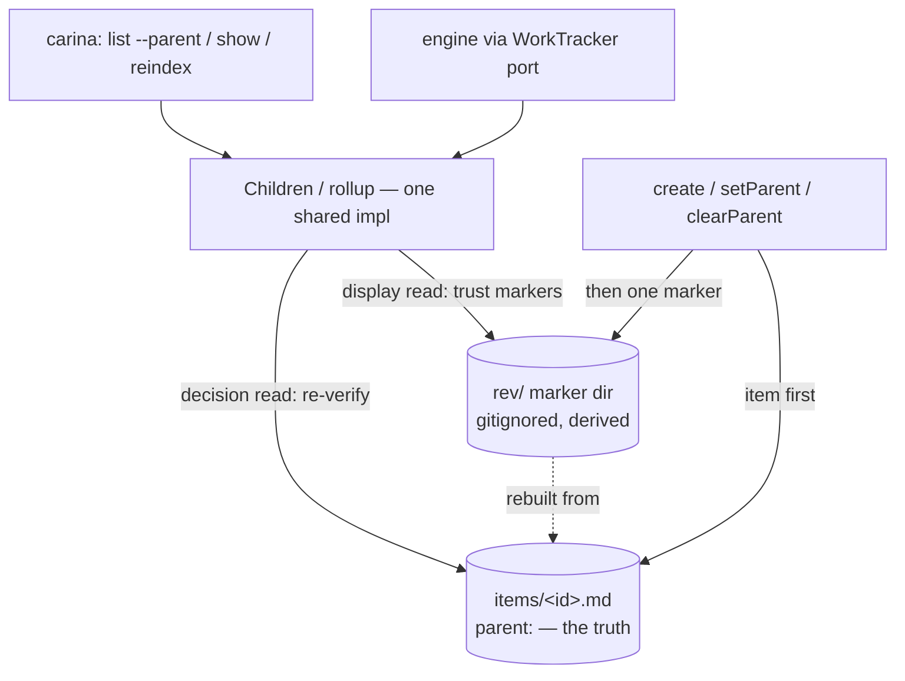

# Work-item hierarchy query & the reverse-parent index — technical design

| Field | Value |
|---|---|
| **Status** | Approved *(merge is the freezing event; "superseded" is computed by the index, never written here)* |
| **Owner** | @mdarabi |
| **Approver(s)** | @mdarabi (operator) — mandatory named reviewer: this is a data/infra surface (the work-item store's hierarchy layer) |
| **Date** | 2026-07-15 |
| **Relevant-when** | designing or changing the work-item parent→children query, the reverse-parent (`rev/`) index, or Carina's `list --parent` / `show`-rollup / `reindex` surface; implementing hierarchy enumeration against the WorkTracker port; superseding the hierarchy-index design |
| **Scope** | The parent→children **query surface** (a `list` parent filter + an all-states `show` rollup) and the **O(k) hierarchy index** that backs it — the reverse-parent marker directory, its maintenance/rebuild/decision-path discipline, and the `reindex` recovery verb. **Not**: the core item store, the id scheme, or any non-hierarchy query (owned by `local-work-tracker`); cross-clone / multi-writer concurrency (out of scope — hosted adapters). |
| **Tracking** | introducing PR (filed on approval) |
| **Builds-on** | docs/tech-design/local-work-tracker.md |
| **Supersedes** | — |
| **Serves** | prd:local-work-tracker/FR-19 · prd:local-work-tracker/NFR-8 · prd:local-work-tracker/FR-7 |
| **Security/privacy impact** | none — a local derived index over data the operand already owns; no network, identity, secrets, model/provider egress, or new authenticated surface (see §3.5) |
| **Template version** | tech-design-template/v1 |

## 1. Problem

The `local-work-tracker` PRD, amended (FR-19, NFR-8), now requires a first-class **parent→children query** — a work item's direct children across all states, shared by the engine (port) and the human (CLI) — that runs in **O(k)** in the child count, not **O(N)** in the whole store, without a full-corpus scan on the query path, while the child's `parent` field stays the sole source of truth. The shipped tracker cannot meet this: the edge is stored once on the child (`parent:`), children are found by reading *every* item and filtering (a full-store scan — `design-brainstorm:worktracker-hierarchy-query-tech-design#F-7`), and `show <epic>` reports only *open* children, so a completed epic's task set is reachable only by grepping the files. The frozen design deferred a store index to "measured need" (its Q3); the amendment is that need made a requirement.

Why now: the base tracker shipped and was dogfooded, which surfaced both the missing parent-scoped query and the O(N) cost; the amendment froze the requirement, so the mechanism must be decided before the implementing work (RW-5).

## 2. Decision

**Decision:** Carina gains a parent→children query exposed as a **parent filter on the existing `list`** (composing with the state/signal/role filters) plus an **all-states `show <epic>` rollup** grouped by open/closed — one implementation shared by the port and the CLI, over the existing `Children` port method, adding no new port verb (`design-brainstorm:worktracker-hierarchy-query-tech-design#D-1`). It is backed by a **reverse-parent directory** — one **empty marker file per edge** under a parent-keyed directory (`design-brainstorm:worktracker-hierarchy-query-tech-design#D-3` · `#ALT-1`) — that is **derived, non-authoritative, gitignored, and rebuildable** (`#D-4`): git versions only the authoritative item files. The index is maintained **incrementally** at the single edge-mutation choke point (one marker created/removed per parent-write, the item written first) and **healed by a full `reindex` rebuild** — the sole drift-recovery, cheap enough at the store's capacity to be the only one (`#D-5`, benchmark-backed). The child's `parent` field remains the sole truth; the index only accelerates *which files to open*, never *what they say*, so a read that feeds a destructive or dispatch decision re-verifies each candidate's own `parent` field — O(k) reads never cost consistency.

This is safe because the marker holds no state — only membership — so it can never return a *wrong value*, only lag membership, which is cheaply detected and rebuilt from the truth; and because per-edge files make concurrent parent-writes touch **disjoint** files, the store needs no coordinator to stay correct under its real concurrency (multiple processes on one clone). Concrete forms — the exact directory layout, the Go interface additions, the CLI flag surface, and the `reindex` signature — live in the paired solution-shape (`docs/solution-shapes/worktracker-hierarchy-index.md`), authoritative until the code exists.

## 3. The design

### 3.1 The query surface

**Decision:** the parent→children capability is a **filter on `list`** (a work item's direct children, all states by default, narrowable by the existing state/signal/role filters), and `show <epic>` lists its children **grouped by open and closed** rather than the open-only rollup it prints today (`design-brainstorm:worktracker-hierarchy-query-tech-design#D-1`, seams `#S-1`/`#S-2`). There is no dedicated `children` verb: one filterable path answers every "children of X where…" query (AP-11 — one place). Both front doors call the one `Children` implementation over the index; the port method it consumes already exists. Exact flag spelling and output grammar are in the solution-shape (a volatile surface, not frozen here).

### 3.2 Boundaries and non-goals

- **Not solved here** — the core item store, the identifier scheme, and every non-hierarchy query (owned by `local-work-tracker`); multi-user / multi-clone / distributed concurrency (out of scope — a git-merge conflict signals out-of-design usage; hosted adapters serve that, `design-brainstorm:worktracker-hierarchy-query-tech-design#O-1`).
- **Owned by a future design** — any richer traversal (transitive descendants, ancestor chains, cross-repo hierarchy) beyond a work item's *direct* children.
- **Implementation must not infer** — that the `rev/` marker set is authoritative (it is a hint, never the truth — DINV-1/DINV-2); that a marker's *existence* proves the child's state or even its current parentage (re-read the item — DINV-2); that `rev/` may be committed to git (DINV-3); that the index may back a *decision* read without re-verification (DINV-2).
- **Must remain unchanged** — the base store's files-as-truth model, per-item `flock` + atomic write discipline, and the child-stored `parent` field as the sole authoritative edge (`local-work-tracker` §3.4/§3.5, DINV-1 preserved).

### 3.3 Invariants

- **DINV-1** — the child's `parent` field is the **sole authoritative** record of a parent→child edge; the `rev/` directory is derived and authoritative for nothing (it preserves the base's DINV-1: no reverse index is authoritative).
- **DINV-2** — a read that feeds a destructive or dispatch decision re-reads each candidate child's own `parent` field and drops any that no longer names the parent; the `rev/` set is never trusted as complete or correct on a decision path (AP-15 / base DINV-4). Display reads may trust the markers.
- **DINV-3** — `rev/` is **gitignored and never committed**; git versions only the authoritative item files. It is derived, rebuildable state, and its absence is normal (a fresh clone).
- **DINV-4** — the reverse edge is maintained as **one file per edge** (create/remove a single marker); no shared per-parent aggregate is ever written, so concurrent parent-writes to different children touch disjoint files and never contend (AP-27 — the unit of extension is the file, not the line).
- **DINV-5** — the authoritative item write **commits before** the marker operation (field-first). A crash between them leaves the truth correct and only `rev/` lagging — never the reverse.
- **DINV-6** — `reindex` rebuilds `rev/` **solely from the item `parent` fields** (a pure derivation); it is the **sole** drift-recovery, run on first use, on a detected mismatch, and on a cheap dirty check. No incremental self-correction logic exists — recovery is always a full rebuild.
- **DINV-7** — the parent→children enumerator and the epic rollup are **one implementation** each, shared by the port and the CLI (AP-11 / base DINV-6).

### 3.4 Observability

- **Events/logs** — index maintenance and rebuild emit through the same structured-event/`slog` path as other mutations (base §3.11): a marker add/remove rides its parent-write event; a `reindex` logs its trigger (first-use · mismatch · dirty · explicit), item count, and duration.
- **Metrics** — none intrinsic (no daemon); rebuild duration and children-query latency are derivable from event timings where an `EventSink` is bound.
- **Alerts** — none intrinsic; during development a red conformance row (O(k) latency, rebuild-heals-drift, decision-path re-verify) is the alert.
- **Debugging surface** — the index *is* inspectable: `ls rev/<parent>/` lists an item's children; a divergence between `rev/` and the item `parent` fields is visible by comparison and fixed by `reindex`. Every defect names file, operation, reason, and remedy (base §3.13).
- **Trace/correlation** — hierarchy reads/writes take `context.Context` and propagate trace context end-to-end (AP-5), unchanged from the base.

### 3.5 Security & privacy

none — the `rev/` index is local derived state over work-item files the operand already owns; it introduces no network, identity, secret, model/provider-egress, or new authenticated surface, and the OS filesystem stays the access boundary. Being gitignored (DINV-3), it is not even transmitted to the backup remote. This subsection agrees with the header row (`none`).

### 3.6 The reverse-parent index — the marker directory

**Decision:** the index is a directory of **empty marker files, one per edge**, under a parent-keyed shard: a child's membership under a parent is the *presence of its marker file*, carrying no data (`design-brainstorm:worktracker-hierarchy-query-tech-design#ALT-1`). A children query lists the parent's marker directory (bounded by k, the child count) and then reads each named child's authoritative item file; the rollup counts open ones from those reads. Empty markers mean the index can only ever *lag* membership, never hold a wrong value — the stale-value class of drift is structurally impossible, which is why decision-path re-verification (DINV-2) fully closes the correctness gap. The exact on-disk path layout (root, sharding, filename grammar) is in the solution-shape.

Alternatives that lose here are argued in §4; the load-bearing reasons are that a per-edge **file** (not a shared per-parent list) is what keeps concurrent writes disjoint (DINV-4, AP-27) and merge-clean, and that empty markers keep the shape a pure membership accelerator with no parser and no whole-file rewrite.

### 3.7 Maintenance, rebuild, and the decision-path discipline

**Decision:** the reverse edge is maintained **incrementally** at the base store's single edge-mutation choke point (`create`, `setParent`, `clearParent`), under the child's existing per-item lock, writing the item first and then creating/removing exactly one marker (DINV-5). Recovery is a **full `reindex`** — a pure O(N) rebuild from the item `parent` fields — run lazily on first use when `rev/` is absent, on a detected mismatch, and when a cheap dirty check trips (the hand-edit case, NR-2); it is the only drift-recovery (DINV-6). This split is deliberate and measured: the incremental write is orders of magnitude cheaper than a rebuild, so rebuild-on-write is rejected (it would blow the interactive/scheduling bound and go quadratic on bulk creation — `design-brainstorm:worktracker-hierarchy-query-tech-design#D-5`), while a full rebuild is cheap enough at the store's capacity target to be the *sole* recovery, which deletes a whole class of self-healing logic.

**Two read modes** (DINV-2): a **display read** (`list --parent`, `show`) trusts the markers for speed; a **decision read** (an exact rollup feeding an epic close/reap, or any dispatch decision) runs in **verify mode** — it re-reads each candidate child's `parent` field and drops any that no longer names this parent, so a lagging or hand-edited marker degrades speed, never correctness. The dirty check that gates a rebuild-before-exact-read is an implementation choice recorded in §7 (Q1).

### 3.8 Failure modes

| Failure | System behavior | Detection | Recovery |
|---|---|---|---|
| crash between item write and marker op | truth correct; `rev/` lags by one edge (DINV-5) | mismatch on next read / dirty check | `reindex` (DINV-6) |
| hand-edited `parent:` bypassing the CLI (NR-2) | markers stale for that item; decision reads still correct (re-verify, DINV-2) | dirty check (item newer than `rev/`) | `reindex` before the next exact read |
| `rev/` absent (fresh clone, post-`pyxis remove`) | normal — index is derived (DINV-3) | first hierarchy read finds no `rev/` | lazy build / `reindex` |
| concurrent parent-writes, different children, one epic | disjoint marker files; no contention (DINV-4) | — | none needed |
| a marker names a since-deleted child | display read shows it; decision read drops it (its `Get` fails) | on read | swept by `reindex` |

## 4. Alternatives considered

| Alternative | Why rejected |
|---|---|
| Reverse-parent **hardlink** directory (`design-brainstorm:worktracker-hierarchy-query-tech-design#ALT-2`) | unsound under the base store's atomic write: item writes are `rename()`-over-target, which swaps the child's inode, so a hardlink set at parent-time shows stale content after any later child edit (record `#F-9`). Stripped of read-via-link it degenerates to the chosen empty-marker directory. Its verify-on-decision-path + dirty-flag are adopted here. |
| Per-parent child-id **sidecar file** (`design-brainstorm:worktracker-hierarchy-query-tech-design#ALT-3`) | same O(k), but the sidecar is a shared per-parent append point — every concurrent child of one epic rewrites the same file (AP-27's conflict magnet; a git add/add magnet too). The per-edge file avoids it entirely. Its typed hint-vs-decision read modes and the `reindex` verb are adopted here. |
| Authored **`children:` header** on the parent (`design-brainstorm:worktracker-hierarchy-query-tech-design#ALT-4`) | a second, driftable copy of the edge in an authoritative file; write-amplifies the parent and makes it a hot, shared-append write (violates AP-27, strains DINV-1). The reverse directory keeps one truth + a disposable cache. |
| **Directory-per-parent** as the primary layout (`design-brainstorm:worktracker-hierarchy-query-tech-design#ALT-5`) | O(k) natively, but restructures the whole store — breaks the flat `items/<id>.md` model, `O_EXCL` flat-id allocation, and makes reparent a file move; the base design (§4) already rejected directory-per-item. Too invasive for an additive query. |
| **In-memory** index rebuilt per process (`design-brainstorm:worktracker-hierarchy-query-tech-design#ALT-6`) | the CLI is short-lived and daemon-free (AP-19), so it pays a full O(N) rebuild on every invocation — worse than today's scan for the real usage model. |
| A storage **daemon** owning the files | unnecessary (per-item `flock` + atomic writes already give safe same-machine concurrency), useless for the only distributed case (git merge, which is out of scope), and it would break AP-19 and hand-editability (NR-2). Correctness comes from decomposition (per-edge files), not centralization (`design-brainstorm:worktracker-hierarchy-query-tech-design#D-2`). |
| Rebuild the whole index on **every write** | measured ~160,000× the incremental marker cost; blows the interactive bound and goes quadratic on bulk creation. A full rebuild is retained only as the occasional heal (`design-brainstorm:worktracker-hierarchy-query-tech-design#D-5`). |

## 5. Risks

| ID | Risk | Impact | Mitigation | Verification / evidence |
|---|---|---|---|---|
| R1 | a hand-edit of `parent:` bypassing the CLI leaves `rev/` stale (NR-2 keeps files hand-editable) | a plain enumeration under-/over-reports until rebuild | decision reads re-verify each candidate (DINV-2); a dirty check gates a rebuild before an exact read; `reindex` heals (DINV-6) | verify-mode fixture + a hand-edit-then-rebuild fixture (A-3, A-4) |
| R2 | the index introduces the store's first non-atomic two-write (item + marker) | a crash can desync `rev/` from truth | non-authoritative + field-first ordering (DINV-5) so truth is never wrong; `reindex` restores the cache | crash-injection fixture (A-5) |
| R3 | rebuild cost grows with the corpus | a first-use / dirty rebuild stalls | rebuild is kept **off the hot path** (writes are incremental, DINV-5/§3.7); its cost is bounded by the capacity target (NFR-2) and measured acceptable as an occasional op (`design-brainstorm:worktracker-hierarchy-query-tech-design#D-5`) | perf fixture at the capacity target (A-2) |
| R4 | cross-clone id collision (`design-brainstorm:worktracker-hierarchy-query-tech-design#P-1`) | add/add conflict on a shared item id | **out of scope** (D-2/O-1): single-clone `O_EXCL` suffices; the concern belongs to a hosted adapter, not Carina | scope boundary (§3.2); no fix here |

## 6. Acceptance

| ID | Acceptance criterion | Verify | Required evidence | Traces to |
|---|---|---|---|---|
| A-1 | `list` filtered by parent returns exactly that item's direct children (all states by default; the state filter narrows correctly; empty for a childless parent), byte-identical from the CLI and the port | Test | fixture | prd:local-work-tracker/FR-19 · §2 · #DINV-7 |
| A-2 | children + rollup lookup is O(k): latency is flat in total item count N (fixed k) across the capacity range, with no full-corpus scan on the query path | Test (perf) | timed fixture at the NFR-2 capacity | prd:local-work-tracker/NFR-8 |
| A-3 | a decision-path rollup reflects every prior write and drops a stale/hand-edited marker (re-verifies each candidate's `parent`) | Test | interleave + stale-marker fixture | #DINV-2 · prd:local-work-tracker/FR-14 |
| A-4 | with `rev/` absent (fresh clone), a hierarchy read lazily builds it and `reindex` reconstructs it correctly from the item files; `rev/` never appears in git | Test + Inspection | build-from-empty fixture + gitignore/import audit | #DINV-3 · #DINV-6 |
| A-5 | a crash injected between the item write and the marker op leaves the item correct; `reindex` restores `rev/` | Test (failure injection) | crash-injection fixture | #DINV-5 |
| A-6 | concurrent parent-writes to different children under one parent touch disjoint marker files and complete without contention or loss | Test | parallel-write fixture | #DINV-4 |
| A-7 | the epic rollup (`show`) reports children grouped by open/closed and matches a hand-computed expectation over a fixture corpus | Test | fixture | prd:local-work-tracker/FR-7 · §3.1 |

## 7. Open questions

| ID | Question | Owner | Blocks | Status | Resolution |
|---|---|---|---|---|---|
| Q1 | the exact dirty-check signal that gates a rebuild-before-exact-read (a `rev/` stamp vs an item-tree mtime compare vs a generation counter) | implementation | nothing (v1 can always verify-on-read; the dirty check is an optimization) | open | decided at implementation against the interleave + hand-edit fixtures (A-3) |
| Q2 | the marker-directory sharding threshold (when a parent's or the root's directory is large enough to shard further) | implementation | nothing | open | decided against the capacity perf fixture (A-2) |

## Principles

- **AP-27 — honored.** The parent→children aggregate is derived, never authored: each edge self-registers as its own marker file, so a new child is picked up with zero edits to any shared aggregate, and concurrent writers touch disjoint files (DINV-4).
- **AP-15 / INV-7 — honored.** Decision-feeding reads are exact and fresh: they re-read the authoritative `parent` field and never trust an index value that can lag (DINV-2). The index accelerates *finding*, never *deciding*.
- **AP-11 / INV-30 — honored.** One parent→children enumerator and one rollup, shared by port and CLI (DINV-7).
- **AP-19 — honored.** No daemon; the index is touched only on an edge write and read on demand; idle costs nothing.
- **AP-23 — honored.** Per-edge marker files keep parallel authors (engine, CLI, workers) collision-free on the reverse edge.
- **AP-5 / AP-6 — honored.** Maintenance and rebuild emit structured events with trace context; the index carries typed membership, no free-form contract.
- **RW-3 — honored.** The medium's weakness (no cheap reverse lookup) is absorbed as a non-authoritative accelerator behind the port, not a rebuilt marker grammar; the truth stays the typed `parent` field.
- **Base DINV-1 / DINV-4 (local-work-tracker) — preserved.** No reverse index is authoritative; decision-path reads bypass the index to the authoritative file. This design resolves the base's deferred Q3 without contradicting it — hence `Builds-on`, not `Supersedes` (`design-brainstorm:worktracker-hierarchy-query-tech-design#D-6`).
- **Deviation:** the incremental path introduces the store's **first non-atomic two-write** (item + marker) — a conscious deviation from the base's strict per-file atomicity (base DINV-2), contained by making `rev/` non-authoritative, field-first-ordered, and fully rebuildable (DINV-5/DINV-6), so a torn pair degrades to staleness, never corruption.
