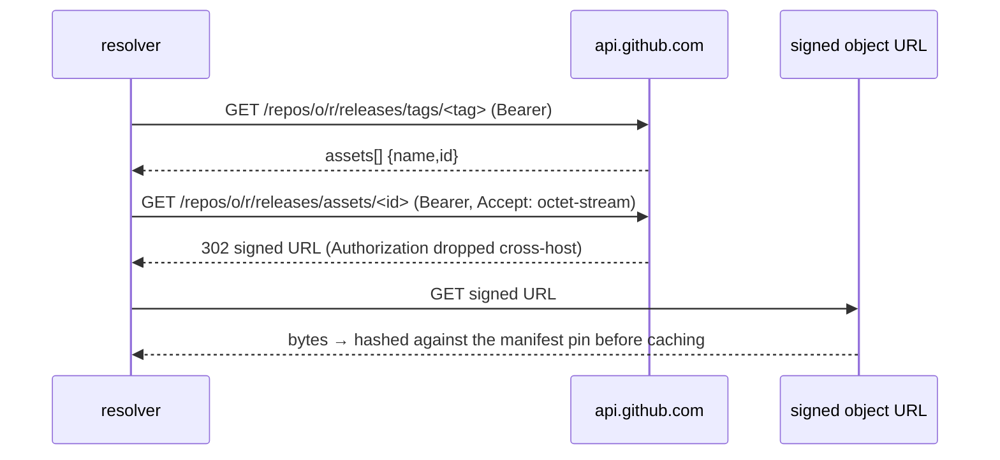

# Acquisition trust and access — technical design

| Field | Value |
|---|---|
| **Status** | Draft → Approved *(merge requires Approved; merge is the freezing event; "superseded" is computed by the index, never written here)* |
| **Owner** | @mdarabi |
| **Approver(s)** | @mdarabi (operator — trust-floor + credential surface; a named reviewer is mandatory here) |
| **Date** | 2026-07-21 |
| **Relevant-when** | designing or changing how pyxis fetches, verifies, and trusts release artifacts; the cache-trust boundary; authenticating to a private release host; the source of `pyxis init`'s system pin; reading or revising installer-v1's per-exec verification floor |
| **Scope** | The resolver's acquisition trust-and-access model: **when** a fetched artifact is verified, **how long** that verification is trusted, **how** pyxis reaches a private release host, and **how** the manifest-sha pin reaches `pyxis init`. **Not**: the release build/pack/manifest derivation (installer-v1 §3.1–3.3 stand); the front-door exec grammar (DINV-5 stands); source-mode fall-through (DINV-8 stands); the ownership-class converge engine. |
| **Tracking** | this PR — reconciles shipped behavior (PRs #575, #577, #579) with the frozen acquisition design |
| **Builds-on** | installer-v1 (extends and revises its acquisition core, §3.4) |
| **Supersedes** | — |
| **Serves** | prd:installer/FR-13 · prd:installer/FR-17 · prd:installer/FR-22 |
| **Security/privacy impact** | yes — a GitHub token becomes a fetch-time credential, a private-release network boundary is crossed, and the cache-trust boundary is deliberately relaxed · reviewer: @mdarabi. The analysis lives in §3.7. |
| **Template version** | tech-design-template/v1 |

## 0. Read to rule — the human reviewer's section (~4 min)

*Audience: the gate-signing reviewer, and no machine.*

This design records three changes already shipped to `main` (#575, #577, #579) and reconciles them with installer-v1's frozen acquisition design (§3.4). It changes no behavior on its own — the code is live and dogfood-proven; this is the governance catch-up.

Rule on three things and one meta-question:

- **The relaxed floor (§3.1)** — is *verify-at-fetch, then trust the version-named cache* the right trust-versus-cost trade for the hot path? It drops the per-exec re-hash and keeps fetch-time verification.
- **Authenticated fetch (§3.2)** — the token source (`gh` login) and the containment (the token is attached only to `github.com`, never to a mirror).
- **The pin hand-off (§3.3)** — install.sh recording the manifest-sha for a flag-free `pyxis init`.
- **Q-1, the one call the code did not make:** the supersession scope. This revises installer-v1's `DINV-1`; the whole-document supersession model would retire *all* of installer-v1, most of which is still live. It is authored here as a scoped `Builds-on` revision. §7 lays out the choice.

Nothing in this document binds a machine; on any conflict the body governs.

## 1. Problem

installer-v1 §3.4 designed acquisition for the shape it could see: a release host that serves bytes to anyone, each byte re-verified per-exec against the manifest. Shipping v0.1.0 into a real, private repository — the AP-14 move, executing the actual install rather than reviewing the diff — opened three gaps between that design and a working install.

1. **The per-exec re-hash was cost without a matching threat.** `DINV-1` re-hashed the cached tool binary against the manifest on *every* `pyxis exec` — every git hook, every gate run — re-reading a multi-megabyte binary each time. The only thing it guarded was the operand's own gitignored binary cache against on-disk edits; an attacker who can rewrite that cache can already rewrite the operand's committed config or the invoking `PATH`. The floor charged a per-invocation price on the hot path (against the steady-state budget, AP-19) for a threat the filesystem already owns.

2. **The resolver could not reach a private release host.** The design assumed the host serves bytes; a *private* GitHub repo does not. An unauthenticated `GET` on the `releases/download/…` URL 404s — and, non-obviously, a bearer token on that same URL 404s too. `pyxis init` died on its first fetch. The CLI installed (install.sh drives `gh`), but the operand could acquire nothing.

3. **The trust-root pin had no delivery path to `init`.** installer-v1's bootstrap carries pyxis's *own* pin "in the install instructions." But `pyxis init` also needs the *manifest* sha256 — the operand's trust root — and nothing delivered it: a user had to copy a 64-hex string from release notes by hand.

## 2. Decision

**Decision:** Acquisition **verifies at fetch** and then **trusts the version-named cache**; it **authenticates to the default GitHub release host** through the API asset endpoint when a token is available; and the manifest-sha pin is **handed off by install.sh** over its own authenticated fetch. The manifest-sha stays the single trust root — a fetched byte is accepted only if it hashes to a pin rooted in the operand's committed config. **Auth governs *access*, never *acceptance*.**

This revises installer-v1's `DINV-1`. The invariant's *intent* — no unverified byte enters the operand's trusted set — is preserved: every byte is still hashed against its pin before it is cached. The *mechanism* — "re-hash before every execution" — is retired: an already-present, version-named cache entry is verified once, at fetch, and run as-is thereafter.

These are one decision — the acquisition trust-and-access model for a real, private-repo, hot-path operand — not three. They were forced together by one problem (make a private install work and stay cheap) and they share one invariant (the manifest-sha trust root). §3 details each.

## 3. The design

### 3.1 Verify-at-fetch, trust the cache

**Decision:** A tool binary is verified against its manifest pin **when it is fetched** — streamed to a temp file, hashed in flight, chmod 0755, atomically renamed. A version-named cache entry that is already present is **trusted and executed as-is**, without re-hashing, on every later invocation.

The cache is content-keyed by version in its filename (`<tool>-<version>-<platform>`), so a system-version bump is a cache miss → re-fetch → re-verify. The only case the relaxed floor no longer catches is a *same-version* on-disk edit to the operand's own gitignored binary cache — the threat the filesystem owns, and which nothing else in the trust chain defends against either (an attacker with write access to that cache also has it to the operand's committed config, the manifest, and `PATH`). This is a **bounded** form of the tamper window installer-v1 rejected `#ALT-8` to avoid: there it was unbounded — any post-converge tampering, on any path, until `doctor`; here it is narrowed to a same-version edit of a gitignored path the attacker already fully controls. The reduction is deliberate and named, not a silent relaxation of the "on any path" guardrail.

Two verifications are kept, deliberately, because they are cheap or infrequent, not hot-path:

- **The manifest anchor-check** stays on every resolve: the cached manifest's bytes must equal the config's `manifest_sha256` before it is parsed (27 KB; microseconds). It doubles as config-cache coherence — a changed pin invalidates a stale cached manifest of the same version.
- **The payload archive** is verified at converge time (infrequent), and each engine-verbatim file it materializes is re-hashed against the manifest — unchanged.

### 3.2 Authenticated acquisition from the private release host

**Decision:** When fetching from the **default** `github.com` release host, the resolver authenticates through the GitHub **API asset endpoint** if a token is available. It lists the release by tag to map an asset **name → id**, then `GET`s `repos/<o>/<r>/releases/assets/<id>` with `Accept: application/octet-stream` and a bearer token; GitHub 302-redirects to a signed object URL, which the client follows.

A bearer token on the plain `releases/download/…` URL 404s for private assets — the API asset endpoint is the only path that serves them. The token source, in order: `GH_TOKEN`, then `GITHUB_TOKEN`, then `gh auth token` — so an authenticated `gh` login (the documented install prerequisite) suffices with no separate export.

**Decision (containment):** The token is attached **only** to requests to the default host. A `PYXIS_ARTIFACT_SOURCE` mirror/override takes the plain, unauthenticated path and never receives the token. With no token, the resolver uses the unauthenticated download URL: a public repo still resolves; a private one gets the honest 404 with the pre-warm/bootstrap remedy.

### 3.3 The pin hand-off — install.sh records, init resolves

**Decision:** install.sh carries the release `manifest_sha256` and, after installing the CLI, records it with the system version at `$XDG_CONFIG_HOME/pyxis/release.env` — written only for the pinned version, whose manifest sha the script ships. `pyxis init` resolves the version and manifest sha256 in order: the `--system-version`/`--manifest-sha256` **flag**, else the `PYXIS_*` **env var**, else **release.env**; it refuses by name, listing all three sources, when none supply a pin.

This is a *trusted* delivery, not mere convenience: install.sh is served over the caller's authenticated `gh` session (the same channel that carries pyxis's own bootstrap pin), so the pin it records is anchored to the same trust root as the release itself.

### 3.4 Boundaries and non-goals

- **Not solved here** — the release build, pack, deps bundle, and manifest derivation (installer-v1 §3.1–3.3); the ownership-class converge engine.
- **Owned by a future design** — release channels/cohorts; a token source for fully-unattended contexts with neither env nor `gh` (§7 Q-2); a paginated asset lookup past the 100-asset tag-list ceiling (§5); a richer public-mirror trust model beyond "serve bytes."
- **Delivery, not migration** — these changes ride the *resolver/CLI* (install.sh-delivered), not the operand pin. An operand already installed on an older release picks the behavior up on its next CLI upgrade; there is no operand-pin migration, and re-pinning to a release carrying this resolver is the existing cache-miss → re-fetch → re-verify path (§3.1).
- **Implementation must not infer** — that cache-trust weakens fetch-time verification (it does not — every byte is still pinned at fetch); or that the token may reach a mirror (it may not — DINV-2).
- **Must remain unchanged** — the manifest-sha trust root; the exec grammar (installer-v1 DINV-5); source-mode fall-through (installer-v1 DINV-8); converge's per-class ownership and the payload/manifest verification path.

### 3.5 Invariants

- **DINV-1** *(revises installer-v1#DINV-1)* — every fetched artifact is hashed against a config-rooted pin **before it enters the cache**; a version-named **tool-binary** cache entry, once written, is trusted and executed **without re-hash**. The trusted set never admits an unverified byte; the *tool-binary* cache is not re-checked per execution — the 27 KB manifest anchor-check *is* re-hashed on every resolve (§3.1), the deliberately-cheap exception.
- **DINV-2** — a GitHub token is attached only to requests whose host is the default `github.com`/`api.github.com`. No `PYXIS_ARTIFACT_SOURCE` override request carries it.
- **DINV-3** — authentication changes only *whether* bytes can be fetched, never *whether* they are accepted. Acceptance is the manifest-pin hash comparison, unchanged by the presence, absence, or source of a token.
- **DINV-4** — the init pin resolves flag → env → file; whatever the source, the resolved `manifest_sha256` is the single trust root the operand's config commits and everything else verifies through.

### 3.6 Observability

- **Events/logs** — the resolve `fetch` slog line (artifact, url) is unchanged; a verification failure still logs expected-vs-actual sha. **No token is ever logged** (headers are not emitted).
- **Metrics** — none (a CLI with no resident surface).
- **Alerts** — none.
- **Debugging surface** — `pyxis doctor` reports the artifact source; an offline or private-host 404 refuses by name with the pre-warm / `gh auth` remedy; a checksum mismatch names the artifact and both hashes.
- **Trace/correlation** — n/a (single-process invocation).

### 3.7 Security & privacy

**Surfaces touched:** secrets (a GitHub token held in memory for the fetch), network boundaries (authenticated requests to `github.com`/`api.github.com`), and the supply-chain trust boundary (the relaxed cache re-verification).

**Data handled:** a short-lived bearer token, read from the environment or `gh` and never persisted, logged, or written to disk by the resolver.

**Threat sketch and mitigations:**

- *Token exfiltration to an untrusted host.* A `PYXIS_ARTIFACT_SOURCE` mirror could otherwise harvest a token. Mitigated by DINV-2 — the token is attached only to the default host; the mirror path is unauthenticated by construction. Go additionally drops the `Authorization` header across the cross-host redirect to the signed object URL — a stdlib guarantee this design relies on and that §3.8 names as a seam to exercise explicitly (a two-host test), since the current suite proves only the *attach* side (A-2), not the *detach* on the authenticated 302.
- *Credential over-reach beyond the declared operation set (basis ABUSE-3 / §5.4 egress).* The basis PRD scopes the ambient GitHub credential to the **declared wiring operations** and enumerates GitHub-mode egress as those write operations; it never listed an authenticated *artifact fetch*, because installer-v1 assumed a public host that needs no credential. Reaching a **private** host requires the credential for a new use. This is bounded, not over-reach: the fetch is **read-only** (release-asset download — it creates and mutates nothing), it uses the caller's *own* `gh`/`GH_TOKEN` (least-privilege — the user's existing read access, not a broadened grant), it is host-scoped to `github.com` (DINV-2), and it never touches the wiring write scope ABUSE-3 guards. The declared-operation egress set (installer-v1 §5.4) gains one entry — a read-only release-asset GET on the default host — and nothing more.
- *An expired or under-scoped token.* Distinct from the no-token case: a stale `gh` token or one lacking read scope authenticates yet 401/403s on the private asset. It fails closed (DINV-3) and surfaces as a named `list release … 401/403` fetch error — never a silent wrong fetch — with the `gh auth refresh` / re-scope remedy (§3.6). "Short-lived" is a privacy virtue (nothing durable to leak) whose operational cost is exactly this: the operand re-authenticates when the token lapses.
- *A malicious or compromised host/mirror substituting bytes.* Unchanged from installer-v1 and preserved by DINV-3: the manifest-sha pin rejects any byte that does not hash to it, regardless of how or from where it was fetched. Auth is access, not acceptance.
- *On-disk tamper of the operand cache.* The relaxed floor (DINV-1) no longer re-hashes a cached binary per exec. This is a **deliberate, bounded reduction**: the residual exposure is a same-version edit to a gitignored path the attacker could only reach with write access that already subverts config, manifest, and PATH. Fetch-time verification, the manifest anchor-check, and the version-keyed cache name are the retained defenses; a system-version bump re-fetches and re-verifies.
- *A bad root pin.* Out of scope here and unchanged: the `manifest_sha256` anchor is delivered out-of-band (install.sh over authenticated `gh`, or the documented invocation); the hash chain guarantees internal consistency, never that the pinned release is benign.

This subsection agrees with the header's `yes`.

### 3.8 Testing strategy

- **The auth dance** — *in-process / local-substitutable*: an `httptest` server standing in for `github.com`+`api.github.com` proves the name→id lookup, the bearer + octet-stream headers, the missing-asset error, and the non-release fall-through; a unit test proves the token attaches only on the default host and never to a mirror (`TestFetcherAttachesAuthOnlyOnDefaultHost`), and env-token precedence. **A seam to add:** the cross-host `Authorization` drop on the authenticated 302 — a two-host `httptest` topology (an api stand-in that 302s to a *distinct* object-store stand-in), asserting the second-hop request carries no `Authorization`. The present harness returns the asset bytes directly, so it exercises only the *attach* side (A-2), not the *detach* the token-exfil mitigation (§3.7) relies on.
- **The relaxed floor** — *local-substitutable*: a `file://` fixture release proves a present cache entry is run as-is even after an on-disk edit, while a tampered *source* fetch still refuses (`TestToolTrustsCachedBinary` + the fetch-time tamper/truncation cases).
- **The pin hand-off** — *in-process*: init pin resolution from flag/env/file with flag-wins; `test-install-sh.sh` proves install.sh records `release.env`.
- **End-to-end (AP-14)** — the deployment context: `pyxis init` against the live private release with only `gh` authed produces a `doctor`-healthy operand.

## 4. Alternatives considered

- **Keep the per-exec re-hash.** Rejected: cost on the hot path without a matching threat (§1.1).
- **Bearer token on the plain download URL.** Rejected: empirically 404s for private assets; the API asset endpoint is the only serving path.
- **Shell to `gh release download` from the resolver for every fetch.** Rejected: pushes a runtime `gh` dependency into every operand fetch. The repo's Go-by-default / bash-only-on-proven-necessity policy makes a self-contained Go fetch the default and admits a shell-out only as the pre-binary bootstrap first-mover — which install.sh already is; here `gh` is consulted only as a *token* source, once per process.
- **install.sh pre-fetches the whole release into a `file://` cache.** Rejected as the *model* (it is the documented workaround, not the design): it defeats the lazy floor and duplicates the release per repo; the CLI-only installer scope keeps install.sh to the CLI.

## 5. Risks

- **`gh auth token` shells out.** A subprocess on the token path. Bounded: consulted once per process, only when the env vars are absent, and a missing/failed `gh` degrades to the honest 404 — never a crash, never a silent wrong fetch.
- **Reduced cache-trust threat model.** A conscious reduction (§3.7). The debt is named, not silent, and reversible — reinstating a per-exec re-hash is a localized change if the threat model shifts.
- **GitHub API asset-endpoint dependency.** A GitHub REST contract; pinned by the tags/assets response shape the code parses. A breaking change surfaces as a named fetch error, not a silent acceptance (DINV-3).
- **The tag-list asset ceiling.** The name→id lookup reads `releases/tags/<tag>` once and scans the inlined `assets[]`; that endpoint returns at most **100 assets** and does not paginate. Today's release is well under (13 tools × 4 platforms + payload/deps/manifest = 56), but a growing shipped-tool set trends toward the cap, past which an asset beyond it surfaces *misleadingly* as a `no asset "<name>"` error (reads like a bad pin, not a ceiling). Recorded as a bounded assumption (§3.4); the follow-up is a paginated lookup, not a design change.
- **Per-init API call volume.** The authenticated path is more API-chatty than a direct download: pre-warm fetches each current-platform binary, and each cache-miss re-lists the whole release for its name→id map (no memoization across the loop) — a cold init is O(binaries) list+asset call pairs, bounded by the authenticated 5000/hr limit and fine for one repo, but the cost model this design faults installer-v1 for hiding (§1.1) now has a new entry that should be stated. A trivial deferred optimization (list once per pre-warm, reuse the map) is noted, not built.
- **GitHub API rate-limiting.** Given the call volume, a primary/secondary rate limit is a plausible operational failure. It fails closed — a 403/429 becomes a named fetch error (DINV-3), never a wrong acceptance — with retry/backoff as the operator remedy; §3.6's refusal narrative should read it as a rate limit, not a generic error.

## 6. Acceptance

| # | Criterion | Method | Trace |
|---|---|---|---|
| A-1 | `pyxis init` against a private release with only `gh` authed and no `--artifact-source` yields a `doctor`-healthy operand | Live install (manual, AP-14) | prd:installer/FR-17 · #DINV-3 |
| A-2 | a `PYXIS_ARTIFACT_SOURCE` override is served by an unauthenticated fetcher — no auth leg is constructed, so no `Authorization` header can attach on the override path | Test (unit, construction) | prd:installer/FR-22 · #DINV-2 |
| A-3 | a present cache entry runs as-is after an on-disk edit; a tampered *source* fetch still refuses by name | Test (unit) | #DINV-1 |
| A-4 | `pyxis init` resolves the pin from flag / `PYXIS_*` env / `release.env`, flag winning | Test (unit) | #DINV-4 |
| A-5 | no token is written to disk or logs on any path | Review (the token sets only a request header; no slog line emits headers) | prd:installer/FR-13 · §3.7 |
| A-6 | on the authenticated 302 to the signed object URL, the second-hop request carries no `Authorization` header (the cross-host drop) | Test (unit, two-host — a seam §3.8 names to add) | #DINV-2 · §3.7 |

## 7. Open questions

- **Q-1 — the supersession scope (RESOLVED — operator ruling, 2026-07-21).** This design makes a binding statement of installer-v1 (`DINV-1`, "re-hash before every execution") false. The conventions say a contradiction of a live design requires `Supersedes`; but installer-v1 is a **bundled** design whose release model, front-door, init, wiring, and seeding decisions are all still live, and whole-document supersession would retire them with it. The operator ruled **(a): a scoped `Builds-on` revision** — this design Builds-on installer-v1 and revises its `DINV-1` explicitly (the single invariant, intent preserved); installer-v1 stays `live` for every other decision. The considered alternatives were **(b)** a full `installer-v2` re-stating installer-v1's still-live decisions, and **(c)** retroactively carving installer-v1's §3.4 into its own design to supersede — both rejected as disproportionate to a one-invariant revision.
- **Q-2 — token source for fully-unattended contexts.** Today a run with neither `GH_TOKEN`/`GITHUB_TOKEN` nor an authenticated `gh` gets the honest 404 + remedy. A future design may add a config-declared token source (or a mirror/`file://` artifact source) for headless operands; out of scope here.

## Principles

- **AP-14 (Verify by execution and observation)** — honored, and the reason this design exists: the three gaps were found by executing the real private install (a green merge is not a working install), and every mechanism here carries a deployment-context acceptance row (§6). This document is the reconciliation of shipped-and-proven behavior back into governance.
- **AP-19 (Idle costs nothing)** — honored by §3.1: the per-exec re-hash spent hot-path work on a threat the filesystem owns; removing it returns the invocation to config-parse + execve while keeping the fetch-time verification the steady-state budget assumed.
- **AP-13 (Success is a verified artifact)** / **AP-6 (Everything passed around is contractual)** — honored: the manifest-sha pin remains the verified floor (DINV-1/DINV-3); the release manifest is the contract every fetched byte is checked against.
- **AP-17 (Fail closed on destructive, fail open on additive)** — honored, and central to the design: every ambiguous or failed verification path refuses closed with zero execution and zero partial trust — a checksum mismatch, a missing pin (all three sources named), a private-host 404, and a missing or expired token all refuse *by name* rather than fetch or run a wrong byte (§3.3, §3.6, §3.7, DINV-3). This is the acquisition floor installer-v1 cited AP-17 for; the revision preserves it byte-for-byte, and adding a token source never weakens it (no token → the honest 404, never a silent fallback).
- **AP-11 (One predicate, one place)** — honored: the manifest-pin acceptance test is one predicate, evaluated at fetch (`fetchVerifyTo`, §3.1). Retiring the per-exec re-hash *removes* a second evaluation of that same predicate rather than adding one, so no twin can diverge — acceptance is decided in exactly one place for every path (DINV-3).
- **AP-9 (Releases are staged and observable)** — honored on the **observability leg**: acquisition is observable through `doctor` and named fetch refusals (§3.6); the artifact source (default host or override) is surfaced, not hidden. Release channels, cohorts, and auto-update remain installer-v1's deferred ground (its record O-2), untouched here — this design does not claim the staging half.
- **installer-v1#DINV-1** — **deviated, with reason**: the per-exec re-hash mechanism is retired; the invariant's intent (no unverified byte in the trusted set) is preserved by fetch-time verification and restated as this design's DINV-1. The deviation is the subject of Q-1. installer-v1's A-9 (per-invocation overhead ≤ 100 ms p95) still holds as the bound it always was — now met without the per-exec sha256 the cost model named.
- **installer-v1#DINV-5 (exec grammar)**, **#DINV-8 (source mode)**, **#DINV-2 (pin pair)** — honored, unchanged; explicitly out of scope (§3.4).
