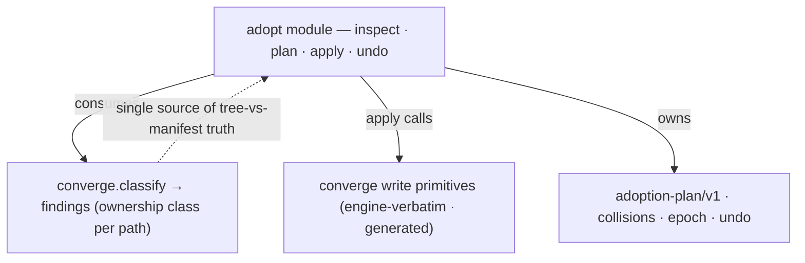

# Existing-repo onboarding v2 — the adopt negotiation over converge — technical design

| Field | Value |
|---|---|
| **Status** | Draft *(→ Approved at the introducing PR's review; merge is the freezing event; "superseded" is computed by the index, never written here)* |
| **Owner** | @mdarabi |
| **Approver(s)** | @mdarabi (operator) — named reviewer: the change writes into a foreign repository and relaxes the governance gates (a governance/production-control surface) |
| **Date** | 2026-07-24 |
| **Relevant-when** | designing or changing existing-repo adoption — the `adopt` verb and its plan/apply/undo, the adoption-plan artifact, the install-epoch's gate scoping, hook-path chaining, stack detection, or the round-trip proof; implementing against it; superseding it |
| **Scope** | The concrete shape for existing-repo adoption: the `adopt` engine's relationship to converge (reuse the classifier, own plan/apply/undo), the durable adoption-plan artifact and its lifecycle, the single-owner collision resolutions, the install-epoch's gate-scoping mechanism, undo, stack detection, and the round-trip acceptance harness. **Not**: language profiles, org-wide sweep, branch-protection/bot-identity, repo intelligence, upgrade/migration of an adopted repo, and partial (subset) adoption (the basis's NG/WR rows). |
| **Tracking** | — *(the introducing PR)* |
| **Builds-on** | docs/tech-design/config-driven-portability-v1.md · docs/tech-design/installer-v1.md · docs/tech-design/repo-layout-and-system-footprint.md |
| **Supersedes** | docs/tech-design/existing-repo-onboarding-v1.md |
| **Serves** | prd:existing-repo-onboarding/FR-1 · prd:existing-repo-onboarding/FR-2 · prd:existing-repo-onboarding/FR-3 · prd:existing-repo-onboarding/FR-4 · prd:existing-repo-onboarding/FR-5 · prd:existing-repo-onboarding/FR-6 · prd:existing-repo-onboarding/FR-7 · prd:existing-repo-onboarding/FR-8 · prd:existing-repo-onboarding/FR-9 · prd:existing-repo-onboarding/FR-10 · prd:existing-repo-onboarding/FR-11 · prd:existing-repo-onboarding/UB-1 · prd:existing-repo-onboarding/UB-2 · prd:existing-repo-onboarding/UB-3 · prd:existing-repo-onboarding/UB-4 · prd:existing-repo-onboarding/UB-5 · prd:existing-repo-onboarding/UB-6 · prd:existing-repo-onboarding/UB-7 · prd:existing-repo-onboarding/ABUSE-1 · prd:existing-repo-onboarding/ABUSE-2 · prd:existing-repo-onboarding/NR-1 · prd:existing-repo-onboarding/NR-2 · prd:existing-repo-onboarding/NR-3 · prd:existing-repo-onboarding/NFR-1 · prd:existing-repo-onboarding/NFR-2 · prd:existing-repo-onboarding/NFR-3 · prd:existing-repo-onboarding/NFR-4 |
| **Security/privacy impact** | yes — adoption writes into a repository the engine did not create and relaxes the governance gates over its pre-existing corpus. A defect could mutate content the repo owns, or the epoch could silence gates on changed content. Same-principal threat model (the operator running `adopt` already has write access); mitigations are the never-touch confinement (§3.10, DINV-1, A-2), epoch-scope-to-adoption-commit (DINV-4/DINV-6, A-3), and fail-closed undo (DINV-5, A-7). · reviewer: @mdarabi |
| **Template version** | tech-design-template/v1 |

*This design supersedes `existing-repo-onboarding-v1` (frozen at merge #658) wholly, carrying its valid content forward and applying the ten `tech-design-review` findings (`review:existing-repo-onboarding-v2`): v1 merged before the review's dispositions could land, so the corrections — the `#D-11` re-anchor, the per-added-path baseline for undo detection, DINV-3's acceptance row, the empty/non-git dispatch, FR-9's manual-reversal naming, the AP-17/AP-20/AP-30 principle cites, the converge write-primitive split, the apply-ordering guard, the deterministic epoch-scaling proof, and the DINV-1 narrowing — arrive here rather than in the frozen v1. No decision of record changed; the stage-3 direction is unchanged.*

## 0. Read to rule — the human reviewer's section (~5 min)

*The body is the contract; this section only routes attention — on any conflict the body governs; machines ignore it.*

**Judge these**

| # | The call | Could have gone | If you disagree |
|---|---|---|---|
| 1 | `adopt` **reuses converge's classifier** and owns plan/apply/undo on top — one classifier, converge's `Run` untouched (§2, §3.1) | drive converge extended (`design-brainstorm:existing-repo-onboarding-tech-design#ALT-2`) or a parallel inspector (`#ALT-3`) | converge's steady-state Run carries adoption semantics (ALT-2), or two classifiers drift — incident I5 (ALT-3) → §3.1, DINV-2 |
| 2 | The adoption plan is **one durable receipt** (draft→applied→undo) in the system tree (§3.2) | transient plan + manifest-driven undo (`#ALT-5`) or a repo-root file (`#ALT-6`) | "what adoption did" splits across three surfaces (ALT-5), or a pyxis artifact lands in the adopter's root (ALT-6) → §3.2, DINV-3 |
| 3 | The epoch scopes the gates by a **single `git diff` filter** at scan-set construction (§3.4) | a per-file changed-since-epoch query, or a content-hash snapshot | O(files) git calls (R1), or a second "what changed" source that drifts (I5) → §3.4, DINV-6 |
| 4 | Undo **removes the installation and preserves post-adoption work**, failing closed on operator-edited artifacts (§3.5) | revert to the pre-adoption snapshot (clobbers a week of work) | a normal week of work is destroyed by undo → §3.5, DINV-5, A-7 |
| 5 | Collisions resolve **additive-adjacent or by instruction, never by merging an owned file** (§3.3) | teach converge to merge (basis NG-2 / installer NG-3) | the engine rewrites content the repo owns → §3.3, DINV-1 |

**Sanity-check the numbers** — the acceptance rows are pass/fail, not thresholds. The bounds worth a gut-check: A-2's *byte-identical* never-touch set across the round trip (deliberately strict — a violation is a trust breach), and DINV-6's O(changed-set) gate cost, independent of corpus size (NFR-1) — the property A-8 scales.

**The author's open questions** — Q1 (§7): a later hook-manager re-install may reset `core.hooksPath`; whether doctor's detection + converge's repair suffice or a stronger guard is warranted — blocks nothing.

**Skip the rest** — schema/structure → docgate; substance, reuse, and basis fidelity → the unmanned `tech-design-review`; implementation defects → codegate + the round-trip e2e; rationale and rejected shapes → §4 (explanatory).

## 1. Problem

The basis settled *that* adoption is a negotiation — inspect, propose a reviewable plan, apply on approval, reverse cleanly — and *why* (`prd:installer/NG-3` forecloses merge intelligence in converge, so collision resolution must be an explicit, approved decision). It left the mechanism to design: how the `adopt` verb relates to converge (which already classifies a tree against the release manifest and repairs it), where the durable plan lives and what `undo` consumes, how a tree-local gate honours an epoch without a per-file cost, how a single git hook-path is chained without hijack, and how the never-touch guarantee is proven. converge was built for a tree it *owns* — pointed at a repository full of another author's source, hooks, CI, and documents it must instead negotiate. This design decides that engine relationship and the surrounding artifact, epoch, collision, and proof shapes. Now, because phase-1 (config-driven portability) just made every target-facing surface resolve from config: the layout block is gone and adoption is the next milestone.

## 2. Decision

**Decision:** `adopt` is a **layer over converge, not a rewrite of it** (`design-brainstorm:existing-repo-onboarding-tech-design#D-1` · `#ALT-1`). It consumes converge's ownership-class classification as the single source of tree-vs-manifest truth — one classifier, so no second list drifts (AP-11; the failure `docs/observability/incidents.md#I5` records) — and owns the adoption-specific concerns on top: the plan, the collision resolutions, the epoch, and undo. converge's steady-state `Run` is not overloaded with one-time adoption semantics (NR-2). The **adoption plan** is one durable, closed-schema receipt (`adoption-plan/v1`) in the engine's system namespace, rendered human-readable for review, with a lifecycle draft (`adopt`) → applied (`apply` stamps it with the undo-data) → consumed (`undo`) — the agreement and the receipt are one artifact (`#D-2`). The **install-epoch** is the already-present `epoch.commit`, consumed by the tree-local gates through a single `git diff --name-only epoch..HEAD` filter at scan-set construction, so grandfathering costs O(changed-set), never O(corpus) (`#D-3`). Collisions resolve **additive-adjacent where an honest mechanism exists** — hook chaining, a distinct workflow filename — and **by named instruction where none does** (an existing root convention file); nothing the repo owns is rewritten (`#D-4`; NG-3). **Undo removes the installation and preserves post-adoption work**, failing closed on operator-edited artifacts (`brainstorm:existing-repo-onboarding#D-11`). A reader who stops here knows the shape: **one classifier, one durable plan-receipt, an epoch-scoped gate, and a reversible install that never touches what the repo owns.**

## 3. The design

### 3.1 The `adopt` engine and the converge scan⟂write seam

converge today performs, inside one call, a read (classify every manifest-listed path by ownership class into a `Report` of would-write / refused / repaired / regenerated findings) and a write (repair engine-verbatim files, regenerate generated ones). **Decision:** both faces are exposed as callables independent of `Run`. The **read** is near-existing — converge already offers a write-free classification callable (`Drift`, running the shared scan predicate) — so exposing it for `adopt` is trivial. The **write** is not yet separable: the per-class writes live inline in `Run`'s loop (entangled with archive acquisition and per-file manifest re-hash), so this design **exposes archive-backed engine-verbatim and generated write primitives** (returning the action set) extracted from that loop — a real, named converge change, not merely the read exposure. `adopt` consumes the classification findings **plus the generated-class desired bytes and the verified archive** (not the finding set alone) and never invokes `Run` (`design-brainstorm:…#S-1`); `Run` itself is not extended with adoption semantics (§3.7).

`adopt` first **dispatches by tree state**: a target that is not a git repository is refused by name before any inspection (`prd:existing-repo-onboarding/UB-5`), and an empty tree routes to `init` — the empty-repo installer — writing no plan (`prd:existing-repo-onboarding/UB-1`; the anti-segment, a negotiation with nothing to negotiate). Only a non-empty git repository proceeds to the four operations:

- **inspect** — run converge's classification over the non-empty tree, and separately detect the stack (§3.6) and the collisions (§3.3). A path the manifest does not list is the adopter's own content — converge never acts on it, so the **never-touch set is the manifest's complement** (a property, not a second list: `design-brainstorm:…#F-3`).
- **plan** — assemble the findings + collisions + stack + never-touch complement into the `adoption-plan/v1` artifact (§3.2), writing nothing else.
- **apply** — for the engine-verbatim and generated classes, call converge's newly-exposed write primitives (consuming the generated desired bytes + verified archive); for the collision classes, apply the additive resolutions (§3.3); record the epoch (§3.4); stamp the plan applied. `apply` changes no path the plan does not name (FR-3). Its step ordering and idempotency are §3.3.
- **undo** — reverse the applied plan (§3.5).



### 3.2 The adoption-plan artifact

**Decision:** the plan is one closed schema-versioned record, `adoption-plan/v1`, stored in the engine's system namespace (no collision with the adopter's tree), rendered human-readable for review (`design-brainstorm:…#D-2`; AP-5). It carries, per path, the class the engine assigns it, and — after apply — the resolved undo-data. The operator commits it with the adoption (no engine-authored commit, DINV-4).

```
adoption-plan/v1
  schema_version: "adoption-plan/v1"
  status:         draft | applied            # the lifecycle state (DINV-3)
  epoch:          <commit sha>               # set at apply (§3.4)
  entries:                                   # one per path the engine acts on
    - path:       <repo-relative path>
      class:      add | chain | collide-manual | never-touch | generated | engine-verbatim
      detail:     <the resolution, e.g. the exact lines to add for collide-manual>
  hooks:                                      # set at apply, for undo
    prior_hooks_path: <the core.hooksPath adoption displaced, or "">
  stack:
    detected:     [ <name>, … ]              # every stack detected, or [] = unknown
    gate_actions: [ <the executor.gate.<command> the adopter must set>, … ]
  added_paths:                               # set at apply, for undo (the delete set + baselines)
    - path:       <repo-relative path>
      sha256:     <content hash at apply>     # the baseline undo's "modified since adoption" test compares against (§3.5, DINV-7)
```

The lifecycle is the artifact's states: `adopt` writes it `draft`; `apply` refuses a plan absent or stale relative to the tree (UB-2), else applies it and rewrites it `applied` with `epoch`, `hooks.prior_hooks_path`, and `added_paths` populated; `undo` reads the `applied` record. A re-`adopt` against an already-adopted repo re-plans and reports only drift (UB-4); a plan that references a prior config surface that is absent/partial/malformed under the closed schema is refused by name (UB-7).

### 3.3 Single-owner collision resolution

Where the engine wants a path a third party has already fixed, resolution is **additive-adjacent where an honest mechanism exists, and a named human instruction where none does** — the engine never rewrites content the repo owns (`design-brainstorm:…#D-4`; `prd:installer/NG-3`, basis NG-2).

- **Git hooks (`core.hooksPath`)** — git honours a single hook path. `adopt` sets `core.hooksPath` to the engine's own hook directory and the engine's hook **delegates forward**: it runs its checks, then invokes the adopter's previously-configured hook. **Apply ordering is load-bearing here** (FR-11): apply reads the current `core.hooksPath` and durably records it into `hooks.prior_hooks_path` **before** overwriting `core.hooksPath` — and it is **idempotent**: if `core.hooksPath` already resolves to the engine's hook directory (an already-chained repo, on a re-apply or re-adopt), the capture is skipped as a no-op, so re-apply never overwrites the recorded prior path with the engine's own directory. `undo` restores `hooks.prior_hooks_path` (a one-value restore). The engine writes no file into the adopter's hook-manager directory (FR-4).
- **The installed CI workflow** — the `.github/workflows/` directory is fixed by the CI host and is additive by filename. When the engine's workflow filename would collide with an existing one, the engine's workflow lands under a distinct, non-colliding filename; the adopter's workflow is untouched (FR-5).
- **A root convention file (`AGENTS.md` / `CLAUDE.md`)** — content has no honest mechanical merge (NG-2). The engine writes nothing to an existing one; the plan carries the exact lines for the human to add (a `collide-manual` entry), and the file is byte-identical after apply (FR-6).

### 3.4 The install epoch and gate scoping

**Decision:** the install-epoch is the already-present `epoch.commit` config field (`design-brainstorm:…#F-2`); `apply` records the repository's current commit into it and **creates no commit of its own** — the operator commits the adoption, so adoption makes no undisclosed change to history (DINV-4; `prd:existing-repo-onboarding/J1`). The tree-local gates honour it by a **single `git diff --name-only epoch.commit..HEAD` (∪ working-tree changes) computed once per gate run and intersected with the scan-set**: only content changed since the epoch is checked, so the grandfathered corpus is never visited and gate cost scales with the changed set, not the corpus (DINV-6; NFR-1). History-scoped checks (immutability, governing) already compare against a ref and are unaffected. An unreachable epoch commit (a shallow clone) **fails closed** — gate everything, naming the cause. The per-check grandfather exception lists remain available for targeted exceptions alongside the epoch (NR-3).

### 3.5 Undo

**Decision:** undo **removes the installation and preserves post-adoption work** (`brainstorm:existing-repo-onboarding#D-11`; `prd:existing-repo-onboarding/FR-9`). It unchains the hook (restoring `hooks.prior_hooks_path`), deletes the paths in `added_paths`, clears `epoch.commit`, and **names the plan's `collide-manual` entries for the human to reverse** — symmetric to adopt emitting them, since adoption never touched those owned files (`prd:existing-repo-onboarding/FR-9`; PRD §4.4) — leaving every post-adoption commit and edit in place. It **fails closed on operator edits**: a path in `added_paths` the operator has modified since adoption (a chained-hook wrapper, an added file) is **preserved and named, never deleted** (DINV-5; `prd:existing-repo-onboarding/UB-6`) — undo completes the rest of the removal and reports the preserved path.

**"Modified since adoption" is decided per class** against a baseline captured at apply (§3.2, DINV-7): an engine-verbatim path against its manifest SHA; a generated path by regenerate-and-compare; an `add`/`chain` path (no manifest entry, no generator) against the `sha256` `apply` stamped into its `added_paths` entry. A current hash matching the baseline is untouched (delete); a mismatch is preserved-and-named. On the round-trip fixture, where undo is immediate and no divergence exists, the whole tree is byte-identical to its pre-adoption state (A-7).

### 3.6 Stack detection

**Decision:** detection reuses the existing ecosystem marker registry (go/python/node marker files); the plan **names every detected stack** and the required `executor.gate.<command>` action for each, and **invents no command** (`design-brainstorm:…#D-5`; `prd:existing-repo-onboarding/FR-7`, basis NG-1 detect-and-surface). A repository no marker matches yields a single `unknown stack — set your gate commands` plan line — never an error (UB-3). Detection's only output is the plan's `stack` block; it wires nothing.

### 3.7 Boundaries and non-goals

- **The one converge change is bounded to the scan⟂write exposure (§3.1).** Extending `converge.Run` itself with adoption semantics — collision classes, the plan, non-empty-tree apply — is refused; adoption logic lives in the `adopt` layer, keeping converge's steady-state contract intact (`design-brainstorm:…#O-1`; NR-2). The `adopt` module reuses converge's classifier and git-native primitives rather than re-implementing tree-vs-manifest classification, drift, or byte-diffing — no parallel engine (`#O-2`).
- **Owned by the basis's deferred rows — not designed here** — language profiles, the org-wide adoption sweep, branch-protection and bot-identity wiring, repo intelligence, upgrade/migration of an adopted repo, and partial (subset) adoption (`prd:existing-repo-onboarding/NG-1..NG-4 · WR-1..WR-5`). This design reopens none of them.
- **Implementation must not infer** — that adoption commits to the adopter's history (it does not; the operator does — §3.4), or that stack detection wires a gate command (it names one — §3.6).
- **Must remain unchanged** — the empty-repo install path (`init`) and converge's steady-state repair for a repo already under management (DINV-2; NR-1, NR-2, A-9).

### 3.8 Invariants

- **DINV-1** — `adopt` never writes into, configures, or mutates any path in the plan's never-touch set (the manifest's complement); the never-touch guarantee is a write-confinement, not a promise. (Detection reads adopter marker files under §3.6; the invariant is about not mutating adopter content, not about not observing it.)
- **DINV-2** — one classifier: `adopt` consumes converge's ownership-class classification, and no second tree-vs-manifest classification exists in the engine; converge's steady-state `Run` is unchanged.
- **DINV-3** — the `adoption-plan/v1` record is the single durable statement of what adoption agreed and did; `apply` and `undo` bind to it, and no second record of the same fact is kept.
- **DINV-4** — `apply` records the repository's commit as the epoch and creates no commit of its own; adoption introduces no commit into the adopter's history.
- **DINV-5** — `undo` removes the installation while preserving post-adoption work, and preserves-and-names (never deletes) any added artifact the operator has modified since adoption.
- **DINV-6** — the tree-local gates scope to content changed since `epoch.commit`; their cost is a function of the changed set, independent of the pre-existing corpus size.
- **DINV-7** — undo's "modified since adoption" test is decided per ownership class against a baseline captured at apply: engine-verbatim against its manifest SHA, generated by regenerate-and-compare, `add`/`chain` against the `sha256` stamped into its `added_paths` entry; a mismatch is preserved-and-named, never deleted.

### 3.9 Observability

- **Events/logs** — the round-trip acceptance job (the basis's e2e) records the fixture adoption and its green/red outcome; `apply`/`undo` name every path they act on; a refused plan (UB-2/UB-7) names the offending key and remedy.
- **Metrics** — none beyond the acceptance job's pass/fail; deterministic engine tooling, not a runtime service (basis §3.2).
- **Alerts** — none (no runtime service to alert on).
- **Debugging surface** — `doctor` reports the adoption state (the epoch, the chained hook path) and names a `core.hooksPath` that has been displaced since adoption (Q1); converge repairs a drifted engine-verbatim/generated managed path as it does today.
- **Trace/correlation** — none — adoption is synchronous and local.

### 3.10 Security & privacy

yes — echoing the header. The surface touched is **another author's repository and the governance gates over it**. Two vectors: (1) a defect writes outside the plan, mutating content the repo owns — the core trust violation (`prd:existing-repo-onboarding/ABUSE-1`); (2) the epoch grandfathers content changed *after* adoption, silently disabling the gates (`ABUSE-2`, the phase-1 gate-aiming class). No secrets, user data, or network boundary is introduced. **Threat model:** the operator running `adopt` already holds write access to the repository — there is no privilege escalation beyond what the principal already has. **Mitigations** (traced to binding elements): the never-touch confinement (DINV-1) with the manifest's-complement property, proven byte-identical across the round trip (A-2); the epoch is set to the adoption commit and only earlier content is grandfathered, so a post-epoch change is fully gated (DINV-6, A-3); undo fails closed on operator edits (DINV-5, A-7). The adopter reviews the plan before any write (FR-1), so no mutation is unsurprising.

### 3.11 Testing strategy and the round-trip harness

The seams under test, binned:

- **The classifier reuse (§3.1)** — *in-process*: `adopt`'s consumption of converge's classification is asserted against fixture operand trees; converge's steady-state `Run` suite passes unchanged (NR-2).
- **The plan artifact (§3.2)** — *in-process*: schema round-trip (draft→applied) fixtures; the render is a golden; refusal fixtures for absent/stale/malformed plans and configs (UB-2/UB-4/UB-7).
- **Collision resolution (§3.3)** — *in-process*: a hook-chain fixture (delegate forward + prior-path restore), a workflow-filename-collision fixture, an existing-root-convention-file fixture (byte-identical + exact lines emitted).
- **The epoch filter (§3.4)** — *in-process*: a non-conforming-corpus fixture is gate-green immediately after adoption; a post-epoch change to a file is fully gated; a scaling fixture (fixed change-set, growing corpus) shows one `git diff` invocation and a files-visited count of \|changed ∩ scan-set\|, both invariant to corpus size (NFR-1, the deterministic observable — not a wall-clock figure, per `docs/observability/incidents.md#I5`).
- **Undo (§3.5)** — *in-process*: adopt→undo restores the tree; an adopt→edit-a-chained-hook→undo fixture preserves-and-names it.
- **The round-trip proof** — the basis's M1/DOD-1, run as a CI job over a **fixture repository carrying every collision at once** (an existing `AGENTS.md`, a hook-manager `core.hooksPath`, a name-colliding workflow, a non-conforming corpus, a non-Go stack), git-init'd at a pre-adoption commit. **Never-touch**: `git diff` restricted to paths outside the plan's managed set is empty after apply. **Round-trip**: after undo, the working tree and `HEAD` equal the pre-adoption commit (git's tree SHA is the whole-tree hash) — the git-native mechanism (`design-brainstorm:…#D-6`), reusing the installer e2e fixture + removal-test patterns.

## 4. Alternatives considered

| Alternative | Why rejected |
|---|---|
| Drive converge, plan = extended `Report` (`design-brainstorm:…#ALT-2`) | overloads converge's steady-state `Run` with one-time adoption semantics (collision classes, non-empty apply) and couples the plan schema to converge's internal types; the hybrid reuses the classifier without that surgery |
| Parallel adopt inspector/applier beside converge (`#ALT-3`) | two engines classifying tree-vs-manifest — the exact two-list drift `docs/observability/incidents.md#I5` warns against — and duplicates converge's ownership walk (NFR-4 says reuse, not parallelize) |
| Transient plan + manifest-driven undo (`#ALT-5`) | splits "what adoption did" across the release manifest, the config epoch, and a receipt — three surfaces that can drift; one durable receipt is a single source |
| Repo-root plan file, e.g. `ADOPTION.md` (`#ALT-6`) | puts a pyxis-authored artifact in the adopter's own root namespace for visibility the rendered review already provides |
| Per-file `git log epoch..HEAD -- <file>` epoch honouring | O(number of files) git invocations — the per-file cost R1 flags; the single `git diff` gives the changed set in one call |
| Content-hash snapshot of the corpus for epoch/proof | re-implements what `git diff` / git's tree-SHA already compute, and is a second "what changed" source (the I5 flavour) the git-native mechanisms avoid |
| Install the engine's hook into the adopter's existing hooks directory | writes a foreign file into a hook-manager-owned directory (husky regenerates it; edges toward NG-2); delegate-forward keeps ownership clean and undo a one-value restore |
| Revert-to-pre-adoption-snapshot undo | destroys a week of the operator's own post-adoption work; removal-preserving-work is the honest meaning of reversible for a repo that kept working |

## 5. Risks

| ID | Risk | Impact | Mitigation | Verification / evidence |
|---|---|---|---|---|
| R1 | Honouring the epoch inside tree-local gates costs per-file | slow gates on a large corpus (NFR-1 breach) | the single `git diff --name-only` computes the changed set in one call; gate cost scales with the changed set, not the corpus | A-8 (scaling), DINV-6 |
| R2 | A later hook-manager re-install (e.g. `husky install`) resets `core.hooksPath`, displacing the engine's chained entry | the engine's pre-push gate silently stops running | `doctor` names a displaced `core.hooksPath`; converge/re-adopt restores it; the risk is operability, not data loss (Q1) | A-4 (chain), §3.9 |
| R3 | The collision resolutions compose in ways isolated tests miss | adoption breaks on a real multi-collision repo | the fixture carries every collision at once and runs the full round trip, not isolated per-collision tests | A-1, A-2 |
| R4 | The plan artifact drifts from what was applied (edited by hand between apply and undo) | undo reverses a stale record | the plan is the single applied record (DINV-3); undo fails closed on a modified added artifact rather than trusting the record blindly (DINV-5) | A-7 |

## 6. Acceptance

| ID | Acceptance criterion | Verify | Required evidence | Traces to |
|---|---|---|---|---|
| A-1 | On a fixture repo carrying every collision at once, `adopt`→`apply` reaches gate-green, and re-apply lands zero further changes | Test (CI e2e) | the round-trip job link | `prd:existing-repo-onboarding/FR-1 · FR-2 · FR-3 · FR-11 · UB-4` · §2 |
| A-2 | Across `adopt`→`apply`→`undo`, the plan's never-touch set is byte-identical before/after apply, and the whole tree is byte-identical to its pre-adoption state after undo | Test (git-native diff/tree-equality) | the round-trip assertion result | `prd:existing-repo-onboarding/FR-9 · FR-10 · ABUSE-1 · NFR-2` · #DINV-1 · #DINV-5 |
| A-3 | The non-conforming corpus is gate-green immediately after adoption, and a post-epoch change to a file is fully gated | Test | the epoch fixture result | `prd:existing-repo-onboarding/FR-8 · ABUSE-2` · #DINV-4 · #DINV-6 |
| A-4 | A hook collision resolves by chaining — the pre-existing hook is byte-identical and still runs after apply; `undo` restores the prior `core.hooksPath` | Test | the hook-chain fixture result | `prd:existing-repo-onboarding/FR-4` · §3.3 |
| A-5 | A name-colliding workflow: the adopter's existing workflow file is untouched and both workflows are present after apply | Test | the workflow-collision fixture result | `prd:existing-repo-onboarding/FR-5` · #DINV-1 |
| A-6 | An existing root convention file is byte-identical after apply and the plan carries the exact lines to add | Test | the convention-file fixture result | `prd:existing-repo-onboarding/FR-6` · #DINV-1 |
| A-7 | After `adopt`→edit a chained-hook artifact→`undo`, the modified artifact is preserved-and-named (against its stored baseline), the plan's `collide-manual` entries are named for the human to reverse, and the rest of the installation is removed | Test | the undo fail-closed + manual-reversal fixture result | `prd:existing-repo-onboarding/FR-9 · UB-6` · #DINV-5 · #DINV-7 |
| A-8 | Gate cost after adoption is independent of corpus size — for a fixed change-set against a growing corpus the gate makes one `git diff` invocation and visits exactly \|changed ∩ scan-set\| files, both invariant to corpus size (the deterministic observable; a wall-clock figure is a recorded measurement, never the verdict — `docs/observability/incidents.md#I5`) | Test (deterministic count) | the git-diff-invocation + files-visited count | `prd:existing-repo-onboarding/NFR-1` · #DINV-6 |
| A-9 | The empty-repo `init` path and converge's steady-state repair suites pass unchanged | Test | the existing suites' result | `prd:existing-repo-onboarding/NR-1 · NR-2` · #DINV-2 |
| A-10 | For a Go and a non-Go fixture, the plan names the detected stack(s) + the required gate-command action; an unknown-stack fixture yields a plan, not an error; a malformed prior config is refused by name | Test | the detection + refusal fixtures | `prd:existing-repo-onboarding/FR-7 · UB-3 · UB-7` · §3.6 |
| A-11 | Exactly one `adoption-plan/v1` record exists after apply and after undo, and both operations bind to it — no second record of what adoption did | Test | the plan-lifecycle fixture result | `prd:existing-repo-onboarding/FR-1` · #DINV-3 |
| A-12 | `adopt` on an empty tree routes to `init` and writes no plan; `adopt` on a non-git target refuses by name before inspecting and writes nothing | Test | the dispatch fixtures | `prd:existing-repo-onboarding/UB-1 · UB-5` |

## 7. Open questions

| ID | Question | Owner | Blocks | Status | Resolution |
|---|---|---|---|---|---|
| Q1 | A later hook-manager re-install may reset `core.hooksPath`, displacing the engine's chained entry. Is doctor's detection + converge's repair sufficient, or is a stronger guard (e.g. an idempotent re-chain on each `pyxis` invocation) warranted? | @mdarabi | none | open | detection-and-repair at implementation; a stronger guard is a plausible later addition (`design-brainstorm:existing-repo-onboarding-tech-design#G-1`) |

## Principles

- **AP-1 — honored.** The core stays medium-independent: adoption negotiates with a repository the engine did not create, adapting to its layout, hooks, CI, and corpus via config and the plan rather than assuming them.
- **AP-5 — honored.** The adoption plan is a schema-versioned closed struct (`adoption-plan/v1`); observability is designed in — `doctor` sees the adoption state and names a displaced hook path (§3.9).
- **AP-11 — honored.** One classifier, one plan-receipt, one epoch value: tree-vs-manifest truth is evaluated in one place (converge's classification) and the never-touch set is its complement, never a second list (§3.1, DINV-2/DINV-3; the failure `docs/observability/incidents.md#I5` records).
- **AP-13 — honored.** Success is a verified artifact: every §6 acceptance row carries a Verify method and required evidence, anchored on the git-native round-trip proof.
- **AP-17 — honored.** Fail closed on destructive, fail open on additive: undo *deletes* the installation but, on any ambiguity, an operator-modified added artifact is preserved-and-named rather than deleted (DINV-5/DINV-7, §3.5), and an unreachable epoch commit (shallow clone) fails closed — gate everything (§3.4). Ambiguity never deletes.
- **AP-20 — honored.** Narrowest blast radius, enforced mechanically: the never-touch set is the manifest's complement and adoption's writes are confined to it by construction (DINV-1) — the same foreign-repo-write confinement the Builds-on `installer-v1` cites AP-20 for, sharpened here because the tree is another author's.
- **AP-24 — honored.** The repo config (and the epoch it carries) is human-authored input the engine reads and the operator commits; the engine never derives or rebuilds it from the governed content.
- **AP-27 — honored.** Extension by addition: adoption adds the `adopt` verb and the `adoption-plan/v1` class, exposes converge's classification, and consumes the already-present `epoch.commit` — no existing contract is changed (§3.1, §3.4).
- **AP-30 — honored.** Every operand-owned value adoption resolves — the doc paths, the default branch and remote, the epoch — is read from the repo config (phase-1's config-driven resolution, which this Builds-on), never hardcoded; the adoption plan records the resolved values it acts on, and stack detection *names* the operand's `executor.gate` command rather than baking one (§3.6, DINV-1).
- **INV-32 — honored.** The config schema stays closed — a malformed or partial prior config surface is refused by name at load (§3.2, UB-7).
- **Deviation:** none. (`prd:installer/NG-3` — no merge intelligence in converge — is honored, not deviated: collisions resolve additively or by instruction, never by merging an owned file, §3.3.)
