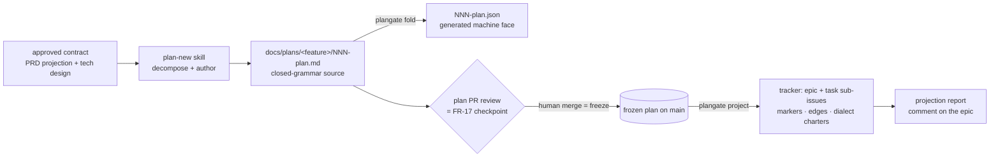

# plan-new v1 — the frozen plan artifact and its idempotent projection — technical design

| Field | Value |
|---|---|
| **Status** | Approved (2026-07-09 — operator, in doc-review) *(merge is the freezing event; "superseded" is computed by the index, never written here)* |
| **Owner** | @mdarabi |
| **Approver(s)** | @mdarabi (operator) — mandatory named reviewer: Security/privacy impact is yes, and this is a factory-control surface (charters steer autonomous workers) |
| **Date** | 2026-07-09 |
| **Relevant-when** | designing or changing the plan document class (`docs/plans/`), the plangate tool, the plan/charter/report schemas, the tracker projection or its idempotency, the executor dialect rendering, or the sizing-policy config; implementing the plan-new skill; triaging planner defects (duplicate issues, premature routing, charterless or vague tasks); superseding this design |
| **Scope** | The plan-new bootstrap slice as one coupled unit: the plan document class and its freeze lifecycle (PRD Q1), the deterministic tool and its projection idempotency + race posture (Q2), the tracker hierarchy mapping (Q3), the executor-dialect contract (Q4), and the sizing-policy home (Q5). **Not**: the engine's Planner judgment service, scheduling/execution (PRD NG-1), stage-6 contract compilation (NG-2), multi-epic clustering / umbrellas / verification epics (WR-1), the WorkTracker-port rebinding (WR-3), plan supersession mechanics (WR-5). |
| **Tracking** | introducing PR (filed on approval) — **serves and merges after PR #67** (the plan-new PRD) |
| **Builds-on** | docs/tech-design/repo-layout-and-system-footprint.md (the three buckets, `.pyxis/config.yaml` closed path surface — this design adds the `paths.plans` key and the `plan:` config block) · docs/tech-design/docgate-v1.md (the source→fold projection pattern, closed-grammar stdlib parsing, thin-`cmd/` Go shape, typed-defect boundary) · docs/tech-design/local-work-tracker.md (the co-design-with-sole-medium pattern this repeats for the projection surface; bucket-1 reasoning for operand work products) |
| **Supersedes** | — |
| **Serves** | prd:plan-new/FR-1 · prd:plan-new/FR-2 · prd:plan-new/FR-3 · prd:plan-new/FR-4 · prd:plan-new/FR-5 · prd:plan-new/FR-6 · prd:plan-new/FR-7 · prd:plan-new/FR-8 · prd:plan-new/FR-9 · prd:plan-new/FR-10 · prd:plan-new/FR-11 · prd:plan-new/FR-12 · prd:plan-new/FR-13 · prd:plan-new/FR-14 · prd:plan-new/FR-15 · prd:plan-new/FR-16 · prd:plan-new/FR-17 · prd:plan-new/FR-18 · prd:plan-new/FR-19 · prd:plan-new/FR-20 · prd:plan-new/FR-21 · prd:plan-new/FR-22 · prd:plan-new/FR-23 · prd:plan-new/FR-24 · prd:plan-new/UB-1 · prd:plan-new/UB-2 · prd:plan-new/UB-3 · prd:plan-new/UB-4 · prd:plan-new/UB-5 · prd:plan-new/UB-6 · prd:plan-new/NR-1 · prd:plan-new/NR-2 · prd:plan-new/NR-3 · prd:plan-new/NFR-1 · prd:plan-new/NFR-2 · prd:plan-new/NFR-3 · prd:plan-new/NFR-4 · prd:plan-new/NFR-5 · prd:plan-new/NFR-6 · prd:plan-new/EVAL-1 |
| **Security/privacy impact** | yes — tracker writes under the invoker's existing credentials; model-derived content published to a third-party tracker; prompt-injection surface via governing documents · reviewer: @mdarabi (see §3.5) |
| **Template version** | tech-design-template/v1 |

## 1. Problem

The plan-new PRD (PR #67) is gate-signed but deliberately mechanism-free: it
states what must be observably true (24 Must/Should FRs) and leaves five
questions open — Q1 where the frozen plan artifact lives and how it freezes,
Q2 how projection stays idempotent and race-safe, Q3 how the four-level work
hierarchy maps onto the tracker, Q4 how the executor dialect is pinned and
upgraded, Q5 where the sizing policy lives. Until those are decided, nothing
can be built: the skill has no artifact to write, the tool has no schema to
validate, the projection has no idempotency story, and the first dogfood plan
(the local-work-tracker implementation, approved and waiting) stays
hand-plannable only. The cheapest moment is now: the footprint design just
settled the bucket taxonomy and config surface these questions land on, and
docgate proved the source→fold→gate shape this class can reuse rather than
invent.

## 2. Decision

**Decision:** A feature's plan is a **frozen, versioned, bucket-1 document** —
a human-authored closed-grammar source folded by a new Go tool, **plangate**,
into a schema-versioned machine face, both committed together — whose
**approval and freeze are the doc system's merge event**; its tracker presence
is a **stateless, convergent projection**: plangate creates each task at most
once (keyed by a plan-task-id marker probed with exact reads), wires all
hierarchy and dependency edges before any routing signal, renders charters
through a version-pinned executor dialect, and reports the outcome as a
structured artifact on the feature's epic.

Why one document: today exactly one plan class, one tracker medium (GitHub),
and one executor (the predecessor fleet) exist; the artifact grammar, freeze
lifecycle, idempotency keys, hierarchy encoding, dialect rendering, and
policy home co-emerge and would only change together in this slice — the
local-work-tracker precedent applied to the planning surface. §3.2 names the
futures that are separately revisable and deliberately not decided here. Why
this shape: reusing the doc system's merge-freeze gives the plan immutability,
review surface, and audit for free (one operator touch: the plan PR's review
*is* the FR-17 checkpoint); statelessness over the tracker keeps the swap
test honest ahead of the WorkTracker port (D1's leaning applied early); and
folding validation into one deterministic tool makes every structural gate —
sizing, coverage, fog, cycles, charter lint — code, not prompt discipline
(AP-10), which is exactly what EVAL-1 then re-runs as the envelope eval.

## 3. The design

### 3.1 The plan document class (Q1)

**Decision:** Plans live at `<paths.plans>/<feature-slug>/NNN-plan.md`
(default `docs/plans/`, the path a new closed key in `.pyxis/config.yaml`
per the footprint's binding-becomes-data rule) — dense-numbered per feature,
`001-plan.md` first, a later plan for the same feature taking the next
number (the WR-5 supersession seam, not mechanized here). The `.md` is the
**authored source**: a closed grammar in the docgate manner — a header table
(feature ref, plan version, dialect pin, status), one structured section per
task carrying the §4.5 layer-2 charter fields as labeled regions, an edges
block, and the coverage-matrix section. `plangate fold` validates it and
emits `NNN-plan.json` (schema `plan/v1`), committed beside its source like
`effective.source.json` — authored face for humans and review, generated
face for the projection and every later consumer.

Plans are **bucket-1 operand content**: work products of this repo, not
factory footprint — they survive `pyxis remove` (footprint DINV-1) and never
reference a `.pyxis/` path (DINV-8 below). **Freeze = merge**: while the plan
PR is open the plan is a draft and the annotate→apply review loop on it *is*
the FR-17 checkpoint (present whole plan → edit → re-present → explicit
approval); the human merge is the approval record and the freezing event —
the same lifecycle every governed document class already has, requiring
exactly one operator touch per plan. `plangate project` refuses any plan not
reachable as merged content (DINV-1), so "zero tracker writes before
approval" is enforced by the tool, not the session.

### 3.2 Boundaries and non-goals

- **Not solved here** — the engine Planner service and the F3 judgment
  contract; scheduling, claiming, executing, or merging tasks (PRD NG-1);
  stage-6 contract validation (NG-2); multi-epic clustering, umbrellas, and
  verification epics (WR-1); milestone-layer tracker entities (WR-2); plan
  supersession mechanics beyond the numbering seam (WR-5); completion
  monitoring (WR-4).
- **Owned by a future design** — the WorkTracker-port rebinding of the
  projection (WR-3): §3.8's tracker surface is deliberately one narrow
  internal seam so extraction is adapter work; a cross-process projection
  mutex (arrives with the engine's LeaseStore, Q2 below documents the v1
  posture); eval-backed decomposition quality (WR-6).
- **Implementation must not infer** — that the projection surface is a
  finalized medium-independent port (it co-emerged with one medium; keep it
  free of GitHub-isms beyond the adapter file, but its extraction is a
  *later* decision); that plan markdown may be hand-parsed by any consumer
  other than plangate (the JSON face is the contract — AP-6); that a
  duplicate-marker collision may be auto-resolved by closing issues (never —
  fail-closed on destructive, §3.8).
- **Must remain unchanged** — the doc system's classes, paths, and gates
  (docgate v1/v2 semantics, ledger conventions); the footprint's bucket
  rules and config schema beyond the two additions this design declares
  (`paths.plans`, the `plan:` block); the executor's own contracts (we
  render *into* its dialect; we change nothing *in* it — PRD NR-3).

### 3.3 Invariants

- **DINV-1** — `plangate project` reads only a **merged** plan; no tracker
  write ever derives from unmerged plan state. (FR-17; §3.3 guardrail 1.)
- **DINV-2** — every projected byte derives from the frozen plan: no
  information appears on the tracker that is absent from `NNN-plan.json`
  (renderings — issue bodies, dialect markers — are pure functions of it).
- **DINV-3** — projection is convergent: per plan-task-id, at most one task
  is created across any number of runs, crashes, and resumes; a detected
  duplicate (§3.8 race window) **halts loudly and is never auto-deleted**.
- **DINV-4** — every read feeding a projection decision is an exact,
  bounded REST enumeration reflecting current state; never a server-side
  search index, never a cache-prone conditional read. (AP-15; predecessor
  I4/I12.)
- **DINV-5** — the routing signal is applied to a task only after its
  parent link and every dependency edge exist; between create and route a
  task is invisible to dispatch. (FR-19/UB-5.)
- **DINV-6** — a plan that folds green has zero fog and a complete
  coverage matrix; all-or-nothing fog refusal is a plangate verdict, not
  session discipline. (FR-15/FR-16.)
- **DINV-7** — the projection mutates nothing it did not create, beyond
  additively linking tasks to the plan's own epic. (FR-20/NR-2.)
- **DINV-8** — plans are bucket-1 content: no plan file references a
  `.pyxis/` path; template/dialect references are version pins. (Footprint
  DINV-4 applied to this class.)
- **DINV-9** — dialect rendering is pinned: the plan header names the
  dialect+version it froze with; `project` in routing mode requires that
  dialect's contract test green at the built version.

### 3.4 Observability

- **Events/logs** — plangate emits one structured line per projection step
  (`created`/`linked`/`wired`/`routed`/`skipped-existing`/`halted` × task),
  keyed by plan-task-id; `fold` emits one line per defect with the
  document/task/rule/reason/remedy quadruple (NFR-4).
- **Metrics** — none committed in v1 (no ledger exists): M1–M3 are measured
  from artifacts per the PRD's §3.2 plans; the projection report carries the
  per-run counts those sweeps read.
- **Alerts** — none beyond loud failure: a red fold, a red dialect contract
  test, or a DINV-3 halt is the alarm (CI-red / non-zero exit), consistent
  with the repo's gate posture.
- **Debugging surface** — `plangate project --dry-run` prints the exact
  write set; `plangate report` re-probes the tracker and regenerates the
  report from reality (statelessness makes the tracker itself the debugger).
- **Trace/correlation** — the plan-task-id is the correlation key: stamped
  in the issue marker, the report, and every log line; with the charter's
  requirement/anchor refs it forms the idea→PRD→plan→task→PR chain — the
  VNEXT-3 seed this slice contributes.

### 3.5 Security & privacy

Matches the header row (yes). Surfaces: (1) **tracker writes** — plangate
uses the invoking operator's/bot's existing credentials; it mints nothing,
stores nothing, and adds no identity or permission surface; its write verbs
are create/label/link/comment only — never close, delete, or edit of foreign
items (DINV-7). (2) **Egress** — plan and charter content is published to
GitHub; all of it derives from already-repo-public documents (PRD §5.4), and
the charter schema's integrity rule (no secrets or credentials, ever) is a
fold-time lint. (3) **Injection** — a poisoned governing document steering
charters is mitigated by the chain the PRD binds: only human-approved merged
inputs (FR-1), untraceable content fails the coverage matrix (FR-15), the
whole plan passes a human checkpoint (FR-17), and executor trigger strings
are neutralized at render time per the dialect manifest (UB-6) so issue
creation fires no unintended automation. Threats out of scope: a compromised
tracker or executor (their own trust domains).

### 3.6 plangate — the deterministic half

**Decision:** One new Go binary, `cmd/plangate` + `internal/plangate/`
(docgate's shape: thin main, verbs, typed defects, golden fixtures),
absorbed into the `pyxis` binary when the engine exists. Verbs:

| Verb | Does |
|---|---|
| `fold <plan-dir>` | parse the closed grammar; run every structural gate — sizing thresholds (§3.11), mechanical-quarantine and expand–contract shape checks, charter schema + durability lint (path/line-number patterns, vagueness blacklist, trigger-string scan), dependency-cycle refusal, overlap-resolution check, coverage matrix, all-or-nothing fog — then emit `NNN-plan.json` (`plan/v1`). Any defect: named quadruple, no output. (FR-4..16 mechanics.) |
| `verify <plan-dir>` | byte-compare committed JSON vs recomputed fold (the doc system's `verify-generated` pattern; CI hook for this class). |
| `project <plan-dir> [--dry-run] [--no-routing]` | the §3.8 projection; flags map to the PRD's staged modes (§6.5): dry-run prints the write set; `--no-routing` stops before the routing signal (stage 2; also the kill-switch posture). |
| `report <plan-dir>` | re-probe the tracker and emit the `plan-projection-report/v1` artifact; `project` runs it implicitly at the end and posts it as a comment on the epic. |

The skill (`.pyxis/skills/plan-new/` + `.pyxis/authoring/plan-new.md`,
bucket 2, AP-25) owns only judgment: read the contract, decompose, author
`NNN-plan.md`, loop on `fold` defects, raise the plan PR for the checkpoint
review. Everything enumerable lives in plangate; the skill never re-derives
a rule the tool enforces (AP-10/AP-11 — one validator, invoked by the
session, CI, and EVAL-1 alike).

### 3.7 Projection mechanics — stateless idempotency (Q2)

**Decision:** Projection is **stateless over the tracker**: no repo-resident
projection record, no lockfile — reality is probed, exactly, every run. Each
task's idempotency key is its **plan-task-id** (`<feature>/<NNN>/<task-id>`),
embedded at creation as a machine marker in the issue body. The probe
enumerates candidates by **exact REST listing** — the plan epic's sub-issues
plus the repo's open issues filtered client-side by marker (bounded sets;
catches a created-but-not-yet-linked stray) — never server search (DINV-4).
Ordering per run: ensure labels (FR-23) → ensure epic → create missing tasks
(marker in body at birth) → link every task to the epic → wire every
dependency edge → only then apply routing signals task-by-task (DINV-5) →
post the report. A crash at any cut point leaves a state the next run
converges from (create-before-link is why the stray-scan exists); re-running
a completed projection is a no-op that still refreshes the report.

**The honest race window:** GitHub issue creation is not compare-and-swap,
so two *concurrent* projections of one plan can both probe-miss and both
create. v1's posture: the window is accepted, detected, and loud — the probe
treats two issues bearing one plan-task-id as a **halt** (DINV-3): the
report names both, routing is withheld for the pair, and resolution (close
one by hand) is the operator's — additive duplication is tolerable and
visible, destructive auto-repair is not (AP-17). Single-operator bootstrap
makes concurrence rare; the real mutex is the engine LeaseStore's job
(§3.2), not a bespoke lock here.

### 3.8 Tracker hierarchy mapping (Q3)

**Decision:** A v1 plan projects as **one epic + N task sub-issues** — the
tracker's native parent/child depth of two. The domain model's four levels
map as: **Feature** → the plan header's feature ref (the PRD/design pair;
its tracker face *is* the epic, titled for the feature); **Milestone** →
plan-artifact metadata only, no tracker entity until WR-2; **Epic** → the
one issue created per plan, carrying the executor's structural vocabulary
and the consumption contract in its body (the frontier rule, verbatim, plus
the plan's repo path and version — FR-20); **Task** → sub-issues, each
carrying the §4.5 three-layer contract. Dependency edges use the tracker's
native blocked-by relation where the capability probe finds it, else the
dialect's documented body encoding — probed once per run, the docgate
dep-API lesson inherited as mechanism.

### 3.9 The executor dialect contract (Q4)

**Decision:** A dialect is a **versioned rendering module + a data manifest
+ a contract test**, one per executor; v1 ships exactly one (the predecessor
fleet's). The manifest (data, not prose: dialect name, grammar version
constant, label vocabulary, marker shapes, trigger strings to neutralize)
lives with plangate's source and fixtures — grammar bytes are volatile facts
and stay out of frozen documents, this one included. The **contract test**
replicates the executor's own spec-validity gate over golden renderings
(structurally valid charter marker, required labels, neutralized triggers)
and runs in CI; red blocks `project` in routing mode (DINV-9) while
plan-only authoring continues. The plan header records the dialect+version
it froze with, so projecting an old plan states its rendering contract
explicitly. An executor grammar bump is: bump the manifest + fixtures in a
normal PR; already-projected issues keep their markers (the executor keys on
the versioned prefix); un-projected frozen plans re-render under the new
manifest only if their pinned version is still contract-green, else they are
superseded (WR-5 seam). Charter fields themselves are dialect-independent
(`charter/v1` = the PRD's §4.5 layer 2, cited not restated); a dialect may
only down-render, never demand fields the schema lacks.

### 3.10 Sizing policy in the config surface (Q5)

**Decision:** The sizing thresholds are a **`plan:` block in
`.pyxis/config.yaml`** — the repo's one sanctioned, closed-schema extension
surface (AP-8; footprint §3.6), not a separate policy file: closed keys for
the acceptance-criteria cap, scope-bullet cap, estimated-size band cap, and
per-plan share cap; unknown keys are errors; values are data whose change is
a reviewed config PR. Seed values port the predecessor's measured baselines
(the PRD's evidence rows own the numbers; this document deliberately states
none). Recalibration cadence: on M3 evidence at the PRD's post-launch
review — a data-only diff, per FR-6's fit criterion. `plangate fold` reads
only this block; the skill never sees a threshold except through fold's
verdicts.

### 3.11 Failure modes

| Failure | System behavior | Detection | Recovery |
|---|---|---|---|
| governing input drifted after freeze (anchor moved, FR superseded) | `project` refuses, names each drifted reference (UB-1) | fold-recorded refs re-resolved at project time | supersede the plan (next NNN) or re-approve inputs |
| tracker API error mid-projection | halt; report names created set; no retry storm (bounded retries) | non-zero exit + partial report | re-run `project` — converges (DINV-3) |
| executor tick during projection window | blocked/unwired tasks invisible to dispatch | UB-5 race probe in CI; routing-last ordering | none needed — by construction (DINV-5) |
| duplicate creation via concurrent projections | halt; both issues named; routing withheld for the pair | marker-collision scan every run | operator closes one; re-run converges |
| dialect contract test red | `project --no-routing` still works; routing mode blocked | CI + pre-project check (DINV-9) | bump manifest/fixtures PR; re-run |
| fold defect (oversize, fog, dangling ref, cycle, mixed mechanical) | no JSON emitted; quadruple defects | fold exit + named rows | fix the plan draft; re-fold (draft phase — plan PR still open) |

## 4. Alternatives considered

| Alternative | Why rejected |
|---|---|
| plan lives only in the tracker (issues as the source; no repo artifact) | the PRD's rejected option B — no frozen judgment record, no coverage check, resume ad hoc; the predecessor's I2/I3/I15 family traces to plan state living only in the tracker |
| repo-resident projection record (task↔issue map committed after each run) | the record lags reality across crashes — a stale record *causes* duplicates instead of preventing them; statelessness + exact probes make the tracker the single source (D1's leaning, AP-15) |
| in-session approval freezes the plan (no PR; commit direct to main) | bypasses the repo's one human-merge governance rule; loses the review surface, audit, and immutability the doc system already provides for exactly this lifecycle |
| markers via server-side search for idempotency probes | search is fuzzy and index-lagged — the predecessor's I4 duplicate-reimplementation incident class; exact bounded enumeration or nothing |
| a bespoke projection lock (lockfile / lock-issue) to close the race window | a second half-mutex beside the engine's future LeaseStore is a twin-predicate seed (AP-11); the window is rare, detected, and loud in v1 — the real mutex arrives with the engine |
| separate `size-policy.yaml` at repo root (predecessor shape) | a second config surface beside `.pyxis/config.yaml` violates the one-sanctioned-surface rule (AP-8); the block is four closed keys, not a file's worth |
| one binary verb on docgate instead of a new `plangate` | docgate's contract is the document system; plans are operand work products with their own schema family — one predicate per fence, and the PRD's NR-1 keeps the doc system's gates outranking, not absorbing, the planner |

## 5. Risks

| ID | Risk | Impact | Mitigation | Verification / evidence |
|---|---|---|---|---|
| R1 | the closed plan grammar fights authoring (LLM writes it badly) | fold-defect loops burn session time | grammar mirrors the ledger conventions authors already produce; fold defects carry the quadruple; golden exemplar ships with the template | authoring the dogfood plan measures the loop count (PRD G3 signal) |
| R2 | probe cost grows with open-issue count (stray scan) | slow projections on big trackers | candidate sets are bounded (epic sub-issues + open issues, paginated exact REST); NFR-2's bound is the budget; a marker-indexed cache is future work **only** if measured red | NFR-2 timing fixture at the PRD's 30-task bound |
| R3 | dialect replica drifts from the executor's real gate | contract test green, live dispatch red | the manifest pins the version; the dogfood plan is the live acceptance (M2: zero nospec fires); drift found live becomes a fixture the same day | A-6 + DOD-3 evidence |
| R4 | the FR-17 checkpoint degrades into rubber-stamping a large diff | wrong decomposition merges | the plan PR renders via doc-review (annotate→apply, the same loop that reviewed the PRD); flags (`SIZE-ACCEPTED`, `OVERLAP-UNRESOLVED`) are explicit rows the render surfaces; EVAL-1 keeps the structural floor beneath the human judgment | review-session records on the first plans |
| R5 | two plans for one feature drift (NNN seam without supersession mechanics) | ambiguous "current plan" | plangate refuses to `project` a plan when a higher-numbered green plan exists for the feature (cheap check, fail-closed); full supersession is WR-5 | fold/project fixture |

## 6. Acceptance

| ID | Acceptance criterion | Verify | Required evidence | Traces to |
|---|---|---|---|---|
| A-1 | fold accepts the golden plan and rejects each defect-class fixture (oversize w/o acceptance, mixed mechanical, cycle, dangling ref, fog-beside-tasks, path-carrying charter, missing matrix row) with the named quadruple | Test | fixture suite in CI | prd:plan-new/FR-4..16 · #DINV-6 |
| A-2 | kill-mid-projection at every cut point, then re-run: converged tracker state, each task exactly once, report matches reality | Test | interruption suite | prd:plan-new/FR-18 · #DINV-3 |
| A-3 | a probing consumer polling throughout projection observes zero instants where a task is routable with a missing edge or parent link | Test | race-probe fixture | prd:plan-new/FR-19 · #DINV-5 |
| A-4 | `project` against an unmerged or drifted plan refuses with named references; `--dry-run` and pre-approval states produce zero tracker writes | Test | refusal fixtures | prd:plan-new/FR-17 · prd:plan-new/UB-1 · #DINV-1 |
| A-5 | duplicate-marker collision (simulated concurrent create) halts, names both issues, withholds routing, never deletes | Test | race fixture | #DINV-3 · prd:plan-new/UB-4 |
| A-6 | every rendered fixture passes the replicated executor spec-validity gate; the dogfood plan dispatches with zero executor-side plan phases | Test + Demo | contract test CI + dogfood dispatch evidence | prd:plan-new/FR-21 · #DINV-9 |
| A-7 | fresh-tracker fixture: all emitted labels ensured idempotently; re-run changes nothing; pre-existing items byte-unchanged (mutation audit) | Test | fixture + audit diff | prd:plan-new/FR-20 · prd:plan-new/FR-23 · #DINV-7 |
| A-8 | `verify` byte-rejects a hand-edited `NNN-plan.json`; fold output is deterministic across re-runs | Test | verify fixture | prd:plan-new/NFR-1 |
| A-9 | the config additions parse closed (unknown key in `plan:` block errors); a threshold edit flips a fold fixture's verdict with zero code diff | Test | config fixtures | prd:plan-new/FR-6 |
| A-10 | one real feature planned end-to-end through this design — authored, folded, PR-merged, projected, executed by the fleet — with the report as evidence | Demo | the dogfood plan's artifacts | prd:plan-new/DOD-3 · §2 |

## 7. Open questions

| ID | Question | Owner | Blocks | Status | Resolution |
|---|---|---|---|---|---|
| Q1 | Exact plan source grammar bytes (region labels, marker syntax) — concepts fixed here, bytes fixed against golden fixtures | implementation | implementation start | open | decided at implementation; the fixtures are the contract |
| Q2 | Does projection auto-fire on plan-PR merge (webhook/CI) or stay operator-invoked? | operator | nothing (v1 is operator-invoked) | open | revisit with the Trigger design; DINV-1 holds either way |
| Q3 | Report retention beyond the epic comment (also commit to the plan dir?) | operator | nothing | open | v1: comment only (regenerable via `report`); revisit if audit needs git history |
| Q4 | Cross-process projection mutex | future engine design (LeaseStore) | nothing (v1 posture: detect + halt, §3.7) | open | superseding design when the engine's coordination medium exists |

## Principles

- **AP-6 — honored.** Plan, charter, and report are closed, schema-versioned contracts with two faces where humans review (source) and machines consume (fold); charters stay compact by citing anchors instead of restating documents.
- **AP-8 — honored.** The only new repo knobs land in `.pyxis/config.yaml` (`paths.plans`, the `plan:` block) — the one sanctioned surface, closed-parse.
- **AP-10 / AP-11 — honored.** Every enumerable rule (sizing, fog, coverage, lint, cycles) is a plangate verdict — one implementation invoked identically by the session, CI, and EVAL-1; the skill holds judgment only.
- **AP-13 — honored.** Success is the report reconciled against probed reality and the marker-carrying issues themselves — never the session's claim.
- **AP-15 — honored.** Every projection-decision read is an exact bounded enumeration; server search is banned on the decision path (DINV-4).
- **AP-17 — honored.** Destructive ambiguity fails closed (duplicates halt, are named, never auto-deleted; charterless dispatch is impossible); additive redundancy is tolerated and loud.
- **AP-19 — honored.** Nothing recurs: plangate runs on invocation; steady-state cost is zero.
- **AP-21 — honored.** All planning judgment freezes in the plan at merge; projection and the executor read it verbatim; the dialect renders, never re-judges.
- **AP-22 — honored.** Projection converges under re-runs, crashes, and (detected) races; the losing path records a no-op or a loud halt, never silent divergence.
- **AP-23 — honored.** Plans are per-feature dirs with dense numbering; parallel plan authors touch disjoint files; markers and labels are namespaced per plan-task-id.
- **AP-24 — honored.** Plans derive from approved contracts; nothing regenerates a contract from a plan; the doc system's gates outrank plangate (PRD NR-1).
- **AP-25 — honored.** The skill's knowledge lives in `.pyxis/authoring/plan-new.md`; vendor dirs hold pointers only.
- **RW-2 — honored.** The predecessor's lessons land as contracts (DINV-3/4/5 from I4/I12/I15; the dep-API probe as mechanism) — no workaround code is ported.
- **RW-4 — deviation, with reason.** The projection targets GitHub directly, ahead of the WorkTracker port and minimal-local adapters — the operator's recorded ruling (PRD decision log, 2026-07-09): the execution half is live on GitHub and self-development closes earliest there. Mitigation: the tracker surface is one narrow internal seam (§3.2) kept free of GitHub-isms outside its adapter file, so the WR-3 rebinding is adapter work, not a rewrite.
- **RW-5 — honored.** This document precedes all plan-new code; each deferred question names its future owner.
- **Deviation:** RW-4 only, as stated above.
