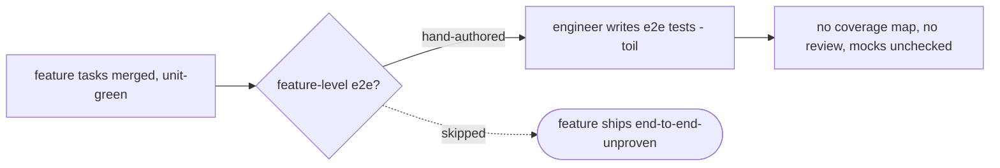

# e2e-verification — the e2e-test authoring line — PRD

| Field | Value |
|---|---|
| **In one line** | Pipeline stage 10's authoring half: three new skills that turn a just-implemented feature into feature-level e2e tests — **e2e-design** (auto-writes scenarios, setup/teardown, mock strategy, harness libraries, a coverage map, and a per-scenario run/mock/manual route), **e2e-review** (human doc-review + a multi-lens unmanned reviewer, findings resolved or rejected), and **e2e-plan** (an ordered plan of tracker tasks — a harness task, then scenario tasks blocked-by it). Building the tests, gating on them, and the incident→regression loop are named follow-ons. |
| **Relevant-when** | planning, building, or reviewing the e2e authoring line — the e2e design doc and its sections, the coverage map / per-scenario route, the multi-lens e2e review and its report, or e2e-task planning and its dependency edges; triaging a shallow-coverage, hollow-scenario, mocked-away, infeasible-scenario, or wrong-build-order defect; drawing the boundary against implementation-verification's stage-8 ladder and implement-now's execution; deciding what the deferred build/gate/incident follow-ons inherit |
| **Status** | Draft — problem review pending *(merge freezes the base)* |
| **Tier** | T2 — a new multi-skill pipeline stage that authors documents, plans, and tracker tasks (all human-reviewed and accepted); no execution, no merge authority, no security/privacy/money surface in this version |
| **Owner** | @mdarabi |
| **Approver(s)** | @mdarabi (operator) |
| **Contributors** | — *(solo operator; gate tables record the introducing PR's review, rule 15)* |
| **Informed** | — |
| **Date** | 2026-07-23 created · 2026-07-23 last updated |
| **Appetite** | Build the three authoring skills well — e2e-design (coverage map + scenarios + setup/teardown + mock strategy + harness selection + per-scenario route), e2e-review (the lens set + review report + the human doc-review half + finding convergence), e2e-plan (an ordered, frozen plan of ordinary tracker tasks with harness→scenario dependency edges) — bounded by dogfooding design → review → plan on one real pyxis feature to an operator-accepted plan. Excludes building/executing the tests (the implement-now e2e adaptation), the dedicated no-regression gate, the incident→regression loop, and driving the harder app shapes to green in CI. |
| **Target release** | No hard release peg: the authoring line precedes — and produces the plans consumed by — the implement-now e2e adaptation (the build follow-on). Its own delivery is bounded by the pyxis dogfood. |
| **Tracking** | — *(the introducing PR)* |
| **Artifacts** | `brainstorm:e2e-verification` — the gated brainstorm record (rides this PR) · `review:e2e-verification-000` — the unmanned reviewer's report (rides this PR once `/prd-review` runs) |
| **Template version** | prd-template/v2 |

## 0. Read to rule — the human reviewer's section (~6 min)

*The body is the contract; this section only routes attention — on any conflict the body governs; machines ignore it.*

**Judge these**

| # | The call | Could have gone | If you disagree |
|---|---|---|---|
| 1 | **v1 stops at the plan — no tests are built or run** — the line delivers a reviewed e2e design and an ordered plan of tracker tasks; building them is a named follow-on | v1 also runs implement-now to build the tests (accepting an unadapted executor) | "e2e verification" ships with nothing executing yet; the dogfood proves authoring, not passing tests → §3.4 NG-1, §4.2, D-14 |
| 2 | **Three dedicated new skills, not reuse of the existing pipeline skills** — e2e-design/e2e-review/e2e-plan parallel, rather than reuse, tech-design-new / the reviewer program / plan-new | reuse the existing skills, e2e-specifics as content inside them | more surface to build and maintain; the alternative would have been fewer skills carrying e2e content → §4.1, D-1 |
| 3 | **The coverage map and per-scenario route are mandatory doc sections** — coverage is an explicit list the reviewers check against; every scenario is marked run/mock/manual | let the agent's judgment carry coverage and mocking implicitly | the review loses its yardstick and mocking-away-the-hard-part becomes invisible → FR-2, FR-4, §5.3 | 
| 4 | **Coverage is derived from the feature's PRD + design + built code** — not from a structured definition-of-done | wait for the structured-DoD schema (not yet built) | a not-yet-built dependency would block v1; the structured DoD becomes a sharper input later → FR-3, §3.4 WR (build follow-on) |
| 5 | **Harness→scenario ordering rides the existing plan/executor** — e2e-plan only declares the blocked-by edge; implement-now already builds unblocked-first | build a new ordering mechanism, or defer ordering to the implement-now adaptation | none needed — the edge is declared in v1 and ordered pickup is free; a wrong belief here would duplicate existing machinery → FR-13, §2.4 |
| 6 | **The factory's own loop is P1; the operator is P2** — the design optimizes the machine's authoring loop; the operator reviews and accepts | operator-first segmentation | trade-offs tip toward human-facing polish over the loop the machine runs every feature → §2.2, D-11 |

**Sanity-check the numbers** — the dogfood demands **one real pyxis feature** carried design→review→plan to an accepted plan (M1); the catch tests demand **every seeded coverage-gap and every seeded hollow scenario flagged** (M2, M3); the guardrail tolerates **zero unresolved false-reds** on the coverage/anti-gaming lenses at the dogfood checkpoint (§3.3). Task counts, lens counts, and retry caps are not this document's numbers — the lens *set* (coverage · anti-gaming) is named in §5.1 but its exact wording is refined in design (§7.2).

**The author's open questions** — where the three artifacts live and whether they are new governed document kinds (§7.2 Q1, design-owned); the exact lens membership and wording (§7.2 Q2, design-owned); the unmanned reviewer's advisory-ramp/adoption checkpoint (§7.2 Q3, mirrors the existing program); how e2e-design picks the live design when a feature has multiple/superseded designs (§7.2 Q6, design-owned). None blocks the solution gate.

**Skip the rest** — structure/ID/fold correctness → docgate; substance and coherence → the unmanned `/prd-review`; document-home and schema mechanics → the technical design (§7.2 design-owned rows); building, driving-to-green, e2e anti-gaming at run time, and the harder app shapes → the deferred implement-now e2e adaptation; the dedicated no-regression gate and the incident→regression loop → their own follow-on features.

## 1. Summary — the one-pager

- **Problem** — When a feature finishes implementation, nothing turns "what this feature must do end-to-end, and how we'd prove it" into a reviewed, planned artifact. Feature-level e2e coverage is either hand-authored by the engineer (toil the factory exists to remove) or skipped, so features ship without anyone deciding — and checking — that the whole thing works, not just its unit-tested slices.
- **For whom** — P1: the factory's own loop (the three new skills), which runs the authoring line once per finished feature. P2: the operator, who reviews and accepts the e2e design and decides run/mock/manual when the skill is unsure.
- **Why now** — Stage 8 (implementation) and its stage-8 verification harness are landing; stage 10 (feature-level e2e) is a named, unclaimed gap the nearest neighbor explicitly deferred to this feature. The operator removed an earlier single-skill attempt to re-shape the stage as design → review → plan → build; this is that redo, scoped to the authoring half.
- **Direction** — Three dedicated skills mirroring the pipeline itself: **e2e-design** reads the finished feature (PRD + technical design + built code) and auto-writes an e2e design doc — scenarios, setup/teardown, what to mock, harness libraries, a coverage map from each required behavior to its proving scenario, and a per-scenario run/mock/manual route. **e2e-review** reviews that doc two ways — the operator in doc-review, and an unmanned reviewer running blind lenses (coverage, anti-gaming) into a review report — with findings resolved or rejected. **e2e-plan** turns the approved doc into an ordered plan of tracker tasks: a harness task, then scenario tasks that depend on it.
- **Appetite** — The header's budget: the three skills built well, bounded by dogfooding design→review→plan on one real pyxis feature. Excludes building the tests, gating on them, the incident loop, and the harder app shapes.
- **Success** — One real pyxis feature carried through design → review → plan to an operator-accepted reviewed design and ordered plan (M1), with every seeded coverage-gap and hollow scenario caught by the review (M2, M3).
- **Guardrail** — Zero unresolved false-reds on the coverage/anti-gaming lenses: a reviewer that cries wolf trains the operator to ignore it (§3.3).
- **Top risks** — (1) auto-authored coverage is shallow and misses behaviors the unit tests already imply; (2) the review lenses cry wolf and the operator learns to wave findings through; (3) v1 ships an authoring line whose tests never actually run in this version, so its value depends on the build follow-on landing.

## 2. Problem space

### 2.1 Problem statement

A feature reaches the end of implementation as a set of merged tasks, each unit-verified in isolation, and nothing decides whether the assembled feature works end-to-end. Turning "what the whole feature must do, and how we would prove it" into concrete e2e tests means someone enumerates the behaviors, writes scenarios, decides setup/teardown and what to mock, picks a harness, and orders the work — today that someone is the engineer, by hand, or no one. Hand authoring is toil the factory exists to remove; skipping it ships features whose end-to-end behavior was never stated as testable, let alone reviewed. The cost compounds every feature: unit-green proposals that no one has proven work as a whole, and an engineer pulled back into writing tests instead of defining and accepting.

### 2.2 Users and segments

| Segment | Role and context | Domain exp. | Tech exp. | Key goals | Pain today | Evidence |
|---|---|---|---|---|---|---|
| **P1 (primary)** | The factory's own loop — the three skills (e2e-design, e2e-review, e2e-plan) — run once per finished feature; the design optimizes this authoring loop | master | master | derive good coverage and a buildable, ordered e2e plan without a human writing tests | no stage-10 line exists; the verification-epic pattern was the only ancestor | `brainstorm:e2e-verification#D-11` |
| P2 (secondary) | The operator of a pyxis-onboarded repo — reviews the e2e design (doc-review + comments), answers run/mock/manual when asked, accepts the result | master | master | trust that the e2e scope is complete and honest without authoring it | e2e tests are hand-written or skipped; coverage is nobody's explicit decision | `brainstorm:e2e-verification#D-11`, `#D-12` |
| **Anti-segment** | Behaviors only checkable by hand or physically (routed to manual, never auto-e2e, `#D-7`); repos with no pyxis operator to review and accept (`#D-11`) | — | — | — | — | — |

### 2.3 Jobs and desired outcomes

| # | When… (situation) | I want to… (motivation) | So I can… (outcome) | Today's workaround | Evidence |
|---|---|---|---|---|---|
| J1 | a feature's implementation tasks have all landed | derive an explicit coverage map and auto-author an e2e design doc proving each behavior end-to-end | have the feature's e2e scope stated and buildable without hand-writing it | the engineer hand-writes e2e tests, or none exist | `brainstorm:e2e-verification#D-12` |
| J2 | an e2e design doc has been drafted | review it — human comments plus blind lenses — and converge findings | trust the coverage is complete, honest, and feasible before anything is built | ad-hoc human judgment, or no review at all | `brainstorm:e2e-verification#D-12`, `#D-8` |
| J3 | an e2e design doc is approved | turn it into an ordered plan of tracker tasks the executor can build in the right order | hand the build off without hand-writing issues or wiring build order | hand-write issues one by one | `brainstorm:e2e-verification#D-12`, `#D-10` |
| J4 | the factory hands me a drafted e2e design | review and accept it, deciding run/mock/manual when asked | approve the e2e scope with taste and judgment, not authorship | write or omit the e2e tests myself | `brainstorm:e2e-verification#D-11`, `#D-12` |

### 2.4 Evidence

| Claim | Source (research, data, tickets, interviews) | Confidence |
|---|---|---|
| Stage 10 (feature-level e2e verification) is unbuilt and named an explicit unclaimed gap — the predecessor had only the verification-epic pattern | `docs/prds/README.md` §Not in the baseline · `brainstorm:e2e-verification#F-1` | High |
| The stage-8 verification harness owns the per-diff mechanical ladder and a future remote gate, and explicitly defers stage-10 feature-level e2e to this feature | `docs/prds/implementation-verification/effective.md` §3.4 WR-4 · `brainstorm:e2e-verification#F-3` | High |
| Dependency-ordered pickup already exists: plan-new emits explicit blocked-by edges and implement-now builds only the unblocked frontier, never off an unmerged blocker — so harness-before-scenarios needs only the edge declared | `docs/prds/plan-new/effective.md` (FR-10 frontier); `docs/tech-design/implement-now.md` §3.2/§3.6, DINV-2 · `brainstorm:e2e-verification#F-9` | High |
| The unmanned reviewer program (prd-review, tech-design-review, impl-review) is an established shape — blind fresh-context lenses over a shared context pack, closable findings, a versioned review report, advisory until an adoption checkpoint | `docs/wiki/glossary.md` (impl-review); `docs/prds/{prd-review,tech-design-review,impl-review}` · `brainstorm:e2e-verification#F-4` | High |
| An earlier stage-10 contract (a single auto-authoring skill) was merged and then operator-removed "to reframe the stage from scratch under a richer framing (design → review → plan → implement)" | git history (#584 added, #609 removed) · `brainstorm:e2e-verification#F-2` | High |
| Auto-authored tests can claim coverage they do not have (a scenario that mocks away the behavior it names) — the design-time analogue of the stage-8 harness's anti-gaming concern | `brainstorm:e2e-verification#P-2`, `#D-9`; reasoned analysis, not yet locally measured | Med |

### 2.5 The journey today

| Phase | User does | User feels / pain | Frontstage (what user sees) | Backstage (systems, people, processes) |
|---|---|---|---|---|
| finish | the feature's tasks all merge, unit-verified | done-ish — but nothing checked the whole | green unit badges | stage-8 verification per task; no feature-level step |
| decide e2e | engineer (if anyone) thinks up end-to-end cases by hand | uncertain — is this complete? what to mock? | a blank editor | no coverage yardstick, no harness convention |
| author | engineer hand-writes e2e tests, or skips | toil, or guilt | scattered test files, or none | the north star's inversion test: this minute is a factory gap |
| review | no dedicated review; coverage is nobody's explicit call | unease — did we prove the feature works? | maybe a PR comment | no lens, no coverage map, no honesty check on mocks |

### 2.6 Opportunity and why now

- **Size** — every feature the factory ships needs feature-level e2e coverage decided once; the authoring line sits on that per-feature moment, and its output is the seed the accumulated-suite gate and the incident loop later build on.
- **Alternatives users have** — hand-author e2e per feature (toil, unrepeatable, coverage by instinct); rely on stage-8 unit/build/test only (blind to whole-feature breakage a unit test passes through); skip e2e (ships end-to-end-unproven features).
- **Why us / strategic fit** — the factory owns the whole pipeline, so it can apply its own design → review → plan discipline to authoring e2e — the same judge-once, review-before-build shape it uses for features themselves, producing an artifact the deferred build/gate/incident follow-ons all consume.
- **Why now** — stage 8 and its verification harness are landing and the harness deferred feature-level e2e to here; the operator has explicitly re-opened stage 10 under this richer framing.
- **Cost of doing nothing** — the pipeline reaches "unit-green proposals merged" and stops; whole-feature behavior stays unproven, e2e stays a human chore the inversion test charges as a factory gap, and the downstream follow-ons (gate, incident loop) have no authored suite to stand on.

**Decision:** Problem gate — do not proceed to §3–§4 until every contributor signs. *(sign-off table below)*

| Reviewer | Role | Date | Verdict |
|---|---|---|---|
| @mdarabi | operator (via the introducing review session) | — | pending |

## 3. Goals, metrics, and guardrails

### 3.1 Goals as falsifiable hypotheses

| # | We believe that… | Will result in… | Measured by… |
|---|---|---|---|
| G1 | auto-authoring a feature's e2e tests as a *reviewed, planned* artifact (coverage map + scenarios + routes, reviewed, then decomposed) | covering, honest, buildable e2e plans the operator accepts — with the engineer only defining and accepting | M1 |
| G2 | reviewing the e2e design through blind lenses (coverage, anti-gaming) plus a human doc-review pass | coverage gaps and hollow/mocked-away scenarios caught *before* anything is built | M2, M3 |
| G3 *(qualitative)* | making the coverage map and per-scenario route mandatory, reviewable doc sections | the operator trusting the e2e scope is complete and honest — unprompted reliance on the coverage map when accepting | coverage-map-consulted-in-acceptance observed in dogfood and post-launch review (§6.7) |

### 3.2 Goals → signals → metrics

| Metric | Goal | Signal | Baseline | Target (at checkpoint) | Feeds from |
|---|---|---|---|---|---|
| M1 (primary) | G1 | a real pyxis feature carried design → review → plan to an operator-accepted reviewed design doc + ordered plan | 0 (no stage-10 line exists) | 1 feature accepted at the dogfood checkpoint (the pyxis-feature dogfood run complete) | EVT-1, joined to the accepted plan |
| M2 | G2 | seeded coverage gaps (a required behavior with no scenario) flagged by the coverage lens | n/a (no reviewer exists) | every seeded coverage-gap case flagged, measured at the catch-suite checkpoint (a recorded score, not a per-commit gate) | EVT-2, EVT-3 |
| M3 | G2 | seeded hollow scenarios (a scenario that mocks away the behavior it names) flagged by the anti-gaming lens | n/a (no reviewer exists) | every seeded hollow-scenario case flagged, measured at the catch-suite checkpoint | EVT-2, EVT-3 |

### 3.3 Guardrails and decision rule

| Guardrail metric | Threshold | Action if breached |
|---|---|---|
| Unresolved false-reds on the coverage / anti-gaming lenses (a finding the operator disputes, still undispositioned) | 0 at the dogfood checkpoint; every disputed finding gets a disposition (finding upheld, or the lens corrected) before the run closes | tune or demote the offending lens by a recorded change; findings dispositioned wrong-block are excluded from the catch suite; the disposition is recorded (EVT-4) |
| Human-authoring displaced (the operator had to hand-write scenarios the skill should have produced) | 0 unresolved at the dogfood checkpoint | triage within the run: e2e-design defect fixed, or the gap recorded as a named limitation (never worked around by the operator silently authoring); disposition recorded (EVT-4) |

**Ship rule (pre-registered):** M1 met AND both guardrails clean → the authoring line is proven. M2/M3 catch-rates measured at the checkpoint with M1 met → the review is proven; a low catch-rate keeps the reviewer advisory and triggers lens tuning — the lenses are model-driven, so the corpus measures and never per-commit-gates (I5). Any unresolved false-red or displaced-authoring case → not shippable until dispositioned.

### 3.4 Non-goals and waiting room

| ID | Non-goal | Why refused |
|---|---|---|
| NG-1 | Building or executing the e2e tests — implement-now picking up the e2e tasks, driving them to green, run-time anti-gaming, and driving the harder app shapes to green in CI | out of this version by ruling; v1 stops at the ordered plan, deferred to the implement-now e2e adaptation so v1 relies on no unadapted executor (`brainstorm:e2e-verification#D-14`, `#O-3`) |
| NG-2 | The dedicated feature-level no-regression **gate** — the accumulated e2e suite as a distinct required check with a feature-level verdict and an advisory→blocking graduation | a self-contained follow-on; regression protection already holds via ordinary CI once tests exist and the stage-8 harness's no-new-failures enforcement (`#D-2`, `#O-1`) |
| NG-3 | The **incident→regression-e2e-test loop** — a recorded incident triggering auto-authoring a permanent regression test | a separate follow-on reusing this line's authoring machinery, blocked on incident records first carrying reproduction data (incident-machinery's to add) (`#D-3`, `#O-2`) |
| NG-4 | Merge, approval, or landing authority — the three skills emit documents, a review report, and tracker tasks only | landing belongs to merge-lane and humans; an authoring aid that also merges is not what this feature is (`#D-1`; mirrors implementation-verification NG-3) |
| NG-5 | Replacing or touching implementation-verification's stage-8 suite-level check — e2e is an additive feature-level layer | v1 has no execution or gate, so it does not touch the stage-8 harness; the two are complementary, per-diff-mechanical vs feature-level-behavioral (follows from `#D-1`, `#D-2`) |

| ID | Waiting room | Revisit when / intended version |
|---|---|---|
| WR-1 | The build/execution step — the implement-now e2e adaptation: pick up e2e tasks, drive them to green, run-time anti-gaming (falsification/test-delta at the e2e level), and the harder app shapes in CI | the implement-now e2e-adaptation follow-on (`#O-3`, `#P-3`); until then v1 stops at the plan and no unadapted executor runs this stage |
| WR-2 | The dedicated feature-level no-regression gate (accumulated e2e suite as a required check, advisory→blocking) | after this line ships and a feature-level required check is wanted (`#O-1`) |
| WR-3 | The incident→regression-e2e-test loop | after the incident-machinery amendment adding reproduction data lands (`#O-2`) |
| WR-4 | Auto-firing the line when a feature's implementation completes (vs operator-invoked) | engine-era convenience; does not change the design (`#P-1`) |
| WR-5 | General-app *execution* — driving web-UI and other hard app shapes to green in CI | with the implement-now e2e adaptation (WR-1); the authoring skills stay app-shape-aware by construction meanwhile (`#D-14`) |

## 4. Solution space

### 4.1 Approach and alternatives considered

The chosen shape is **three dedicated skills that mirror the pipeline itself, run once per finished feature, stopping at the plan.** e2e-design reads the feature's PRD + technical design + built code and auto-writes an e2e design doc: scenarios, setup/teardown, mock strategy, harness libraries, a coverage map (each required behavior → its proving scenario), and a per-scenario route (run-for-real / mocked / manual-human). e2e-review reviews that doc two ways — the operator in doc-review, and an unmanned reviewer running blind fresh-context lenses into a review report — with each finding resolved (edit the doc) or rejected (with reason); the doc is a live draft through review and freezes at approval. e2e-plan decomposes the approved doc into an ordered, frozen plan of ordinary tracker tasks — a harness task, then scenario tasks each blocked-by it — projected onto the tracker. The tasks are the shape implement-now already consumes; building them is the deferred follow-on.

| Option | Sketch | Why not chosen |
|---|---|---|
| A (chosen) | three dedicated skills (e2e-design → e2e-review → e2e-plan), build via implement-now deferred | — |
| B | reuse the existing pipeline skills directly (tech-design-new / the reviewer program / plan-new), e2e-specifics as content inside them | the operator chose dedicated skills: e2e authoring carries enough e2e-specific structure (scenarios, harness, mocks, coverage routing, e2e-specific lenses) to warrant its own line (`brainstorm:e2e-verification#D-1`) |
| C | a single auto-authoring skill that writes the tests directly (the removed #584 framing) | no reviewed coverage decision and no plan before building; the operator removed exactly this to get design → review → plan (`#F-2`, `#D-1`) |
| Do nothing | — | stage 10 stays unbuilt; features ship end-to-end-unproven; §2.6's cost compounds every feature |

### 4.2 Scope perimeter

- **In (plan of record)** — the three skills: **e2e-design** (the e2e design doc with its six parts — scenarios, setup/teardown, mock strategy, harness libraries, coverage map, per-scenario route — derived from the feature's PRD + design + built code, app-shape-aware); **e2e-review** (the human doc-review half + an unmanned multi-lens reviewer emitting closable findings in a review report; finding convergence — resolve or reject; the design freezes at approval); **e2e-plan** (an ordered, frozen plan of ordinary tracker tasks with harness→scenario blocked-by edges, projected onto the tracker); a catch-test corpus (seeded coverage gaps and hollow scenarios) as permanent tests; the pyxis-feature dogfood proving design→review→plan.
- **Future (believed next, not committed)** — the waiting room: building/executing the tests (WR-1), the dedicated no-regression gate (WR-2), the incident→regression loop (WR-3), auto-firing (WR-4), hard-app-shape execution (WR-5); the structured-DoD as a sharper coverage input.
- **Out** — building, running, or gating on the tests (NG-1, NG-2); the incident loop (NG-3); merge/landing authority (NG-4); touching the stage-8 harness (NG-5).

### 4.3 Experience: flows and states

*The skills have no standing human UI beyond the rendered documents and the tracker; the e2e-design doc renders through doc-review, the review report is a document, the plan projects onto the tracker. Accessibility and localization: skipped — no new human-facing surface ships beyond documents the existing review surface already renders.*

**Flow F1 — author (serves J1)**

| Step | Actor does | System responds | States covered | Design |
|---|---|---|---|---|
| 1 | operator invokes e2e-design on a feature whose tasks have all landed | reads the feature's PRD + design + built code; auto-writes the e2e design doc with all six parts, or refuses if the feature is not fully implemented | ideal · error (not-fully-implemented, UB-1) · error (inputs missing, UB-2) | tech design |
| 2 | — | derives the coverage map (each required behavior → proving scenario) and routes each scenario run/mock/manual, surfacing any behavior it cannot route | partial (unroutable behavior surfaced, UB-3) | FR-2, FR-4 |

**Flow F2 — review (serves J2, J4):** the operator opens the rendered e2e design doc in doc-review and annotates; in parallel the unmanned reviewer runs blind lenses (coverage, anti-gaming/will-it-bite) over a shared context pack and emits closable findings in a review report. Each finding is resolved (the doc is edited) or rejected (with a reason); the design doc is a live draft through review and freezes at approval.

**Flow F3 — plan (serves J3):** e2e-plan decomposes the approved design doc into an ordered, frozen plan — a harness task plus per-scenario tasks, each blocked-by the harness task — and projects it idempotently onto the tracker as ordinary tasks; the operator accepts the plan.

**Flow F4 — the catch (serves J2):** an adversarial design doc — a required behavior with no scenario (coverage gap), or a scenario that mocks away the behavior it names (hollow) — produces a review finding from the coverage or anti-gaming lens naming the gap or the hollow scenario.

### 4.4 Scenarios

**The common case.** A pyxis feature's tasks all merge. The operator runs e2e-design; it reads the PRD, technical design, and code, and writes an e2e design doc: six scenarios, a coverage map tying each PRD behavior to a scenario, setup/teardown for the CLI harness, two externals marked mocked, one slow path routed to manual. The operator opens it in doc-review and comments; the unmanned reviewer flags one uncovered behavior and one over-mocked scenario. Both are resolved by editing the doc; the operator accepts. e2e-plan emits a harness task and six scenario tasks blocked-by it, on the tracker. v1 is done; the build follow-on will pick them up.

**The coverage gap.** e2e-design, optimizing to look complete, omits a scenario for an error path the PRD requires. The coverage lens flags the requirement with no scenario; the finding names the missing behavior. The operator confirms; e2e-design adds the scenario before the plan is cut.

**The mocked-away behavior.** A scenario claims to prove "payment succeeds" but mocks the payment module's success response — proving nothing. The anti-gaming/will-it-bite lens flags it: the mock hollows out the behavior the scenario names. The per-scenario route recorded "mocked," which is what made the shortcut visible.

**The unroutable behavior.** A required behavior can be neither run in CI, sensibly mocked, nor cleanly made manual. e2e-design surfaces it as an open item in the design doc rather than silently dropping it; the operator decides how to route it during review.

**Decision:** Solution gate — contributors sign that this shape, at this appetite, is the bet. Zero TBDs may pass this gate.

| Reviewer | Role | Date | Verdict |
|---|---|---|---|
| @mdarabi | operator (via the introducing review session) | — | pending |

## 5. System requirements

*Terms used below: a **required behavior** is an end-to-end behavior the feature must exhibit, derived from its PRD + technical design; a **scenario** is one end-to-end flow the e2e tests will exercise; the **coverage map** is the required-behavior → scenario(s) mapping (glossary: e2e coverage map); a scenario's **route** is one of run-for-real / mocked / manual-human.*

### 5.1 Functional requirements

| ID | Requirement (EARS) | Rationale | Priority | Risk | Fit criterion | Verify | Traces to |
|---|---|---|---|---|---|---|---|
| FR-1 | When e2e-design is invoked on a feature whose implementation tasks have all landed, the skill shall produce an e2e design doc containing scenarios, setup/teardown, mock strategy, harness libraries, a coverage map, and a per-scenario route. | the design doc is the reviewed artifact everything downstream consumes | Must | med | on the dogfood feature and the fixture features, the produced doc contains all six parts, each non-empty or an explicit `none — <reason>` | Demo, Inspection | G1, J1, F1 |
| FR-2 | The coverage map shall map each required behavior of the feature to the scenario(s) that prove it, with no required behavior left unmapped. | coverage is an explicit checkable list, not left to agent judgment — the reviewers' yardstick | Must | high | on the fixtures, every required behavior enumerated from the feature's PRD/design appears in the coverage map with ≥1 scenario or an explicit routed disposition; a seeded uncovered behavior is detectable as an unmapped entry | Inspection, Test | G1, G2, J1, F1 |
| FR-3 | The coverage list shall be derived from the feature's PRD + technical design + built code, requiring no structured definition-of-done. | buildable today with no blocking dependency on the not-yet-built structured DoD | Must | med | on the fixtures, coverage is produced from PRD + design + code alone; no invocation path reads a structured-DoD artifact | Inspection | G1, J1 |
| FR-4 | Each scenario shall carry a route — run-for-real, mocked, or manual-human — and no required behavior shall be dropped; a behavior not runnable in CI shall be routed mocked or manual, never omitted. | the honesty valve against mocking away the hard part; nothing silently dropped | Must | high | every fixture scenario carries exactly one route; a seeded not-CI-runnable behavior is routed mocked or manual and appears in the doc; zero required behaviors are absent from both the coverage map and the routes | Test, Inspection | G2, J1, F1, F4 |
| FR-5 | Where a scenario is routed manual-human, the design doc shall name the human-judgment owner for that scenario. | the manual route is the Human-judgment verification method — admissible only with a named owner | Should | low | every manual-routed fixture scenario names an owner; a manual route with no owner is a review finding | Inspection | J4, F2 |
| FR-6 | The e2e design doc shall name a harness and mock approach that can drive the feature's app-shape primary external interface (e.g. a web app's HTTP endpoint, a CLI's argv/stdout, a library's public API). | app-shape-awareness is what keeps the authoring line general by construction | Should | med | across fixtures of at least two app shapes, the named harness can drive that fixture's declared primary-interface class; a harness that cannot drive the declared interface is a review finding | Inspection, Test | G1, J1 |
| FR-7 | When an e2e design doc is submitted to e2e-review, the skill shall run blind, fresh-context lens reviewers over one shared context pack and emit closable findings in a review report. | the established reviewer-program shape, applied to the e2e design | Must | med | on a fixture doc, e2e-review emits a review report of closable findings (each naming its own acceptance condition); the report validates against the review-report schema it adopts | Test | G2, J2, F2 |
| FR-8 | The e2e-review lens set shall include lenses for coverage completeness and anti-gaming (a scenario reds if the behavior breaks; no mock hollows out what it proves). | each mandated lens maps to a real e2e risk and carries a proving eval (§5.9); the set is named here, its wording refined in design | Must | high | the catch corpus (seeded coverage gaps and hollow scenarios) is flagged by the coverage and anti-gaming lenses respectively (M2, M3); a fully-covered fixture doc with honest mocks yields no coverage/anti-gaming finding | Test | G2, J2, F4 |
| FR-9 | The e2e-review step shall run a human doc-review pass on the rendered design doc alongside the unmanned lenses, both feeding one finding-convergence loop. | the human half is active review (operator annotations), not just final acceptance | Must | low | on the dogfood, the operator's doc-review annotations and the unmanned findings are converged in one loop; the design doc reflects both | Demo | J2, J4, F2 |
| FR-10 | When a review finding is raised, e2e-review shall record it as resolved (the design doc edited) or rejected (with a stated reason) before the design doc is approved. | closable findings converge; nothing is silently dropped | Must | med | on the fixture review, every finding ends resolved or rejected-with-reason; no finding is left open at approval | Test | G2, J2, F2 |
| FR-11 | The e2e review report shall be persisted alongside the e2e design doc and ride its introducing change. | the review report is the design's evidence package, like the existing review reports | Should | low | the dogfood produces a persisted review report riding the design doc's change | Inspection | J2, F2 |
| FR-12 | When e2e-plan is invoked on an approved e2e design doc, the skill shall decompose it into an ordered plan — a harness task and per-scenario tasks — and project it onto the tracker as ordinary tasks. | the plan is the buildable output; ordinary tasks so the existing executor consumes them | Must | med | on the dogfood, e2e-plan produces a harness task plus one task per scenario (or grouped scenarios) projected onto the tracker; the tasks validate against the existing task/charter schema | Demo, Test | G1, J3, F3 |
| FR-13 | Each scenario task shall carry an explicit blocked-by dependency on the harness task. | harness-before-scenarios; the edge is all that is needed since the executor already builds unblocked-first | Must | high | in the produced plan, every scenario task is blocked-by the harness task; the projected tracker items carry the native blocked-by relation; a scenario task with no such edge is a plan defect | Test | G1, J3, F3 |
| FR-14 | The e2e-plan tasks shall be ordinary tracker tasks in the shape the existing executor already consumes, adding no e2e-specific task type. | so implement-now picks them up unchanged; e2e-specific handling is the deferred adaptation | Must | med | inspection confirms the produced tasks use the existing task/charter schema with no new required field; the executor's frontier computation accepts them unchanged | Inspection, Test | G1, J3, NG-1 |
| FR-15 | The e2e plan shall freeze at operator approval and project idempotently onto the tracker — re-projection creates no duplicate tasks. | a frozen, idempotently-projected plan, mirroring the existing planner | Must | med | a re-run of the projection on the dogfood plan creates zero duplicate tracker items; the frozen plan artifact is byte-stable after approval | Test | J3, F3 |

*Rank within Must: FR-1/2/4/8/13 are the irreducible bet (coverage explicit, honesty-routed, lens-checked, build-ordered); a proposal to cut any reopens the contract. FR-3/7/9/10/12/14/15 are the mechanics that make them real.*

**Non-regression (NR-n)**

| ID | Existing behavior protected | Why protected | Risk | Fit criterion | Verify | Traces to |
|---|---|---|---|---|---|---|
| NR-1 | The existing pipeline skills and reviewer program (tech-design-new, plan-new, implement-now, prd-review/tech-design-review/impl-review) are untouched | the three new skills are additive; landing them must not perturb the existing pipeline | med | the existing skills' behavior and their tests are byte-unchanged by this feature | Inspection | NG-4 |
| NR-2 | implement-now is reused unchanged — v1 adds no e2e-specific executor behavior | the build step is the deferred adaptation; v1 relies on no executor change | med | zero edits to implement-now's contract or code land in this feature; the e2e tasks are consumed by the unchanged frontier computation (FR-14) | Inspection | NG-1 |
| NR-3 | The repo's existing CI contexts (docs-gate, Go build/test) stay green when the skills land | the skills are additive tooling; landing them must not perturb existing gates | low | all pre-existing required contexts green on the introducing and implementing PRs | Test | — |

### 5.2 Unwanted behavior and failure handling

| ID | If… (trigger) | Then the system shall… | User sees | Priority | Risk | Fit criterion | Verify | Traces to |
|---|---|---|---|---|---|---|---|---|
| UB-1 | e2e-design is invoked before all the feature's implementation tasks have landed | refuse with a named reason — an end-to-end test needs the whole integrated feature | refusal naming the unlanded tasks | Must | med | the not-fully-implemented fixture yields refusal; zero design docs are produced | Test | F1, FR-1 |
| UB-2 | the feature's PRD or technical design is missing or unreadable | refuse with a named defect — coverage cannot be derived without them | configuration-error naming the missing input | Must | med | the missing-input fixtures each yield refusal with the input named | Test | FR-3 |
| UB-3 | a required behavior can be neither run in CI, sensibly mocked, nor cleanly made manual | surface it as an explicit open item in the design doc, never silently drop it | the doc lists the unroutable behavior for the operator to decide | Must | high | the unroutable-behavior fixture produces a doc that lists the behavior as an open item; zero required behaviors are absent from both coverage map and routes | Test | FR-4, F4 |
| UB-4 | e2e-plan is invoked on an e2e design doc that is not operator-approved | refuse — no plan is cut from an unapproved design | refusal naming the missing approval | Must | med | the unapproved-doc fixture yields refusal; zero tasks are projected | Test | FR-12 |
| UB-5 | a review finding is left neither resolved nor rejected at approval | block approval of the design doc until every finding is dispositioned | the doc cannot advance to plan with open findings | Must | med | the open-finding fixture blocks approval; the design doc does not advance to e2e-plan | Test | FR-10 |
| UB-6 | the feature has no meaningfully-automatable e2e surface — every required behavior routes to manual, or the feature is pure-doc/refactor with no end-to-end behavior to exercise | produce an explicit manual-only (or empty, reason-recorded) e2e design and a manual-checklist result, never fabricated scenarios or a degenerate harness+scenario plan | the design records "no automatable e2e surface" with the reason; e2e-plan emits a manual checklist, not a harness+scenario build plan | Must | med | the no-automatable-surface fixtures (an all-manual feature and a pure-doc feature) each yield an explicit manual-only design + checklist; zero fabricated scenarios; zero degenerate harness/scenario tasks | Test | F1, FR-1, FR-12 |

### 5.3 Permissions and abuse cases

*No user roles or standing access surface ship: the skills are invoked by the operator; their outputs (design doc, review report, plan, tracker tasks) are human-reviewed content. The abuse table is the heart of this section — the adversary is the e2e-design skill optimizing to look complete, caught at design-review time (there is no execution surface to attack in this version).*

| ID | Actor and intent | Vector | Impact | Severity | Mitigated by | Verify |
|---|---|---|---|---|---|---|
| ABUSE-1 | e2e-design optimizing to look complete | writes a scenario that mocks away the very behavior it names (hollow scenario) | the coverage map claims coverage that proves nothing | high | FR-4 (per-scenario route recorded and visible) + FR-8 (anti-gaming/will-it-bite lens); design-time only — run-time anti-gaming is WR-1 (`brainstorm:e2e-verification#P-2`, `#P-3`) | catch corpus (hollow-scenario cases), measured at the checkpoint (M3) |
| ABUSE-2 | e2e-design optimizing to look complete | omits scenarios for required behaviors, leaving the feature under-covered | end-to-end gaps ship unproven | high | FR-2 (every required behavior mapped) + FR-8 (coverage lens) | catch corpus (coverage-gap cases), measured at the checkpoint (M2) |
| ABUSE-3 | e2e-design under CI-runnability pressure | over-uses the mocked/manual routes to avoid hard real runs, hollowing the suite | the suite looks routed but exercises little | med | FR-4 routes are recorded and reviewed; FR-8 anti-gaming lens; the human doc-review pass (FR-9); residual named — quantitative route-balance thresholds are a build-follow-on concern (WR-1) | Inspection (dogfood review) |
| ABUSE-4 | e2e-design optimizing to look complete | maps a scenario to required behaviors it does not actually exercise (over-mapping / coverage inflation) — honest about each scenario's own behavior, but extra map edges claim coverage the scenario never touches | the coverage map reads fully green while proving a fraction of what it claims | high | FR-2 (every behavior mapped) + FR-8 (coverage/anti-gaming lens); the per-map-edge exercise check — each behavior→scenario edge genuinely exercised, not just present — and its seeded catch case are design-owned (§7.2 Q2) | Inspection (dogfood review); per-edge check design-owned |

### 5.4 Data

| Entity / field | Meaning | Source of truth | Retention | Integrity rules | Privacy class |
|---|---|---|---|---|---|
| e2e design doc | the reviewed artifact: scenarios, setup/teardown, mock strategy, harness libraries, coverage map, per-scenario routes | authored by e2e-design; a live draft through review | repo lifetime | frozen at approval (its exact home/kind is a design decision, §7.2 Q1); built against downstream | internal |
| e2e review report | the unmanned reviewer's closable findings + dispositions for one design doc | e2e-review | rides the design doc's change | closable findings; each resolved or rejected-with-reason (FR-10) | internal |
| e2e plan | the ordered, frozen plan of tracker tasks (harness + scenarios with blocked-by edges) | e2e-plan | frozen at approval | mirrors the existing plan schema (FR-14); idempotent projection (FR-15) | internal |
| e2e tracker tasks | the projected issues implement-now (later) consumes | the tracker (projected by e2e-plan) | tracker lifetime | ordinary task/charter schema, no new type (FR-14); scenario tasks blocked-by the harness task (FR-13) | internal |

- **Migration** — none: all entities are new.
- **Parallel-run / cutover** — none: the line is additive; nothing pre-existing is replaced (NR-1, NR-2).
- **Rollback** — the artifacts are inert documents and tracker tasks; not invoking the skills leaves the pipeline exactly as before.
- **Decommission** — n/a for v1 (no persistent services).
- **Privacy check** — no personal data; no DPIA trigger.
- **Egress** — the skills read repo content and (e2e-plan) write tasks to the repo's configured tracker; no other content leaves the environment. The e2e-design skill is model-driven (§5.9): the prompt content it sends to a model is the feature's own repo artifacts (PRD, design, code) — the same egress class as the existing authoring/review skills, governed by their conventions.

### 5.5 Interfaces and integrations

| Interface | Direction | Purpose | Contract (format, ranges, timing) | Failure modes | Owner |
|---|---|---|---|---|---|
| feature PRD projection + technical design + built code | in | e2e-design's coverage source (F1) | reads the feature's `effective.md` projection, its technical design, and the built tree | UB-2 (missing/unreadable) | this feature |
| doc-review | in/out | the human review half (F2) | renders the e2e design doc for inline annotation via the existing review surface | — (degrades per doc-review's own contract) | doc-review (reused) |
| review-report shape | out | the unmanned reviewer's findings artifact (F2) | adopts the existing versioned review-report/closable-finding shapes | schema drift if restated | this feature (adopts the program's shape) |
| tracker projection | out | e2e-plan projects the frozen plan onto the tracker (F3) | ordinary tasks in the existing executor dialect, with native blocked-by edges (FR-13, FR-14) | duplicate-on-reproject (guarded by FR-15) | this feature (reuses the projection dialect) |
| implement-now | out (future) | consumes the e2e tasks to build the tests | deferred to WR-1; v1 produces tasks the unchanged frontier already accepts (FR-14, NR-2) | — | build follow-on |

### 5.6 Non-functional requirements

| ID | Area | Requirement | Fit criterion | Verify |
|---|---|---|---|---|
| NFR-1 | Portability (app-shape neutrality) | The authoring skills shall reason about e2e app-neutrally — producing a design and tasks, not a running system — carrying no app-shape-specific code that would tie them to one shape. | across fixtures of at least two app shapes, the skills produce a valid design + plan; inspection confirms shape-specific choices live in the authored content, not skill code | Inspection, Test |
| NFR-2 | Operability | The three skills shall be invocable independently and resumable, each reading its input from committed artifacts (finished feature; drafted design; approved design) rather than in-memory session state. | each skill run cold from the committed inputs reproduces its behavior; a fresh session resumes at the right step | Demo |
| NFR-3 | Cost | Each skill invocation's model spend shall be bounded and attributable per run: the e2e-review convergence loop shall enforce a maximum round count, and each e2e-design run shall bound the code-context it ingests rather than reading the whole tree unbounded (the specific caps are design-owned). | the dogfood run records per-invocation token spend and demonstrates the round cap and context bound are enforced — a run reaching the cap stops rather than fanning out; no unbounded fan-out | Analysis, Test |
| NFR-4 | Maintainability | Adding or adjusting a review lens shall land without editing the other lenses' logic. | inspection: a lens is a self-contained unit; adding the catch-corpus's demonstration lens touches no other lens | Inspection |

### 5.7 Instrumentation — the tracking plan

| ID | Event name | Fires when | Properties (typed) | Source | Feeds |
|---|---|---|---|---|---|
| EVT-1 | e2e_line_step | an e2e-design / e2e-review / e2e-plan invocation completes | feature_id: string, step: enum(design·review·plan), outcome: enum(produced·refused·accepted), tokens: int | skill run log | M1 |
| EVT-2 | review_finding | an e2e-review lens emits a finding | lens: enum(coverage·anti_gaming), class: string, disposition: enum(open·resolved·rejected) | e2e-review log | M2, M3, §3.3 |
| EVT-3 | catch_corpus_run | the catch corpus is run at the checkpoint | case_family: enum(coverage_gap·hollow_scenario), case: string, flagged: bool | catch-corpus run | M2, M3 |
| EVT-4 | finding_disposition | a disputed finding is opened and dispositioned | finding_ref: string, status: enum(opened·dispositioned), verdict: enum(upheld·wrong_block·displaced_authoring) | operator record | §3.3 guardrails |

### 5.8 Definition of Done

| ID | Done criterion | Source | Verify | Required evidence | Blocking? |
|---|---|---|---|---|---|
| DOD-1 | Every Must FR passes its fit criterion | §5.1 Must rows | Test, Demo, Inspection | fixture-suite CI link + dogfood run record | yes |
| DOD-2 | One real pyxis feature is carried design → review → plan to an operator-accepted reviewed design doc + ordered plan | M1; FR-1/7/12 | Demo | dogfood run record (EVT-1) + the accepted design doc, review report, and plan | yes |
| DOD-3 | The catch corpus is run at the catch-suite checkpoint and its catch-rate over the seeded coverage-gap and hollow-scenario cases is recorded — a measurement feeding the reviewer's advisory→blocking ramp (§7.2 Q3), not a per-commit gate (the lenses are model-driven; per I5 it measures, never gates) | M2, M3; FR-8; ABUSE-1/2 | Eval, Analysis | catch-corpus run record (EVT-3) + the EVAL rows (§5.9) | no — recorded measurement |
| DOD-4 | Zero unresolved false-reds and zero unresolved displaced-authoring cases at the dogfood checkpoint | §3.3 | Analysis | disposition records (EVT-4, both statuses) | yes |
| DOD-5 | No non-regression row broken | NR-1..3 | Test, Inspection | CI + inspection note (existing skills/executor byte-unchanged) | yes |
| DOD-6 | Unwanted-behavior rows demonstrated | §5.2 rows | Test | fixture results (refusals + no-silent-drop) | yes |
| DOD-7 | Living rollups updated for the shipped capability (techspec/prd) | repo convention (AGENTS.md rule 3) | Inspection | the implementing PRs | yes |

### 5.9 AI behavior and evals

*The three skills are model-driven: e2e-design authors scenarios and coverage by judgment, and the e2e-review lenses judge the design. The eval-shaped acceptance is the reviewer's catch behavior — the honest floor on "the review actually bites."*

| ID | Behavior | Eval set / harness | Threshold | Negative examples |
|---|---|---|---|---|
| EVAL-1 | the coverage lens flags a required behavior with no scenario | a corpus of e2e design docs with seeded coverage gaps + clean controls | every seeded gap flagged; zero coverage findings on the clean controls | a fully-covered doc yields no coverage finding |
| EVAL-2 | the anti-gaming/will-it-bite lens flags a scenario that mocks away the behavior it names | a corpus of design docs with seeded hollow scenarios + genuine controls | every seeded hollow scenario flagged; zero anti-gaming findings on the genuine controls | a genuine scenario with an honest mock yields no anti-gaming finding |

## 6. Delivery

### 6.1 Phasing and milestones

| Phase | Purpose | Scope | Exit criterion |
|---|---|---|---|
| A — skills + fixtures | prove the three skills on controlled ground | e2e-design, e2e-review (lenses + report), e2e-plan; the catch corpus; multi-app-shape fixtures | the fixture-verifiable Must FRs and DOD-6 green in CI; the catch-corpus catch-rate (DOD-3) recorded |
| B — dogfood | prove the line on a real feature | design → review → plan on one pyxis feature to an accepted plan | M1 met + guardrails clean (DOD-2, DOD-4); NR rows verified (DOD-5) |

### 6.2 Dependencies

| Dependency | Type (team / system / vendor / approval) | Needed by | Status | Owner |
|---|---|---|---|---|
| The reviewer program's shapes (review-report / closable findings) | system (existing) | Phase A | shipped; e2e-review adopts them | @mdarabi |
| doc-review (the human review surface) | system (existing) | Phase A/B | shipped | @mdarabi |
| The planner's tracker-projection dialect (blocked-by edges, idempotent projection) | system (existing, plan-new) | Phase A | shipped; e2e-plan reuses the dialect | @mdarabi |
| A pyxis feature ready for the dogfood (implementation complete) | system | Phase B | available at dogfood time | @mdarabi |
| implement-now e2e adaptation (the build follow-on) | system (future) | after this feature | deferred by ruling (NG-1, WR-1) | @mdarabi |
| The home/document-kind of the three artifacts (`brainstorm:e2e-verification#P-4`) | design decision | technical design | open — routed to the tech design (§7.2 Q1) | @mdarabi |

### 6.3 Risks, assumptions, and rabbit holes

| # | Risk / assumption / rabbit hole | Likelihood | Impact | Mitigation or test | Owner |
|---|---|---|---|---|---|
| R1 | Auto-authored coverage is shallow — e2e-design misses behaviors or writes thin scenarios | M | H | the coverage lens + human doc-review (FR-8, FR-9); the dogfood measures it (M1); FR-2 forces an explicit map to check against | @mdarabi |
| R2 | The lenses cry wolf; the operator learns to wave findings through | M | H | the false-red guardrail with same-run dispositions (§3.3); catch corpus gates the lenses' own correctness (EVAL-1/2) | @mdarabi |
| R3 | v1 ships an authoring line whose tests never run in this version; value depends on the build follow-on landing | M | M | scoped deliberately (`#D-14`); the plan/tasks are the accepted deliverable and the follow-on's direct input; the boundary is stated in §1/§0/NG-1 | @mdarabi |
| R4 | The three artifacts' home/kind is unsettled and churns in design | L | M | routed to the tech design as a named question (§7.2 Q1, `#P-4`); v1 intent recorded (frozen-at-approval, built-against) | @mdarabi |
| R5 | The mock route hollows the suite — over-mocking passes review | M | M | routes recorded per scenario and reviewed (FR-4, ABUSE-3); the anti-gaming lens; quantitative route-balance is a build-follow-on concern (WR-1) | @mdarabi |
| A1 | *Assumption (from §2.4, Med):* the feature's PRD + design + built code carry enough to derive good e2e coverage without a structured DoD | M | M | the dogfood tests it; if coverage is thin, the structured DoD (a later sharper input) is the named upgrade path | @mdarabi |

### 6.4 Release criteria

| Lens | Criterion | Evaluated by |
|---|---|---|
| Functionality | every Must FR passes its fit criterion (DOD-1) | fixture CI + dogfood |
| Usability (machine + operator) | the dogfood's design/review/plan converge with the operator only reviewing and accepting, not authoring (M1 path; §3.3 displaced-authoring guardrail) | dogfood run analysis |
| Reliability | §5.2 rows demonstrated (DOD-6); the catch-corpus catch-rate recorded (DOD-3) | fixture CI + checkpoint record |
| Performance | per-invocation spend bounded and attributed (NFR-3) | run-log analysis |
| Supportability | the design doc, review report, and plan are self-describing; a usage/troubleshooting section ships in the living techspec (DOD-7) | inspection |

### 6.5 Rollout and reversibility

*Local, operator-invoked tooling that authors documents and tracker tasks: no staged user exposure to percentage-roll. Reversibility is structural — the operator invokes the skills or does not.*

- **Flag** — n/a (no runtime population); adoption is the operator invoking the skills.
- **Kill switch** — stop invoking the skills; the pipeline reverts to its pre-existing behavior (no stage-10 authoring). The authored artifacts are inert.
- **Experiment** — none.
- **Cutover/migration steps** — none (§5.4).
- **Stages** — n/a with reason: the dogfood (Phase B) is the exposure; no enforcement or user population exists to roll (the gate is NG-2/WR-2).

### 6.6 Launch readiness

| Area | Item | Owner | Status |
|---|---|---|---|
| Docs | living techspec/prd rollup entries + a usage/troubleshooting section (DOD-7) | @mdarabi | ☐ |
| Support | the e2e design-doc shape + lens set reference in the techspec section above | @mdarabi | ☐ |
| Enablement / Legal / Pricing / Marketing / Platform / Localization | n/a — internal factory capability; no external launch surface | — | n/a |

**Decision:** Launch gate — §6.4 criteria green, §6.6 owned and checked, rollback rehearsed.

| Reviewer | Role | Date | Verdict |
|---|---|---|---|
| @mdarabi | operator (via the introducing PR's review) | — | pending |

### 6.7 Post-launch review

- **Review trigger** — the authoring line has run on 3 features after the dogfood checkpoint · **Owner** — @mdarabi
- **Verdict recorded** — adopt / iterate / kill, with M1–M3 + guardrail evidence and G3's observed coverage-map-consulted-in-acceptance — **on the header's Tracking ref** (post-merge lifecycle lives in the tracker; contract consequences travel as amendments citing the verdict)

## 7. Alignment

### 7.1 FAQ

**Customer (repo operator / engineer)**

- **Q:** Does this run my e2e tests? — **A:** Not in this version. It *authors* them — a reviewed e2e design and an ordered plan of tasks. Building and running them is a named follow-on (the implement-now e2e adaptation). The plan is the accepted deliverable here.
- **Q:** What does the factory write, and can I change it? — **A:** an e2e design doc (you review it in doc-review and edit it during review), a review report, and tracker tasks. You accept the design and the plan; nothing merges without you.
- **Q:** What if a behavior can't be tested in CI? — **A:** it is routed *mocked* or *manual-human* and recorded per scenario — never silently dropped; if it can't be routed at all, the design surfaces it for you to decide.

**Internal**

- **Q:** Why three new skills instead of reusing tech-design/review/plan? — **A:** the operator's ruling: e2e authoring carries enough e2e-specific structure (scenarios, harness, mocks, coverage routing, e2e lenses) to warrant its own line. The executor (implement-now) *is* reused — its e2e adaptation is the deferred follow-on.
- **Q:** How does the harness get built before the scenarios if implement-now isn't adapted yet? — **A:** it already works. e2e-plan declares each scenario task blocked-by the harness task; the existing executor builds only unblocked tasks and never off an unmerged blocker, so ordering is free — no adaptation needed for pickup order.
- **Q:** Isn't "e2e verification that runs nothing" thin? — **A:** deliberately scoped. The reviewed design + ordered plan is a real artifact and the direct input to the build follow-on; the dogfood proves the authoring line end-to-end. Same pattern as shipping an authoring half before its execution half.
- **Q:** The top three obituaries? — **A:** (1) "coverage was shallow and nobody noticed until production." (2) "the lenses cried wolf and the operator waved everything through." (3) "the build follow-on never landed, so the plans sat unbuilt."

### 7.2 Open questions

| # | Question | Owner | Needed by | Status |
|---|---|---|---|---|
| Q1 | The home, document-kind, and mutability of the three artifacts (new governed kind vs reuse of technical-design / review-report / plan vs a lighter class) (`brainstorm:e2e-verification#P-4`) | technical design | design handoff | open — design-owned; v1 intent: frozen at approval, built against |
| Q2 | The exact e2e-review lens wording (the set — coverage · anti-gaming — is named in FR-8; refinement is design's) (`#D-9`) | technical design | design handoff | open — design-owned; the two dimensions are fixed, the phrasing is not |
| Q3 | The unmanned reviewer's advisory-ramp / adoption checkpoint (mirrors the existing reviewer program) | technical design | design handoff | open — design-owned; the human operator's acceptance is the gate meanwhile |
| Q4 | Auto-firing the line on feature completion vs operator-invoked (`#P-1`) | @mdarabi | engine-era | open — WR-4; v1 is operator-invoked |
| Q5 | Run-time anti-gaming and route-balance thresholds for the built tests (`#P-3`) | build follow-on | WR-1 | open — deferred with the build step |
| Q6 | How e2e-design selects the governing design when a feature has multiple or superseded technical designs — §5.5 reads "its technical design" (singular) and UB-2 refuses only missing/unreadable, so a present-but-superseded design would slip through; pick the live (non-superseded) set, surface or refuse on ambiguity | technical design | design handoff | open — design-owned; v1 assumes a single live design |

*None blocks the solution gate: Q1–Q3 and Q6 are design-owned with their product bars fixed in §5; Q4/Q5 are deferred by ruling to later phases.*

### 7.3 Decision log

| Date | Decision | Alternatives considered | Why | Who |
|---|---|---|---|---|
| 2026-07-23 | Identity: three new dedicated skills (e2e-design · e2e-review · e2e-plan) + implement-now reused, adapted later (`brainstorm:e2e-verification#D-1`) | reuse the existing pipeline skills; one auto-authoring skill (#584) | e2e authoring carries enough e2e-specific structure for its own line; the executor is generic enough to reuse | @mdarabi |
| 2026-07-23 | Scope: this feature is the authoring line; the dedicated no-regression gate is deferred (`#D-2`, `#O-1`) | also build the gate now | every one of the four steps authors; regression protection already holds via ordinary CI + the stage-8 harness | @mdarabi |
| 2026-07-23 | The incident→regression-e2e-test loop is deferred to a separate follow-on (`#D-3`, `#O-2`) | in scope now | different trigger, hard cross-feature dependency (incident reproduction data), reuses this line's machinery later | @mdarabi |
| 2026-07-23 | Placement: once per feature, terminal, fired after all the feature's tasks are implemented; operator-invoked (`#D-4`) | per task; auto-fired | an end-to-end test needs the whole integrated feature; matches the terminal verification-epic pattern | @mdarabi |
| 2026-07-23 | The e2e design doc's shape: six parts incl. an explicit coverage map and a per-scenario route (`#D-5`) | let agent judgment carry coverage/mocking implicitly | the coverage map is the reviewers' yardstick; the route is the honesty valve against mocking away the hard part | @mdarabi |
| 2026-07-23 | Coverage derived from the feature's PRD + design + built code; not blocked on the structured DoD (`#D-6`) | wait on the structured DoD | buildable today with no blocking dependency; the structured DoD is a later sharper input | @mdarabi |
| 2026-07-23 | The runnability rule: every scenario CI-runnable, else mocked or routed to a human; nothing dropped (`#D-7`) | drop the untestable | bounds the generality risk; honest degradation; the manual route is the Human-judgment method | @mdarabi |
| 2026-07-23 | The review step: human doc-review + a new unmanned multi-lens e2e-review, review report + resolve-or-reject, mirroring the reviewer program (`#D-8`) | acceptance without a dedicated review | mirrors the established program and doc-review; reuses closable findings + report shapes | @mdarabi |
| 2026-07-23 | The e2e-review lenses: coverage · anti-gaming/will-it-bite — narrowed from the brainstorm's four, dropping feasibility and faithfulness so the mandated set matches what the catch corpus verifies (`#D-9`, narrowed in the introducing review) | keep all four; leave lenses undefined | mandate only a lens backed by a proving eval; feasibility/faithfulness may return in design as advisory-only | @mdarabi |
| 2026-07-23 | The plan emits explicit harness→scenario dependency edges; ordered pickup then comes free from implement-now (`#D-10`, `#F-9`) | a new ordering mechanism; defer ordering to the adaptation | plan-new already wires blocked-by and implement-now already builds unblocked-first; only the edge need be declared | @mdarabi |
| 2026-07-23 | Segments: the factory's own loop P1; the operator P2 (`#D-11`) | operator-first | the machine runs the loop every feature; the operator touches it to review and accept | @mdarabi |
| 2026-07-23 | The jobs: factory authors→reviews→plans; the operator actively reviews (doc-review + comments) and accepts (`#D-12`) | passive-acceptance-only operator | the human half is active review, in parallel with the lenses | @mdarabi |
| 2026-07-23 | The bet + observables: reviewed→planned e2e catches what units miss; dogfood primary (`#D-13`, superseded by `#D-14` for v1 scope) | built-tests-accepted as the v1 observable | the wager stands; v1's proof narrows to authoring (no build) per the appetite | @mdarabi |
| 2026-07-23 | Appetite: v1 is the three authoring skills only; the build step (implement-now) is out of v1 and its dogfood, deferred to the e2e adaptation (`#D-14`, `#O-3`) | run implement-now in the dogfood | keeps v1 a clean authoring line with no reliance on an unadapted executor; execution/generality risk moves to the named follow-on | @mdarabi |

### 7.4 Changelog

| Date | Change | Author |
|---|---|---|
| 2026-07-23 | 000-base created from `brainstorm:e2e-verification` (gated ready-for-prd) | @mdarabi + factory |

## 8. Contract readiness — the executability gate

| Check | Pass? | Notes |
|---|---|---|
| Problem basis accepted — §1 problem accepted (T1); §2 problem gate signed (T2/T3) | ☐ | pending the introducing review session (§2.6) |
| Zero solution-blocking TBDs or open questions (§7.2) | ✓ | Q1–Q3 and Q6 design-owned with product bars fixed in §5; Q4/Q5 deferred by ruling |
| Every Must FR has a fit criterion and a verification method (§5.1) | ✓ | every §5.1 Must row carries both |
| Every requirement row carries a risk tier; high/critical rows have a declared safety plan (§5.1, §6.5) | ✓ | no critical rows (no execution/merge surface in v1); high rows (FR-2/4/8/13, NR none, UB-3) mitigated by the review lenses + catch corpus + human acceptance; kill switch = stop invoking (§6.5) |
| Non-goals drawn (§3.4); non-regression rows named (§5.1) | ✓ | NG-1..5; NR-1..3 |
| Every primary job (§2.3) is covered by a requirement, a non-goal, or a waiting-room entry | ✓ | J1→FR-1/2/3/4; J2→FR-7/8/9/10; J3→FR-12/13/14/15; J4→FR-5/9 + operator acceptance |
| Every key flow (§4.3) has functional, failure, and non-regression coverage (§5.1–5.2) | ✓ | F1→FR-1/2/3/4+UB-1/2/3/6; F2→FR-7/8/9/10/11+UB-5; F3→FR-12/13/14/15+UB-4; F4→FR-4/8+ABUSE-1/2/4 |
| Every primary metric (§3.2) has instrumentation (§5.7) or an explicit measurement plan | ✓ | M1←EVT-1 joined to the accepted plan; M2/M3←EVT-2/EVT-3; guardrails←EVT-4 |
| Every blocking DoD row traces to a requirement, guardrail, release criterion, or human-judgment rubric (§5.8) | ✓ | DOD rows each cite their source column; all blocking rows sourced |
| Risks and assumptions have owners (§6.3) | ✓ | R1–R5, A1 owned |
| Human-judgment criteria name an owner and a rubric (§5.8) | ✓ | no human-judgment DoD rows; FR-5 requires a named owner on manual-routed scenarios |
| DoD complete: every blocking row sourced and evidenced; every n/a explained (§5.8) | ✓ | DOD-3 is a recorded checkpoint measurement (model-driven catch-rates measure, not gate — I5); all other DOD rows blocking and sourced; §6.6 n/a rows carry their reason |
