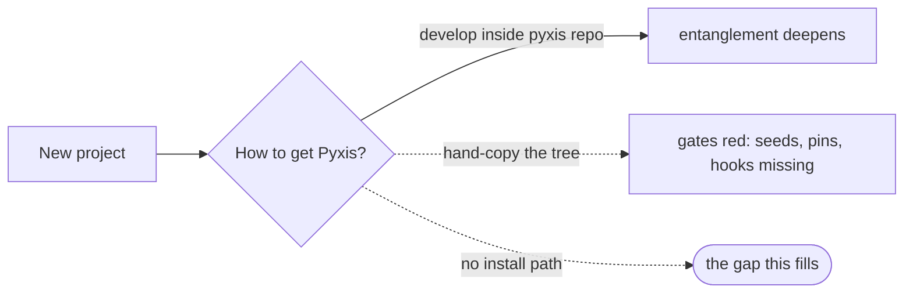

# installer — install the factory into a target repository — PRD

| Field | Value |
|---|---|
| **In one line** | Pyxis becomes a versioned, released product and gains its front door: a one-command, config-driven installer that converges a brand-new repository onto a pinned release — gates, skills, doc system, hooks, tracker, CI — ending green and pipeline-runnable, with existing-repo adoption designed for but deferred. |
| **Relevant-when** | planning, building, or reviewing the installer, the release/distribution machinery, converge/repair/doctor semantics, the release manifest and ownership classes, install-time seeding or wizard knobs; triaging a failed, partial, or drifted install; changing the payload's contents, the repo config schema, or any surface an installed repo consumes (resolver scripts, hooks, skill discovery, CI workflow) |
| **Status** | Draft — problem review pending |
| **Tier** | T3 — a supply-chain execution surface (fetched binaries run on user machines) and a platform contract (the release artifact every installed repo trusts), writing into repositories Pyxis does not own |
| **Owner** | @mdarabi |
| **Approver(s)** | @mdarabi (operator) |
| **Contributors** | — *(solo operator; gate tables record the introducing PR's review, rule 15)* |
| **Informed** | — |
| **Date** | 2026-07-19 created · 2026-07-19 last updated |
| **Appetite** | Program-scale, observable-bounded: the release machinery, the converge core, the five-knob wizard, seeding, doctor, and the e2e proof — on the order of the factory's prior program builds. The cut-line: anything not needed to pass §3.2's targets stays parked (upgrade UX, adoption, org sweep, App flows, telemetry). The complexity valve: when converge semantics threaten to balloon, cut toward simpler verbatim-ownership file classes — never grow merge cleverness. |
| **Target release** | The first public Pyxis release — this feature is what makes "a Pyxis release" exist at all. |
| **Tracking** | — *(the introducing PR)* |
| **Artifacts** | `brainstorm:installer` — the gated brainstorm record (rides this PR) |
| **Template version** | prd-template/v2 |

## 0. Read to rule — the human reviewer's section (~6 min)

*The body is the contract; this section only routes attention — on any conflict the body governs; machines ignore it.*

**Judge these**

| # | The call | Could have gone | If you disagree |
|---|---|---|---|
| 1 | **Converge onto a release** — install, re-run/repair, and (later) upgrade and adopt are one manifest-driven code path | a copy-once scaffolder, converge built later | repair (M2) and the existing-repo follow-up become a second product; idempotency is untested until it hurts → §4.1, G2 |
| 2 | **A single system directory, manifest-marked ownership** — no separate `pyxis-config/` directory in v1 | the two-directory engine/repo-owned physical split the vision's §8 sketches | the vision's extension surface arrives later, and the implementation-verification PRD's manifest home needs re-ruling → §7.2 Q-1 |
| 3 | **Green with skeletons** — install seeds fill-me governing-doc skeletons and ends with gates passing | block install until the human authors vision/principles; or a new advisory gate state | installed repos can sit skeleton-governed indefinitely; the welcome item is the only authorship driver → FR-7, FR-15, R4 |
| 4 | **argus is opt-in, off by default** — the fifth knob | ship the AI Engineer enabled like every other skill | strangers get delegated decision authority by default → FR-16 |
| 5 | **Everything pipeline-serving ships** in the payload | a curated core subset first | payload breadth is parity surface: every shipped skill must behave identically in installed repos → §4.2, §3.3 |
| 6 | **Targets consume released binaries, never Go source** | clone-and-build installs | every adopter inherits a Go toolchain requirement and the module-path coupling → NG-2, FR-17 |
| 7 | **The offline floor is v1 acceptance** — carina + local hooks, zero network after fetch | GitHub-first, offline later | medium-independence stays unproven and the tracker-neutral claim is marketing → FR-13, M1 |

**Sanity-check the numbers** — install ends green at **≤ 5 min p95** on reference runners, dependency install included (NFR-1); exactly **five** asked knobs, everything else defaulted-and-captured (FR-3); **100%** targets on the release-candidate e2e matrix for install success (M1) and drift repair (M2); **zero** telemetry egress (§5.4).

**The author's open questions** — one cross-contract obligation: the implementation-verification PRD homes its verification manifest in a directory this feature deliberately does not create (§7.2 Q-1). The remaining §7.2 rows are design-owned mechanism choices behind settled requirements.

**Skip the rest** — structure/ID/fold correctness → docgate; substance and coherence → the unmanned `/prd-review`; packaging, versioning-scheme, and wiring mechanisms → the technical design (§7.2); supply-chain hardening depth → the design's security section plus the §5.3 drills.

## 1. Summary

- **Problem** — Pyxis has no existence outside its own repository: every capability shipped so far runs only where it was developed, and there is no way to stand up a second factory-managed repo. The product claim — install it and it works — is unproven.
- **For whom** — The operator standing up their next real repos first; shaped throughout for the external open-source adopter (a solo engineer or small team on their own infrastructure).
- **Why now** — The capability mass is here (gates, authoring skills, executor, tracker), the next projects are queued, and every further feature built pre-installer deepens the entanglement with the one repo.
- **Direction** — Pyxis ships as a versioned release: engine binaries plus a manifest-enumerated payload. One command bootstraps a pinned binary; `pyxis init` asks five knobs (or takes flags), converges the repo onto the release per ownership class, seeds skeleton governance docs and valid registries, wires tracker/CI/hooks/CLI surfaces, and ends green with a welcome path into the first feature.
- **Appetite** — The header's budget: release machinery + converge core + wizard + seeding + doctor + e2e proof; everything else parked.
- **Success** — A brand-new repo goes from nothing to all-gates-green and pipeline-runnable in one command at ≤ 5 min p95 (M1); the next real project is created through the installer and ships a feature through the pipeline (M3).
- **Guardrail** — The pyxis source repo's own gates stay green throughout, and every shipped surface behaves identically in an installed repo as in the source repo (§3.3).
- **Top risks** — (1) converge semantics balloon into merge cleverness; (2) a payload surface is secretly source-coupled and breaks only in installed repos; (3) seeded repos rot with skeleton governance docs never authored.

## 2. Problem space

### 2.1 Problem statement

Anyone who wants the factory — starting with the operator's own next projects — has exactly one option today: develop inside the pyxis repository itself. The gates run from their own source tree, the skills assume the repo around them, a fresh repo fails the gates outright for lack of the governed-doc structure, and only one of the engine binaries has ever been released. The compounding value of everything built so far is trapped in one repo, and the cost of doing nothing grows with every feature shipped pre-installer: each one adds more surface that will later need porting.

### 2.2 Users and segments

| Segment | Role and context | Domain exp. | Tech exp. | Key goals | Pain today | Evidence |
|---|---|---|---|---|---|---|
| **P1 (primary)** | The operator starting their next real project repos; runs the installer first, dogfoods the result | master | master | a new repo factory-managed in minutes, nothing hand-copied | no path exists; the factory lives in one repo | `brainstorm:installer#D-2` |
| P2 (design audience) | The external open-source adopter — a solo engineer or 2–5-person team on their own infrastructure, possibly with no GitHub at all | novice–journeyman (of Pyxis) | journeyman–master | install without reading source; sane defaults; no surprise egress or authority | cannot adopt Pyxis at all | `brainstorm:installer#D-2` |
| **Anti-segment** | An org adopting many existing repos in a sweep, or a team on a non-GitHub host (GitLab/Bitbucket/Jira) | — | — | — | served later (WR-5, WR-6), deliberately not by v1 | `brainstorm:installer#D-2` |

### 2.3 Jobs and desired outcomes

| # | When… | I want to… | So I can… | Today's workaround | Evidence |
|---|---|---|---|---|---|
| J1 | I start a new project | stand up a complete, green, factory-managed repository in minutes, deciding tracker, CI mode, CLI surfaces, and argus enablement at install time | run the pipeline from day one | none — develop inside the pyxis repo itself | `brainstorm:installer#D-3` |
| J2 | an installed repo is half-finished, hand-damaged, or drifted from its release | re-run the installer and have it repaired to a converged, green state | trust the installed state without re-creating the repo | none — job goes undone | `brainstorm:installer#D-3` |

### 2.4 Evidence

| Claim | Source | Confidence |
|---|---|---|
| Of the engine binaries under `cmd/`, only docgate has release machinery (tag-triggered matrix + checksums); no installer, Makefile, or goreleaser exists | `brainstorm:installer#F-1` (repo scan) | High |
| A fetch-verify-cache resolver seam already exists for docgate, with a source-mode fallback and a hardcoded release URL | `brainstorm:installer#F-2` (the docgate resolver shim; CI workflow) | High |
| Targets consuming released binaries makes the module-path import surface a non-blocker; the true un-hardcode list is short (branch refs, label default, one trailer constant) | `brainstorm:installer#F-3` (repo grep) | High |
| A fresh empty repo fails docgate absent the governing/system doc set; rollups are validly absent pre-first-ship | `brainstorm:installer#F-4` (gate checks; repo config) | High |
| Tracker selection is flag-only today; `carina init` is the only installer-adjacent verb; no doctor verb exists anywhere | `brainstorm:installer#F-5` (cmd argument-parsing scan) | High |
| `pyxis-config/` is contracted (vision §8; the implementation-verification PRD's manifest home) but absent on disk | `brainstorm:installer#F-6` | High |
| The cross-CLI skill surface is symlink-solved (vendor dirs are pointers into the system tree, AP-25); the review runtime is vendored un-bundled with lockfile-pinned deps | `brainstorm:installer#F-7` | High |
| The installable engine surface in the system tree is ~56 policy/template/skill/script files plus vendor trees; hooks activate via a manual one-time git config step | `brainstorm:installer#F-8` | High |

### 2.5 The journey today

| Phase | User does | User feels / pain | Frontstage | Backstage |
|---|---|---|---|---|
| Want a new factory-managed repo | searches for an install path | there is none | README describes the factory, not how to get it | all capability lives in one repo's tree |
| Attempt | develops inside the pyxis repo, or hand-copies the system tree + binaries | entanglement or guesswork | a foreign repo's conventions | gates fail: no seeds, no config, no hooks, unreleased binaries |
| Give up or entangle | parks the project in the monorepo | the factory cannot leave home | — | value compounds in one repo only |

### 2.6 Opportunity and why now

- **Size** — Every future repo, internal or external, passes through this front door; for an open-source factory, installability is the adoption funnel's first step.
- **Alternatives users have** — Develop inside the pyxis repo (entanglement); hand-copy the tree (unpinned, gate-red, unrepairable); fork the whole repo (inherits everything, updates never).
- **Why us / strategic fit** — The medium-independence posture (AP-1) and the vendor-neutral agent surface (AP-25) were built for exactly this; the resolver seam and release workflow are proven in miniature on docgate.
- **Why now** — The capability mass justifies porting; the next projects are queued and become the dogfood; delay makes every subsequent feature more expensive to free.
- **Cost of doing nothing** — The factory's value stays trapped in one repo; the vision's "engineers simply install it" (§2) remains unproven prose.

**Decision:** Problem gate — sign before §3–§4 are read in review.

| Reviewer | Role | Date | Verdict |
|---|---|---|---|
| @mdarabi | operator (via the introducing PR's review) | — | — |

## 3. Goals, metrics, and guardrails

### 3.1 Goals as falsifiable hypotheses

| # | We believe that… | Will result in… | Measured by… |
|---|---|---|---|
| G1 | a one-command, five-knob converge installer | new repos factory-managed from day one, nothing hand-copied | M1, M3 |
| G2 | converge-not-copy semantics (manifest + ownership classes) | repair today — and upgrade/adopt later — as the same code path, not new products | M2 |
| G3 | distribution-grade releases (binaries + payload + manifest + checksums) | every capability Pyxis ships is installable anywhere, not resident in one repo | M1 |
| G4 *(qualitative)* | stranger-shaped defaults, docs, and refusals | an external adopter completes an install unaided | usage verbatims once external adopters exist |

### 3.2 Goals → signals → metrics

| Metric | Goal | Signal | Baseline | Target (at checkpoint) | Feeds from |
|---|---|---|---|---|---|
| M1 (primary) | G1, G3 | a fresh repo reaches all-gates-green + doctor-clean via one command | 0 (no install path exists) | 100% of the release-candidate e2e matrix combos (tracker × CI mode × platform, offline included) | EVT-1, EVT-3 |
| M2 | G2 | injected drift and damage classes repaired to green by re-run | n/a | 100% of the enumerated drift classes — engine-verbatim file tampered or deleted · generated file stale or deleted · repo-owned file schema-invalid (named, never rewritten) · interrupted partial install (UB-5) — repaired or refused-by-name on the same matrix | EVT-2 |
| M3 | G1 | a real project repo is created through the installer and a feature passes through the pipeline there with zero hand-copying | 0 | 1 repo, at the checkpoint "the next new project starts" | measurement plan: the DOD-8 demo record (the repo's pipeline artifacts + merged proposal); EVT-1 certifies the install precondition |

### 3.3 Guardrails and decision rule

| Guardrail metric | Threshold | Action if breached |
|---|---|---|
| Source-repo health | any required check on the pyxis repo's mainline red from release-machinery or plumbing changes | halt installer work until green |
| Installed-behavior parity | any divergence in gate verdicts or skill behavior between the source repo and an installed repo on identical fixtures | block the release |
| Unverified execution | any fetched artifact executed without checksum verification, on any path | critical defect; block the release |

**Ship rule (pre-registered):** M1 = 100% AND M2 = 100% on the release-candidate matrix AND all guardrails clean → cut the release and proceed to the M3 dogfood; any guardrail breach → no release until closed.

### 3.4 Non-goals and waiting room

| ID | Non-goal | Why refused |
|---|---|---|
| NG-1 | Authoring governing-document content — the installer writes skeletons only, never vision/principles substance | governing docs are human-authored inputs; generated governance is counterfeit (`brainstorm:installer#D-8`) |
| NG-2 | Distributing Go source to targets, or any clone-and-build install path | targets would inherit a toolchain requirement and module coupling; binaries are the contract (`brainstorm:installer#F-3`, D-1) |
| NG-3 | Merge intelligence in converge — three-way merges or conflict resolution inside repo-owned files | the D-5 complexity valve: ownership classes stay simple; repo-owned content is never rewritten (`brainstorm:installer#D-5`) |

| ID | Waiting room | Revisit when / intended version |
|---|---|---|
| WR-1 | Existing-repo adoption (the designed-for follow-up: converge pointed at a non-empty tree, epoch baselines, path honoring) | the first real existing repo that wants the factory (`brainstorm:installer#O-3`) |
| WR-2 | Upgrade UX — channels, changelogs, migration notes (v1 is structurally upgrade-ready: pins + converge) | the first release that changes installed files (`brainstorm:installer#O-2`) |
| WR-3 | Self-converging the pyxis repo onto its own release manifest (instance #0) | external installs have proven converge (`brainstorm:installer#O-5`) |
| WR-4 | Uninstall (conservative off) | first real request; FLEET-6 parity (`brainstorm:installer#O-6`) |
| WR-5 | Org-wide adoption sweep (SCAF-4's successor) | org-scale adoption demand (`brainstorm:installer#O-1`) |
| WR-6 | Non-GitHub hosts and trackers (GitLab/Bitbucket/Jira/Linear) | the corresponding adapters exist (`brainstorm:installer#O-1`) |
| WR-7 | GitHub App creation / bot-identity wiring (installed workflows run on the default `GITHUB_TOKEN`) | the org-installer program (`brainstorm:installer#O-4`) |
| WR-8 | Telemetry, update channels, and the autonomy-level dial (config keys reserved, never asked) | the platform-loop program (vision §9) (`brainstorm:installer#O-7`) |
| WR-9 | Non-`main` default branch support (the branch is captured in config; only `main` is honored in v1) | first adopter demand (`brainstorm:installer#D-6`) |
| WR-10 | Honoring non-default captured paths (v1 captures every path in config and refuses non-default values fail-closed) | the existing-repo follow-up (WR-1), which needs real path flexibility (`brainstorm:installer#D-6`) |

## 4. Solution space

### 4.1 Approach and alternatives considered

Pyxis becomes a **versioned, released product**, and installing becomes **converging a repository onto a pinned release**. A release ships every engine binary per supported platform, the payload (the system tree: skills, templates, authoring guides, scripts, hooks, review runtime), and a **release manifest** enumerating every installed file with a hash and an **ownership class** — engine-verbatim (converge repairs it byte-exact), repo-owned (converge validates, never rewrites), generated (converge regenerates). One curl-able bootstrap line fetches the pinned `pyxis` binary, verifies it, and hands off to `pyxis init`: five knobs asked (or flags), answers persisted into the repo config together with every path and pin the engine consumes, the tree converged, governance skeletons and registries seeded, tracker/CI/hooks/CLI surfaces wired — ending green, with a welcome path into authoring the vision and the first feature. Re-running any of it is the same converge: idempotent on a clean repo, repairing on a damaged one. `pyxis doctor` is the read-only face of the same manifest.

| Option | Sketch | Why not chosen |
|---|---|---|
| A (chosen) | versioned release + manifest converge; the wizard is the front end | — |
| B | copy-once scaffolder now, converge/manifest later | rebuilds itself the day upgrade or adoption arrives; idempotency and repair untested until then (`brainstorm:installer` Framings) |
| C | portability-program-first: un-hardcode everything, ship the installer as its acceptance harness afterwards | slowest route to any usable install; the same items land as this feature's acceptance criteria instead (`brainstorm:installer` Framings) |
| Do nothing | — | the factory stays trapped in its own repo (§2.6) |

### 4.2 Scope perimeter

- **In (plan of record)** — the release artifact set (binaries per platform + payload + manifest + checksums) and its pipeline; the bootstrap line; `pyxis init` with the five knobs (tracker gh|carina · CI mode local|actions|both · GitHub wiring depth incl. protection level · CLI surfaces auto|explicit · argus on|off), full flag parity, and complete config capture (paths, pins, branch); converge/repair with ownership classes; seeding (skeletons, registries, taxonomy dirs, hooks activation, `carina init`, workflow push, labels/protection); pinned-binary resolution in installed repos; the doc-review runtime as a hard dependency; the offline floor; `pyxis doctor`; the welcome path; the preview mode; the e2e matrix.
- **Future (believed next, not committed)** — existing-repo adoption, upgrade UX, self-converge of the pyxis repo, uninstall, org sweep, other hosts, App wiring, the platform loop, non-default branches, and path honoring (WR-1..WR-10).
- **Out** — governing-content generation, source distribution, converge merge intelligence (mirrors §3.4 NG rows).

### 4.3 Experience: flows and states

*A terminal product: "states" are the CLI's reporting states. Accessibility: n/a — terminal tooling, no UI pages/processes in scope. Localization: n/a — developer-facing, English-only v1.*

**Flow F1 — fresh install, GitHub mode (serves J1)**

| Step | User does | System responds | States covered | Design |
|---|---|---|---|---|
| 1 | runs the bootstrap line in an empty directory | fetches the pinned binary, verifies checksum, hands off to init | ideal · error (checksum, network, platform) | tech design |
| 2 | answers the five knobs (or none: flags) | records answers; reports the converge plan | ideal · error (dirty dir, prereqs missing) | tech design |
| 3 | waits ≤ 5 min | converges payload, seeds docs/registries, installs deps, activates hooks, wires labels/protection/workflow, folds and gates | ideal · partial (permission hand-off) · error | tech design |
| 4 | reads the end report | green confirmation + welcome next-steps + welcome work item | ideal | tech design |

**Flow F2 — offline install, carina mode (serves J1; proves FR-13)** — identical shape with zero network after artifact fetch: tracker = local store via `carina init`, CI = hooks only, no GitHub calls of any kind.

**Flow F3 — repair (serves J2)** — `pyxis init` (or the repair verb) on a damaged install: reports the drift set by ownership class, repairs engine-verbatim and generated files, refuses to touch repo-owned content, ends green or names what it cannot repair.

**Flow F4 — doctor** — read-only: manifest drift + environment health (deps present, hooks active, tracker reachable, CLI surfaces intact, skeletons still unauthored as an advisory), zero mutations.

- **Empty** — bootstrap into an empty dir is the ideal path; where no git repository exists init initializes one, and on a repo with no commits it creates the initial structure and first commit-able tree.
- **Partial** — a permission-limited run (e.g. no admin for protection) completes every permitted step and emits a copy-paste hand-off for the remainder (UB-4).
- **Error** — every refusal names the cause and the remediation; no partial write is left behind un-reported (UB-1, UB-5).

### 4.4 Scenarios

**The operator's next project.** A new product idea deserves its own repo. One bootstrap line, five answers (GitHub tracker, both CI modes, auto CLI detection, argus on), under five minutes: labels and protection set, docs-gate workflow live, hooks active, welcome issue open. The first `/feature-brainstorm` runs that afternoon; nothing was copied from the pyxis repo.

**The offline adopter.** An engineer on a locked-down network fetches the release artifact once, runs init with carina + local-CI flags, argus off. No GitHub account is ever touched; the gates run in hooks; work items live in the local store. The repo is exactly as governed as the operator's.

**Death mid-install.** The network dies during dependency install. The tree holds a half-converged state; the user re-runs init; converge reports what exists, completes the remainder, ends green — no cleanup archaeology (UB-2, UB-5).

**The hand-damaged repo.** Someone "cleans up" a hook shim and edits a shipped template. Doctor names both drifts; repair restores them byte-exact from the manifest; the repo's own config and docs are untouched (J2, FR-5).

**Decision:** Solution gate — zero TBDs may pass.

| Reviewer | Role | Date | Verdict |
|---|---|---|---|
| @mdarabi | operator (via the introducing PR's review) | — | — |

## 5. System requirements

### 5.1 Functional requirements

| ID | Requirement (EARS) | Rationale | Priority | Risk | Fit criterion | Verify | Traces to |
|---|---|---|---|---|---|---|---|
| FR-1 | When a release is cut, the release pipeline shall publish a versioned artifact set: every engine binary for every supported platform, the payload archive, the release manifest, and checksums for all of them. | the release is the product's unit of existence | Must | med | for each supported platform the full set resolves; every checksum verifies; the manifest enumerates every payload file with ownership class + hash | Test | G3, F1 |
| FR-2 | When the documented bootstrap command runs on a supported platform, it shall fetch the pinned `pyxis` binary, verify its checksum, and hand off to init — executing nothing that failed verification. | the front door; supply-chain floor | Must | high | on clean darwin/linux runners the bootstrap yields a verified binary and reaches init; a tampered artifact is refused with zero execution | Test | G1, F1, UB-3 |
| FR-3 | When `pyxis init` runs interactively, it shall elicit exactly the five knobs (tracker · CI mode · GitHub wiring depth · CLI surfaces · argus enablement), each with a recommended default, and persist every answer plus every path, pin, and branch value the engine consumes into the repo config. | config-driven install; complete capture, no implicit paths | Must | med | post-init config contains the five knob keys and the complete path/pin/branch key set, closed-schema valid; no sixth question is asked | Test | G1, J1, F1 |
| FR-4 | Where flags or an answers file are provided, init shall complete with zero interactive prompts. | automation and CI parity (SCAF-1 parity) | Must | med | the entire e2e matrix runs flag-only with zero prompts | Test | G1, F1, F2 |
| FR-5 | When init or repair runs, the system shall converge the repository onto the pinned release manifest per ownership class: writing engine-verbatim files byte-exact, regenerating generated files, and validating repo-owned files against their closed schema without rewriting them. | converge is the product's core semantic | Must | high | injected engine-file drift is repaired byte-exact; repo-owned edits survive byte-exact; generated files regenerate; validation failures are named | Test | G2, J2, F3 |
| FR-6 | When init or repair re-runs on a converged repository, it shall change nothing and report convergence. | idempotency is the repair proof's floor | Must | med | a second run produces zero file mutations and a "converged" report | Test | G2, J2, F3 |
| FR-7 | When init runs in an empty target — a directory holding no tracked content; where no git repository exists, init shall initialize one — it shall seed the governed-document skeletons the gates require, the empty-but-valid registries and taxonomy directories, and no governing content beyond template structure and guidance. | green-on-install without counterfeit governance; one command from nothing (D-4) | Must | high | post-init docgate passes from both a bare directory and a git-initialized empty repo; seeded skeletons contain only template-derived structure/guidance (diffed against the shipped templates) | Test + Inspection | G1, NG-1, F1 |
| FR-8 | When init completes, the installed repository's hook-run gate shall pass locally. | install ends green — the D-4 invariant | Must | high | gate exit 0 in every matrix combo immediately post-init | Test | G1, M1, F1, F2 |
| FR-9 | When init completes, the git hooks shall be active without further manual steps and shall enforce the same checks as the source repo's hooks. | today's manual hooksPath step disappears | Must | med | a gate-violating commit is rejected locally in a fresh installed repo | Test | G1, F1 |
| FR-10 | When tracker wiring runs, the system shall initialize the local work-item store where carina is chosen, and where GitHub is chosen shall ensure the routing labels and the selected branch-protection level with the gate's required check — performing only its declared operation set against the user's account. | the tracker knob materialized; bounded authority | Must | high | carina: the store answers a query post-init; GitHub: labels exist, protection matches the chosen level exactly, and the audit log shows only declared operations | Test | G1, J1, F1, ABUSE-3 |
| FR-11 | When init completes, the chosen agent-CLI surfaces shall be materialized as pointers into the payload, with every shipped skill discoverable and invokable from each chosen surface. | CLI plurality survives installation (AP-25) | Must | med | for each chosen surface, skill discovery resolves and an invocation smoke test passes | Test | G1, F1 |
| FR-12 | When init completes, the review-surface runtime dependencies shall be installed from the shipped lockfile — a hard dependency with no opt-out knob. | doc-review is load-bearing for every authoring stage | Must | med | the render and driver smoke tests pass offline immediately post-init | Test | G1, F1, F2 |
| FR-13 | Where carina and local-CI are chosen, each of the following shall complete with zero network operations after the release artifact fetch: init, converge/repair, doctor, pinned-binary resolution, the hook-run gate, and skill invocation from a wired CLI surface. | the offline floor — medium-independence proven | Must | high | each enumerated behavior is exercised in a network-denied environment and completes; any network operation observed fails the run | Test | G1, M1, F2 |
| FR-14 | When `pyxis doctor` runs, it shall report manifest drift by ownership class and environment health (dependencies, hooks, tracker reachability, CLI surfaces, unauthored skeletons as advisory) while performing zero mutations. | the read-only face of converge | Must | med | each injected drift class is detected and named; a clean install reports healthy; the filesystem diff across a doctor run is empty | Test | J2, F4 |
| FR-15 | When init completes, the system shall emit next-steps and, where a tracker is wired, create a welcome work item directing the human to author the governing documents and run the first feature-definition stage. | the authorship duty travels with the repo (SCAF-5 parity) | Must | low | the welcome item exists with the authorship pointers; next-steps are printed in every mode | Test | G1, F1, R4 |
| FR-16 | While the argus knob is off, the installed repository shall carry no active delegated decision authority: the argus skill refuses with a pointer to enablement, and no authority contract exists. | autonomy is opted into, never defaulted | Must | high | knob-off: the skill refuses and no authority contract file exists; knob-on: the surfaces are present at the floor tier | Test | G1, F1 |
| FR-17 | The installed repository shall resolve every engine binary by the config-pinned version, with checksum verification before execution. | pinned, verifiable distribution | Must | high | the installed resolver fetches only the pinned version and refuses a checksum mismatch with zero execution | Test | G3, F3, UB-3 |
| FR-18 | While a captured path key differs from its shipped default, the engine shall refuse the operation with a named not-yet-configurable error rather than silently ignoring the key. | captured config must never lie (WR-10 holds the honoring) | Must | med | every non-default path key produces the named refusal; zero silent-ignore paths exist for captured keys | Test | F3, UB-8 |
| FR-19 | When init or converge runs with the preview flag, the system shall report every write and external operation it would perform and perform none of them. | judgment before mutation (SCAF-1 dry-run parity; the adoption groundwork) | Must | med | preview output enumerates the exact write/operation set; the filesystem and remote state are untouched | Test | J2, F3 |
| FR-20 | When the first push occurs in a repository installed with actions CI mode, the CI workflow's required check shall pass. | install ends green extends to the remote gate | Must | high | github-mode matrix combos: the first push's required check completes green | Test | G1, M1, F1 |
| FR-21 | The installed repository's tooling shall never build an engine binary from source; a missing pinned artifact is a named failure, never a toolchain invocation. | targets consume binaries, never source (NG-2) | Must | high | with the pinned artifact removed, resolution fails by name and no Go toolchain is invoked | Test | G3, NG-2, F3 |
| FR-22 | Where an artifact-source override is configured, resolution shall fetch from the override with the same checksum verification, and preview and doctor shall report the override's presence. | fork/mirror distribution without weakening the supply-chain floor | Must | high | override-configured fixtures fetch from the override, still refuse checksum mismatches, and surface the override in preview and doctor output | Test | G3, F3, F4 |

*Priority bar: every row above is Must — the release does not ship without it; the deliberately deferred rows live in §3.4's waiting room instead of a Should/Could tail.*

**Non-regression (NR-n)**

| ID | Existing behavior protected | Why protected | Risk | Fit criterion | Verify | Traces to |
|---|---|---|---|---|---|---|
| NR-1 | The pyxis source repo's developer flow: source-mode resolution, existing hooks, the existing release workflow, and all required checks stay working | the source repo is not an installed repo (WR-3) and must not be destabilized | high | the source repo's full gate + test suite is green on every installer change; source-mode resolution still works in the source tree | Test | §3.3 |
| NR-2 | Gate semantics: an installed repo's checks produce the same verdicts as the source repo's on identical fixtures | parity is the payload's contract | high | the parity fixture suite shows zero verdict divergence source-vs-installed | Test | §3.3, G3 |
| NR-3 | Existing executor and tracker flag interfaces keep working; the captured config defaults change no current behavior | config capture is additive, not a breaking re-plumb | med | existing executor/tracker test suites pass unchanged with the new config present | Test | FR-3 |

### 5.2 Unwanted behavior and failure handling

| ID | If… | Then the system shall… | User sees | Priority | Risk | Fit criterion | Verify | Traces to |
|---|---|---|---|---|---|---|---|---|
| UB-1 | init targets a non-empty or dirty directory (v1 scope is new repos) | refuse before any write, enumerating the conflicting paths | a named refusal + the conflict list | Must | high | zero writes occur; the conflict set matches the injected state | Test | FR-5, WR-1 |
| UB-2 | the network fails mid-fetch or mid-dependency-install | trust no partial artifact, leave a re-runnable state, and converge to the same end state on re-run | a named failure; re-run completes | Must | high | after an injected mid-flight failure, re-run ends green with no manual cleanup | Test | FR-6, F1, F2 |
| UB-3 | any fetched artifact fails checksum verification | refuse execution, name expected vs actual, and exit non-zero | a checksum refusal | Must | critical | tampered binary, payload, and dependency fixtures are all refused with zero execution | Test | FR-2, FR-17, §3.3 |
| UB-4 | the GitHub credential lacks a permission (e.g. admin for protection), or a transient API failure (rate limit, server error) interrupts wiring | complete every permitted step, retry transient failures within a stated bound, and emit a copy-paste hand-off for the remainder, reporting partial | a partial report + the hand-off block | Must | high | the permitted subset is applied; a 429 fixture retries then hands off; the hand-off completes the rest verbatim (SCAF-2 two-phase parity) | Test | FR-10, F1 |
| UB-5 | the process is killed mid-install | leave a state from which re-run converges to the identical end state | re-run completes green | Must | high | kill-at-random-step fixtures all converge on re-run | Test | FR-6, F3 |
| UB-6 | the repo config violates its closed schema or carries unknown keys | fail closed naming every offending key | named schema errors | Must | med | every seeded violation is named; nothing proceeds | Test | FR-3 |
| UB-7 | a runtime prerequisite is missing (git, or the node runtime for the review surface) | name the missing prerequisite and its remediation, claim no success, and leave doctor red | a named prerequisite failure | Must | med | each removed prerequisite produces its named remediation; doctor reports it | Test | FR-12, FR-14, F2 |
| UB-8 | a captured path key is set to a non-default value | refuse with the named not-yet-configurable error (never a silent ignore, never a partial honor) | the named refusal citing the key | Must | med | every captured path key exercised non-default refuses by name | Test | FR-18, WR-10, F3 |
| UB-9 | an argument beginning with `-` occupies a positional slot, or an unknown flag is passed, on any `pyxis` verb | refuse with a named usage error before performing any write or external operation | the usage refusal | Must | high | misparse fixtures (flag-after-positional, unknown flag) on init/converge/doctor refuse with zero writes and zero external operations, in interactive and flag-only modes | Test | FR-4, FR-19; incident I3 |
| UB-10 | git user identity (user.name / user.email) is unset at every level when init must create a commit | establish a repo-local identity from the wizard's answers, or refuse with a named remediation — never attempt a commit that will fail | identity established, or the named remediation | Must | med | identity-unset fixtures either produce a working repo-local identity or the named refusal; no failed-commit state is left behind | Test | FR-7, FR-8, F1, F2 |

### 5.3 Permissions and abuse cases

*Access: init runs under the invoking user's identity. GitHub operations use their ambient credential for the declared operation set only; the offline path needs no credential at all. Nothing is stored by the installer beyond the repo's own files.*

| Function / data | User with repo admin | User with write-only | No GitHub credential |
|---|---|---|---|
| converge files, seed, hooks, carina, CLI surfaces | full | full | full (offline path) |
| labels + workflow push | full | full | none (skipped or hand-off) |
| branch protection | full | hand-off block (UB-4) | none |

| ID | Actor and intent | Vector | Impact | Severity | Mitigated by | Verify |
|---|---|---|---|---|---|---|
| ABUSE-1 | an attacker serving a spoofed artifact (poisoned mirror, MITM, typo-squatted override) | the artifact-source override or a compromised fetch path | arbitrary code on the user's machine | critical | FR-2/FR-17/UB-3 (checksum before any execution); the override is explicit config, loudly reported in preview and doctor | drill: spoofed-source fixtures are refused on every fetch path |
| ABUSE-2 | a malicious PR to an installed repo edits engine-verbatim files to smuggle behavior into future agent runs | installed repos trust their installed system tree | altered gates/skills act with the repo's authority | high | FR-14 (doctor names the drift by class) + FR-5 (repair restores byte-exact); manifest hashes make tampering detectable | drill: a tampered shipped file is detected and repaired |
| ABUSE-3 | the installer itself over-reaching on the granted GitHub credential | any API call beyond the declared wiring set | unwanted account mutation; trust collapse for an open-source installer | high | FR-10's declared-operation bound + EVT-4's audit record; preview (FR-19) shows the operation set before it runs | Test: the recorded operation set equals the declared set in every matrix combo |
| ABUSE-4 | an attacker serving a malicious bootstrap script (distinct from a tampered binary — the shell executes fetched bytes before any binary verification can run) | bootstrap URL substitution or interception ahead of the checksum step | arbitrary shell on the user's machine | critical | the documented bootstrap line is a pinned HTTPS URL; the shim fetches the checksum set before executing any fetched byte beyond itself; the getting-started docs state the HTTPS floor and the pinned-URL pattern | drill: a tampered bootstrap-script fixture is refused; DOD-5's drill set includes it |

### 5.4 Data

| Entity / field | Meaning | Source of truth | Retention | Integrity rules | Privacy class |
|---|---|---|---|---|---|
| repo config | the five knob answers + every captured path/pin/branch | the installed repo's git | repo lifetime | closed schema; unknown keys fail (UB-6) | internal |
| release manifest (installed copy) | the pinned release's file inventory: hash + ownership class per file | the release artifact; copied into the repo at converge | until next converge | converge/doctor read it; never hand-edited | public (ships in the release) |
| seeded skeletons + registries | the governed-doc structure the gates require | the installed repo's git | repo lifetime | content is the human's; structure from templates (NG-1) | internal |
| local work-item store | carina's files-as-truth store, when chosen | the installed repo / its store root | repo lifetime | carina's own invariants | internal |

- **Migration** — none: v1 targets empty repositories (UB-1, WR-1).
- **Parallel-run / cutover** — n/a (nothing pre-exists in the target).
- **Rollback** — every write is in the target repo's git; un-merging or reverting the install commit(s) restores the prior state. The bootstrap binary cache is disposable.
- **Decommission** — WR-4 (uninstall); until then, removal is documented as git revert + cache delete.
- **Privacy check** — no personal or sensitive data is created or read; no DPIA trigger.
- **Egress** — **zero telemetry** (WR-8: keys reserved, nothing sent). Outbound traffic is exactly: release-artifact fetch (in), dependency install from the pinned lockfile (in), and — GitHub mode only — the declared wiring operations (out). The offline combo performs none of the above after fetch (FR-13).

### 5.5 Interfaces and integrations

| Interface | Direction | Purpose | Contract | Failure modes | Owner |
|---|---|---|---|---|---|
| release artifact host (GitHub Releases; overridable source) | in | fetch binaries + payload | versioned URLs + checksums (FR-1, FR-17) | unreachable → named failure, re-runnable (UB-2); tamper → refuse (UB-3) | this feature |
| GitHub API (labels, protection, workflow, welcome item) | out | the wiring knob | the declared operation set (FR-10) | missing permission → hand-off (UB-4); absent credential → skip/offline | this feature |
| git (hooks path, initial structure) | both | hook activation + the installed tree | hooks enforce the same checks as the source repo (FR-9) | missing git → UB-7 | this feature |
| agent CLI surfaces (claude/codex/cursor/opencode dirs) | out | skill discovery in installed repos | pointers into the payload (FR-11, AP-25) | absent CLI → auto-detect skips; explicit choice materializes regardless | this feature |
| node runtime + pinned lockfile | in | the review-surface hard dependency (FR-12) | lockfile-pinned install, un-bundled vendor | absent node → UB-7 | this feature |

### 5.6 Non-functional requirements

| ID | Area | Requirement | Fit criterion | Verify |
|---|---|---|---|---|
| NFR-1 | Performance | Init shall complete, dependency install included, within the install budget on reference CI runners. | p95 ≤ 5 min, p99 ≤ 8 min across the release-candidate matrix runs | Test |
| NFR-2 | Platforms | The release and installer shall support the same platform set the existing release workflow builds. | every matrix combo passes on darwin+linux × arm64+amd64 | Test |
| NFR-3 | Security | The system shall execute no fetched artifact that has not passed checksum verification, on any code path. | the UB-3/ABUSE-1 drill set shows zero unverified executions | Test |
| NFR-4 | Operability | Every refusal and failure shall name its cause and remediation; doctor shall classify every failure state named in §5.2. | each UB-1..UB-10 fixture's output contains its named remediation; doctor classifies each seeded UB state | Test + Inspection |
| NFR-5 | Maintainability | Installer logic shall be Go; shell shall be limited to the bootstrap line and hook shims, each a locate-and-delegate shim within the repo's shell floor. | inspection of the shipped surface finds no logic-bearing shell beyond the admissible shims | Inspection |
| NFR-6 | Cost | Init, converge/repair, and doctor shall spend zero model inference. | no model call is observed in any e2e run | Test |

### 5.7 Instrumentation — the tracking plan

*Local, structured events only (slog); they land in the run's log and CI artifacts. Nothing leaves the machine (§5.4 Egress; WR-8).*

| ID | Event name | Fires when | Properties (typed) | Source | Feeds |
|---|---|---|---|---|---|
| EVT-1 | install_completed | init ends green | version: str, tracker: enum, ci_mode: enum, cli_surfaces: str[], argus_enabled: bool, duration_ms: int, platform: str | pyxis CLI | M1, M3 |
| EVT-2 | converge_run | any converge finishes | mode: enum(install,repair,noop,preview), repaired: int, drift_classes: str[] | pyxis CLI | M2 |
| EVT-3 | doctor_run | doctor finishes | healthy: bool, findings: str[] | pyxis CLI | M1 |
| EVT-4 | wiring_applied | GitHub wiring finishes | operations: str[], partial: bool | pyxis CLI | ABUSE-3 audit |
| EVT-5 | welcome_emitted | the welcome path fires | tracker_ref: str | pyxis CLI | — |

### 5.8 Definition of Done

| ID | Done criterion | Source | Verify | Required evidence | Blocking? |
|---|---|---|---|---|---|
| DOD-1 | All Must FRs pass their fit criteria | FR-1..FR-22 | Test | CI run link | yes |
| DOD-2 | No non-regression row broken | NR-1..NR-3 | Test | suite result | yes |
| DOD-3 | All UB rows handled as specified | UB-1..UB-10 | Test | failure-injection suite | yes |
| DOD-4 | The release-candidate e2e matrix (tracker × CI mode × platform, offline combo included) is 100% green, at the install budget | M1, M2, NFR-1, NFR-2 | Test | matrix run link | yes |
| DOD-5 | Supply-chain posture proven: checksum refusal on every fetch path; declared-operation audit clean | UB-3, UB-9, ABUSE-1..4, NFR-3 | Test + drill | drill records | yes |
| DOD-6 | Installed-behavior parity clean | NR-2, §3.3 | Test | parity suite result | yes |
| DOD-7 | Getting-started documentation exists and a cold walkthrough completes every step as written | G4 | Human judgment — @mdarabi; rubric: every documented step executes verbatim on a clean machine, zero undocumented steps needed | walkthrough record | yes |
| DOD-8 | Dogfood: the next real project repo is created through the installer and a feature passes the pipeline there | M3, G1 | Demo | the repo + its pipeline artifacts | no — post-release checkpoint (§6.7); the release ships on DOD-1..7 |

### 5.9 AI behavior and evals

Skipped: the installer's verbs are deterministic (NFR-6 — zero model inference); no model-driven behavior ships in this feature. The payload's skills carry their own PRDs' evals.

## 6. Delivery

### 6.1 Phasing and milestones

| Phase | Purpose | Scope | Exit criterion |
|---|---|---|---|
| Release machinery | make "a Pyxis release" exist | FR-1, FR-2, FR-17 (artifact set, bootstrap, pinned resolution) | a tagged release's artifact set fetches, verifies, and runs on all platforms |
| Converge core | the manifest semantics | FR-5, FR-6, FR-19, doctor (FR-14) | offline-fixture converge/repair/preview/doctor all green |
| Init end-to-end | the product face | FR-3, FR-4, FR-7..FR-13, FR-15, FR-16 | the full e2e matrix green at the install budget (DOD-4) |
| Dogfood | prove it on a real repo | M3 | DOD-8 recorded on Tracking |

### 6.2 Dependencies

| Dependency | Type | Needed by | Status | Owner |
|---|---|---|---|---|
| GitHub Releases (artifact hosting) | vendor | Release machinery | available (docgate precedent) | this feature |
| darwin + linux CI runners for the matrix | system | Init end-to-end | available; darwin runner cost noted (R3) | this feature |
| node runtime on target machines | user prerequisite | Init end-to-end | documented prerequisite (UB-7) | user |
| GitHub credential for wiring (optional) | user prerequisite | GitHub-mode installs | user-provided (UB-4) | user |
| parked technical constraints handed to the design | design input | design gate | `brainstorm:installer#P-1..#P-8` | technical design |

### 6.3 Risks, assumptions, and rabbit holes

| # | Risk / assumption / rabbit hole | Likelihood | Impact | Mitigation or test | Owner |
|---|---|---|---|---|---|
| R1 | converge semantics balloon (merge cleverness, conflict UX) | M | H | NG-3 + the appetite valve: ownership classes only; repo-owned is never rewritten | design |
| R2 | a payload surface is source-coupled and breaks only in installed repos (resolver fallbacks, path assumptions, toolchain leaks) | H | H | the parity suite (NR-2) + the portability audit of every skill invocation line (`brainstorm:installer#P-8`); the offline combo catches network/toolchain leaks | design |
| R3 | darwin CI cost/flakiness undermines the matrix | M | M | full matrix on linux; darwin as a smoke tier per release candidate | design |
| R4 | installed repos rot with skeleton governance never authored | M | M | FR-15's welcome item + FR-14's advisory finding keep it visible; accepted residual — NG-1 forbids stronger coercion | product |
| R5 | dependency install at init time varies with registry health (the lockfile pins versions, not availability) | M | M | UB-2 re-runnability; the offline combo documents the pre-fetched alternative | design |
| R6 | the five knobs prove insufficient for a real adopter (a sixth decision emerges) | M | M | config keys are reserved ahead of knobs (WR-8, WR-9); a new knob is an amendment, not a redesign | product |

### 6.4 Release criteria

| Lens | Criterion | Evaluated by |
|---|---|---|
| Functionality | all Must FRs pass their fit criteria; the matrix is 100% green | CI / e2e suite |
| Usability | the cold getting-started walkthrough completes as written (DOD-7) | operator walkthrough |
| Reliability | UB drills pass; kill/re-run converges; repair restores byte-exact | failure injection |
| Security | zero unverified execution; declared-operation audit clean; drift detectable | drills + audit |
| Supportability | every failure names its remediation; doctor classifies all seeded states | inspection |

### 6.5 Rollout and reversibility

- **Flag** — none: installation is invocation-gated (nothing happens to anyone who does not run it).
- **Kill switch** — pull or deprecate the release; the bootstrap fetches only pinned, checksummed versions, and a prior pin remains installable (FR-17). An installed repo is unaffected until it chooses to converge to a newer pin.
- **Experiment** — none.
- **Cutover/migration steps** — none (empty-repo scope).

| Stage | Audience | Minimum evidence | Advance when | Roll back when |
|---|---|---|---|---|
| RC | CI only | the full e2e matrix + drills | DOD-1..6 green | any §3.3 breach |
| Dogfood | operator's next real repo | M3's checkpoint evidence | DOD-8 recorded | any §3.3 breach |
| Public | README + getting-started announce | dogfood held; docs walked (DOD-7) | operator go | supply-chain guardrail breach |

### 6.6 Launch readiness

| Area | Item | Owner | Status |
|---|---|---|---|
| Docs | getting-started for a fresh repo (bootstrap → five knobs → first feature) | @mdarabi | ☐ |
| Support | remediation reference: the UB refusals + doctor findings, as user-facing text | @mdarabi | ☐ |
| Platform | supported platforms + prerequisites note (git + committer identity, node) | @mdarabi | ☐ |
| Legal & privacy | license and notice files ride the release artifacts; the zero-egress posture stated in docs | @mdarabi | ☐ |
| Marketing & comms | README install section replaces the develop-in-repo framing | @mdarabi | ☐ |
| Enablement · Pricing · Localization | n/a — open-source tooling, no commercial packaging, English-only v1 | — | n/a |

**Decision:** Launch gate — §6.4 green, docs walked, rollback (pin the prior release) documented.

| Reviewer | Role | Date | Verdict |
|---|---|---|---|
| @mdarabi | operator (via the introducing PR's review) | — | — |

### 6.7 Post-launch review

- **Review trigger** — M3's checkpoint: the next real project repo is created through the installer and a feature passes the pipeline there. · **Owner** — @mdarabi
- **Verdict recorded** — adopt / iterate / kill, with the matrix + dogfood evidence, on the header's Tracking ref (post-merge lifecycle lives in the tracker, never as edits to this frozen document).

## 7. Alignment

### 7.1 FAQ

**Customer** *(an adopter)*

- **Q:** Do I need Go installed? — **A:** No. You receive released, checksummed binaries; no source, no toolchain (NG-2).
- **Q:** Does it phone home? — **A:** No. Zero telemetry; outbound traffic is the artifact fetch, the dependency install, and — only if you chose GitHub wiring — the operations it declared to you (§5.4).
- **Q:** Can I use it without GitHub? — **A:** Yes — the offline floor is a first-class configuration: local tracker, local hooks, zero network after fetch (FR-13).
- **Q:** What exactly will it do to my GitHub account? — **A:** Only the declared wiring set — labels, the CI workflow, the protection level you chose, a welcome issue — shown in preview before it runs, recorded after (FR-10, FR-19, EVT-4).
- **Q:** I already have a repo — can I adopt it? — **A:** Not yet; v1 refuses non-empty targets. Adoption is the designed-for follow-up (UB-1, WR-1).
- **Q:** How do I upgrade later? — **A:** The structure is ready (pins + converge); the polished upgrade experience arrives with the first release that changes installed files (WR-2).
- **Q:** Is the AI Engineer active after install? — **A:** Only if you turned its knob on; off is the default, and off means no delegated authority exists in the repo (FR-16).

**Internal**

- **Q:** Why one system directory instead of the vision's `pyxis-config/` split? — **A:** Operator ruling: ownership lives in the manifest, not in directory topology; the vision's surface is future ground, and the one cross-contract consequence is owned in Q-1 (`brainstorm:installer#D-7`).
- **Q:** Why does install end green with unauthored governance docs? — **A:** The alternatives were blocking install on human authorship or new gate states; the welcome item plus doctor's advisory carry the duty instead (`brainstorm:installer#D-8`, R4).
- **Q:** Why ship everything rather than a core subset? — **A:** The idea's own bar — "all the skills, all the tools" — with the one consent moment carved out for argus (`brainstorm:installer#D-11`).
- **Q:** Top three ways this fails? — **A:** The §1 obituaries: converge balloon (NG-3 + valve), source-coupled payload surfaces (NR-2 + P-8 audit), skeleton rot (FR-15 + FR-14 advisory).

### 7.2 Open questions

| # | Question | Owner | Needed by | Status |
|---|---|---|---|---|
| Q-1 | The verification manifest's home: the implementation-verification PRD contracts it into `pyxis-config/`, which v1 deliberately does not create — re-home it into the system tree by typed amendment there, or hold FR-5-of-that-PRD for a later `pyxis-config/` feature? | operator (an amendment to `docs/prds/implementation-verification/`) | before the verification manifest ships in a payload release | open — `brainstorm:installer#G-1` |
| Q-2 | The release/versioning scheme: one system version pinning binaries + payload together, or per-binary tags (today's docgate pattern) — and the manifest's exact schema | technical design | design gate | open — `brainstorm:installer#P-4` |
| Q-3 | The GitHub wiring mechanism: gh CLI as a prerequisite vs direct REST with the ambient token — and how the declared-operation audit is produced | technical design | design gate | open |
| Q-4 | The install-epoch baseline shape (generalized grandfathering) that keeps WR-1 adoption structurally cheap without building it now | technical design | design gate | open — `brainstorm:installer#P-5` |

*All rows except Q-1 are design-owned mechanism choices behind settled requirements; Q-1 is a cross-contract obligation this PRD carries but does not decide.*

### 7.3 Decision log

| Date | Decision | Alternatives considered | Why | Who |
|---|---|---|---|---|
| 2026-07-19 | Destination: converge onto a release — one code path for install/repair/upgrade/adopt | copy-once wizard; portability-program-first | the existing-repo constraint falls out structurally, not as a second product | @mdarabi (`brainstorm:installer` Destination) |
| 2026-07-19 | The problem: the factory is trapped in its own repo | internal-need or product-claim emphasis | portability-unproven is the root; both emphases follow | @mdarabi (`brainstorm:installer#D-1`) |
| 2026-07-19 | Segments: operator-first, adopter-shaped | external-first; operator-only | dogfood validates while the artifact stays stranger-shaped | @mdarabi (`brainstorm:installer#D-2`) |
| 2026-07-19 | v1 jobs: install + idempotent repair; upgrade ready-not-polished; adoption deferred | install-only; full upgrade UX | repair proves converge is real; polish before consumers is waste | @mdarabi (`brainstorm:installer#D-3`) |
| 2026-07-19 | Success: ≤5-min green install, the next-real-repo checkpoint, the repair proof | drop the time bound; checkpoint-as-sole-gate | three observables, each falsifying a different failure | @mdarabi (`brainstorm:installer#D-4`) |
| 2026-07-19 | Appetite: program-scale, observable-bounded, verbatim-over-merge valve | lean v1; unbounded | a hard edge against sprawl into the platform loop | @mdarabi (`brainstorm:installer#D-5`) |
| 2026-07-19 | Five asked knobs; doc-review a hard dep; branch `main` assumed; every path captured in config | six knobs incl. deps/branch; also asking doc paths | hard dependencies get no opt-out; capture-complete config without path-asking UX | @mdarabi (`brainstorm:installer#D-6`) |
| 2026-07-19 | A single system directory, manifest-marked ownership; no `pyxis-config/` in v1 | the two-directory physical split (recommended); everything under `pyxis-config/` | no new top-level dir; ownership is manifest bookkeeping; consequences owned in Q-1 | @mdarabi (`brainstorm:installer#D-7`) |
| 2026-07-19 | Green-with-skeletons seeding + welcome path | block-until-authored; a bootstrap-grace gate state | preserves the one-command flow and NG-1 with zero new gate machinery | @mdarabi (`brainstorm:installer#D-8`) |
| 2026-07-19 | One `pyxis` command as the product face | installer-only binary; script-first | one entry point; packaging stays a design decision | @mdarabi (`brainstorm:installer#D-9`) |
| 2026-07-19 | Offline floor + doctor in v1; self-converge and uninstall deferred | shipping all four; neither | the floor proves medium-independence; doctor is converge's read-only face | @mdarabi (`brainstorm:installer#D-10`) |
| 2026-07-19 | Payload ships everything pipeline-serving; argus as the opt-in fifth knob | everything-on; curated subset | "everything we have built," with delegated authority as an explicit consent | @mdarabi (`brainstorm:installer#D-11`) |

### 7.4 Changelog

| Date | Change | Author |
|---|---|---|
| 2026-07-19 | 000-base authored from the gated brainstorm record `brainstorm:installer` | @mdarabi |

## 8. Contract readiness — the executability gate

| Check | Pass? | Notes |
|---|---|---|
| Problem basis accepted — §2 problem gate signed (T3) | ☐ | pending the introducing PR's review |
| Zero solution-blocking TBDs or open questions (§7.2) | ☑ | Q-2..Q-4 are design-owned; Q-1 is a carried cross-contract obligation with a named owner and deadline, blocking nothing in this contract |
| Every Must FR has a fit criterion and a verification method (§5.1) | ☑ | |
| Every requirement row carries a risk tier; high/critical rows have a declared safety plan (§5.1, §6.5) | ☑ | checksum-refusal floor (UB-3/NFR-3), preview-before-mutation (FR-19), declared-operation bound (FR-10), invocation-gated rollout + prior-pin rollback (§6.5) |
| Non-goals drawn (§3.4); non-regression rows named (§5.1) | ☑ | NG-1..3; NR-1..3 |
| Every primary job (§2.3) covered by a requirement, non-goal, or waiting-room entry | ☑ | J1 → FR-3..FR-13, FR-15..FR-16, FR-20; J2 → FR-5, FR-6, FR-14, FR-19 |
| Every key flow (§4.3) has functional, failure, and non-regression coverage (§5.1–5.2) | ☑ | F1 → FR-2..FR-12, FR-20/UB-1..UB-7, UB-9, UB-10; F2 → FR-13, UB-2, UB-7, UB-10; F3 → FR-5, FR-6, FR-19/UB-5, UB-8, UB-9; F4 → FR-14, FR-22; NR-1..NR-3 apply flow-wide |
| Every primary metric (§3.2) has instrumentation (§5.7) or a measurement plan | ☑ | M1 → EVT-1/3; M2 → EVT-2; M3 → measurement plan: the DOD-8 demo record (EVT-1 certifies the install precondition) |
| Every blocking DoD row traces to a requirement, guardrail, release criterion, or rubric (§5.8) | ☑ | |
| Risks and assumptions have owners (§6.3) | ☑ | |
| Human-judgment criteria name an owner and a rubric (§5.8) | ☑ | DOD-7: @mdarabi, verbatim-walkthrough rubric |
| DoD complete: every blocking row sourced and evidenced; every n/a explained (§5.8) | ☑ | DOD-8 non-blocking with its post-release reason stated |
