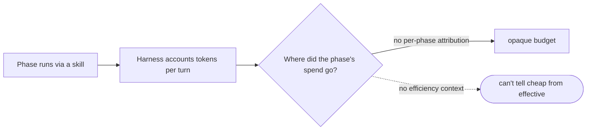

# Pipeline measurement — per-phase spend & efficiency for the factory's own pipeline — PRD

| Field | Value |
|---|---|
| **In one line** | A per-phase measurement plane for the factory's own pipeline: each phase's spend (tokens by model + cost) and artifact/git-derived efficiency signals recorded to one per-phase run record, across all four supported agentic CLIs, at zero model-token measurement overhead. |
| **Relevant-when** | planning, building, or reviewing per-phase pipeline measurement — attributing token/model/cost spend to a pipeline stage, the phase-bounded run record, the artifact+git efficiency signals, or the per-harness spend adapters; triaging a mis-attributed or silently-missing spend figure, a stale efficiency read, or a cross-harness capture gap; changing the pipeline stages, the skills that run them, or how a phase's boundary is detected. |
| **Status** | Solution-reviewed — problem + solution gates approved 2026-07-20 (operator `/doc-review`); Launch review pending post-implementation |
| **Tier** | T2 — internal tooling over the factory's own runs; reversible (records are additive, opt-in, regenerable); no factory-control, money, or migration surface. One property carries higher risk within the tier: honest cross-harness capture — a silent zero would mislead the very budget decisions this serves (§5.1 FR-6). |
| **Owner** | @mdarabi |
| **Approver(s)** | @mdarabi — via the introducing PR's operator review (solo operator; one real gate). |
| **Contributors** | @mdarabi (product / engineering); the orchestrating session (synthesis). |
| **Informed** | future repo contributors; every operator running drives under a budget; the future routing (VNEXT-7) and optimizer (F6) consumers. |
| **Date** | 2026-07-20 created · 2026-07-20 last updated |
| **Appetite** | Bounded increment: the per-phase run record + the artifact+git efficiency reader + spend adapters for all four supported harnesses + the carried run/feature id + a thin operator read, proven on real front-half runs. Human attention: this PRD's review, the design review, and the operator reading the measurement on real runs. Machine work: the recorder/reader (a docgate-family verb or sibling) + four harness spend adapters + the reconciliation check. Excluded: model routing, the optimizer loop, execution mechanism (headless/resume), context reduction, the built-app evidence plane, the rest of the OBS plane, telemetry export, a query API, and the J3 rollup *view*. |
| **Target release** | No calendar target. Usable once one real front-half run is measured end-to-end — per-phase spend reconciled or honestly declared on each supported harness, and the efficiency floor present. |
| **Tracking** | — *(the introducing PR / epic, once filed)* |
| **Artifacts** | The gated brainstorm record `docs/brainstorms/pipeline-measurement.md` (D-1..D-6, O-1..O-8, P-1..P-7, T-1..T-3); this session's survey of cross-harness capture channels (headless result envelope, session transcript, OTEL metrics, LLM proxy) — recorded in this PR's discussion, not a separate corpus. |
| **Template version** | prd-template/v2 |

## 0. Read to rule — the human reviewer's section (~4 min)

*The body is the contract; this section only routes attention — on any conflict the body governs; machines ignore it.*

**Judge these**

| # | The call | Could have gone | If you disagree |
|---|---|---|---|
| 1 | Spend-first (the token number is the headline), with the artifact+git efficiency signals as a universal floor | Structural-first — ship the free, universal reader and defer the token number | v1 becomes the efficiency reader only; spend is a follow-on → §4.1, FR-1/FR-5 |
| 2 | v1 captures spend on **all four** harnesses (operator override of "one + seam") | Prove one reconciled harness in v1; the other three follow | cut FR-5 to one harness, restore the seam-only ambition → header Appetite, FR-5 |
| 3 | Honest degradation — a harness that cannot expose a figure yields a declared "unavailable", never a silent zero or estimate | Best-effort: fill capture gaps with an estimate | allow estimated spend where capture fails → FR-6, §3.3 |
| 4 | Execution-agnostic — measurement reads whatever accounting the run produced, however the phase ran | Couple measurement to a chosen execution mode (e.g. require headless) | fold the headless/resume mechanism into this feature → FR-7, NG-3 |
| 5 | v1 ships records + a thin read, no query/analytics surface | Ship a query API in v1 | pull WR-3 into scope → §4.2, WR-3 |

**Sanity-check the numbers** — the reconciliation tolerance for "the figure matches the harness's own accounting" is design-owned (Q2), not fixed here; zero model-token measurement overhead (FR-10, NFR-1) is a hard zero, not a target; "four harnesses" is the whole supported set (FR-5).

**The author's open questions** — Q1 (the per-harness capability matrix may force honest degradation on one or more harnesses — Cursor's proxy billing is the prime suspect); Q2 (how tight "reconciles" must be).

**Skip the rest** — structure → docgate; substance/coherence → the unmanned `/prd-review`; implementation defects → downstream gates; the record schema/home, the per-harness capture channel, and boundary detection → the technical design (P-1..P-7 carry them).

## 1. Summary — the one-pager

- **Problem** — The factory cannot see what each pipeline phase costs — tokens, on which model, at what dollar cost — or how efficient a phase was. "Cost per shipped feature" and "where did the budget go" are unanswerable, and the routing and optimizer loops have no substrate to learn from.
- **For whom** — The operator running pipeline drives under a token budget; later, the factory's own routing (VNEXT-7) and optimizer (F6) consumers read the same records.
- **Why now** — Drives are routine and the review fan-out is proven necessary; spend is the dominant, least-visible line item, and the corpus already reserves this convention (context-pack WR-3 waits for "a token-accounting convention"). Nothing measures the factory's own phases today.
- **Direction** — Record one per-phase run record carrying, per model, the token quartet and dollar cost, attributed to the phase by a deterministic boundary (skill-invocation → artifact-write) — with the artifact+git efficiency signals (questions, fog, rework, defects, latency) on the same record as a universal floor. Capture spend through a per-harness adapter for all four supported CLIs; where a harness cannot expose a figure, declare it unavailable — never a silent zero. Measurement reads accounting and git only; it spawns no model.
- **Appetite** — The run record + the efficiency reader + four harness spend adapters + the carried run/feature id + a thin read, proven on real runs; as in the header.
- **Success** — For a real front-half run, every completed phase carries per-model tokens, cost, and efficiency signals; the spend reconciles to the harness's own accounting and is attributed to the correct phase (M1).
- **Guardrail** — Zero model-token overhead (measurement never spawns an LLM) and zero silent-zeros (a missing figure is always a declared "unavailable").
- **Top risks** — (1) a harness (Cursor's proxy billing the prime suspect) exposes no per-model spend on the user's key, forcing honest degradation on part of the four; (2) phase-boundary detection is wrong on some harness and the numbers are confidently mis-attributed; (3) the reconciliation tolerance is too loose and a wrong figure passes as measured.

## 2. Problem space

### 2.1 Problem statement

The factory runs an expanding pipeline of skill-driven phases (feature-brainstorm, prd-new, tech-design-brainstorm, tech-design-new, plan-new, the reviewers …), each burning tokens against the operator's budget — yet nothing attributes that spend to the phase that incurred it, to the model it ran on, or to a dollar figure. The operator cannot answer "which phase is expensive", "is that phase's cost buying proportionate quality", or "what did this feature cost to produce", and so cannot decide what to optimize; the factory's own routing and self-improvement loops, which are supposed to learn from outcomes, have no per-phase cost-or-efficiency substrate to read. The cost of doing nothing: the budget is spent blind, the dominant line item stays invisible, and the vision's own cost-per-feature guardrail (§10) remains uncomputable.

### 2.2 Users and segments

| Segment | Role and context | Domain exp. | Tech exp. | Key goals | Pain today | Evidence |
|---|---|---|---|---|---|---|
| **P1 (primary)** | The operator running pipeline drives under a token budget | master | master | see where the budget goes (which phase, which model), tell a cheap phase from an effective one, and track cost per shipped feature | per-phase cost is invisible; "where did the tokens go" is unanswerable | brainstorm:pipeline-measurement#D-2 |
| P2 (secondary) | The factory's own machine consumers — routing intelligence (VNEXT-7) and the F6 optimizer | — | — | read per-phase spend to route models and self-tune | no per-phase substrate exists to read | brainstorm:pipeline-measurement#D-2 |
| **Anti-segment** | The built application's runtime (observable-by-construction's E0–E4 plane) and the model-routing *decision* itself | — | — | — | — | disjoint plane / owned by VNEXT-7 (§3.4 NG-1, NG-5) |

### 2.3 Jobs and desired outcomes

| # | When… (situation) | I want to… (motivation) | So I can… (outcome) | Today's workaround | Evidence |
|---|---|---|---|---|---|
| J1 | a phase (or a run) completes | see what it cost — tokens by model, and dollar cost | find where the budget goes and which phase/model to change | none — the number is not captured | brainstorm:pipeline-measurement#D-3 |
| J2 | I look at a phase's cost | see its efficiency signals beside the cost — questions, fog, rework, defects, latency | tell a cheap phase from an effective one and not optimize the wrong thing | none — no per-phase efficiency read | brainstorm:pipeline-measurement#D-3 |
| J3 | a feature ships | roll its phases' spend up to one "cost per shipped feature" number | track §10's guardrail metric | none — features carry no aggregated cost | brainstorm:pipeline-measurement#D-3 |

### 2.4 Evidence

| Claim | Source | Confidence |
|---|---|---|
| The factory's own spend plane (OBS-2: per-turn token quartet, attribution) is specified but unbuilt in pyxis | docs/prds/observability-and-spend.md OBS-2; docs/prds/README.md ("Implemented in Pyxis: none yet") | High |
| The corpus already reserves this convention — context-pack defers "a token-telemetry plane" (NG-5) and waits for "a cost line in the delivery ledger … when a token-accounting convention lands" (WR-3) | docs/prds/context-pack/effective.md §3.4, §6.3 | High |
| The data model is planned but nothing is built — TokenUsageRecord (per-turn quartet), Trace, DomainEvent carry verdicts Generalize/Port/New | docs/domain-model.md §3.7 | High |
| The vision's cost-per-feature guardrail is computable only from an observability plane that exists to measure it | docs/product-vision.md §10 | High |
| Each front-half phase runs as a skill and freezes a durable artifact — a deterministic phase boundary exists (skill-invocation → artifact-write) | product-vision §4 (the pipeline stages); brainstorm:pipeline-measurement#F-8 | High |
| Whether Codex/Cursor/OpenCode expose per-model spend on the user's own key, and by which channel, is not yet established | this session's survey (headless envelope / transcript / OTEL / proxy); brainstorm:pipeline-measurement#P-1 | Low |

### 2.5 The journey today

| Phase | User does | User feels / pain | Frontstage | Backstage |
|---|---|---|---|---|
| Run | drives a pipeline stage through a skill | it's costing tokens, but how many and on what? | the skill's output artifact | the harness's own accounting |
| Ask | tries to find what a phase cost | opaque — the number is nowhere | — | session logs, scattered, per-harness |
| Decide | wants to cut cost or judge efficiency | can't act — no per-phase cost or efficiency read | — | — |

### 2.6 Opportunity and why now

- **Size** — every drive × every phase in it; per-phase spend is the dominant, least-visible line item, and cost-per-feature (§10) is uncomputable without it.
- **Alternatives users have** — read raw per-harness session logs by hand (opaque, per-harness, no attribution); guess; do nothing (the budget stays blind).
- **Why us / strategic fit** — pyxis already treats its work as artifacts on disk with deterministic phase boundaries; attributing spend to a phase is native, feeds the §10 metrics directly, and honors the standing token-consciousness constraint.
- **Why now** — drives are routine; the corpus explicitly reserves this convention (context-pack WR-3); the routing/optimizer loops are specified and will need this substrate.
- **Cost of doing nothing** — the dominant cost line stays invisible, the operator optimizes blind, and the vision's cost-per-feature guardrail remains uncomputable.

**Decision:** Problem gate — approved via the operator's `/doc-review` session, ratified on the introducing PR.

| Reviewer | Role | Date | Verdict |
|---|---|---|---|
| @mdarabi | operator | 2026-07-20 | approved |

*`capture: ~5m · items: [out] the record's metrics/logs structure — routed to the tech design (Q3), PRD unchanged`*

## 3. Goals, metrics, and guardrails

### 3.1 Goals as falsifiable hypotheses

| # | We believe that… | Will result in… | Measured by… |
|---|---|---|---|
| G1 | recording per-phase, per-model spend attributed to the phase that incurred it | the operator can locate the expensive phases/models and act, and cost-per-feature becomes computable | M1, M3 |
| G2 | putting the artifact+git efficiency signals on the same record as the spend | cost becomes interpretable — a cheap phase is distinguishable from an effective one | M2 (efficiency-floor coverage) |
| G3 | capturing spend on all four harnesses with honest degradation instead of a uniform pretence | the number is trustworthy: measured where possible, declared-absent where not, never fabricated | M2 |

### 3.2 Goals → signals → metrics

| Metric | Goal | Signal | Baseline | Target (at checkpoint) | Feeds from |
|---|---|---|---|---|---|
| M1 (primary) — spend-attribution accuracy | G1 | per-phase per-model figure vs the harness's own accounting, and phase-attribution correctness | no per-phase attribution exists | on the reference run, 100% of completed phases carry a per-model spend figure that reconciles to the harness's own accounting within tolerance and is attributed to the correct phase — checkpoint: first real front-half run measured | EVT-1, EVT-3 |
| M2 — cross-harness coverage | G3 | per-harness capture-or-declare, and structural-floor presence | 0/4 harnesses | 4/4 supported harnesses either capture per-phase spend or record an honest "unavailable" (never a silent zero); efficiency floor present on 100% of phases regardless of harness — checkpoint: the reference run replayed on each of the four | EVT-1, EVT-2 |
| M3 — cost-per-feature reachable | G1 | a feature's phases roll up via the carried run/feature id | unreachable | for the reference feature, its phase records sum to one cost-per-feature figure with no record missing its run/feature id — checkpoint: the reference feature's front-half run | EVT-1 |

### 3.3 Guardrails and decision rule

| Guardrail metric | Threshold | Action if breached |
|---|---|---|
| Model-token overhead added by measurement | zero — the recorder/reader spawns no model call | block; the mechanism is wrong until it reads accounting + git only |
| A spend figure recorded as zero/absent without a declared "unavailable" marker (a silent zero) | zero — zero tolerance | block; honest degradation must hold before ship |
| Mutation of the run being measured (its artifacts, or the harness's operation) | zero | block; measurement is read-only over the run |

**Ship rule (pre-registered):** M1 reconciles on ≥ 1 harness AND M2 clean (4/4 capture-or-declare, floor 100%) AND zero overhead AND zero silent-zeros → adopt at the declared per-harness coverage; spend unavailable on some harnesses but honestly declared with the floor intact → adopt with that coverage recorded; any silent zero, run mutation, or non-zero model overhead → do not ship.

### 3.4 Non-goals and waiting room

| ID | Non-goal | Why refused |
|---|---|---|
| NG-1 | Model routing / choosing which model runs a phase | VNEXT-7 and context-pack NG-1 own routing; this produces the spend substrate routing reads, it never routes (O-1) |
| NG-2 | The optimizer / self-improvement loop | F6/VNEXT-15 consume these records; building the adaptation loop is separate (O-2) |
| NG-3 | Deciding how a phase executes (inline / subagent / headless / resume) | harness/orchestration policy (context-pack NG-3); measurement is execution-agnostic, reading whatever accounting the run produced (O-3) |
| NG-4 | Context reduction / the context-pack | a separate existing feature; this measures spend, it does not reduce it (O-4) |
| NG-5 | The built application's runtime evidence (E0–E4) | observable-by-construction's disjoint plane; this measures the factory's phases, not the software it builds (O-5) |

| ID | Waiting room | Revisit when / intended version |
|---|---|---|
| WR-1 | The rest of the OBS plane — the full ~60-kind domain-event stream (OBS-1), health alarms/detectors (OBS-4), a live monitoring dashboard (OBS-5), prompt logging (OBS-6) | as the Ledger grows past the per-phase spend+efficiency slice (O-6) |
| WR-2 | Global / anonymous telemetry export (§9) | when cross-install aggregation is taken up; local operation stays decoupled (O-7) |
| WR-3 | A query / analytics surface over the records; and the J3 cost-per-feature *view* | after the producer-side records prove out on real runs (O-8) |
| WR-4 | A cost line fed into the argus delivery ledger | when this convention lands and the delivery ledger takes it up (context-pack WR-3 — the reciprocal) |

## 4. Solution space

### 4.1 Approach and alternatives considered

The chosen shape (the A-spine hybrid, `brainstorm:pipeline-measurement#D-1`): one **per-phase run record** per pipeline phase, carrying — for each model the phase used — the input/output/cache token quartet and a dollar cost, plus the artifact+git efficiency signals, plus a run/feature id, attributed to the phase by the deterministic boundary (skill-invocation → artifact-write). Spend is captured through a **per-harness adapter** for each of the four supported CLIs; where a harness cannot expose a required figure, the record declares it unavailable rather than fabricating one. The efficiency signals are computed from the frozen artifacts and git history alone — universal across harnesses, no runtime instrumentation — so they hold even where spend capture degrades. The recorder spawns no model: it reads accounting the harness already produced and the repo.

| Option | Sketch | Why not chosen |
|---|---|---|
| A (chosen) | per-phase run record: per-model spend (reconciled) + efficiency signals + run/feature id, one schema, four harness adapters, honest degradation | — |
| B | artifact+git efficiency reader only; defer the token number | defers the very per-model spend number the idea started from and the corpus reserves (WR-3); kept as the universal *floor* inside A, not the whole feature |
| C | the full pipeline-run Ledger (all ~60 event kinds, trace, alarms) in one feature | balloons to the whole OBS plane (O-6); A takes C's "define the record once" discipline without its scope |
| Do nothing | read raw per-harness logs by hand | §2.6's cost — the dominant spend line stays invisible and cost-per-feature stays uncomputable |

### 4.2 Scope perimeter

- **In (plan of record)** — the per-phase run record schema; the deterministic phase-boundary attribution; per-model token quartet + dollar cost, reconciled to the harness's own accounting; spend adapters for all four supported harnesses with honest degradation; the artifact+git efficiency-signal reader (universal floor); the carried run/feature id; a thin operator read; zero model-token overhead.
- **Future (believed next, not committed)** — WR-1..WR-4.
- **Out** — NG-1..NG-5.

### 4.3 Experience: flows and states

*The surface is a recorder/reader command plus the records it produces; states are the record-visible conditions. Accessibility/localization: n/a — no graphical surface.*

**Flow F1 — record a phase's spend and efficiency (serves J1, J2)**

| Step | User does | System responds | States covered | Design |
|---|---|---|---|---|
| 1 | a phase completes (artifact written) | brackets the phase (skill-invocation → artifact-write), reads the harness accounting for that bracket, writes one record with per-model tokens + cost + efficiency signals + run/feature id | ideal · partial (a phase with no close boundary → recorded incomplete, not dropped) | the phase boundary (P-2) |
| 2 | the harness exposes no per-model usage | records a declared "unavailable" naming the harness and figure — never a zero | error (degraded → declared) | honest degradation (FR-6) |
| 3 | reads a run's per-phase measurement | lists each phase: tokens by model, cost, efficiency signals, or the unavailable markers | ideal · partial | the thin read (FR-9) |

**Flow F2 — honest cross-harness capture (serves J1, G3)**

| Step | User does | System responds | States covered | Design |
|---|---|---|---|---|
| 1 | runs the same phase on a different supported harness | the matching adapter captures the per-phase figure, or declares it unavailable | ideal · degraded | the per-harness adapter (FR-5) |
| 2 | a run switches harness mid-pipeline | each phase's record names the harness that ran it; spend is never blended across harnesses | partial | per-record harness identity (UB-4) |

### 4.4 Scenarios

1. **The archetype.** The operator drives feature-brainstorm → prd-new → tech-design-brainstorm → tech-design-new → plan-new on Claude Code. Each phase, at its artifact-write, gets one record: tokens by model (Opus for the reasoning, a cheaper model for a sub-lookup), a dollar cost, and its efficiency signals (questions asked, fog, rework). The read shows plan-new cost 3× tech-design-new, mostly on the expensive model — an actionable target.
2. **The honest gap.** The same run is replayed on a harness whose CLI does not expose per-model tokens on the operator's key. The efficiency floor is still computed for every phase; the spend lines read "unavailable on <harness>" — declared, never a silent zero — so the operator knows exactly what is and isn't measured.
3. **The feature cost.** A feature ships; its phase records, all carrying the same run/feature id, sum to one cost-per-feature figure — the §10 guardrail, computed for the first time.

**Decision:** Solution gate — approved via the operator's `/doc-review` session, ratified on the introducing PR. Zero TBDs pass.

| Reviewer | Role | Date | Verdict |
|---|---|---|---|
| @mdarabi | operator | 2026-07-20 | approved |

## 5. System requirements

### 5.1 Functional requirements

| ID | Requirement (EARS) | Rationale | Priority | Risk | Fit criterion | Verify | Traces to |
|---|---|---|---|---|---|---|---|
| FR-1 | When a pipeline phase completes, the system shall record one per-phase run record carrying the phase identity, the run/feature id, and — for each model the phase used — the input/output/cache token quartet. | the per-phase spend substrate (J1) | Must | med | for a reference run, every completed phase yields exactly one record whose per-model token quartet reconciles to the harness's own accounting — exact where the harness reports an authoritative per-model total, else within the design-set tolerance (Q2) | Test | G1, J1, F1 |
| FR-2 | For each model on a phase record, the system shall record a dollar cost derived from versioned per-model price data. | the operator's budget is in dollars, not raw tokens (J1) | Must | low | each per-model line's cost equals its tokens × the pinned price entry; a model with no price entry is flagged, never silently zero-costed | Test | G1, J1 |
| FR-3 | The system shall attribute a phase's spend and turns using the deterministic phase boundary — skill-invocation (open) to artifact-write (close). | correct attribution is the core claim (J1) | Must | high | for a reference run, 100% of recorded spend falls within its correct phase boundary; a turn outside any boundary is attributed to none, never mis-attributed to a neighbor | Test | G1, J1, F1 |
| FR-4 | For every phase, the system shall compute the efficiency signals — questions, fog, rework, defects, latency — from the frozen artifacts and git history, with no runtime instrumentation. | the universal floor that interprets cost (J2) | Must | med | for a reference run on each supported harness, every phase carries efficiency signals derived solely from artifacts+git, identical across harnesses for the same run | Test | G2, J2, F1 |
| FR-5 | The system shall capture per-phase spend on each of the four supported harnesses — Claude Code, Codex, Cursor CLI, OpenCode — through a per-harness adapter. | the appetite's four-harness commitment (D-6) | Must | high | each of the four harnesses has an adapter that, for a reference run, produces the per-phase per-model spend figure or the FR-6 declaration | Test | G1, G3, J1 |
| FR-6 | Where a harness cannot expose a required spend figure, the system shall record a declared "unavailable" marker naming the harness and the missing figure, and shall never record a silent zero or a fabricated value. | trust: honesty over a false uniform number (G3) | Must | high | over a fixture where a harness exposes no usage, the record carries an explicit unavailable marker; no zero or estimate is presented as measured | Test | G3, J1 |
| FR-7 | The system shall attribute the same per-phase spend figure regardless of whether the phase ran inline, as a subagent, or as a headless invocation. | execution-agnostic — the mechanism is out of scope (NG-3) | Must | med | the same phase run under two execution modes yields the same reconciled figure | Test | J1, NG-3 |
| FR-8 | Each per-phase record shall carry the run/feature id it belongs to. | cost-per-feature as a later read (J3) | Must | low | every record carries a resolvable run/feature id; the reference feature's records sum to a cost-per-feature figure | Test | J3 |
| FR-9 | The system shall provide a read that presents, per phase of a run, tokens by model, dollar cost, and the efficiency signals. | the operator-facing surface (J1, J2) | Should | low | for a reference run, the read lists every phase with its per-model tokens, cost, and efficiency signals or the unavailable markers | Demo | J1, J2 |
| FR-10 | The system shall record and compute measurements without invoking any model. | zero model-token overhead — a measurement plane that burned tokens would fail §10 | Must | med | over a full reference run's measurement, zero model tokens are consumed by the recorder/reader | Test | G3, J1 |

*Priority bar: FR-9 is the one Should — the records and their correctness are the release; the packaged read can follow. FR-1..8 and FR-10 are Must.*

**Non-regression (NR-n)**

| ID | Existing behavior protected | Why protected | Risk | Fit criterion | Verify | Traces to |
|---|---|---|---|---|---|---|
| NR-1 | The pipeline run being measured — its artifacts, and the harness's operation | measurement must never alter the thing it measures | high | measurement over a run leaves the run's artifacts and the harness state byte-unchanged | Test | §2.1 |
| NR-2 | docgate's existing verbs and their outputs | the recorder adds a capability; it must not alter existing doc-system behavior | med | docgate gate and fold produce identical results before and after this feature | Test | §2 |
| NR-3 | Each harness's own token accounting | the adapters read it; they must never alter it | low | a harness's own usage output is byte-unchanged by the adapter reading it | Inspection | FR-5 |

### 5.2 Unwanted behavior and failure handling

| ID | If… (trigger) | Then the system shall… | User sees | Priority | Risk | Fit criterion | Verify | Traces to |
|---|---|---|---|---|---|---|---|---|
| UB-1 | If a harness exposes no per-model usage for a phase | record the FR-6 "unavailable" marker and emit no zero | an unavailable marker naming the harness | Must | high | a no-usage fixture yields a declared unavailable; no zero or estimate appears | Test | FR-6 |
| UB-2 | If a model used by a phase has no price entry | record its tokens with the cost flagged "no price", never a silent zero cost | a cost flagged as un-priced | Must | low | an un-priced model yields tokens + a "no price" flag, not a $0 line | Test | FR-2 |
| UB-3 | If a phase produced no artifact (no close boundary) | record the phase as incomplete and attribute its spend to that incomplete phase | an incomplete-phase record | Must | med | an aborted phase is recorded incomplete with its spend, never dropped or rolled silently into the next phase | Test | FR-3 |
| UB-4 | If a run switches harness mid-pipeline | name, per record, the harness that ran that phase; never blend spend across harnesses | per-phase harness identity | Must | med | a harness-switch fixture yields records each naming their harness; no blended figure | Test | FR-5 |
| UB-5 | If a phase invokes a sub-skill (a nested phase) | record the nested phase's spend distinctly under its own phase identity and never blend it into the parent; the exact nested-attribution rule is design-owned (Q4) | a nested-phase record | Must | med | a nested-invocation fixture yields distinct records per phase, with no silent blending into the parent | Test | FR-3 |

### 5.3 Permissions and abuse cases

*No new role or permission surface — local tooling over the factory's own runs. The one integrity abuse:*

| ID | Actor and intent | Vector | Impact | Severity | Mitigated by | Verify |
|---|---|---|---|---|---|---|
| ABUSE-1 | A flawed adapter (or a harness returning empty) yields a zero that reads as "this phase was free" | a capture gap silently recorded as 0 | the operator's cost picture is skewed; a routing/optimizer consumer learns from a false zero | high | FR-6 (honest degradation) + M1 reconciliation + §3.3 silent-zero guardrail | Test |

### 5.4 Data

| Entity / field | Meaning | Source of truth | Retention | Integrity rules | Privacy class |
|---|---|---|---|---|---|
| per-phase run record | phase id · run/feature id · harness · per-model token quartet · per-model cost · efficiency signals · unavailable markers | derived from harness accounting + git; never authoritative over them | local, append-only, regenerable | reconciles to the harness's own accounting; never mutated after write; a missing figure is a declared marker | internal |
| per-model price table | tokens→dollars per model | the repo (versioned config data) | repo history | pinned per record; an un-priced model is flagged | public |

- **Migration** — none: new artifact class.
- **Parallel-run / cutover** — none: additive; recording is opt-in and changes no existing path.
- **Rollback** — stop recording; the pipeline runs exactly as today. No state to unwind (records are additive scratch).
- **Decommission** — delete the records; runs are untouched.
- **Egress** — none new. The records stay local and contain only accounting the harness already produced (token counts, model ids) plus repo-derived signals; no new destination and no new content leaves the environment. Secrets are never captured (NFR-5).

### 5.5 Interfaces and integrations

| Interface | Direction | Purpose | Contract (format, ranges, timing) | Failure modes | Owner |
|---|---|---|---|---|---|
| Claude Code accounting | in | read per-phase per-model usage/cost | the harness's own usage surface (result envelope / session transcript / OTEL — chosen in design, P-1) | no usage exposed → FR-6 | this feature (adapter) |
| Codex accounting | in | read per-phase per-model usage | the harness's own usage surface (P-1) | no usage exposed → FR-6 | this feature (adapter) |
| Cursor CLI accounting | in | read per-phase per-model usage | the harness's own usage surface; proxy-billing risk (Q1) | no per-model usage on the user's key → FR-6 | this feature (adapter) |
| OpenCode accounting | in | read per-phase per-model usage | the harness's own usage surface / server API (P-1) | no usage exposed → FR-6 | this feature (adapter) |
| git + frozen artifacts | in | compute the efficiency signals (FR-4) | read-only over the repo history and records/reviews/plans corpus | a corpus artifact absent → the signal reads "none", not fabricated | this feature (reader) |

### 5.6 Non-functional requirements

| ID | Area | Requirement | Fit criterion | Verify |
|---|---|---|---|---|
| NFR-1 | Cost | The measurement shall consume no model tokens. | zero model tokens consumed by the recorder/reader over a reference run (FR-10) | Test |
| NFR-2 | Determinism | A given run's records shall be reproducible from the same accounting + git inputs. | re-running the recorder over the same run produces identical records | Test |
| NFR-3 | Operability | A record shall be self-describing: which run, phase, harness, and model, and whether each figure is measured or declared unavailable. | inspection of a record shows all of these | Inspection |
| NFR-4 | Maintainability | Adding a harness adapter or a model price shall be an adapter/data change, not a change to the record/reader core. | a new price or adapter lands with no edit to the core | Inspection |
| NFR-5 | Security | The recorder shall read only harness accounting and the repo, and shall never capture a secret or credential value. | over any run, no secret/credential value appears in a record | Test |

### 5.7 Instrumentation — the tracking plan

*This feature is itself the measurement plane; its "events" are the records it produces, read back for its own metrics — no separate telemetry surface.*

| ID | Event name | Fires when | Properties (typed) | Source | Feeds |
|---|---|---|---|---|---|
| EVT-1 | phase_measured | a phase's record is written | run_id: str, phase_id: str, harness: str, per_model_quartet: map, cost: number, efficiency: map | the recorder | M1, M3 |
| EVT-2 | spend_unavailable | a harness cannot expose a required figure | harness: str, phase_id: str, missing_figure: str | the adapter | M2 |
| EVT-3 | reconciliation_check | a recorded figure is checked against harness accounting | phase_id: str, recorded: number, harness_reported: number, within_tolerance: bool | the reconciler | M1 |

### 5.8 Definition of Done

| ID | Done criterion | Source | Verify | Required evidence | Blocking? |
|---|---|---|---|---|---|
| DOD-1 | All Must FRs pass their fit criteria | FR-1..8, FR-10 | Test | CI run + per-harness fixtures | yes |
| DOD-2 | No non-regression row broken | NR-1..3 | Test | run artifacts + harness output byte-unchanged; docgate identical | yes |
| DOD-3 | Reconciliation holds: per-phase spend reconciles to harness accounting on the reference run, attributed to the correct phase | M1, FR-1, FR-3 | Test | reconciliation report on the reference run | yes |
| DOD-4 | Honest degradation holds: a no-usage fixture yields a declared unavailable, never a silent zero | FR-6, UB-1, ABUSE-1, §3.3 | Test | the degradation fixture, red-first then green | yes |
| DOD-5 | Four-harness coverage: each of the four harnesses captures-or-declares on the reference run; the efficiency floor is present on 100% of phases | M2, FR-4, FR-5 | Test | per-harness run evidence | yes |
| DOD-6 | Near-zero overhead: zero model tokens consumed by measurement | NFR-1, FR-10, §3.3 | Test | token accounting of the measurement pass | yes |
| DOD-7 | The measured run is un-mutated: its artifacts and the harness state are byte-unchanged | NR-1, §3.3 | Test | before/after byte comparison | yes |

### 5.9 AI behavior and evals

Skipped: no model-driven behavior — the recorder/reader reads harness accounting and git and spawns no model (FR-10, NFR-1). There is nothing model-driven to eval.

## 6. Delivery

### 6.1 Phasing and milestones

| Phase | Purpose | Scope | Exit criterion |
|---|---|---|---|
| 1 — record | the per-phase record + attribution + one harness | record schema + boundary attribution + efficiency reader + the Claude Code adapter | DOD-1 (for FR-1..4,7,8,10), DOD-2, DOD-3, DOD-6, DOD-7 green on one harness |
| 2 — cross-harness | all four harnesses, honestly | the Codex, Cursor CLI, OpenCode adapters + honest degradation | DOD-4, DOD-5 green (4/4 capture-or-declare, floor 100%) |
| 3 — prove | a real feature measured end-to-end | one real front-half run + the thin read (FR-9) + cost-per-feature rollup (M3) | M1/M2/M3 recorded on a real run |

### 6.2 Dependencies

| Dependency | Type | Needed by | Status | Owner |
|---|---|---|---|---|
| docgate verb-set (the recorder/reader is a sibling verb or tool) | system | Phase 1 | confirmed — exists | repo |
| the four harnesses' per-model accounting surfaces (P-1 capability matrix) | vendor | Phase 2 | at-risk — to be established in design (Q1) | this feature |
| per-model price data | system | Phase 1 | to author (versioned config) | repo |
| the deterministic phase boundary (skill-invocation → artifact-write) | system | Phase 1 | confirmed — the skills freeze artifacts (F-8) | repo |

### 6.3 Risks, assumptions, and rabbit holes

| # | Risk / assumption / rabbit hole | Likelihood | Impact | Mitigation or test | Owner |
|---|---|---|---|---|---|
| R1 | a harness (Cursor's proxy billing the prime suspect) exposes no per-model spend on the user's key → some of the four only degrade (obituary #1) | M | M | FR-6 honest degradation; P-1 capability matrix resolved in design; the structural floor holds regardless | @mdarabi |
| R2 | phase-boundary detection is wrong on some harness → confidently mis-attributed spend (obituary #2) | L | H | FR-3 deterministic boundary + M1 reconciliation catches drift against the harness total | @mdarabi |
| R3 | the reconciliation tolerance is too loose → a wrong figure passes as measured (obituary #3) | M | M | Q2 fixes the tolerance in design; EVT-3 records every check | @mdarabi |
| A1 | each harness's own accounting (headless envelope / transcript / OTEL) is faithful to real provider usage | H (assumed) | M | reconcile against the harness's own reported total; the delta is exactly what M1 measures | @mdarabi |

### 6.4 Release criteria

| Lens | Criterion | Evaluated by |
|---|---|---|
| Functionality | all Must FRs pass their fit criteria | CI / fixtures |
| Reliability | honest-degradation and un-mutation fixtures pass (DOD-4, DOD-7) | failure injection |
| Performance | zero model-token overhead (DOD-6) | token accounting |
| Supportability | records are self-describing (NFR-3) | inspection |

### 6.5 Rollout and reversibility

- **Flag** — recording is opt-in per drive: a drive either records its phases or does not; nothing forces it.
- **Kill switch** — stop invoking the recorder; the pipeline runs exactly as today (no state to unwind — records are additive scratch).
- **Experiment** — the reference run measured on each of the four harnesses is the controlled comparison.
- **Cutover/migration steps** — none.

| Stage | Audience | Minimum evidence | Advance when | Roll back when |
|---|---|---|---|---|
| record | this repo, one harness | DOD-1 (core FRs), DOD-2/3/6/7 green | attribution reconciles on one harness, run un-mutated | any silent zero or run mutation |
| cross-harness | all four harnesses | DOD-4, DOD-5 green | 4/4 capture-or-declare, floor 100% | a silent zero on any harness |
| prove | one real feature | M1/M2/M3 on a real run | the operator reads a real run's per-phase cost + efficiency | a reconciliation or overhead breach |

### 6.6 Launch readiness

| Area | Item | Owner | Status |
|---|---|---|---|
| Docs | the recorder/reader usage + the per-harness adapter and price-data conventions documented with the implementation | @mdarabi | ☐ |
| Support / enablement / legal / pricing / marketing / platform / localization | skipped: solo-operator open-source tooling — no support org, billing, or comms surface | — | n/a |

**Decision:** Launch gate — §6.4 criteria green, rollback (stop recording) rehearsed.

| Reviewer | Role | Date | Verdict |
|---|---|---|---|
| @mdarabi | operator | *(pending)* | *(pending)* |

### 6.7 Post-launch review

- **Review trigger** — the first five real front-half runs measured across the supported harnesses · **Owner** — @mdarabi
- **Verdict recorded** — adopt / iterate / kill, with the M1/M2/M3 evidence — on the header's Tracking ref.

## 7. Alignment

### 7.1 FAQ

**Customer**

- **Q:** How much does the measurement itself cost? — **A:** Zero in model tokens: it reads accounting the harness already produced and computes efficiency signals from git — it never spawns an LLM to measure (FR-10, NFR-1).
- **Q:** What if my CLI doesn't report per-model tokens? — **A:** You still get every phase's efficiency signals (they come from artifacts+git), and the spend lines read "unavailable on <harness>" — declared, never a fabricated zero (FR-6).

**Internal**

- **Q:** How is spend attributed to a phase when a session spans several? — **A:** By the deterministic boundary — skill-invocation opens the phase, the artifact-write closes it — and every figure is reconciled against the harness's own accounting (FR-3, M1).
- **Q:** Isn't this just OBS-2 / the Ledger? — **A:** It is the first pyxis-native slice of that plane, scoped to per-phase spend+efficiency; the rest of the OBS plane, telemetry export, and a query API are the waiting room (WR-1..WR-3), not this feature.
- **Q:** Why not defer the token number and ship the free efficiency reader first? — **A:** The token number is the idea's origin and the convention the corpus reserves (context-pack WR-3); B is kept as the universal floor *inside* A, not the whole feature (§4.1).

### 7.2 Open questions

| # | Question | Owner | Needed by | Status |
|---|---|---|---|---|
| Q1 | The per-harness capability matrix: for each of the four, which channel exposes per-model spend on the user's own key (headless result envelope / session transcript / OTEL / proxy), and where honest degradation must apply | design | design (Phase 2 adapters) | open — `brainstorm:pipeline-measurement#P-1` |
| Q2 | How tight "reconciles to the harness's own accounting" must be (the M1 tolerance) | design | design | open — `brainstorm:pipeline-measurement#P-6` |
| Q3 | The record's schema and home: a first append-only slice of the Ledger (system-design D7, open) or the delivery-ledger cost line (context-pack WR-3) | design | design | open — `brainstorm:pipeline-measurement#P-3` |
| Q4 | The attribution rule for nested skill invocations (a phase invoking a sub-skill, e.g. prd-new invoking prd-review): innermost-active-phase, split, or parent-absorbs | design | design | open — `brainstorm:pipeline-measurement#P-2` |

### 7.3 Decision log

| Date | Decision | Alternatives considered | Why | Who |
|---|---|---|---|---|
| 2026-07-20 | The A-spine hybrid: per-phase per-model spend record as the headline, one unified per-phase run record, artifact+git efficiency signals as the universal floor | B structural-first; C full run-Ledger | A is the number the idea started from and the corpus reserves; the single record keeps B's signals additive; the floor holds where spend capture degrades (`brainstorm:pipeline-measurement#D-1`) | @mdarabi |
| 2026-07-20 | Primary segment = the operator under a token budget; machine consumers secondary; built-app runtime + routing decision anti | optimizer-primary | keeps v1 a human-actionable read; machine-consumer precision would balloon toward full-Ledger C (`brainstorm:pipeline-measurement#D-2`) | @mdarabi |
| 2026-07-20 | Jobs J1 attribute spend · J2 efficiency beside cost · J3 cost-per-feature (carry the id, aggregate later) | drop J3 to the waiting room | J1+J2 are the actionable read; J3 reaches §10's metric via a carried id, not run-grouping machinery (`brainstorm:pipeline-measurement#D-3`) | @mdarabi |
| 2026-07-20 | Success = spend reconciles to the harness's own accounting, right phase, universal floor, honest degradation, near-zero overhead | a looser "emit some number" bar | tests both halves — the number is real and the plane is honest cross-harness (`brainstorm:pipeline-measurement#D-4`) | @mdarabi |
| 2026-07-20 | Boundary set O-1..O-8 → NG-1..5 / WR-1..4 | absorb neighbors; build the whole OBS plane | keeps the feature a bounded slice, not the whole plane (`brainstorm:pipeline-measurement#D-5`) | @mdarabi |
| 2026-07-20 | v1 covers all four supported harnesses (operator override of one-reconciled + seam) | one reconciled harness, seam for the rest | meets the cross-harness constraint concretely; the capability matrix becomes a design input, honest degradation the floor (`brainstorm:pipeline-measurement#D-6`) | @mdarabi |

### 7.4 Changelog

| Date | Change | Author |
|---|---|---|
| 2026-07-20 | 000-base drafted for operator review, synthesized from `brainstorm:pipeline-measurement` (verdict ready-for-prd) | @mdarabi (via the orchestrating session) |
| 2026-07-20 | applied prd-review round-1 findings (FND-1 overhead prose · FND-2 M1 tolerance bound · FND-3 nested-invocation UB-5/Q4 · FND-4 G2 metric) | @mdarabi (via the orchestrating session) |
| 2026-07-20 | problem + solution gates approved via operator `/doc-review`; the metrics/logs record structure routed to the tech design (Q3) | @mdarabi |

## 8. Contract readiness — the executability gate

| Check | Pass? | Notes |
|---|---|---|
| Problem basis accepted — §2 problem gate signed (T2) | ☐ | pending operator review |
| Zero solution-blocking TBDs or open questions (§7.2) | ✅ | Q1/Q2/Q3 are design-owned, not solution-blocking |
| Every Must FR has a fit criterion and a verification method (§5.1) | ✅ | FR-1..8, FR-10 each carry both |
| Every requirement row carries a risk tier; high/critical rows have a declared safety plan (§5.1, §6.5) | ✅ | FR-3/FR-5/FR-6/NR-1 high → the reconciliation, degradation, and un-mutation fixtures + opt-in/kill-switch rollout |
| Non-goals drawn (§3.4); non-regression rows named (§5.1) | ✅ | NG-1..5, WR-1..4; NR-1..3 |
| Every primary job (§2.3) is covered by a requirement, a non-goal, or a waiting-room entry | ✅ | J1→FR-1/2/3/5; J2→FR-4; J3→FR-8 (view WR-3) |
| Every key flow (§4.3) has functional, failure, and non-regression coverage | ✅ | F1→FR-1/3/4/6/9, UB-1/3, NR-1; F2→FR-5, UB-4 |
| Every primary metric (§3.2) has instrumentation (§5.7) or a measurement plan | ✅ | M1→EVT-1/3; M2→EVT-1/2; M3→EVT-1 |
| Every blocking DoD row traces to a requirement, guardrail, release criterion, or human-judgment rubric (§5.8) | ✅ | DOD-1..7 each cite sources |
| Risks and assumptions have owners (§6.3) | ✅ | R1..R3, A1 owned |
| Human-judgment criteria name an owner and a rubric (§5.8) | ✅ | none — all DoD rows are Test |
| DoD complete: every blocking row sourced and evidenced; every n/a explained (§5.8) | ✅ | §5.9 n/a explained (no model-driven behavior); no n/a DoD rows |

## Superseded & retired

None — this is the base.
