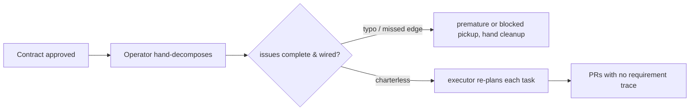

# Implementation planning (plan-new) — approved contract → executable task graph — PRD

| Field | Value |
|---|---|
| **In one line** | The bootstrap slice of pipeline stage 7: decompose an approved feature contract (PRD + technical design) into a frozen, schema-validated plan — dependency-ordered, sized, vertically-sliced tasks each carrying a frozen worker charter — projected idempotently onto the repo's issue tracker so the executor fleet implements them without re-planning. |
| **Relevant-when** | planning, building, or reviewing the plan-new skill, the plan/charter/report schemas, decomposition and sizing rules, or the tracker projection; triaging defects in planner output (bad decomposition, oversize tasks, unwired dependencies, charterless or vague tasks, duplicate issues); changing the PRD-ledger/tech-design surfaces it consumes or the executor dialect it emits |
| **Status** | Problem review ✓ · Solution review ✓ (2026-07-09) — launch review pending, post-implementation |
| **Tier** | T3 *(upgraded from T2 at review, 2026-07-09 — factory-control surface: model-driven output steers autonomous workers and triggers fleet spend)* |
| **Owner** | @mdarabi |
| **Approver(s)** | @mdarabi (operator) |
| **Contributors** | operator (product) · factory agents (authoring + implementation) |
| **Informed** | executor-fleet operators (harbormaster today); future engine-Planner designers; PR reviewers consuming task traceability |
| **Date** | 2026-07-09 created · 2026-07-09 last updated |
| **Appetite** | medium: the planning skill, its deterministic validation/projection tooling, and three schemas (plan, charter, report), for one repo and one executor dialect; one plan-review checkpoint per feature thereafter; steady-state machine cost ≈ zero (runs only on demand, AP-19). Excludes the engine's Planner service, scheduling/execution, and every other pipeline stage. |
| **Target release** | the first planning artifact of the self-development loop: from here, every remaining pyxis feature is planned by pyxis and implemented by the executor fleet. |
| **Tracking** | introducing PR (filed on approval) |
| **Artifacts** | system-design.md §2.3 (Planner) + F2 · domain-model.md §3.1 (work hierarchy) · harbormaster planning study 2026-07-09 (feature-plan skill; plan-umbrella / default-kickoff / completion-monitor / reviewable-diff-budget / conflict-magnet-prevention / multi-repo-scheduler-execution designs; incidents I2/I3/I4/I12/I14/I15; the 525-PR sizing evidence) · decomposition/charter craft borrowings (operator-supplied skills corpus: to-tickets, wayfinder, agent-brief) · pyxis#58 → PR #61 (the executor smoke test) |
| **Template version** | prd-template/v1 |

## 1. Summary — the one-pager

- **Problem** — Approved designs pile up with no executable work behind them: converting a contract into tracker issues is manual operator toil, and the result is lossy — no requirement traceability, no sizing discipline, and charterless issues that force the executor to re-plan each task with less context than the planning session had.
- **For whom** — the operator (today's only planner), the executor fleet that implements tasks, and the PR reviewer who needs to know which requirement authorized which change.
- **Why now** — the execution half of the self-development cycle is live and proven (pyxis#58 → merged PR #61), the document system is finished and gated, and an approved design is already queued unbuilt; planning is the missing link between them, and every future pyxis feature flows through it.
- **Direction** — a planning skill plus deterministic tooling: judgment decomposes the approved PRD + design into vertically-sliced, size-gated tasks with frozen charters; a non-skippable operator checkpoint approves the plan; the frozen plan is projected idempotently onto GitHub Issues in the executor's dialect, dependency edges wired before anything becomes routable.
- **Appetite** — as header: one skill + tooling + schemas, one repo, one executor dialect; no engine service.
- **Success** — plans execute without fixup: zero human edits to projected issues before executor pickup across the first three plans, and 100% of dogfood-plan tasks dispatched through the executor's spec-valid path (its own planning phase never fires).
- **Guardrail** — the tracker is never polluted: zero writes before plan approval, zero duplicate issues under re-runs, zero mutations of pre-existing tracker items.
- **Top risks** — decomposition quality below the bar (silent wrong decomposition is the most expensive failure); executor dialect drift breaking dispatch; the external dependency on the executor's foreign-repo path being enabled and soaked.

## 2. Problem space

### 2.1 Problem statement

A feature contract that has passed its reviews is still inert: nothing implements a PRD or a design document. Turning it into work the factory can execute means someone decomposes it into tasks, sizes them, orders them by dependency, writes each task's brief, creates the issues, wires the edges, and routes them — today that someone is the operator, by hand. Hand conversion is slow, unrepeatable, and lossy in exactly the ways that matter downstream: tasks carry no requirement IDs (so reviewers and future drift detection cannot trace a change to its authorization), sizing is instinct (the predecessor's measured result: 11% of task PRs exceeded 600 lines and were rubber-stamped unread in ~6 minutes), and issues arrive charterless — the smoke test showed the executor then generates its own machine charter per task, re-judging with less context than the planning session had and paying for planning twice. The cost of doing nothing is that the self-development loop stays half-open: execution is autonomous, planning is toil, and by the inversion test every operator-minute spent converting documents into issues is a factory gap.

### 2.2 Users and segments

| Segment | Role and context | Domain exp. | Tech exp. | Key goals | Pain today | Evidence |
|---|---|---|---|---|---|---|
| **P1 (primary)** | the operator holding approved contracts for this repo | master | master | turn an approved contract into a running backlog in one gated pass; keep final say over the decomposition | hand-writes every issue; no traceability or sizing discipline survives the conversion | pyxis#58 (hand-written); backlog: approved-but-unbuilt design |
| P2 | the executor fleet — workers picking up ready tasks days later in a changed codebase | — | master | a frozen, self-sufficient charter per task: goal, acceptance, scope, boundaries, trace refs | charterless issues → executor-side re-planning (nospec path), double judgment cost | pyxis#58 nospec charter; harbormaster single-issue-worker runtime |
| P3 | the PR reviewer at stage 9 | master | master | know which requirement/design decision authorized this diff; review a diff a human can actually read | no requirement links on tasks; oversized PRs go effectively unreviewed | harbormaster 525-PR evidence (99%+ zero inline review) |
| **Anti-segment** | teams wanting a general-purpose project-management or estimation tool | — | — | — | — | this is the factory's stage-7 contract, not a PM product; scope is factory-executable plans |

### 2.3 Jobs and desired outcomes

| # | When… | I want to… | So I can… | Today's workaround | Evidence |
|---|---|---|---|---|---|
| J1 | a feature contract (PRD + design) is approved | decompose it into dependency-ordered, agent-ready tasks in one pass | have the fleet implementing within one executor tick | hand-write issues one by one | pyxis#58; inversion test (vision §1) |
| J2 | I am about to fan tasks out to the tracker | review and edit the whole plan — tasks, sizes, edges, flags — before anything is written | catch wrong decomposition at the only cheap point | none — issues appear as they are typed | harbormaster Phase-4 gate ("the most expensive failure mode is silent wrong decomposition") |
| J3 | a worker picks up a task days after planning | read one frozen charter that says what to build, how done is proven, and what is out of scope | implement without re-reading the whole corpus or re-planning | executor generates its own charter per task (nospec) | pyxis#58 charter comment; agent-brief durability rules |
| J4 | I review a task's PR | see which PRD requirement and design decision the task serves | judge spec faithfulness, not just code quality | grep the docs and guess | VNEXT-3; PLAN-4 |
| J5 | a projection run fails partway or is re-run | have it converge — finish the remainder, duplicate nothing | trust the planner with the tracker | manual cleanup of half-created sets | harbormaster §5 halt-on-failure story; AP-22 |

### 2.4 Evidence

| Claim | Source | Confidence |
|---|---|---|
| The execution half already works end-to-end for this repo: labeled issue → charter → PR → gate → merge | pyxis#58 → PR #61 (2026-07-08), docs-gate SUCCESS | High |
| Charterless issues cause executor-side re-planning with less context (paying twice, judging worse) | pyxis#58 `plan-nospec-attempt-1` path; AP-21 | High |
| Plan-time sizing discipline is the only cheap enforcement point, and its absence produces an unreviewable fat tail | harbormaster reviewable-diff-budget §2: 525 merged PRs — 11% of task PRs >600 lines; >4 acceptance criteria → 36% oversize; one leaf swallowing 68–77% of an epic; §10 names plan-stage gating as the pyxis port | High |
| Duplicated readiness predicates and unwired-before-routable races produce loops and premature dispatch | harbormaster I2/I3 (predicate divergence, ~2M tokens/hr), I15 (verification leaf ran early — verified-done voided), default-kickoff D3 (label-after-wiring) | High |
| Vertical-slice decomposition with explicit blocking edges is a proven task shape for AFK agent consumption | operator-supplied skills corpus (to-tickets vertical-slice rules; agent-brief durability rules; wayfinder frontier/fog) | Med |
| An operator-authored `local-agent` issue in this repo is dispatched by the executor when its foreign-repo path is enabled | harbormaster multi-repo-scheduler-execution (acceptance case: pyxis#58); flag `RIG_SCHED_FOREIGN` default-off | High |

### 2.5 The journey today

| Phase | User does | User feels / pain | Frontstage | Backstage |
|---|---|---|---|---|
| Contract approved | operator closes the design review | "now I have to type it all in" | approved docs in the repo | no consumer of the approval event |
| Decompose | operator invents tasks in their head | unrepeatable; instinct-sized | — | no sizing rules, no coverage check |
| Create | operator hand-writes issues, links, labels | slow; error-prone (edges forgotten) | GitHub issue forms | no idempotency; a mistake is hand-cleaned |
| Execute | fleet picks tasks up | charter quality varies per issue | executor's own plan phase fires per task | double planning cost; judgment with less context |
| Review | reviewer reads PRs cold | "which requirement is this?" | PR diff | no task→requirement trace |

### 2.6 Opportunity and why now

- **Size** — every future pyxis feature passes through stage 7; the queued backlog starts with one approved-but-unbuilt design and grows with each contract the doc system approves.
- **Alternatives users have** — keep hand-writing issues (status quo toil, no traceability); adopt the predecessor's planner (coupled to its own doc conventions — it cannot parse pyxis ledgers/designs); wait for the full engine Planner (blocks self-development on the largest build).
- **Why us / strategic fit** — stage 7 is the named missing link: the doc system (upstream) and the executor fleet (downstream) both exist and are proven; this is the smallest feature that closes the loop, and its schemas (plan, charter) seed VNEXT-2/VNEXT-3 ground the later stages stand on.
- **Why now** — the smoke test just proved the downstream path; the upstream doc system just froze; the compounding is earliest here: once planning is factory work, every remaining engine feature is dogfood.
- **Cost of doing nothing** — the self-development loop stays half-open; planning toil scales linearly with the backlog; traceability and sizing discipline never exist (retrofitting them onto hand-written issues is the drift VNEXT-4 would then have to catch).

**Decision:** Problem gate — do not proceed to §3–§4 until signed.

| Reviewer | Role | Date | Verdict |
|---|---|---|---|
| @mdarabi | operator | 2026-07-09 | approved |

## 3. Goals, metrics, and guardrails

### 3.1 Goals as falsifiable hypotheses

| # | We believe that… | Will result in… | Measured by… |
|---|---|---|---|
| G1 | freezing all planning judgment at the richest-context site (the planning session) into charters the executor reads verbatim | tasks executing with zero re-planning and zero human fixup | M1, M2 |
| G2 | enforcing sizing as a structural gate at plan time (thresholds as data) | task PRs a human can actually review — the fat tail cut | M3 |
| G3 *(qualitative)* | a non-skippable whole-plan checkpoint before any write | operator trust: approval rounds per plan trend down while edits move from the tracker to the checkpoint | qual: checkpoint edit counts on the first plans (§6.7) |

### 3.2 Goals → signals → metrics

| Metric | Goal | Signal | Baseline | Target (at checkpoint) | Feeds from |
|---|---|---|---|---|---|
| M1 (primary) | G1 | projected issues need no human repair before pickup | n/a (no planner) | 0 human edits to projected issues between projection and first executor pickup, across the first 3 plans (checkpoint: "3 plans executed") | measurement plan: issue edit-history audit per plan |
| M2 | G1 | the executor dispatches on the planner's charter, never its own | nospec path fired on pyxis#58 | 100% of dogfood-plan tasks dispatched spec-valid — executor plan phase fires 0 times (checkpoint: "first dogfood plan executed") | measurement plan: executor dispatch events / absence of nospec markers |
| M3 | G2 | resulting task PRs stay reviewable | predecessor: 11% of task PRs >600 changed lines; largest-task epic share median 35% | ≤5% of task PRs >600 changed lines AND no task's actual size >50% of its plan's total (checkpoint: "first 20 task PRs merged") | measurement plan: PR-size sweep over merged task PRs |

*(§5.7 tracking plan skipped with reason — no analytics plane exists yet; all three measurement plans read artifacts already produced: tracker histories, executor markers, and merged-PR listings.)*

### 3.3 Guardrails and decision rule

| Guardrail metric | Threshold | Action if breached |
|---|---|---|
| tracker writes before plan approval | any (> 0) | defect — the checkpoint is the consent point (FR-17); block until fixed |
| duplicate issues across re-runs of one plan | any | halt projection for that plan class; fix idempotency before any further projection (FR-18) |
| mutations of tracker items the planner did not create (beyond additive parent linkage) | any | defect — the planner's blast radius is its own plan (NR-2) |
| docgate `gate` on any planner-produced repo artifact | any red | fix before the plan lands; the doc system's gates outrank the planner (NR-1) |

**Ship rule (pre-registered):** M1 and M2 at target AND all guardrails clean through the dogfood plan → adopt plan-new as the standing planning path for this repo; any guardrail breach → fall back to plan-only mode (no projection) until the breach class is fixed and re-verified.

### 3.4 Non-goals and waiting room

| ID | Non-goal | Why refused |
|---|---|---|
| NG-1 | Executing, scheduling, claiming, or merging tasks | the executor's job (today the predecessor fleet; later the engine's F1 loop); the planner's contract ends at "routable, wired, charter-carrying tasks" |
| NG-2 | Contract *validation* beyond planability (stage 6 — classifying contracts executable/ambiguous/contradictory) | VNEXT-1 is its own capability; upstream human approval is the interim gate — the planner checks it can *state* tasks precisely, not that the contract is globally sound |
| NG-3 | Re-triaging or re-judging planner output downstream | tasks are agent-ready by construction and carry that state as data (FR-21); re-evaluation would re-open AP-21 |
| NG-4 | A general-purpose PM/estimation surface (velocity, burndown, calendars) | metric targets bind to checkpoints, never dates; the factory's progress metrics live in the vision (§10), not per-plan tooling |
| NG-5 | Editing a frozen plan in place | frozen means frozen (AP-7 discipline applied to plans); a wrong plan is superseded (WR-5), never mutated |
| NG-6 | The GitHub-Actions/cloud kickoff mode of the predecessor | no such trigger surface exists in this repo; routing modes are local (routing signal) or plan-only |

| ID | Waiting room | Revisit when / intended version |
|---|---|---|
| WR-1 | Multi-epic clustering, the plan umbrella, and the terminal verification epic (predecessor PLAN-5 parity) | first plan whose dependency graph splits into independent clusters, or a second always-on executor node |
| WR-2 | The milestone layer of the Feature → Milestone → Epic → Task hierarchy | first feature whose plan needs staged delivery below the feature and above the epic |
| WR-3 | Local WorkTracker (file) medium projection | the local-work-tracker adapter ships; the projection then binds through the WorkTracker port |
| WR-4 | Completion monitoring / progress reporting after kickoff (PLAN-7 parity) | when plans routinely outlive a session; the tracker itself is the interim status surface |
| WR-5 | Plan supersession mechanics (retire unstarted tasks of a replaced plan mechanically) | first materially-wrong approved plan; until then the projection report (FR-24) guides manual retirement |
| WR-6 | Eval-backed acceptance of decomposition quality (golden plans, regression sets) | when the checkpoint's human approval is to be relaxed toward higher autonomy (vision §6 ladder) |
| WR-7 | Cross-repo plans (per-repo epics with manual cross-repo sequencing) | first feature spanning two repos |
| WR-8 | Stage-6 integration: consume a compiled Executable Contract instead of raw PRD + design | VNEXT-1 ships |

## 4. Solution space

### 4.1 Approach and alternatives considered

The chosen shape: **judgment in the session, determinism in tooling, one freeze point between them.** A planning skill reads the approved PRD projection and technical design, decomposes them into vertically-sliced, size-gated tasks with frozen per-task charters and explicit dependency edges, and assembles a schema-validated plan artifact carrying a requirement↔task coverage matrix and explicit flags. A contract any portion of which is fog — not yet precisely specifiable — bounces back whole, with a named report: all or nothing, never a partial plan. A non-skippable operator checkpoint reviews the whole plan; approval freezes it. Deterministic tooling then projects the frozen plan onto the tracker — create, link, wire, then route — idempotently, in the executor's dialect, and emits a machine-readable projection report. The predecessor's planner and its incident history supply the mechanics; the decomposition-craft borrowings supply the task shape; pyxis's doc system supplies what the predecessor never had — real requirement IDs to trace to.

| Option | Sketch | Why not chosen |
|---|---|---|
| A (chosen) | frozen plan artifact + idempotent projection; charters authored at plan time | — |
| B | tracker-only planning (skill writes issues directly, no plan artifact) — the predecessor's shape | no frozen judgment record, no coverage check, resume/idempotency ad hoc; the predecessor's own incidents (I2/I3/I15) trace to plan state living only in the tracker |
| C | thin issues; the executor authors each charter at dispatch (the nospec path as the design) | re-judges with less context (AP-21), pays for planning twice per task — measured on pyxis#58 |
| D | wait for the engine's Planner service (stage 7 in the F1/F2 loops proper) | blocks self-development on the largest build; this slice's schemas are the engine Planner's future input contract anyway |
| Do nothing | operator keeps hand-writing issues | §2.6 — toil scales with backlog; traceability and sizing never exist |

### 4.2 Scope perimeter

- **In (plan of record)** — input gating on approved contracts; decomposition rules (vertical slice, sizing gate from policy data, mechanical quarantine, expand–contract, prefactoring); dependency graph with cycle refusal and overlap sequencing; per-task frozen charters (durability rules, out-of-scope, trace refs); coverage matrix; fog handling; the operator checkpoint + plan freeze; idempotent tracker projection (create → link → wire → route) in the executor dialect with label self-ensure, plan-time stamps, and a projection report; single-feature/single-epic plans in this repo.
- **Future (believed next, not committed)** — WR-1..8.
- **Out** — NG-1..6.

### 4.3 Experience: flows and states

**Flow F1 — author and approve a plan (serves J1, J2)**

| Step | User does | System responds | States covered | Design |
|---|---|---|---|---|
| 1 | invokes plan-new with a feature's design | verifies both governing inputs are approved; refuses with a named defect otherwise | ideal · error (unapproved/missing input) | tech design |
| 2 | — | drafts tasks: slices, sizes, charters, edges; computes the coverage matrix; collects flags — or detects fog and prepares the bounce-back report | ideal · error (fog → whole-contract bounce-back, zero tasks) | tech design |
| 3 | reviews the checkpoint: task table, dependency graph, sizes, flags, matrix, fog | applies edits (merge/split/reword/re-edge); re-presents until approved or cancelled | ideal · edit loop · cancel (zero writes) | tech design |
| 4 | approves | freezes the plan artifact; nothing on the tracker yet | ideal | tech design |

**Flow F2 — project the frozen plan (serves J5)**

| Step | User does | System responds | States covered | Design |
|---|---|---|---|---|
| 1 | requests projection (or approves with projection) | validates the frozen plan against current tracker state; creates missing tasks only | ideal · empty (all exist — no-op) | tech design |
| 2 | — | links hierarchy, wires every dependency edge, ensures labels; only then applies the routing signal | ideal · partial (halt names created set) | tech design |
| 3 | — | emits the projection report (task ↔ tracker id ↔ status) | ideal · error (report names failures) | tech design |

**Flow F3 — the fleet consumes (serves J3, J4; context, not this feature's surface)**

| Step | Actor | Behavior | States covered | Design |
|---|---|---|---|---|
| 1 | executor | dispatches any open, unblocked, unclaimed routable task on the planner's charter — its own plan phase never fires | ideal | executor contract (§5.5) |
| 2 | reviewer | reads the task's trace refs (requirement IDs, design anchors) beside the PR | ideal | — |

*(five-UI-states condensed to the per-step "States covered" column — a skill/tooling surface's states are named defects, empty results, edit loops, and partial-failure reports, specified in §5.2; accessibility and localization skipped — terminal and markdown surfaces, English-only repo convention.)*

### 4.4 Scenarios

The operator invokes plan-new on the approved local-work-tracker design; twenty minutes later the checkpoint shows nine tasks — the conformance-kit task first, storage and identifier tasks blocked behind it, a mechanical fixture-drop quarantined, one flagged `SIZE-ACCEPTED: atomic schema change` — a coverage matrix with every FR mapped, and one fog line ("search index shape — not yet specifiable, blocked on Q3"). The operator merges two tasks, approves; ten issues appear wired and routable, and the fleet starts on the frontier within a tick. — A projection dies at issue six of ten: the report names the six; the re-run creates the remaining four and duplicates nothing. — A worker picks up a task eleven days later; three files it would have referenced were renamed meanwhile, but the charter names interfaces and behavior, not paths, so nothing in it lies. — A design section only gestures at its answer; the planner refuses the whole contract — no partial plan — and hands back a fog report naming the gap, and the operator routes the design back through doc review instead of shipping a guess to the fleet.

**Decision:** Solution gate — contributors sign that this shape, at this appetite, is the bet. Zero TBDs may pass.

| Reviewer | Role | Date | Verdict |
|---|---|---|---|
| @mdarabi | operator | 2026-07-09 | approved |

### 4.5 The task contract — what every projected task carries

*The product contract for task content: **what information** exists on every projected task and who consumes it. This is the one authoritative enumeration — FR-12 binds the charter layer; FR-10/19/20/21/22 bind the tracker and stamp layers. The wire format — field names on the wire, marker encoding, schema versioning — is the technical design's decision (Q1/Q4); every rendering (the issue body a human reads, the executor's dialect markers) derives from these fields and carries no information absent from them.*

**Layer 1 — tracker surface** (native tracker structures; what the fleet's gates and a backlog scan read):

| # | Field | What it holds | Primary consumer |
|---|---|---|---|
| 1 | Title | one imperative sentence naming the behavior delivered, in the repo's domain vocabulary | backlog scans; the checkpoint table |
| 2 | Parent link | the feature (epic) this task belongs to, via the tracker's native hierarchy | rollup; executor epic scoping (FR-20) |
| 3 | Dependency edges | this task's blockers, as native blocked-by relations (restated in the charter for the worker) | the frontier — open ∧ unblocked ∧ unclaimed (FR-10) |
| 4 | Routing signal | the agent-ready marker that makes the task dispatchable — applied only after every edge exists | executor pickup (FR-19, FR-21) |
| 5 | Flags | recorded decisions riding as signals: `mechanical` · `size-accepted` · `unresolved-overlap` | reviewer attention; sizing accounting (FR-5/7/11) |

**Layer 2 — the charter** (the frozen contract the worker executes; FR-12's field set, written under FR-13's durability rules):

| # | Field | What it holds | Primary consumer |
|---|---|---|---|
| 6 | Goal | the one behavior this task delivers, end to end | worker |
| 7 | Current behavior | what the system does today at this seam (for a fresh capability: the status-quo gap) | worker |
| 8 | Desired behavior | what it does once this task is done, edge cases named | worker |
| 9 | Scope | the work included, stated behaviorally | worker |
| 10 | Out of scope | what this task must not change, even though adjacent | worker; reviewer (gold-plating check) |
| 11 | Acceptance criteria | independently verifiable checks, each decidable in isolation ("running X yields Y") | worker; gates; stage-9 review |
| 12 | Key interfaces | durable anchors — types, signatures, contracts, config shapes to find or change; never file paths or line numbers | worker, days later in a changed codebase |
| 13 | Trace references | the PRD requirement IDs and design section anchors this task serves | reviewer (J4); coverage matrix (FR-15); future drift detection |
| 14 | Routing proposal *(optional)* | proposed capability rung / runtime, frozen at plan time, clamp-bounded downstream | executor dispatch (FR-14) |

**Layer 3 — machine stamps** (plan-derived data downstream tooling reads verbatim):

| # | Field | What it holds | Primary consumer |
|---|---|---|---|
| 15 | Foundation level | root / has-dependents / leaf, derived from the dependency graph | PR-time risk classification (FR-22) |
| 16 | Size band | the estimated logic-size band, graded later against actuals | sizing accounting; M3 drift (FR-22) |
| 17 | Dialect markers | the executor-grammar rendering of rows 6–14 | the executor's spec-validity gate (FR-21) |

## 5. System requirements

*The named subject is "the planner" — the plan-new capability as a whole (skill + deterministic tooling); the split of responsibilities between them is the technical design's decision.*

### 5.1 Functional requirements

| ID | Requirement (EARS) | Rationale | Priority | Risk | Fit criterion | Verify | Traces to |
|---|---|---|---|---|---|---|---|
| FR-1 | When invoked to plan a feature, the planner shall accept as governing input only an approved technical design together with its approved PRD projection, refusing any other input with a defect naming what is missing or unapproved. | plans derive from human-approved contracts only — the interim stage-6 gate (NG-2) | Must | high | fixture matrix (missing design / draft design / missing PRD / approved pair): the first three refused with the named defect, the last accepted | Test | J1, G1 |
| FR-2 | When reading the governing inputs, the planner shall resolve the PRD's requirement IDs and the design's stable section anchors, and shall use only resolvable references as trace targets in every output. | traceability is real only if links resolve (VNEXT-3 seed; AP-7 makes them permanent) | Must | med | zero dangling trace references across all fixtures and the dogfood plan (mechanical resolution check) | Test | J4, FR-15 |
| FR-3 | When an open plan or epic in the target tracker plausibly covers the same feature, the planner shall surface it at the checkpoint before drafting further, offering extend-or-supersede — never silently creating a parallel plan. | duplicate plans pollute the tracker (predecessor §1 rule) | Must | med | fixture with a pre-existing overlapping epic: surfaced at checkpoint; zero parallel plans created without an explicit operator decision | Test | J2, G3 |
| FR-4 | When decomposing, the planner shall emit tasks that each deliver one behavior end-to-end (a vertical slice), such that each completed task is verifiable against its own acceptance criteria without reference to sibling tasks. | tracer-bullet shape: horizontal layer-slices and kitchen-sink tasks are the measured failure unit (E7) | Must | high | checkpoint rubric per task on the dogfood plans: acceptance criteria self-contained AND behavior-stating; 0 tasks fail the rubric | Human judgment — @mdarabi, rubric per task | J3, G2 |
| FR-5 | When a drafted task exceeds any sizing threshold (acceptance-criteria count, scope-bullet count, estimated size band), the planner shall split it or attach an explicit oversize-acceptance naming why it is unsplittable — a silently oversized task shall not validate. | sizing enforced structurally at the only cheap point (reviewable-diff-budget §10); oversize is a recorded decision, never a default | Must | high | validation fixtures: over-threshold task without acceptance → named defect; with acceptance → validates carrying the flag; thresholds exercised per key | Test | G2, M3 |
| FR-6 | The planner shall read its sizing thresholds from a closed-schema, versioned policy artifact, such that changing a threshold is a data change requiring no behavior-code change. | policy as data (AP-6/AP-10); predecessor seeds: max 4 acceptance criteria, max 4 scope bullets, size-band caps | Must | med | unknown policy key → named error; a threshold edit flips a fixture's gate outcome with zero code diff | Test | G2 |
| FR-7 | When work is provenance-only (vendoring, generated artifacts, moves/renames, mechanical migrations), the planner shall emit it as dedicated mechanical-flagged tasks whose charters state the provenance to verify, and a task mixing mechanical and behavior work shall not validate. | mechanical quarantine: provenance is verified, not read; mixing is the laundering risk (58% of the predecessor's big-PR volume) | Must | med | fixtures: mixed task → named defect; mechanical task validates with provenance charter and zero-size band | Test | G2 |
| FR-8 | When a single mechanical change's blast radius is too broad to land green as one task (a wide refactor), the planner shall decompose it as one expand task, migrate-batch tasks bounded by blast radius and blocked by the expand, and one contract task blocked by every batch. | the one case vertical slicing fails, encoded — else the planner forces fake slices or emits a monster | Must | med | the wide-refactor fixture yields exactly the expand → batches → contract shape with correct edges | Test | G2 |
| FR-9 | Where preparatory refactoring would materially shrink the behavior tasks that follow, the planner should emit it as its own task sequenced before them. | "make the change easy, then make the easy change" — hidden prefactoring is where fat-tail PRs come from | Should | low | checkpoint rubric: no approved task's charter contains refactor-then-implement compound scope | Human judgment — @mdarabi, rubric | G2 |
| FR-10 | The planner shall declare every ordering constraint as an explicit task-level dependency edge, such that a task with no open blockers is safely startable by any executor, and the frontier (open ∧ unblocked ∧ unclaimed) is computable from task data alone. | edges as first-class data; sub-issue-level edges are the executor-proof hold (I15's lesson) | Must | high | fixture corpus: computed frontier matches hand expectation; every cross-task ordering stated in charters exists as an edge | Test | J5, F3 |
| FR-11 | When two tasks' declared touched-surface sets overlap on a non-test surface, the planner shall sequence them, insert a shared prep task, or attach an explicit unresolved-overlap flag surfaced at the checkpoint — never emit silently colliding parallel tasks. | parallel siblings colliding at merge was a recurring predecessor incident; under-declared shared surfaces were the root cause | Must | med | overlap fixtures: each resolved by one of the three named outcomes; zero unflagged overlaps validate | Test | J5, AP-23 |
| FR-12 | When emitting a task, the planner shall attach a charter as schema-versioned structured data carrying every charter field of the task contract (§4.5, layer 2). | the charter is the contract the worker executes (AP-6/AP-21); the field set — predecessor spec grammar ∪ agent-brief craft — is enumerated once, in §4.5 | Must | high | every emitted charter validates against the charter schema; each §4.5 layer-2 field class exercised by fixtures | Test | J3, FR-2 |
| FR-13 | While authoring charter text, the planner shall describe behavior and interfaces, and shall not reference file paths or line numbers, excepting a decision-encoding snippet explicitly marked as originating from a prototype or design. | durability: charters are read days later in a changed codebase — paths and line numbers lie by then | Must | med | mechanical lint over charter text: zero path/line-number patterns on fixtures + dogfood plan except marked carve-outs | Test | J3 |
| FR-14 | Where routing judgment is available at plan time, the planner should record a per-task capability-routing proposal (e.g. rung) as frozen data, subject to the executor's enforcement envelope. | judge once, clamp downstream (IMPL-7 heritage; AP-21's envelope) | Should | low | when present, the proposal parses and never exceeds the envelope on fixtures; absence is valid | Test | J3 |
| FR-15 | When a plan is assembled, the planner shall emit a coverage matrix mapping every in-scope requirement of the governing PRD to at least one task and every task to at least one requirement or design anchor, and shall report any unmapped item as a named defect blocking plan completion. | the completion criterion is coverage, not "a change list" — and the input stage-9 spec-faithfulness review needs | Must | high | fixtures: a dropped requirement → defect naming it; a rogue task → defect naming it; complete plan validates with a full matrix | Test | J4, G1 |
| FR-16 | If any in-scope portion of the governing inputs cannot be stated as precisely-specified tasks, then the planner shall refuse the whole contract: it shall emit a fog report naming each such portion, what is missing, and what unblocks it, and shall neither freeze nor project any plan for that contract. | fog refusal is all-or-nothing (operator ruling, review 2026-07-09): a partial plan ships guesses beside gaps and contradicts FR-15's coverage bar; the report is the bounce-back to the contract owner | Must | high | fog fixtures: zero tasks frozen or projected for the whole contract, the report names every fogged portion + its unblock; fog-free fixtures plan normally; charter text passes the Appendix-A vagueness lint | Test | J2, NG-2, FR-15 |
| FR-17 | Before any tracker write, the planner shall present the complete plan — tasks, charters, edges, sizes, flags, coverage matrix — for operator approval, shall apply requested edits and re-present, and shall proceed only on explicit approval, at which point the plan freezes and projection reads only the frozen form. | the checkpoint is the consent point and the freeze point (AP-21); silent wrong decomposition is the most expensive failure | Must | critical | no write path executes pre-approval (inspection + test: cancel and dry-run produce zero tracker writes); projected content is byte-derived from the frozen artifact | Test + Inspection | J2, G3 |
| FR-18 | When projecting an approved plan, the planner shall create each task at most once across any number of runs — re-running after any partial failure converges: it completes the remainder and duplicates nothing. | idempotent and raceable (AP-22); the tracker-pollution guardrail | Must | critical | kill-mid-projection fixtures across N cut points: converged final state, zero duplicates, every task present exactly once | Test | J5, §3.3 |
| FR-19 | When projecting, the planner shall create tasks first and wire every hierarchy link and dependency edge before applying any routing signal, such that at no observable instant is a task routable with its edges missing. | routing-before-wiring races the executor into claiming unwired work (default-kickoff D3; I15's family) | Must | critical | a probing consumer polling throughout projection fixtures observes zero routable-with-missing-edges instants | Test | FR-10, F2 |
| FR-20 | When projecting, the planner shall link each task to its parent feature entity using the tracker's native hierarchy, shall embed the plan's consumption rule in the parent's body (work the frontier: open ∧ unblocked ∧ unclaimed), and shall not close, reassign, or edit any pre-existing tracker item beyond additively linking the named parent. | the artifact teaches its consumer; the planner's blast radius is its own plan (AP-20) | Must | med | fixtures: linkage present, frontier rule embedded verbatim, mutation audit of pre-existing items shows zero non-additive changes | Test | J1, NR-2 |
| FR-21 | Where the target executor requires a specific charter and routing dialect, the planner shall render the frozen charter, routing state, and agent-ready markers into that dialect such that the executor dispatches the task directly and performs no planning phase of its own. | the judge-once bridge: dispatch on the planner's charter, not a downstream re-judgment (NG-3) | Must | high | dialect contract test: every projected task passes the executor's spec-validity gate on fixtures; on the dogfood plan the executor's own plan phase fires zero times (M2) | Test + Demo | J3, M2 |
| FR-22 | When projecting, the planner shall stamp each task with machine-readable plan-time data: its foundation level derived from the dependency graph (root / has-dependents / leaf) and its estimated size band. | plan-time signals downstream risk and size accounting read verbatim (predecessor risk-classifier contract; estimate-vs-actual drift needs the estimate recorded) | Must | med | stamps parse on every projected fixture task; foundation levels match the hand-computed DAG | Test | FR-5, M3 |
| FR-23 | When projecting, the planner shall ensure every signal (label) it emits exists in the target tracker with its canonical presentation before use, idempotently. | plans work in any repo state; the predecessor shipped a label it never ensured (a live defect this fixes by construction) | Must | low | fresh-tracker fixture: all emitted labels created; re-run changes nothing | Test | J5 |
| FR-24 | When a projection run completes or halts, the planner shall emit a schema-versioned projection report mapping every plan task to its tracker identifier and per-item status (created / already-existing / failed), naming each failure. | success is a verified artifact (AP-13); the report is the resume substrate and the retirement guide (WR-5) | Must | med | report validates against its schema across success, partial-failure, and no-op fixtures; statuses match tracker reality | Test | J5, UB-4 |

*Priority bar: every Must row above is one the feature does not ship without; the two Should rows (FR-9, FR-14) improve plans but their absence does not invalidate one. Ranking within Must: FR-17/18/19 (consent, idempotency, wiring-before-routing — the trust floor) > FR-1/4/5/15/16 (input gate + decomposition integrity) > FR-10/11/12/21 (graph + charter contract) > the rest.*

**Non-regression (NR-n)**

| ID | Existing behavior protected | Why protected | Risk | Fit criterion | Verify | Traces to |
|---|---|---|---|---|---|---|
| NR-1 | The document system's gates stay green: no planner output edits a governing document, a frozen ledger, or a generated projection, and `docgate gate` passes on every planner-touched branch | the doc system outranks the planner; its artifacts are the planner's *inputs* (AP-24 posture) | high | docgate gate green in CI on the dogfood plan's branches; zero diffs under `docs/prds/**` or `docs/tech-design/**` from planner runs | Test + Inspection | FR-1 |
| NR-2 | Pre-existing tracker items — issues, labels' semantics, open PRs — behave exactly as before a projection ran | the planner shares the tracker with humans and the executor's existing flows | high | mutation audit across projection fixtures: zero non-additive changes to items the planner did not create; no existing label's meaning is repurposed | Test | FR-20, FR-23 |
| NR-3 | The executor's handling of non-planner work is unchanged: planner-emitted markers and signals use only the executor's documented vocabulary and namespaces | dialect collisions would corrupt the fleet's dispatch of everything else | med | namespace inspection against the executor's documented grammar; smoke: a non-planner issue routes exactly as before | Inspection + Demo | FR-21 |

### 5.2 Unwanted behavior and failure handling

| ID | If… | Then the planner shall… | User sees | Priority | Risk | Fit criterion | Verify | Traces to |
|---|---|---|---|---|---|---|---|---|
| UB-1 | If a governing input changes between plan approval and projection (anchor moved, requirement superseded, doc re-merged) | detect the drift against the frozen plan's recorded references and halt with a defect naming the drifted references — never project a stale plan silently | named defect listing drifted refs | Must | high | drift fixtures (moved anchor, superseded FR): projection refuses, names each drifted reference; unchanged inputs project normally | Test | FR-2, FR-17 |
| UB-2 | If a trace target cannot be resolved at authoring time (design lacks stable anchors; PRD projection missing) | refuse to emit the affected tasks, naming each unresolvable reference and the document that must change | named defect per reference | Must | med | fixtures per reference class refused with the target named; no task with a dangling reference validates | Test | FR-2 |
| UB-3 | If a declared dependency set contains a cycle | refuse the plan, naming the cycle path | named defect with the cycle | Must | med | cycle fixture refused with the full path named; no cyclic plan reaches the checkpoint as valid | Test | FR-10 |
| UB-4 | If projection fails partway (tracker API error, permission refusal, interruption) | halt without retry storms, emit the projection report naming what exists and what failed, and leave the tracker in a state from which re-running converges | partial report + resumable state | Must | high | injected failures at each projection step: report accurate, re-run converges (FR-18's fixtures), zero retry loops beyond a stated bound | Test | FR-18, FR-24 |
| UB-5 | If an executor tick fires during the projection window | observe no routable task with missing edges — blocked and unwired tasks are invisible to dispatch until wiring completes | no premature pickup | Must | critical | the FR-19 probing consumer, run as a race fixture: zero premature-dispatch-eligible observations | Test | FR-19 |
| UB-6 | If plan or charter content contains strings that would fire tracker automations on creation (executor trigger phrases) | neutralize them so rendering is visually preserved and no automation fires | identical-looking text, no side effects | Must | med | trigger-string fixtures: zero automation events fired; rendered text visually identical | Test | FR-21 |

### 5.3 Permissions and abuse cases

The planner writes to the tracker with the invoking operator's (or the factory bot's) existing credentials; it introduces no new roles, identities, or authenticated surfaces. The abuse surface is *influence*: the planner turns documents into instructions autonomous workers execute.

| ID | Actor and intent | Vector | Impact | Severity | Mitigated by | Verify |
|---|---|---|---|---|---|---|
| ABUSE-1 | an author sneaking instructions into a design/PRD so charters steer workers to unauthorized changes | poisoned governing input → injected charter content | fleet implements unreviewed intent | med | FR-1 (only human-approved merged docs are inputs) + FR-15 (every task traces to a requirement — untraceable content fails the matrix) + FR-17 (operator reads the whole plan before any write) | adversarial fixture: injected instruction either fails the matrix or is visibly surfaced at the checkpoint (review drill) |
| ABUSE-2 | anything (bug, compromise, retry storm) turning projection into tracker flooding | unbounded or repeated creation | tracker unusable; fleet burns cycles | med | FR-17 (writes gated on approval), FR-18 (converging idempotency caps total writes at the approved task count), UB-4 (bounded retries) | re-run storm fixture: total created items == approved task count regardless of run count | 

### 5.4 Data

| Entity / field | Meaning | Source of truth | Retention | Integrity rules | Privacy class |
|---|---|---|---|---|---|
| Plan {feature ref, version, status, tasks[] (each: charter + stamps per §4.5), edges[], flags[], coverage matrix} | the frozen stage-7 output | the plan artifact (frozen at approval) | permanent (supersession only, NG-5) | schema-versioned, closed; immutable once approved; every trace ref resolvable at freeze; zero fog by construction (FR-16) | internal (public repo) |
| Fog report {fogged portions[], missing, unblocks} | the all-or-nothing refusal artifact (FR-16) — exists only when a contract bounces; no plan freezes beside it | emitted by the authoring session | with the feature's planning record | names every fogged portion and its unblock | internal (public repo) |
| Charter (per task) {goal, current, desired, scope[], out_of_scope[], acceptance[], key_interfaces[], deps[], traces{requirement_ids[], design_anchors[]}, routing?{rung, runtime}} | the worker's frozen contract — the exact field set is §4.5 layer 2 | part of the plan; the tracker copy is a projection, never truth | with the plan | schema-versioned; durability rules (FR-13); no secrets or credentials ever (charters derive only from repo documents) | internal (public repo) |
| Projection record {task ↔ tracker id, status} | what exists where | the projection report (FR-24), re-derivable by deterministic probe of the tracker | per plan | statuses match tracker reality; the idempotency key discipline is the design's decision (Q2) | internal |
| Sizing policy {thresholds} | the split gates | a repo-resident policy file | versioned with the repo | closed schema (FR-6); unknown key = error | internal |

- **Migration** — none: a fresh capability with no predecessor data in this repo. Existing hand-written issues stay untouched (NR-2).
- **Parallel-run / cutover** — plan-only mode (no projection) coexists with hand-written issues indefinitely; full mode is per-plan opt-in until the §3.3 ship rule adopts it.
- **Rollback** — a projected plan is retired by closing its unstarted tasks per the projection report; the frozen plan artifact remains as the record (WR-5 mechanizes this later).
- **Decommission** — stop invoking; artifacts remain inert and readable.
- **Privacy check** — no personal or sensitive data; content derives entirely from repo documents. No DPIA surface.
- **Egress** — plan content (charters, task bodies) is published to the tracker (GitHub) — third-party custody, same as every other repo artifact; nothing beyond already-repo-public document content leaves (integrity rule above), and the trigger-string neutralization (UB-6) prevents side-channel automation firing.

### 5.5 Interfaces and integrations

| Interface | Direction | Purpose | Contract (format, ranges, timing) | Failure modes | Owner |
|---|---|---|---|---|---|
| PRD ledger projection (`effective.md` + source) | in | the requirement side of the governing contract | docgate's generated projection; requirement IDs are the trace namespace | missing/stale projection → FR-1/UB-1 refusal | doc system |
| Technical design (`docs/tech-design/<slug>.md`) | in | the decision side of the governing contract | approved doc with stable section anchors | missing anchors → UB-2 refusal | doc system |
| Sizing policy file | in | split thresholds as data | closed schema, versioned (FR-6) | unknown key → named error | this feature |
| GitHub Issues (tracker) | out | the projection target | native hierarchy links + dependency edges where the API provides them, documented body-encoding fallback otherwise; create/label/link/wire verbs only | API errors → UB-4 halt + report; capability probe decides edge surface | this feature |
| Executor dialect (charter marker grammar, routing signals, agent-ready markers) | out | dispatch without downstream re-planning | the executor's documented spec grammar, pinned by version and covered by a contract test (FR-21, NR-3) | dialect drift → contract test red, projection blocked for full mode | this feature ↔ executor operator |
| Operator checkpoint | human | consent + freeze point | whole-plan presentation with edit loop (FR-17) | cancel → zero writes | this feature |

### 5.6 Non-functional requirements

| ID | Area | Requirement | Fit criterion | Verify |
|---|---|---|---|---|
| NFR-1 | Determinism | Given one frozen plan and one tracker state, projection shall produce one outcome: identical create/link/wire sets and an identical report, independent of run count or interleaving. | property fixtures: byte-identical reports (modulo timestamps/ids) across repeated and interrupted runs | Test |
| NFR-2 | Performance | Validation and projection shall complete within an interactive session's patience. | plan validation < 5 s; projection of a 30-task plan < 5 min on developer hardware incl. tracker API time | Test |
| NFR-3 | Cost | The capability shall spend nothing at rest and state its per-use cost. | zero scheduled/recurring processes (runs only on invocation); the checkpoint presents the plan's task count and the session records its own token spend in the plan artifact | Analysis |
| NFR-4 | Operability | Every defect shall name the document or task, the reference or rule violated, the reason, and the remedy. | 100% of fixture defects carry the quadruple | Test |
| NFR-5 | Maintainability | The repo's Go language rules apply in full to every executable artifact this feature ships. | gofmt / go vet / golangci-lint clean; `go test -race` green; stdlib-first | Inspection |
| NFR-6 | Portability | The tooling shall run on macOS and Linux. | CI matrix green on both | Test |

### 5.7 Instrumentation — the tracking plan

Skipped with reason: see §3.2 — no analytics plane exists yet; M1–M3 are measured from artifacts the feature already produces (tracker edit histories, executor dispatch markers, merged-PR listings), with the measurement plans stated inline. The engine's Ledger (AP-5) adopts these signals when it exists.

### 5.8 Definition of Done

| ID | Done criterion | Source | Verify | Required evidence | Blocking? |
|---|---|---|---|---|---|
| DOD-1 | All Must FRs pass their fit criteria | FR-1..24 | Test | CI suite run | yes |
| DOD-2 | No unwanted-behavior, non-regression, or abuse row broken | UB-1..6, NR-1..3, ABUSE-1..2 | Test + Inspection | suite results + audit notes | yes |
| DOD-3 | The dogfood plan runs end-to-end: one real approved pyxis feature planned, approved at the checkpoint, projected, and fully implemented by the executor fleet with zero human edits to projected issues and zero executor-side plan phases | M1, M2, FR-21 | Demo | plan artifact + projection report + tracker/PR links | yes |
| DOD-4 | Idempotency, wiring-before-routing, and consent-gating proven under interruption and races | FR-17, FR-18, FR-19, UB-4, UB-5 | Test | interruption + race suites | yes |
| DOD-5 | The dogfood plan's coverage matrix is complete and every trace reference resolves | FR-2, FR-15 | Test | matrix validation output | yes |
| DOD-6 | Operator judges the dogfood plan's decomposition acceptable | FR-4, FR-9, G3 | Human judgment — @mdarabi, rubric: every task vertical-slice-verifiable per the FR-4 rubric; fog honestly recorded; no compound refactor-and-implement scope | checkpoint record | yes |
| DOD-7 | The skill and its authoring guide live on the vendor-neutral surface, with vendor dirs holding pointers only | AP-25 | Inspection | tree listing | yes |
| DOD-8 | The structural-envelope eval is green | EVAL-1 | Eval | eval-suite CI run | yes |

### 5.9 AI behavior and evals

*The model-driven half (decomposition, charter authoring) terminates at the mandatory human checkpoint (FR-17), which is the per-plan acceptance judgment — DOD-6 records it with a rubric. EVAL-1 binds the structural floor beneath that judgment now (T3); judgment-quality evals (golden-plan comparison sets) remain WR-6 — the precondition for ever relaxing the human gate, never a parallel authority beside it.*

| ID | Behavior | Eval set / harness | Threshold | Negative examples |
|---|---|---|---|---|
| EVAL-1 | Decomposition output always lands inside the structural envelope: coverage complete, sizing gates clean or explicitly accepted, charters schema-valid and durability-lint-clean, edges acyclic, fog handled all-or-nothing | the fixture contract corpus (incl. the wide-refactor, fog, overlap, and oversize fixtures), decomposition re-run K times per release | 100% of runs pass the full validation suite; zero structural-gate bypasses | a layer-sliced decomposition, a kitchen-sink task, a charter carrying file paths, a partial plan beside fog — each rejected by the gates, never silently approved |

## 6. Delivery

### 6.1 Phasing and milestones

| Phase | Purpose | Scope | Exit criterion |
|---|---|---|---|
| Contract-first | pin the data before behavior | plan, charter, and report schemas; sizing-policy seed (predecessor-calibrated); validation with fixture corpus | schemas + validation committed; fixture suite green |
| Authoring | the judgment half | the plan-new skill: input gating, decomposition rules, checkpoint + freeze | a fixture contract yields an approvable plan; FR-1..17 fixture-green |
| Projection | the deterministic half | idempotent tracker projection, wiring order, dialect rendering, stamps, labels, report | FR-18..24 + UB-4..6 suites green against a scratch repo |
| Dogfood | prove the loop | plan the next queued approved feature (candidate: the local-work-tracker implementation) and let the fleet execute it | DOD-3 — plan → issues → PRs → merges, zero fixup |

### 6.2 Dependencies

| Dependency | Type | Needed by | Status | Owner |
|---|---|---|---|---|
| approved technical design for plan-new (RW-5) — schemas, artifact home, projection mechanics (Q1–Q5) | docs | Contract-first | next step after this PRD | @mdarabi |
| executor foreign-repo dispatch enabled and soaked (`RIG_SCHED_FOREIGN`, provisioned clone on a node) | system (external) | Dogfood | flag default-off; canary pending | executor operator (@mdarabi) |
| merge-lane governance decision for this repo (executor auto-merge vs human-merge rule) | approval | Dogfood | open — surfaced by the smoke test | @mdarabi |
| tracker capability probe (native dependency-edge and sub-issue APIs vs body-encoding fallback) | system | Projection | resolved at first projection run | this feature |

### 6.3 Risks, assumptions, and rabbit holes

| # | Risk / assumption / rabbit hole | Likelihood | Impact | Mitigation or test | Owner |
|---|---|---|---|---|---|
| R1 | decomposition quality below the bar — plausible-but-wrong plans passing a tired checkpoint | M | H | structural gates carry what they can (FR-5/7/8/15/16); the checkpoint is whole-plan with flags, never per-issue; M1/M3 measure the residue; WR-6 adds evals before the gate relaxes | @mdarabi |
| R2 | executor dialect drift — the fleet's grammar or gates change under us | M | H | dialect pinned by version + contract test (FR-21, NR-3); red contract test blocks full mode, plan-only continues | @mdarabi |
| R3 | size estimates are unfalsifiable at plan time | M | M | estimates are predictions graded later: stamps (FR-22) + the M3 sweep expose drift; thresholds are data (FR-6), retuned from evidence | this feature |
| R4 | scope creep into execution — "just also spawn the worker" | M | H | NG-1 and the F3 boundary; the projection report is the handoff artifact | @mdarabi |
| R5 | assumption: the executor honors task-level dependency edges before dispatch | — | H | verified in the dogfood plan (a deliberately blocked task must not be picked up early); if violated, edges are additionally rendered in the dialect's body convention (UB-5's probe catches it) | this feature |
| R6 | staleness between approval and execution — the repo moves under a frozen plan | M | M | UB-1 re-validates references at projection; charter durability rules (FR-13) bound what can rot; supersession (WR-5) is the escape | this feature |

### 6.4 Release criteria

| Lens | Criterion | Evaluated by |
|---|---|---|
| Functionality | DOD-1, DOD-5 | CI suites |
| Reliability | DOD-4 (consent, idempotency, race, resume) | interruption + race suites |
| Performance | NFR-1..2 at the 30-task bound | timed suite |
| Supportability | every defect names document/task, rule, reason, remedy (NFR-4); the projection report is the recovery runbook | fixture review |
| Usability | DOD-6 — the operator approves a real plan without fighting the checkpoint | dogfood session |

### 6.5 Rollout and reversibility

Staged by *capability mode*, not audience (single-repo, single-operator tooling):

- **Stage 0 — dry-run:** authoring + validation only; projection prints what it would write. Exit: fixture suites green.
- **Stage 1 — plan-only:** plans author and freeze; no projection. Exit: first real plan approved at the checkpoint.
- **Stage 2 — project, routing withheld:** issues created and wired, no routing signal — the fleet cannot see them. Exit: projection report matches tracker reality; UB-5 probe clean.
- **Stage 3 — full:** routing applied after wiring; the fleet executes. Advance per the §3.3 ship rule.

**Kill switch** — withholding the routing signal (stage 2 behavior) stops all fleet pickup instantly without deleting anything; tested as part of the stage-2 exit. **Fallback** — retire a projected plan by closing its unstarted tasks per the projection report (tested on a scratch plan before stage 3). The guardrail table (§3.3) is the rollback contract.

### 6.6 Launch readiness

| Area | Item | Owner | Status |
|---|---|---|---|
| Docs | the plan-new authoring guide on the vendor-neutral surface (AP-25); README pointer | @mdarabi | ☐ |
| Support | the defect catalog beside the fixtures (doubles as the runbook); the projection report documented as the recovery surface | implementation | ☐ |
| Platform | executor dialect version pin + contract test wired into CI | implementation | ☐ |

*(remaining rows skipped: no pricing, marketing, legal, localization, or enablement surface — repo tooling)*

**Decision:** Launch gate — §6.4 criteria green, §6.6 owned, kill switch and fallback rehearsed.

| Reviewer | Role | Date | Verdict |
|---|---|---|---|
| @mdarabi | operator | — | pending |

### 6.7 Post-launch review

- **Review trigger** — the dogfood plan fully executed AND the first 20 planner-originated task PRs merged · **Owner** — @mdarabi
- **Verdict recorded** — adopt / iterate / kill, with M1–M3 and guardrail evidence; checkpoint edit-count trend (G3) reviewed alongside

## 7. Alignment

### 7.1 FAQ

**Customer (the operator):** **Q:** What if I approve a plan and it turns out wrong? — **A:** A frozen plan is never edited: supersede it with a new plan and retire the old one's unstarted tasks using the projection report (WR-5 mechanizes this; until then it is a guided manual step). **Q:** Can the fleet start before I've seen the plan? — **A:** No — zero tracker writes exist before your approval (FR-17), and nothing is routable until every edge is wired (FR-19).

**Internal:** **Q:** Why GitHub Issues and not the WorkTracker port with the local adapter first (RW-4)? — **A:** A deliberate, recorded ordering deviation: the execution half lives on GitHub today and self-development is the priority; the projection is specified port-shaped (one verb surface, §5.5) so WR-3 rebinding is adapter work. The technical design records the deviation-with-reason formally. **Q:** Why author charters at plan time instead of letting the executor plan per task? — **A:** AP-21: the planning session holds the PRD + design; the executor's per-task phase re-judges with less context and pays twice — measured on pyxis#58. **Q:** What happens when the executor's grammar changes? — **A:** The dialect is version-pinned with a contract test (FR-21/NR-3); red blocks full mode, plan-only continues.

### 7.2 Open questions

| # | Question | Owner | Needed by | Status |
|---|---|---|---|---|
| Q1 | Where the frozen plan artifact lives (repo path, per-feature dir, or tracker-attached) and its lifecycle relative to the doc system's gates | tech design | Contract-first | open |
| Q2 | The idempotency mechanism for projection (deterministic probe of the tracker vs a repo-resident projection record) and its race story | tech design | Projection | open |
| Q3 | How the Feature → Milestone → Epic → Task hierarchy maps onto the tracker's parent/child depth for N=1 plans (and later WR-1/WR-2 shapes) | tech design | Contract-first | open |
| Q4 | Dialect pinning mechanics: how the executor grammar version is declared, tested, and upgraded without breaking in-flight plans | tech design | Projection | open |
| Q5 | Sizing-policy home (repo root vs the sanctioned per-repo config surface, AP-8) and the recalibration cadence once M3 data exists | tech design | Contract-first | open |

*(none block the solution gate — all block downstream design/implementation phases.)*

### 7.3 Decision log

| Date | Decision | Alternatives considered | Why | Who |
|---|---|---|---|---|
| 2026-07-09 | Target GitHub Issues first; specify the projection port-shaped for later WorkTracker rebinding | local (file) tracker medium first, per RW-4 ordering | the execution half is live on GitHub (pyxis#58 → PR #61) and self-development closes earliest there; recorded as a deviation-with-reason for the design's Principles section | @mdarabi |
| 2026-07-09 | Charters authored and frozen at plan time, rendered into the executor's dialect | executor-side per-task planning (the nospec path) | AP-21 — richest context is the planning session; double-judgment cost measured on the smoke test | @mdarabi |
| 2026-07-09 | The plan is a frozen schema-validated artifact; tracker issues are its idempotent projection | tracker-only planning (the predecessor's shape) | the predecessor's plan-state-in-tracker produced its I2/I3/I15 incident family; a frozen source + generated projection is the doc system's own proven fold pattern | @mdarabi |
| 2026-07-09 | v1 plans are single-feature/single-epic; clustering, umbrella, verification epic deferred | full PLAN-5 parity now | one operator, one node — the parallelism the clustering serves does not exist yet (WR-1 trigger named) | @mdarabi |
| 2026-07-09 | Skill named `plan-new`, joining the artifact-first family (prd-new → tech-design-new → plan-new) | `feature-plan` (predecessor name), `planner` | family consistency; component vs action naming (system-design §9) | @mdarabi |
| 2026-07-09 | Tier upgraded T2 → T3 (review session) | stay T2, carrying risk at the row level only | the planner is a factory-control surface: model-driven output steers autonomous workers and triggers fleet spend; T3's full-rigor deltas were already present or now bound (abuse cases; EVAL-1 + DOD-8; remaining skips re-reasoned) | @mdarabi |
| 2026-07-09 | Fog is all-or-nothing: any fog bounces the whole contract; no partial plans (review session) | partial planning with a recorded not-yet-specified section | a partial plan ships guesses beside gaps, contradicts FR-15's coverage bar, and blurs what "planned" means; the bounce-back names defects instead — the stage-6 posture scoped to planability | @mdarabi |

### 7.4 Changelog

| Date | Change | Author |
|---|---|---|
| 2026-07-09 | 000-base drafted for review | @mdarabi (factory-assisted) |
| 2026-07-09 | review session (doc-review): §4.5 task-contract table added, FR-12 + §5.4 bound to it; Tier T2→T3 with EVAL-1 + DOD-8; fog refusal made all-or-nothing (FR-16 reworded; FR-17, §4.1, §4.3 F1, §4.4, §5.4 aligned) | @mdarabi (factory-assisted) |
| 2026-07-09 | problem + solution gates signed in the review session; Status advanced | @mdarabi |

## 8. Contract readiness — the executability gate

| Check | Pass? | Notes |
|---|---|---|
| Problem basis accepted — §2 problem gate signed (T3) | pass | problem + solution gates signed 2026-07-09 (doc-review session) |
| Zero solution-blocking TBDs or open questions (§7.2) | pass | Q1–Q5 block design/implementation phases, not the solution gate |
| Every Must FR has a fit criterion and a verification method (§5.1) | pass | FR-1..24 each carry both |
| Every requirement row carries a risk tier; high/critical rows have a declared safety plan (§5.1, §6.5) | pass | critical rows FR-17/18/19 + UB-5 gated behind consent/idempotency/race suites; staged modes + routing-withheld kill switch are the reversibility plan |
| Non-goals drawn (§3.4); non-regression rows named (§5.1) | pass | NG-1..6; NR-1..3 |
| Every primary job (§2.3) is covered by a requirement, a non-goal, or a waiting-room entry | pass | J1→FR-1/3/20; J2→FR-16/17, FR-3; J3→FR-12/13/14/21; J4→FR-2/15/22; J5→FR-10/18/23/24, UB-4 |
| Every key flow (§4.3) has functional, failure, and non-regression coverage (§5.1–5.2) | pass | F1→FR-1..17/UB-1..3; F2→FR-18..24/UB-4..6; F3→FR-21/NR-3/UB-5 |
| Every primary metric (§3.2) has instrumentation or an explicit measurement plan | pass | measurement plans stated in §3.2 (artifact-derived); §5.7 skip reasoned |
| Every blocking DoD row traces to a requirement, guardrail, release criterion, or human-judgment rubric (§5.8) | pass | DOD-1..7 sourced; DOD-6 names owner + rubric |
| Risks and assumptions have owners (§6.3) | pass | R1..R6 owned |
| Human-judgment criteria name an owner and a rubric (§5.8) | pass | DOD-6 (and FR-4/FR-9 verify rows) name @mdarabi + rubric |
| DoD complete: every blocking row sourced and evidenced; every n/a explained (§5.8) | pass | no n/a rows; §5.7 skip carries its reason; §5.9 holds EVAL-1 (judgment-quality evals deferred to WR-6) |
