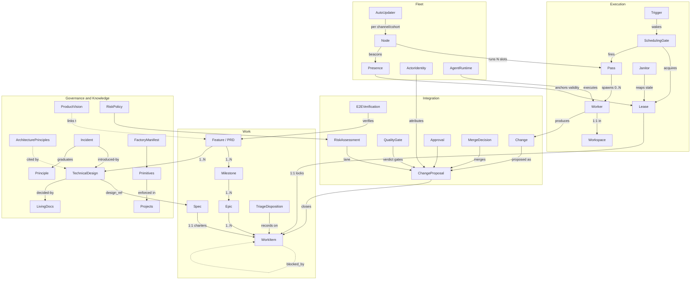

# Pyxis Domain Model

**v0.2 — extracted from harbormaster · 2026-07-01 · status: working draft for the design phase**
**v0.2 incorporates the operator product guidelines of 2026-07-01 — see
[`product-vision.md`](product-vision.md) and
[`architecture-principles.md`](architecture-principles.md) (the governing inputs).**

Provenance: distilled from a five-subsystem sweep of `agenticlab-ai/harbormaster`
(orchestration core · planning & work items · change integration & gates · fleet,
identity & agent runtimes · governance & knowledge). "Today" columns cite the
harbormaster artifact that implements each concept, for traceability. This document
is the ubiquitous-language baseline for the rewrite: *what exists and how it
relates*, ahead of deciding *how Pyxis implements it*.

---

## 1. Prime directives

Pyxis is an **open-source software factory**: engineers install it on their own
machines or servers, and it turns raw product ideas into merged, verified
changes, using agent workers, under governance (AP-1). It ships **only the core
logic — the engine**. Everything else is a **medium** — a replaceable place
where domain state is stored or domain actions are executed:

- **GitHub** is a medium (stores work items as issues, code as repos, proposals as PRs).
- **git** itself is a medium (stores leases as refs, presence as refs, changes as branches).
- **GitHub Actions** is a medium (runs checks). **tmux/cron/Docker** are media (host runtimes).
- **Claude Code / Cursor / Codex / OpenCode** are media (execute worker intelligence).
- **Schedulers and webhooks** are media (deliver wake signals — pull or push, AP-2).

The user of a Pyxis installation decides which media to bind. Three tests every
design decision must pass:

1. **Swap test** — replace GitHub with GitLab for code hosting, GitHub Issues
   with Linear for tracking, Actions with any CI, a polling scheduler with a
   webhook: the engine is untouched; only adapters change.
2. **Minimal form** — a single machine with **local bare git repositories** as
   the code host and **a plain file/directory** as the task tracker is a
   complete, working Pyxis installation. (This binding doubles as the hermetic
   test harness — see §8.)
3. **New-adapter test** — adding an integration point is as simple as following
   the port's adapter guide and passing its conformance kit; zero core changes
   (AP-3).

Two further axioms hold everywhere:

- **Deterministic core, explicit judgment points.** The engine is mechanical;
  intelligence is invoked only at named judgment points, through the
  AgentRuntime port (§2).
- **Contractual data everywhere (AP-6).** All information crossing any boundary
  (engine↔adapter, engine↔agent, node↔node) is schema-versioned structured
  data — no free-form text contracts. Schemas evolve additively and stay
  **compact**: token cost and payload size are design constraints.

The extraction confirms the split is real. Nearly every harbormaster concept is
medium-neutral; its *storage* is a medium trick (a lease stored as a git ref, a
state machine stored as GitHub labels, a worker charter stored as an HTML
comment). The governance and knowledge layers are already pure data (YAML / TOML /
Markdown) and port unchanged. The multi-CLI `adapters/` layer is an existing,
proven port-and-adapter seam — the pattern to replicate for every other medium.

---

## 2. Context map

| Bounded context | Responsibility | Heart of it |
|---|---|---|
| **Work** | What to build: features, work items, hierarchy, dependencies, specs, dispositions | Feature→Milestone→Epic→Task DAG |
| **Execution** | Getting work done: scheduling, mutual exclusion, workers, recovery | Lease + Pass + Worker + Janitors |
| **Integration** | Getting changes merged safely: changes, proposals, gates, risk, merge authority | QualityGate + RiskPolicy + MergeDecision |
| **Fleet** | Where execution happens: nodes, presence, identity, agent runtimes, distribution | Node + Presence + ActorIdentity + AgentRuntime + Updater |
| **Governance** | Keeping every project compliant: primitives, drift, policies, provisioning | Manifest + Doctor + policies-as-data |
| **Knowledge** | Why we build this way: vision, principles, PRDs, designs, incidents, living rollups | Immutable/append-only decision memory |
| **Observability** *(cross-cutting, first-class — AP-5)* | What happened: domain events, traces, spend, health | Contractual event stream + end-to-end traces |

### 2.1 The pipeline: raw idea → verified feature

The product surface is a pipeline of commands (product-vision.md). Stages 1–6
are the System-2 half (documents and judgment); 7–11 the System-1 half
(execution and upkeep):

| # | Stage | Actor | Produces | Harbormaster ancestor |
|---|---|---|---|---|
| 1 | Feature definition | Factory | Per-feature **PRD** (requirements, feature interactions, UX/behavior impact) | — *(new upstream)* |
| 2 | Feature review | Human | Approved PRD (inline-annotate loop) | design-review pattern |
| 3 | Design brainstorming | Factory ↔ Human | Candidate approaches, scored; back-and-forth | /brainstorm |
| 4 | Technical design | Factory | 1..N immutable **technical-design docs** from the PRD | /feature-design |
| 5 | Technical review | Human | Approved techspec(s) | /design-review |
| 6 | Implementation planning | Factory | **Milestones → epics → tasks** + dependency graph + specs | /feature-plan |
| 7 | Implementation | Factory | Per task: code + tests + doc updates + proposal | /feature-supervisor + workers |
| 8 | Implementation review | Human | Reviewed/merged proposals (risk-tiered: AUTO lane may bypass) | risk-tiered approval + feedback loop |
| 9 | E2E verification | Factory | Every PRD requirement verified end-to-end; no regression | verification-epic pattern *(graduated to a stage)* |
| 10 | Periodic maintenance | Factory | Stale-doc / dead-code / refactor findings → new work items | janitors + doc-audit *(graduated to a stage)* |
| 11 | Incident management | Factory | Incident records: what broke, why missed, prevention | /incident |

---

## 3. Entity catalog

Porting verdicts: **Port** = concept + rules move as-is · **Generalize** = concept
ports, storage moves behind a port · **Adapter** = belongs inside one adapter ·
**Drop** = medium accident, not part of the domain · **New** = required by the
product vision, no harbormaster ancestor.

### 3.1 Work

| Entity | What it is (key rules) | Today in harbormaster | Verdict |
|---|---|---|---|
| **Feature (PRD)** | The unit of product intent: a per-feature PRD capturing requirements, interactions with other features, UX/behavior impact. **Immutable once its introducing PR is approved** (AP-7); linked from product_vision; decomposes into technical designs and then milestones. | — (harbormaster starts at design docs) | **New** |
| **Milestone** | Delivery stage of a feature, grouping epics; dependency-ordered. Harbormaster's *Plan umbrella* ≈ this level; its verification-epic pattern graduates to pipeline stage 9. | Issue + `plan` label + sub-issues | **Generalize** |
| **Epic** | Coherent workstream grouping WorkItems; dependency-ordered members; auto-closes when all members close. | Issue + `epic` label + native sub-issues | **Generalize** |
| **WorkItem** (task) | Atomic, single-change-sized unit of work. States: draft → triaged → specced → ready → leased → in-progress → proposed → done (+ failure paths: worker-failed, merge-conflict, verify-pending). Readiness = deps closed ∧ no lease ∧ no open proposal ∧ authorized. | GitHub issue + labels + comments | **Generalize** |
| **DependencyEdge** | Partial order at every level of the hierarchy (task-level `blocked_by`, epic-level, milestone-level sequencing). | GitHub native blocked_by + body text (cross-repo) | **Generalize** |
| **Spec (worker charter)** | Frozen brief a worker executes from: goal, acceptance[], scope, type, deps, definition-of-done, design_ref, rung (capability tier), runtime override. Written once at plan time (judge-once), latest-wins, never edited in place. | `<!-- fs-spec:v1 {json} -->` issue comment | **Generalize** |
| **TriageDisposition** | One recorded decision per item: plan / operator / reject / structural-skip, plus orthogonal incident classification. Marker-gated: never re-judged unless explicitly re-opened (`retriage`). | Comment marker + labels | **Generalize** |
| **DecisionRecord** | Append-only, namespaced decision log on a work item (triage, claim witness, spec versions). The audit trail that makes every sweep idempotent. | Namespaced HTML comments | **Generalize** |
| **Signal** (today: Label) | Typed control state, not decoration. Roles: **routing** (local-agent, operator, needs-plan), **authorization** (local-agent = merge token), **status/recovery** (worker-failed, merge-conflict, verify-pending, hold, feedback-stalled, empty-pr), **classification** (kind:\*, area:\*, incident, risk:auto/human), **structural** (epic, plan, pinned). | GitHub labels (canonical set in `templates/python/labels.yaml`) | **Generalize** → typed states/fields; labels become a per-tracker *projection* |

### 3.2 Execution

| Entity | What it is (key rules) | Today | Verdict |
|---|---|---|---|
| **Lease** (today: Claim) | The load-bearing cross-node mutex on a WorkItem. Atomic compare-and-set acquire; holder identity recorded; dual TTL (own-unspawned ≈15m, foreign/PR-less ≈2h); validity anchored to holder **Presence**; fencing on loss (tombstone → worker aborts at next checkpoint); PR-bearing leases immune to reaping. | `claim/<N>` git ref + commit metadata | **Generalize** (LeaseStore port) |
| **Trigger** | The normalized wake signal that starts a tick — pull (scheduler) or push (webhook) or manual, all indistinguishable to the engine (AP-2); engine idempotent under duplicates; poll remains the backstop when push is bound. | cron/launchd watchdog (pull only; webhook was backlog #921) | **Generalize** (Trigger port) |
| **SchedulingGate** | Deterministic predicate deciding *fire vs idle* each tick: discovers ready/triage work, **acquires leases before invoking intelligence** (losers exit at ~0 cost), dedupes repeat no-op firings, enforces the forced-pass liveness floor. | `needs-llm-pass` in feature-supervisor.sh + supervisor-tmux.sh | **Port** (engine core) |
| **WorkOrder / WorkDigest** | The locked work set handed from gate to pass: `claimed[]` (binding), `ready[]`/`triage[]` (advisory, expiring), `mode → procedure` routing table (dispatch as data). | JSON digest + work-order-modes.json | **Port** |
| **Pass** | One orchestrator iteration over claimed work: spawn workers, handle triage, report. Ends with an audited **PassReport** where `succeeded[]` is artifact-verified and shipped-nothing workers land in `hollow[]`. | `/feature-supervisor` skill iteration | **Port** (becomes engine loop + judgment calls) |
| **Worker** | One agent execution for one WorkItem in one Workspace. Checkpoint-exit protocol (bounded turns → resumable exit), respawn cap, outcome ∈ {succeeded (verified), hollow, failed, checkpointed}. | Agent-tool sub-agent + spawn template | **Port** (executed via AgentRuntime port) |
| **Workspace** | Isolated working copy per WorkItem; deterministic branch; resume-aware; TTL-pruned after close. | git worktree `.worktrees/…` | **Generalize** (WorkspaceProvider) |
| **WipCheckpoint + ProgressNote** | Resumability protocol: early first push, checkpoint commits at milestones, small PROGRESS note (done/next/gotchas); final proposal is clean (checkpoints squashed, note removed). Orphaned-but-resumable branches are recoverable by janitors. | `[wip]` commits + PROGRESS.md | **Port** (protocol), storage per CodeHost |
| **Janitor** | TTL/GC sweeps keeping the system self-healing: lease reapers (never-spawned / foreign / lease-expired / crashed-worker), workspace pruning, presence pruning, closed-proposal head pruning, fenced-issue recovery, design-approval unparking. | `feature-supervisor.sh cleanup` et al. | **Port** |
| **MaintenanceSweep** | Pipeline stage 10 as a first-class recurring process: review code base + live documents for stale information, dead code, refactor opportunities → file work items. | partial (doc-audit, janitors) | **New** (graduates scattered pieces) |
| **JudgmentPoint** | Explicit places the engine invokes intelligence: feature definition, triage disposition, design brainstorming/authoring, plan decomposition, risk downgrade review, worker implementation, feedback resolution, e2e verification, maintenance review, incident capture. Everything else is mechanical. | Implicit (skills vs bash split) | **Port** (make first-class) |

### 3.3 Integration

| Entity | What it is (key rules) | Today | Verdict |
|---|---|---|---|
| **Change** | Branch + commits + diff for one WorkItem. Contract: conventional-commit message, closes-reference, commit on current branch (never auto-branch), deterministic branch name `<type>/<N>-<slug>`. | git branch | **Port** |
| **ChangeProposal** | The formal merge proposal. States: draft → open → green → merge-ready → merged (+ merge-conflict, worker-failed, held, empty). Carries risk lane, approvals, checks rollup, feedback threads. | GitHub PR | **Generalize** (ProposalService) |
| **QualityGate** | Local mirror of required checks run *before* a proposal opens; composed of **GateChecks** (blocking/non-blocking, diff-scoped/always); produces a **Verdict** and a short-lived **PassToken** (revision-pinned); includes the foreign-lease guard. Guard hooks re-enforce it as a backstop. | pre-pr-gate.sh + bash-guard.sh + gh-pr-guard.sh | **Port** (checks become pluggable per-project data) |
| **ImmutabilityGate** | The enforcement half of AP-7: changes to immutable paths (approved PRDs, technical designs) and append-only docs (vision, principles, incidents) by **automated authors** are rejected — at CI level *and* as prompt/guard constraints. | partial (design-doc gate; living-docs sole-writer) | **New** (hardens existing pieces) |
| **RiskAssessment** | Per-proposal lane (AUTO / HUMAN) + graded advisory level. Stage A deterministic floor (hard-gate globs, self-unlock, foundation floor) → Stage B narrow auto-candidates → Stage C intelligence **downgrade-only**. Judged once at proposal-ready, frozen as data. | classify-pr.sh + risk labels | **Port** |
| **RiskPolicy** | The floor and calibration knobs as versioned data: hard-gate globs, auto-candidate classes, foundation thresholds, maturation window, graduation rules (propose-and-confirm, never auto-applied), kill switch. | risk-policy.yaml (+ schema + validator) | **Port** (already data) |
| **Approval** | Review record attributed to the *acting identity* (engine-bot approvals as bot, humans as themselves), pinned to the exact revision; staleness on head change. | GitHub review by reviewer App | **Generalize** |
| **MergeDecision** | The authority predicate: explicit authorization signal on the closing WorkItem ∧ green checks ∧ no hold ∧ lane satisfied (AUTO: bot-approved; HUMAN: human approval). Idempotent and raceable — the losing racer emits a no-op event. | merge-ready sweep + reaper workflow | **Port** |
| **RequiredChecksProfile** | Per-project calibration of which checks are required (derived from what the project actually runs, never a forced superset). | bootstrap `--[no-]pr-lint` + .rig-config.yaml | **Port** |
| **FeedbackRound** | Human review comments on a proposal dispatch a bounded resolve-and-reply loop (round cap → escalate `feedback-stalled`). | pr-review-feedback-loop | **Port** |
| **E2EVerification** | Pipeline stage 9 as a first-class process: after a feature's tasks merge, verify every PRD requirement end-to-end and check for regressions to existing features; failures file work items. | verification-epic pattern | **New** (graduates the pattern) |

### 3.4 Fleet

| Entity | What it is (key rules) | Today | Verdict |
|---|---|---|---|
| **Node** | A kind-blind execution environment (laptop, always-on box, container — *no code path may distinguish*). Identity: stable `machine_id`, volume-seeded `instance_id` (lease/heartbeat key), display `node_name`. Two install roles on one engine: **supervisor** (fleet automation, bot identity) and **developer** (engineer workbench, human identity). | install.json + heartbeat payload; dev-install/node-install | **Port** |
| **Presence** (Heartbeat) | Per-node liveness beacon with payload (identity, pool size, snapshot); stale-warn ≈30m, reap TTL ≈48h; graceful deregister on teardown. **Anchors lease validity.** | `refs/heartbeats/<instance_id>` force-pushed refs | **Generalize** (PresenceStore) |
| **TelemetrySnapshot** | Current-state observability per node (liveness, activity, resources, throughput, health, queue); overwritten each tick, no history. | `refs/telemetry/*` | **Generalize** |
| **Pool / PoolMember** | N warm supervisor sessions per node, idle until the gate fires one. *Mechanism is Claude-TUI-specific; the domain concept is "N execution slots per node".* | tmux sessions + supervisor-tmux.sh | **Generalize** → slots; warm-TUI detail moves into the Claude adapter |
| **Watchdog** | The mechanical tick: maintenance (sync, beacon, janitors, merge sweep) + gate evaluation every ~5m; revives crashed slots. | cron/launchd + `pool ensure` | **Port** as the engine's own timer loop (one Trigger adapter) |
| **ActorIdentity** | Two-identity model: the **engine-bot** (App identity, scoped short-lived tokens minted per operation class: read / triage / work / merge) vs the **human engineer** (own identity). Every action attributable; bot credentials never persisted into shared auth stores. | GitHub App 3908348 + mint-app-token.sh + credential helper | **Generalize** (IdentityProvider) |
| **AgentRuntime** | Pluggable worker-execution backend. Existing contract: `launch / await / kill / auth_check / guard_shim / instructions_filename / tiermap(rung → model,effort)`. Routing precedence: spec override > project config > routing table. **Skills/hooks are authored once, canonically; each adapter translates them to its CLI-native form (AP-4) — content is never forked per CLI.** | `adapters/{claude,cursor,codex,opencode}.sh` + routing.json + resolve.sh | **Port** (the proven seam; generalize the pattern) |
| **RoutingPolicy** | (phase, type) → (backend, rung) as data; capability tiers ("rungs") map to native model/effort only inside each adapter. | adapters/routing.json | **Port** |
| **Installation / InstallTier** | Two participation modes on one engine: **engineer workbench** (human identity, no automation) and **fleet node** (bot identity, automation on), host or containerized; idempotent install/uninstall; version pins single-sourced. | dev-install.sh / node-install.sh / install-lib.sh / versions.env / Docker volume | **Port** (concept) / **Adapter** (container/tmux mechanics) |
| **ReleaseChannel / Cohort** | Staged distribution as data (AP-9): stable vs **beta (self-pull from git)** channels; a rollout targets a cohort — X% of accounts or named accounts — so impact is watched before widening (A/B). The docker test container updates the core in place from git, no image rebuild. | — (seeds: versions.env, `node-container.sh upgrade --pull`, sync-rig) | **New** |
| **AutoUpdater** | Keeps both install roles — supervisor nodes and developer workbenches — current with their channel on each release; observable, reversible. | sync-rig + upgrade --pull (seeds) | **New** (generalizes the seeds) |
| **TelemetryExporter** | Anonymous global product telemetry from users' supervisor/developer nodes, feeding system improvement; opt-in-respecting; **never load-bearing for local operation** (AP-9). | — | **New** |
| **NodeConfig** | Per-node knobs: managed projects, pool size, effort, power policy (e.g. refuse new leases on battery), TTL overrides, channel/cohort membership. | feature-supervisor.toml + supervisor.env | **Port** |

### 3.5 Governance

| Entity | What it is (key rules) | Today | Verdict |
|---|---|---|---|
| **Primitive** | A managed, governed artifact with an enforcement class: **L** linked (reserved-name shared assets), **M** merged (required keys inside shared config files — key-level merge, never byte-replace), **D** data invariants (ignore rules, never-tracked paths, required docs), **V** vendored (pinned reviewed artifacts, never fetch-and-exec). | factory-manifest.yaml + rig-doctor.sh | **Port** (classes); symlink mechanics per medium |
| **FactoryManifest** | The machine-decidable registry of primitives × tiers (project / org / user). Single source of truth enforcement reconciles toward. | factory-manifest.yaml | **Port** |
| **DriftFinding + Doctor** | Desired-vs-observed gap, classed **mechanical** (auto-fix: re-link, key-merge, append, drop-skeleton) vs **non-mechanical** (escalate to operator; destructive repairs never auto-run). Doctor = the check engine (fleet + engineer checks), dedup-filed findings. | rig-doctor.sh + doctor subcommand | **Port** |
| **OrgPolicy** | Org-level governance: excluded projects get *zero* writes, ever. | org-policy.toml | **Port** |
| **PyxisConfig** | Every onboarded repo carries a **`pyxis-config/` directory** — the sanctioned extension surface (AP-8): repo-specific engine configuration (closed schema, unknown key = hard error; knobs tiered self vs operator) **plus custom prompts for named actions/skills** used in that repo's development. | .rig-config.yaml (config half; prompt extension points are new) | **Port + extend** |
| **DocTemplate** | The five governed document templates: product_vision, architecture_principles, prd, technical-design, incidents — versioned assets rendered at authoring time, linted at gate time. | partial (design-doc template + check-design-doc.sh) | **Port + extend** |
| **LanguageProfile / Template** | Opinionated stack descriptor rendered at scaffold time (tools, layout, commands, CI suite, substitutions incl. ships-LLM-runtime gate). | templates/python/ | **Port** |
| **ProtectionSpec** | Merge-protection rules as data (required contexts, admin enforcement) applied idempotently per project. | branch-protection.json + bootstrap-repo.sh | **Generalize** (per code-host adapter) |
| **ProjectClassification** | Org adoption sweep: managed / adopt / archive / delete / excluded, propose-then-approve. | org-adopt skill | **Port** |
| **Scaffold** | New-project instantiation: create repo → render profile → provision CI/labels/protection + `pyxis-config/` → welcome item; idempotent, dry-runnable. | scaffold-project.sh + bootstrap-repo.sh | **Port** |

### 3.6 Knowledge

The document system (AP-7): five kinds, each templated; append-only or immutable
by class, so links never go stale.

| Entity | What it is (key rules) | Today | Verdict |
|---|---|---|---|
| **ProductVision** | Append-only governing input (human-authored, never derived from the governed system); links forward to feature PRDs and technical designs. | docs/factory-northstar.md | **Port** (renamed, link rules added) |
| **ArchitecturePrinciples** | Append-only citable rules; every technical design cites the principles it honors or deviates from, with reasoning. | docs/tech-design/design-principles.md (P0–P11) | **Port** (renamed) |
| **PRD (per-feature)** | Immutable once its introducing PR is approved; **no automated (non-human-authored) change permitted — CI gate + prompt/guard constraint**; decomposes into technical designs. | — | **New** |
| **TechnicalDesign** | Immutable decision record (header incl. one-line *Relevant-when* routing + *Builds-on* lineage DAG; required Principles section). Never edited after approval; superseded by a new doc citing the old. Same automated-author gating as PRDs. | docs/tech-design/*.md (57 docs) + check-design-doc.sh | **Port** |
| **LivingDocs (`prd.md`, `techspec.md`)** | Current-state rollups with a **sole writer** (reconcile flow); **updated, if needed, on every PR**; advisory content, forward-integrity-linted links. | docs/techspec.md + docs/prd.md + reconcile-docs | **Port** (cadence strengthened to per-PR) |
| **Incident** | Append-only, stably-numbered lesson: tags / decision / broke / lesson / links — **including the technical design that introduced the issue and the PR(s) that implemented it**; captures *why it was missed* and *what prevents recurrence*; single coded writer; retrieved at design time; may **graduate** into a principle. | docs/observability/incidents.md + incident-add.sh | **Port** (link contract strengthened) |
| **DriftSignal** | The single shared predicate "does this diff touch design-owned code?" consumed by reconcile, incident capture, and finalize — one implementation, many callers. | worker-drift-signal | **Port** |

### 3.7 Observability (cross-cutting, first-class — AP-5)

| Entity | What it is | Today | Verdict |
|---|---|---|---|
| **DomainEvent** | One structured record per state transition; ~60 kinds in stable families: gate (fire/skip/defer/forced), lease (claim/lost/reaped/fenced), merge (merged/noop/skipped), recovery (ci-fix, reconcile, feedback), health (starvation, churn, alarms), scheduling, maintenance. Cataloged; schema-versioned; additive evolution (readers default missing fields). | events.jsonl + docs/events-reference.md | **Generalize** (EventSink port; keep the catalog) |
| **Trace** | End-to-end causal chain as first-class data: idea → PRD → designs → milestones/epics/tasks → workers → proposals → verification. Every component action carries trace context; nothing is correlated by log-grepping. | implicit (id correlation across events.jsonl) | **Generalize** (make explicit) |
| **TokenUsageRecord** | Per-turn spend: kind pass/worker, end stop/killed, token quartet, turns, tool_uses. Additive-schema discipline. | token-usage.jsonl (Stop hook) | **Generalize** |
| **PassReport** | The per-pass audit row: spawned / succeeded (artifact-verified) / hollow / failed / skipped + budget. | pass_report event | **Port** |
| **HealthAlarm** | Escalation events with operator routing: gate-failure runs, claim churn, triage stuck, starvation, fleet silence. | doctor + events | **Port** |
| **GlobalTelemetry** | The anonymous, aggregated export slice of the above (via TelemetryExporter) — improves the product across installs; strictly decoupled from local operation. | — | **New** |

---

## 4. Relationships



Cardinality notes: Feature→Milestone 1..N; Milestone→Epic 1..N; Epic→WorkItem
1..N; Feature→TechnicalDesign 1..N; Lease↔WorkItem strictly 1:1 while active;
Worker↔WorkItem 1:1 per attempt (respawns allowed up to cap); Proposal↔WorkItem
1:1 (multiple proposals per item forbidden by gate); Node↔Presence 1:1;
Node→Leases 0..N; Incident→TechnicalDesign N:1 (introduced-by) +
Incident→Proposal N:N (implemented-by).

---

## 5. Canonical lifecycles

**Feature** (the pipeline, §2.1):

```
raw idea → PRD drafted (stage 1) → human-approved → IMMUTABLE (stage 2)
  → designs brainstormed + authored + approved (stages 3–5, immutable on approval)
  → planned: milestones/epics/tasks (stage 6) → implemented task-by-task (stages 7–8)
  → e2e-verified against the PRD, no regression (stage 9) → shipped
  (stages 10–11 run continuously: maintenance findings + incidents feed back in)
```

**WorkItem** (as the factory sees it):

```
created → undecided → [triage] → plan | operator | reject | skip
  plan → specced (charter written, authorized) → ready (deps closed, no lease, no proposal)
  ready → leased → in-progress → proposed → merged/closed
  failure paths: worker-failed | merge-conflict | verify-pending | feedback-stalled → recover (bounded) or operator
  reopened-after-reject → operator (never silently re-closed)
```

**Lease**:

```
free → acquired (atomic CAS; loser exits ~0 cost)
acquired → spawned → proposal-open → released-on-merge
acquired → never-spawned → own-TTL reap (~15m)
acquired → holder silent > lease TTL → lease-expired reap → (if worker in flight) fence → abort at next checkpoint, WIP survives
any → released (explicit) — every acquisition ends in spawn, release, or audited reap
```

**Change / Proposal**:

```
uncommitted → committed-on-branch → gate PASS → pushed → proposal open
open → checks green → risk lane assigned (once) → merge-ready → merged (squash; branch deleted)
open → conflict → bounded reconcile → merged | worker-failed
open → red CI settled → bounded ci-fix attempts → recovered | worker-failed
open → human feedback → bounded feedback rounds → resolved | feedback-stalled
```

**Node**:

```
installed (supervisor or developer role) → registered (presence beats) → working (holds leases)
  ├ asleep/offline → presence stale → leases lapse after TTL (work recoverable elsewhere)
  ├ on battery (policy) → refuses new leases, finishes in-flight
  ├ release published → AutoUpdater applies per channel/cohort (beta: self-pull from git)
  └ graceful stop → release held leases + deregister presence → absent
```

---

## 6. Invariant registry

The portable core of the system — most are incident-backed (paid-for lessons).
"Lands as": **A** aggregate rule · **P** port-contract requirement · **D** policy
data · **E** engine mechanic.

**Concurrency & safety**

| # | Invariant | Lands as |
|---|---|---|
| INV-1 | At most one active Lease per WorkItem; acquisition is atomic compare-and-set, first-writer-wins. | A + P |
| INV-2 | **Claim-before-fire**: leases are acquired mechanically before intelligence is invoked; losing racers cost ~0. | E |
| INV-3 | Every lease is reapable (dual TTL: own-unspawned fast; foreign/PR-less slow); no lease outlives its purpose silently — every acquisition ends in spawn, release, or audited reap. | E |
| INV-4 | Lease validity is anchored to holder Presence; a silent holder's leases lapse; an in-flight holder is *fenced* (tombstone → abort at next checkpoint) — never two merged implementations of one item. | A + E |
| INV-5 | A lease with an open closing proposal is never lease-reaped (PR-bearing immunity). | A |
| INV-6 | **Fail-closed destructive, fail-open additive**: destructive actions (reap, merge, release) require positive evidence; failed probes read as "alive"/skip. | A + P |
| INV-7 | Reads feeding destructive decisions must be strongly consistent (no cached/lagging search paths). | **P** |
| INV-8 | Every cross-node operation is idempotent and raceable; the losing racer emits a no-op event, never an error. | A + E |
| INV-9 | A worker mutates only its own Workspace — never the parent clone or the engine's own checkout. | E (guard) |
| INV-10 | Proposing a change that closes an item leased to another node fails the gate (foreign-lease guard; explicit override only). | E |

**Liveness**

| # | Invariant | Lands as |
|---|---|---|
| INV-11 | Liveness floor: every ready item is attempted at least once per forced-pass interval (unconditional ceiling included). | E |
| INV-12 | Fair rotation across projects (persisted cursor); one project can't starve the rest. | E |
| INV-13 | **Silent skips escalate**: repeated no-op patterns (stuck triage, claim churn, gate-failure runs) raise operator alarms. | E |
| INV-14 | Starvation detection: ready-but-unclaimed across N consecutive digests warns. | E |

**Quality & integration**

| # | Invariant | Lands as |
|---|---|---|
| INV-15 | A proposal opens only on a green QualityGate (guard-hook backstop included). | E |
| INV-16 | **Artifact-verified success**: a worker succeeded only if its verified proposal exists; shipped-nothing = hollow, reported distinctly. | A |
| INV-17 | Merge authority requires an explicit authorization signal on the closing WorkItem; `hold` always blocks; nothing merges implicitly. | A + D |
| INV-18 | The risk floor is deterministic; intelligence may only **downgrade** (AUTO→HUMAN); ambiguity, timeout, or error routes HUMAN. | A + D |
| INV-19 | Self-unlock guard: changes to the risk policy/classifier are always HUMAN-lane. | D |
| INV-20 | Approvals are attributed to the true acting identity and pinned to the exact revision. | P |
| INV-21 | Change contract: conventional commit, closes-reference, commit on the current branch (never auto-branch), deterministic branch naming. | A |
| INV-22 | WIP-checkpoint protocol: early first push, milestone checkpoints, progress note; the final proposal is clean. | E |
| INV-23 | All recovery is bounded (ci-fix attempts, reconcile rounds, feedback rounds, respawns) and escalates to a human at the cap. | A + D |

**Governance & fleet**

| # | Invariant | Lands as |
|---|---|---|
| INV-24 | Nodes are kind-blind: behavior keys on observed state (presence freshness, power, slots), never on a declared kind. | A |
| INV-25 | Identity separation: the engine acts as a bot identity with scoped, short-lived, per-operation credentials, never persisted into shared auth stores; humans act as themselves. | P |
| INV-26 | **Governance is never rebuilt from the governed**: manifests/policies are human-authored inputs; enforcement reconciles toward them. | A |
| INV-27 | Reserved names are managed; extensions live under non-reserved names; shared config files are merged key-level, never byte-replaced. | E |
| INV-28 | Mechanical drift is auto-fixed; non-mechanical drift escalates; destructive repairs never auto-run. | E |
| INV-29 | Excluded projects receive zero writes, ever. | A + D |
| INV-30 | **One predicate, one place**: shared decisions (readiness, drift, reap-eligibility) have exactly one implementation consumed by all callers. | E |
| INV-31 | **Judge once at the richest context, freeze as data**: capability/risk/routing judgments are made once (plan-time / proposal-time) and stored; downstream reads, never re-judges. | A |
| INV-32 | Closed schemas for all policy/config data: unknown keys are hard errors. | D |

**Knowledge**

| # | Invariant | Lands as |
|---|---|---|
| INV-33 | Per-feature PRDs and technical designs are immutable once approved; supersession is a new doc citing the old (rationale trail preserved). | A |
| INV-34 | Living docs (`prd.md`, `techspec.md`) have a sole writer, are reconciled (if needed) on every PR, and are advisory — never a merge gate. | A |
| INV-35 | Incidents are append-only with stable IDs and one coded writer; each links the introducing technical design and the implementing PR(s); lessons graduate into principles. | A |
| INV-36 | Feature-typed changes require a design-doc reference (design-doc-first). | A + D |

**Product & platform (v0.2 — from the operator guidelines)**

| # | Invariant | Lands as |
|---|---|---|
| INV-37 | **Core/adapter separation (AP-1/AP-3)**: the core never references a concrete medium; every integration sits behind a documented port with an adapter guide + conformance kit; a new adapter requires zero core changes. | A + P |
| INV-38 | **Trigger-independence (AP-2)**: pull (scheduler) and push (webhook) deliver the same normalized signal; engine behavior is identical and idempotent under duplicate triggers. | P |
| INV-39 | **Contractual data (AP-6)**: all component-crossing information is schema-versioned structured data — no free-form text contracts; schemas evolve additively and stay compact (token cost is a design constraint). | A + P |
| INV-40 | **Skill/hook portability (AP-4)**: skills/hooks are authored once, canonically; per-CLI translation lives in AgentRuntime adapters; content is never forked per CLI; the set is portable to user machines. | P |
| INV-41 | **Immutability gating (AP-7)**: automated (non-human-authored) changes to approved PRDs/technical designs and to append-only docs (vision, principles, incidents) are rejected at **both** CI level and prompt/guard level. | E + D |
| INV-42 | **Observability first-class (AP-5)**: every action emits contractual events and carries trace context; a feature is traceable end-to-end (idea → PRD → designs → tasks → proposals → verification). | A + P |
| INV-43 | **Staged distribution (AP-9)**: releases roll out via channels and cohorts (X% or named accounts); beta tracks git directly (incl. in-place container core updates); impact is observed before widening. | D + E |
| INV-44 | **Telemetry boundaries (AP-9)**: global telemetry is anonymous and consent-respecting; local operation never depends on the global plane. | P |

---

## 7. Ports (the hexagonal seams)

The engine speaks only to these interfaces. Contract requirements come straight
from the invariant registry — and ship as a **conformance test kit** every
adapter must pass, paired with a written adapter guide (AP-3: "following a
document and it just works" is the acceptance bar).

| Port | Engine needs | Contract requirements | GitHub-stack adapter (today) | Minimal-local adapter |
|---|---|---|---|---|
| **WorkTracker** | CRUD work items; hierarchy; dependency edges; typed states & signals; append DecisionRecords; queries (ready set, undecided set); file operator escalations | Strong reads for destructive predicates (INV-7); append-only records; idempotent upserts | GitHub Issues + labels + sub-issues + comment markers | Directory of YAML/JSON task files (or tasks.jsonl) |
| **CodeHost** | Repos of record; fetch/push; branch CRUD; **atomic ref CAS**; ref-namespace scans | CAS atomicity (INV-1); exact existence probes (INV-7) | GitHub remotes over git | Local bare repos (`file://` remotes — git CAS works identically) |
| **WorkspaceProvider** | Isolated working copy per item: create / resume / prune | Isolation (INV-9); deterministic naming (resume) | git worktrees | Same |
| **ProposalService** | Open/label/approve/merge/close proposals; checks rollup; empty-diff detection; feedback threads | Idempotent+raceable merge (INV-8); revision-pinned approvals (INV-20) | GitHub PRs + reviews + checks API | Proposal records in the tracker + local merge into main |
| **ChecksProvider** | Required contexts per project; latest status per check | Settled-state semantics (recovery loops key off it) | GitHub Actions + branch protection | Run the gate suite locally — the CI mirror *is* the CI |
| **LeaseStore** | acquire(item, holder) CAS · release · inspect(holder, age, proposal-bearing) · scan · fence signal | INV-1..6 wholesale | git refs `claim/<N>` on the code host | Same via local bare repo — or flock/SQLite |
| **PresenceStore** | beacon(node, payload) · list · reap · graceful deregister | TTL semantics; payload versioning | `refs/heartbeats/*`, `refs/telemetry/*` | State-dir files with mtimes |
| **AgentRuntime** | launch(brief, workspace) → handle · await → {status, result, spend} · kill · auth_check · guard wiring · tiermap(rung → model/effort) · **canonical skill/hook translation (INV-40)** | Guards enforce INV-9/15; spend + trace reporting | adapters/{claude,cursor,codex,opencode}.sh + routing.json | Same (this port already exists) |
| **Trigger** | subscribe/deliver normalized wake signals: pull (scheduler tick), push (webhook), manual | Identical engine behavior either way; idempotent under duplicates (INV-38); poll remains the backstop when push is bound | cron/launchd watchdog (pull) | Engine-internal timer loop |
| **IdentityProvider** | Actor identities (engine-bot vs human); mint scoped short-lived credentials per operation class; attribution | INV-25; never persist to shared stores | GitHub App + inline mint + credential helper | OS user (no-op) |
| **EventSink** | append(event) · query (kind/session/node/item/trace) · retention | Append-only; additive schema evolution; trace context (INV-42) | events.jsonl + token-usage.jsonl | Same |
| **TelemetryExport** | export anonymized aggregate slices to the global plane | Anonymous, consent-respecting, never load-bearing locally (INV-44) | — (new) | No-op |
| **UpdateFeed** | discover releases per channel; fetch; apply per cohort; report outcome | Staged rollout (INV-43); observable + reversible | GitHub Releases / git self-pull (beta) / container in-place core update | git pull from a local clone |
| **SecretStore** | store/retrieve credentials | Mode-600 semantics / OS keychain | Keychain / volume files | Same |

**Binding is user configuration.** A Pyxis installation declares its media in
config — e.g. `tracker: github|linear|file`, `codehost: github|gitlab|local`,
`ci: actions|local`, `runtime: claude|codex|cursor|opencode`,
`trigger: schedule|webhook`, `channel: stable|beta` — exactly as harbormaster's
`routing.json` + spec override + project config already do for agent runtimes
(precedence: item override > project config > installation default).

---

## 8. The minimal-local reference medium ("factory in a box")

The simplest complete installation — and the engine's hermetic acceptance-test
environment. No network, no GitHub, no tokens:

| Port | Binding |
|---|---|
| WorkTracker | `~/pyxis/tracker/` — one YAML file per WorkItem (state, signals, edges, spec, decision records) |
| CodeHost | `~/pyxis/repos/<name>.git` — bare repos; clones/worktrees under a workspace root |
| LeaseStore | git refs on the local bare repo (`file://` CAS is atomic) |
| PresenceStore | `~/pyxis/state/presence/<node>.json` (mtime = beacon) |
| ProposalService | proposal records in the tracker + `git merge` into main on green |
| ChecksProvider | the project's gate commands run locally |
| Trigger | engine-internal timer |
| IdentityProvider | OS user |
| AgentRuntime | any installed adapter (claude/codex/…) |
| EventSink | `~/pyxis/state/events.jsonl` |
| TelemetryExport / UpdateFeed | no-op / local git pull |

Why this matters beyond the demo: **every engine behavior — leases, TTL reaps,
fencing, gates, merges, recovery loops — becomes testable in-process with zero
mocks.** The conformance kit (§7) runs against the local adapters first, then
against GitHub/GitLab/Linear adapters unchanged.

---

## 9. What does *not* port (medium accidents)

| Left behind | Why |
|---|---|
| tmux pool + `pool ensure` revive dance + interactive-TUI session mechanics | Replaced by a real daemon owning its slots; warm-session needs live inside the Claude adapter if that CLI still requires them |
| Labels as the state store | Labels become a per-tracker *projection* of typed states (kept bidirectional on GitHub so humans still see/set them) |
| HTML-comment marker grammar (spec / triage / claim markers) | DecisionRecords become structured data behind WorkTracker; no comment parsing (INV-39) |
| Claim *marker* comment (the redundant lock witness) | LeaseStore is authoritative (harbormaster was already heading there: claim-ref-single-source) |
| `.git/.pre-pr-gate-pass` token file | Engine state |
| ETag/search-API freshness workarounds | Graduates into the port contract (INV-7) instead of scattered hacks |
| Symlink distribution of primitives + `sync-rig` self-update | Packaging/distribution concern of a versioned engine (binary + assets) behind UpdateFeed; the *primitive/manifest/drift* concepts stay |
| Inline `GH_TOKEN=$(gh-token …)` mint-per-call dance | IdentityProvider handles minting/caching internally |
| bash-3.2 floor, `bash -n` as CI, YAML-lite hand parsers | Replaced by a typed language, real parsers, and a real test suite |
| cron/launchd as the scheduler of record | One Trigger adapter among several; the engine daemon owns its ticks |
| Free-form prose handoffs between components | Everything contractual (INV-39): schema-versioned, compact, additive |

---

## 10. Open modeling questions for the design phase

1. **Engine state (the big one).** Does Pyxis keep an authoritative local store
   (e.g. SQLite) with media as projections/caches — or stay *stateless over the
   media* (harbormaster's model: the tracker+refs ARE the database)? Leases and
   presence lean stateless-over-media (multi-node correctness comes from the
   medium's CAS); a store changes the consistency story and the swap test.
2. **Canonical WorkItem state schema.** Exact typed states + signal set, and the
   projection contract each tracker adapter must implement (GitHub labels,
   Linear states, file fields).
3. **Gate definition as data.** Per-project check suites (commands, blocking
   class, diff-scoping) declared in `pyxis-config/` — how far does the closed
   schema go, and where do custom prompts plug in?
4. **Process shape.** One `pyxis` daemon per node (slots inside) vs N sessions;
   how the Claude warm-TUI constraint maps into the AgentRuntime contract.
5. **Event/trace store.** Keep JSONL append families or move to an embedded
   store with the doctor/alarm layer as queries; either way keep the catalog,
   additive schemas, and first-class trace context (INV-42).
6. **Conformance kit contents.** Which invariants become executable
   port-contract tests (CAS atomicity, strong reads, idempotent merge, TTL
   semantics, trigger idempotence) — build the kit before the first real
   adapter.
7. **Telemetry model.** Anonymization + consent mechanics for global telemetry
   (open-source trust); exactly which aggregate slices are exported (INV-44).
8. **Update mechanics.** Channel→git-ref mapping, cohort assignment (X% /
   named accounts), rollback story, and the in-place container core update
   versus image releases (INV-43).
9. **Vocabulary.** Code keeps the plain ubiquitous language above;
   Pyxis-flavored naming (if any) stays at the product surface.

*(Resolved in v0.2: hierarchy generality — fixed roles Feature → Milestone →
Epic → Task, with dependency edges at every level; the verification-epic
pattern graduates to pipeline stage 9.)*

---

*Next step: human review of `product-vision.md` + `architecture-principles.md`
(the governing inputs), resolve Q1 (engine state), then design the port
interfaces + the minimal-local adapters + the conformance kit as the first
implementation slice.*
