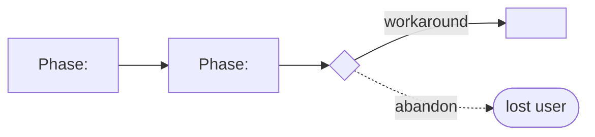

# <Feature or capability name> — PRD

| Field | Value |
|---|---|
| **In one line** | <what this PRD covers, in one plain sentence — the load-or-skip description> |
| **Relevant-when** | <load this document when… — planning, building, or reviewing work that touches <capability>; triaging its defects; changing systems it interfaces with> |
| **Status** | Draft → Problem review → Solution review → Launch review → Launched *(advance as gates pass)* |
| **Tier** | T1 / T2 / T3 *(the how-to's tier table — pick the smallest that fits; upgrade on evidence)* |
| **Owner** | <one accountable person — writes this doc, drives the work, no co-owners> |
| **Approver(s)** | <who signs each gate> |
| **Contributors** | <product, design, engineering, data, support, security, legal — named> |
| **Informed** | <stakeholders who read §1 only> |
| **Date** | <YYYY-MM-DD created · YYYY-MM-DD last updated> |
| **Appetite** | <the total spend this problem is worth: human attention (review budget, judgment points) + machine work (tokens / $ / worker passes) + rollout/support burden — a budget, not an estimate> |
| **Target release** | <version or dependency milestone, and why it matters> |
| **Tracking** | <epic / issue link> |
| **Artifacts** | <ux/design artifacts · research corpus · analytics dashboard · experiment plan — never technical designs: they cite PRDs, not the reverse> |
| **Template version** | prd-template/v2 *(the schema this document is parsed against — recorded at instantiation, never edited after)* |

## How to use this template

*Guidance paragraphs look like this one — italic, starting with a role word. Delete every guidance paragraph when instantiating. Keep section numbers and requirement IDs stable forever: never renumber, never reuse (supersede instead). A section you skip stays in the doc as its heading plus one line — "Skipped: <reason>" — so reviewers see the decision, not a gap.*

*The first two header fields are the routing surface — the analogue of a skill description. An agent or human scanning many PRDs reads only In-one-line and Relevant-when to decide whether to load the rest; write them so that decision is cheap and reliable: name the capability, the behavior it governs, and the situations that should pull this document into context. When instantiating, fill Relevant-when by completing the formula — planning, building, or reviewing <capability>; triaging defects in <its user-visible behavior>; changing <systems it interfaces with> — using concrete nouns, never pronouns, so a scanner can match its current task against the string.*

*Ownership boundary: the PRD owns what, why, for whom, constraints, observable behavior, acceptance, and completion evidence; the technical design (`docs/tech-design/`) owns architecture, APIs, data models, and implementation tradeoffs; the Definition of Done (§5.8) owns how completion is proven. A §5 row that prescribes implementation has crossed the line — move it to the design.*

*Post-approval evolution: once this document merges as a ledger base (`000-base.md`), it is immutable — changes land as typed amendments in the feature's ledger directory and are folded into the generated projection (`effective.md` + `effective.source.json`); see `docs/tech-design/prd-amendment-model.md`. The gates and Status ladder here govern the draft phase; the ledger governs everything after.*

*Scale to risk, not to habit. Pick the smallest tier that fits, and upgrade a tier when evidence or blast radius says so:*

| Tier | When | Required sections |
|---|---|---|
| **T1 — One-pager** | Reversible, well-understood, small spend budget and blast radius | §1, §3.4, §5.1 (Must rows + non-regression), §5.2 when failure paths exist, §5.8, §7.2, §8 *(§6.4 folds into §5.8's blocking rows; §0 may be skipped with the standard `Skipped: <reason>` line — a document that skips §0 holds no §0 gates)* |
| **T2 — Standard** | Default for most features | §0–§8, tables kept short; §5.3–5.5 and §5.9 as relevant |
| **T3 — Full rigor** | Irreversible, security/privacy/money/data-migration surface, platform contracts, regulatory exposure | Everything, §0 included: abuse cases, DPIA check, tracking plan, migration plan, evals where behavior is model-driven |

*Skipping is normal, not failure — most PRDs skip several sections, and the heading plus "Skipped: <reason>" is the record; reviewers judge the reason, not the gap. Two sections are never skipped, at any tier: §5.8 and §8 — they are what makes the PRD executable by the factory instead of merely well-written.*

*The thirteen rules this template enforces — the distillation of the research corpus behind this template (sources recorded in its landing PR):*

1. **Discovery precedes documentation.** This doc records validated learning; it is not a substitute for discovery. Every claim in §2 carries evidence and a confidence rating.
2. **Problem before solution, hard-gated.** Nothing below §3 is written — or read in review — until the problem gate is signed.
3. **Narrative with progressive altitude.** §1 is prose a reader can act on without reading further; depth lives below.
4. **Requirements say what, never how.** Do not spec a candle and prevent the light bulb.
5. **Atomic, ID'd, measurable.** One requirement per statement, an ID that never changes, a fit criterion and a verification method on every row — if you cannot measure it, you do not yet understand it.
6. **Unhappy paths are requirements.** Error, empty, loading, partial, offline, abuse, migration — specified with the same rigor as the happy path.
7. **Metrics are derived, targeted, and guarded.** Goal → signal → metric with baseline, target, checkpoint; guardrails pre-registered with a decision rule; percentiles, never averages.
8. **Non-goals are as load-bearing as goals.** Draw the perimeter; park deferrals in the waiting room with an intended version.
9. **Appetite scopes the work.** Fix the budget, shape the solution to fit; name the rabbit holes before betting.
10. **Ignorance is explicit and owned.** Unknowns are marked `TBD(owner, blocking gate)` in place; zero TBDs may survive the solution gate.
11. **Rollout is reversible by design.** Flags, staged percentages with exit criteria, a tested kill switch, and a trigger-bound post-launch verdict: adopt, iterate, or kill.
12. **Written for humans and agent workers alike.** Stable IDs, machine-checkable criteria, explicit boundaries — this document is executed, not just read.
13. **Done is declared, not discovered.** §5.8 states every completion criterion with its proof and required evidence; §8 refuses handoff while the factory would have to guess.
14. **Frozen prose states no volatile facts.** Once merged this document is immutable — never write a count, range, enumeration, or repo path a later change can falsify ("the six gate verbs", "AP-1..9", `docs/templates/`); name the concept and point at the live surface (a projection, an index, a config key) that owns the current value. The review wave (#54 D3) found this failure four ways.
15. **Sign-offs collapse honestly at small team size.** With a solo operator, the gate tables record the one real review (the introducing PR's) rather than inventing roles — write "via the introducing PR's operator review", never fill ceremonial rows that always pass.

## 0. Read to rule — the human reviewer's section (~N min)

*Audience: the gate-signing human reviewer — and no machine: automated consumers (the unmanned reviewers per their ledgers' adoption, the compiler, traceability, workers, stage flows) skip this section entirely; it is informative, never normative, and nothing downstream may cite into it. Write it last, from this document's own content — every routed item names its body anchor (§/row id) and resolves in this document. The contract (`prd:read-to-rule` · design `read-to-rule-v1` §3.1): the four blocks below, in order, each present or asserted empty as `none — <one-line assertion>`; at most 40 markdown source lines from the heading through the skip map's last line; ranked calls at most 7 rows (healthy instances typically carry 3–7), ordered by irreversibility × blast radius; required at T2/T3, skippable at T1 with the standard skip line. Fill the reading-budget hint in the heading. Amendments that change content §0 routes to update it wholesale — `op: supersede §0`, full replacement body, declared at the computed `contract-changing` tier with the §0-only informative scope in the reason. Delete this guidance paragraph when instantiating; the italic notice line below is contract boilerplate — keep it verbatim.*

*The body is the contract; this section only routes attention — on any conflict the body governs; machines ignore it.*

**Judge these** *(each row: the call · the alternative it displaced · what disagreeing concretely means, with its anchor)*

| # | The call | Could have gone | If you disagree |
|---|---|---|---|
| 1 | <the decision that could have gone the other way> | <the displaced alternative> | <what a veto means for the reviewer> → <§/row> |

**Sanity-check the numbers** — <the targets, caps, and tolerances worth a gut-check, each anchored — or: none — <assertion>>

**The author's open questions** — <the low-confidence calls awaiting the reviewer, each anchored — or: none — <assertion>>

**Skip the rest** — <each content class this section omits and the mechanism that backstops it — e.g. structure → docgate; substance/coherence → the unmanned reviewer; implementation defects → downstream gates>

## 1. Summary — the one-pager

*Audience: everyone, including people who will read nothing else. Write it last, keep it under one page, keep it prose. It must answer: what problem, for whom, why now, what direction, what does success measurably look like, what could kill it. For T1, Success and Guardrail may be acceptance-style criteria rather than instrumented metrics — e.g. "100 simulated lease expiries recover with zero duplicate assignments" / "no existing lease test regresses" — observable and verifiable all the same.*

- **Problem** — <two sentences, in the user's words, no solution vocabulary>
- **For whom** — <primary segment + how many / how often>
- **Why now** — <what changed: evidence, market window, strategic dependency>
- **Direction** — <three sentences on the proposed approach, at concept level>
- **Appetite** — <budget from the header, restated with what it excludes>
- **Success** — <the one primary metric: baseline → target at a named checkpoint>
- **Guardrail** — <the one metric this must not degrade, and its threshold>
- **Top risks** — <the three most credible ways this fails>

## 2. Problem space

*Rule: no solution content anywhere in §2. If a sentence names a feature, move it to §4 or delete it.*

### 2.1 Problem statement

*One short paragraph: who hurts, when, how badly, and the cost of doing nothing. A rambling feature list here means the problem is not yet understood — stop and do discovery.*

### 2.2 Users and segments

*Personas earn their place only when research-grounded and design-relevant — every attribute listed must change a decision in §4/§5; delete decoration. Rate experience per axis: novice / journeyman / master. Include an anti-segment: who this is explicitly not for.*

| Segment | Role and context | Domain exp. | Tech exp. | Key goals | Pain today | Evidence |
|---|---|---|---|---|---|---|
| **P1 (primary)** | <who, where, on what device/cadence> | novice·journeyman·master | novice·journeyman·master | <top 2–3> | <top 2–3> | <link> |
| P2 (secondary) | … | … | … | … | … | <link> |
| **Anti-segment** | <who we are not serving, and why that is deliberate> | — | — | — | — | — |

### 2.3 Jobs and desired outcomes

*Job stories carry causal context that persona attributes cannot. One row per job; today's workaround is the competition.*

| # | When… (situation) | I want to… (motivation) | So I can… (outcome) | Today's workaround | Evidence |
|---|---|---|---|---|---|
| J1 | <situation> | <motivation> | <outcome> | <workaround or "none — job goes undone"> | <link> |

### 2.4 Evidence

*Every load-bearing claim gets a row. Confidence is honest: High = multiple independent sources or hard data; Medium = one good source; Low = belief. Low-confidence claims that §4 depends on become assumptions in §6.3.*

| Claim | Source (research, data, tickets, interviews) | Confidence |
|---|---|---|
| <claim the PRD depends on> | <link — quote or number, not vibes> | High / Med / Low |

### 2.5 The journey today

*Map the current experience end-to-end so the intervention point is visible: phases, user actions, emotions/pain, and the frontstage/backstage system touchpoints behind each phase — this is where user detail meets system detail. A mermaid sketch or a linked blueprint both work.*

| Phase | User does | User feels / pain | Frontstage (what user sees) | Backstage (systems, people, processes) |
|---|---|---|---|---|
| <discover / decide / do / verify / recover> | … | … | … | … |



### 2.6 Opportunity and why now

*The ten-question opportunity discipline, compressed: size it, name the alternatives, argue the timing. If the recommendation would be "do not build", say so here — that is a successful PRD.*

- **Size** — <how many users × how often × value per occurrence; or revenue/cost line>
- **Alternatives users have** — <competitors, workarounds, do-nothing>
- **Why us / strategic fit** — <the durable advantage this builds on>
- **Why now** — <market window, dependency unlocked, risk of waiting>
- **Cost of doing nothing** — <quantified where possible>

**Decision:** Problem gate — do not proceed to §3–§4 until every contributor signs. *(sign-off table below)*

| Reviewer | Role | Date | Verdict |
|---|---|---|---|
| <name> | <role> | <date> | approved / needs-discovery |

*The capture line — the convention for every gate sign-off on a §0-bearing document (this table and the §4/§6 gates alike; stated once here, the guides point at it): one physical line per review event — a collapsed review signing several gate tables at once is one §0 gate, one line — recorded on the sign-off row during the draft phase, on the approving review for amendment gates:*

*`capture: <N>m [· sampled: full read <M>m] · items: [in|out] <entry-citation or gist> · … — or: items: none`*

*`<N>m` is the §0 pass plus drill-ins — the only quantity the gate-time metric consumes; `<M>m` is the sampled full read's own time (at least one full read within every five consecutive §0 gates). Each feedback item carries `[in]` or `[out]` and its `review-feedback:<subject-stem>#<entry-anchor>` citation where the capture adapters recorded it (cite only entries already committed — the resolution gate enforces every such citation), else a short gist; a sampled gate's extra findings are `[out]` items on the same line. Fallbacks: a pre-§0 document's gates sign exactly as today, outside this convention; a §0 item whose route went stale falls back to the body (which governs), the miss recorded as an `[out]` item. A problem-only review on a §0-bearing document is still a §0 gate — it carries the line or stands as a recorded lineless miss (never blocking; a lineless gate's datum is simply void); it takes §0's problem-space rows and defers solution-space rows to the later gate.*

## 3. Goals, metrics, and guardrails

### 3.1 Goals as falsifiable hypotheses

*State each goal so it can lose: tentative, falsifiable, testable. Pair every purpose with an advantage and a measurement. Qualitative goals (how it should feel) are legitimate — list them, labelled as such.*

| # | We believe that… | Will result in… | Measured by… |
|---|---|---|---|
| G1 | <building X for segment P1> | <outcome/behavior change> | <metric M1 below> |
| G2 *(qualitative)* | <e.g. the flow feels trustworthy> | <signal: unprompted user language> | <qual method: interviews, CSAT verbatims> |

### 3.2 Goals → signals → metrics

*Derive, never declare: goal → observable signal (behavior or attitude) → checkpoint-bound metric. A checkpoint is an observable exposure condition (rollout stage reached, N users or tasks through the flow) — never a calendar promise. Use the HEART menu (Happiness, Engagement, Adoption, Retention, Task success) to avoid one-dimensional counting. Ratios over counts; percentiles over averages; every metric names the event that feeds it (§5.7).*

| Metric | Goal | Signal | Baseline | Target (at checkpoint) | Feeds from |
|---|---|---|---|---|---|
| M1 (primary) | G1 | <behavior observed> | <number> | <number at checkpoint> | EVT-1 |
| M2 | … | … | … | … | EVT-n |

### 3.3 Guardrails and decision rule

*Pre-register what this launch must not damage, the threshold, and the action — deciding after seeing the data is not deciding. This table is the rollback contract for §6.5.*

| Guardrail metric | Threshold | Action if breached |
|---|---|---|
| <e.g. p95 latency of adjacent flow> | <e.g. +10% over baseline across a stage's minimum evidence (§6.5)> | pause rollout / rollback / discuss |

**Ship rule (pre-registered):** <e.g. M1 hits target AND no guardrail breached → proceed to 100%; M1 flat and guardrails clean → discuss; any guardrail breached → rollback.>

### 3.4 Non-goals and waiting room

*As clarifying as the goals. Non-goals are deliberate refusals with reasons — they are the perimeter, and for agent workers they are guardrails. The waiting room holds good ideas deliberately deferred, each with an intended revisit.*

| ID | Non-goal | Why refused |
|---|---|---|
| NG-1 | <what we will not do, even though someone will ask> | <reason: appetite, risk, strategy> |

| ID | Waiting room | Revisit when / intended version |
|---|---|---|
| WR-1 | <deferred capability> | <trigger or version> |

## 4. Solution space

*Enter only through the problem gate. Solutions are described at the level of interaction and behavior — concept-concrete, implementation-free.*

### 4.1 Approach and alternatives considered

*The chosen shape in one paragraph, then the alternatives table — comparing options is what makes the decision trustworthy; a PRD with one option is an announcement, not a decision.*

| Option | Sketch | Why not chosen |
|---|---|---|
| A (chosen) | <one-line shape> | — |
| B | <one-line shape> | <cost, risk, misfit — honest> |
| Do nothing | — | <what happens; ties to §2.6> |

### 4.2 Scope perimeter

*Plan of record vs future vs out. Draw the boundary so the team fills it in rather than negotiating it per ticket.*

- **In (plan of record)** — <the features that exist at launch>
- **Future (believed next, not committed)** — <so design leaves room>
- **Out** — <explicitly not in this shape; mirrors §3.4>

### 4.3 Experience: flows and states

*One subsection per key flow. Steps reference live design artifacts (link the source of truth, never paste stale screenshots). Every screen ships in five states — ideal, empty, loading, partial, error — and error states never destroy user input. Note accessibility (target WCAG level and which pages/processes are in scope — conformance is whole-page, whole-process) and localization impact here, where the design decisions happen.*

**Flow F1 — <name> (serves J1)**

| Step | User does | System responds | States covered | Design |
|---|---|---|---|---|
| 1 | <action> | <response> | ideal · empty · loading · partial · error | <link> |

- **Empty** — <first-use, cleared, no-results: what the user sees and can do>
- **Loading** — <what is shown, what is interactive, timeout behavior>
- **Partial** — <some data present: what renders, what defers>
- **Error** — <message voice, preserved input, recovery path>
- **Accessibility** — <WCAG <level> across <pages/process>; keyboard path; announcements>
- **Localization** — <strings, formats, RTL, content expansion>

### 4.4 Scenarios

*Two to four short narratives: the common case told as a story, then the edgy ones — a new user, a power user at scale, a failure mid-flow. If a scenario is awkward to tell, the design has a hole. Optionally lead with a one-paragraph internal press release: if it cannot excite, rewrite the shape, not the paragraph.*

**Decision:** Solution gate — contributors sign that this shape, at this appetite, is the bet. Zero TBDs may pass this gate.

| Reviewer | Role | Date | Verdict |
|---|---|---|---|
| <name> | <role> | <date> | approved / revise |

## 5. System requirements

*How to write every requirement in this section: one sentence, one requirement, EARS-patterned, implementation-free, active voice, with a fit criterion (a measurement that decides pass/fail) and a verification method (Test / Demo / Inspection / Analysis / Eval / Human judgment). Keywords: shall = requirement, should = preference, may = suggestion. IDs are permanent; a changed requirement is superseded under a fresh ID, never edited in place (mechanics in Appendix A). Requirements state externally observable behavior — architecture, APIs, data models, and implementation choices belong to the technical design. The full writing rules, patterns, and banned-vagueness list are Appendix A — read it once before writing this section.*

### 5.1 Functional requirements

| ID | Requirement (EARS) | Rationale | Priority | Risk | Fit criterion | Verify | Traces to |
|---|---|---|---|---|---|---|---|
| FR-1 | When <trigger>, the <system> shall <response>. | <why this exists> | Must | low·med·high·critical | <measurable pass/fail> | Test | G1, J1, F1 |
| FR-2 | While <state>, the <system> shall <response>. | … | Should | … | … | Demo | … |

*Priority bar: Must = the release literally does not ship without it (keep this bar brutal); then Should, then Could — and rank within each class, because cuts arrive mid-build and unranked lists cut themselves.*

*Risk is not priority: a Should touching auth outranks a Must changing copy. Declare each row's tier honestly — risk (not priority) is what decides review lane, required tests, rollout staging, and rollback rehearsal downstream; understating it is how an agent auto-merges what needed a human.*

*Risk tiers: **low** — reversible, local, no user/data/security impact. **medium** — user-visible or cross-module, but reversible and covered by existing tests. **high** — auth, permissions, user data, billing, external contracts, migration, production config, broad blast radius, or weak test coverage. **critical** — irreversible, security/privacy-sensitive, money movement, destructive migration, regulatory exposure, or anything that can compromise factory control (governance, gates, policy). Risk is upgraded by the touched surface, not only by feature intent — a small goal on a dangerous surface is a dangerous change.*

**Non-regression (NR-n)** — *the adjacent behavior this change must not break. Agents satisfy the new requirement and break the neighbor more often than humans do; name the neighbors explicitly.*

| ID | Existing behavior protected | Why protected | Risk | Fit criterion | Verify | Traces to |
|---|---|---|---|---|---|---|
| NR-1 | <e.g. existing password login keeps working> | <e.g. auth continuity> | high | <e.g. zero failures in the existing auth e2e suite> | Test | F1 |

### 5.2 Unwanted behavior and failure handling

*Enumerate the If…then rows until the failure space is covered: invalid input, timeout, dependency down, conflict, overflow, offline, permission denied, mid-flow interruption. Each names the user-visible state from §4.3.*

| ID | If… (trigger) | Then the system shall… | User sees | Priority | Risk | Fit criterion | Verify | Traces to |
|---|---|---|---|---|---|---|---|---|
| UB-1 | If <dependency> is unavailable | <degrade/retry/queue behavior> | <error state, input preserved> | Must | med | <e.g. no data loss in N simulated failures> | Test | F1, FR-1 |

### 5.3 Permissions and abuse cases *(T3; T2 when any new surface or role)*

*Access is a what, not a design. Then invert the use cases: who benefits from misusing this feature, how, and which requirement stops them. Abuse IDs trace into design and tests like any requirement.*

| Function / data | Role: <r1> | Role: <r2> | Unauthenticated |
|---|---|---|---|
| <capability or record type> | read/write | read | none |

| ID | Actor and intent | Vector | Impact | Severity | Mitigated by | Verify |
|---|---|---|---|---|---|---|
| ABUSE-1 | <who gains what> | <how the feature is bent> | <harm> | high/med/low | FR-n, NFR-n | <how the mitigation is proven: test / drill / audit> |

### 5.4 Data *(include whenever state is created or changed)*

*Every new datum answers: where does this live today, and does the new system affect that home? Migration is requirements, not an afterthought: conversion, parallel-run, cutover, rollback, decommission.*

| Entity / field | Meaning | Source of truth | Retention | Integrity rules | Privacy class |
|---|---|---|---|---|---|
| <entity.field> | <definition> | <system> | <duration + deletion path> | <constraints> | public / internal / personal / sensitive |

- **Migration** — <what data moves, transformation rules, verification of fidelity>
- **Parallel-run / cutover** — <old and new side by side? cutover trigger? manual fallback?>
- **Rollback** — <how state written by the new system is survivable if we retreat>
- **Decommission** — <what turns off, when, and who confirms>
- **Privacy check** — <does this trigger a DPIA: new tech, profiling, large-scale sensitive data, monitoring, children's data? If yes, link it>
- **Egress** — <what content leaves the environment (prompts, code, diffs, telemetry): destination service, retention there, redaction before send, opt-in vs opt-out, and how a user inspects what left>

### 5.5 Interfaces and integrations *(include when crossing a system boundary)*

*Product-level contracts and dependencies: what crosses the boundary, its tolerances, and its failure behavior. API design itself belongs to the technical design — unless the API is the product.*

| Interface | Direction | Purpose | Contract (format, ranges, timing) | Failure modes | Owner |
|---|---|---|---|---|---|
| <API / event / file / adjacent system> | in / out / both | <why> | <schema link, tolerances, latency budget> | <timeout, malformed, versioning> | <team> |

### 5.6 Non-functional requirements

*Same discipline as §5.1 — EARS + fit criterion — per area. Delete rows that genuinely do not apply; deleting an area is a reviewed decision, not an omission. Percentiles, never averages; targets you intend to keep, because users build on delivered performance.*

| ID | Area | Requirement | Fit criterion | Verify |
|---|---|---|---|---|
| NFR-1 | Performance | The <system> shall <respond/process>… | p95 ≤ <n> ms, p99 ≤ <n> ms at <load> | Test |
| NFR-2 | Capacity / scale | … | <concurrent users, data volume, growth headroom> | Analysis |
| NFR-3 | Availability | … | <SLO %, error budget, degraded-mode behavior> | Analysis |
| NFR-4 | Security | … | <access, integrity, audit, immunity — each measurable> | Test |
| NFR-5 | Privacy / compliance | … | <regulation named + verifying authority or review> | Inspection |
| NFR-6 | Accessibility | … | WCAG <level> on <pages/processes>, audited by <method> | Inspection |
| NFR-7 | Localization | … | <locales, formats, expansion tolerance> | Demo |
| NFR-8 | Operability / support | … | <diagnosability, runbook, support tooling, config> | Demo |
| NFR-9 | Maintainability | … | <e.g. mean time to change/repair class of change> | Analysis |
| NFR-10 | Cost | … | <unit economics ceiling: cost per user/txn> | Analysis |

### 5.7 Instrumentation — the tracking plan *(required for every metric in §3.2)*

*Defined before implementation, or the metrics in §3 are fiction. One row per event; properties typed; each event names the metric it feeds. Instrument health as well as success: include the events or alerts that tell support it is broken, and name the dashboard §6.5's rollout stages read.*

| ID | Event name | Fires when | Properties (typed) | Source | Feeds |
|---|---|---|---|---|---|
| EVT-1 | <object_action> | <exact trigger> | <prop: type, prop: type> | <client/server/service> | M1 |

### 5.8 Definition of Done *(required at every tier)*

*The single executable completion checklist — everything that must be true before this feature is complete, in one place. Rows aggregate by reference: each cites the IDs it rolls up (§5.1/5.2/5.9, §3.3, §6.4, §6.6); a DoD row that invents a criterion found nowhere else is a requirement hiding from review — move it up. Human-judgment rows name an owner and a rubric. Concrete commands/locations may be filled at plan time, but the method and evidence class are named here. Blocking is yes / no / **n/a** — n/a only with its reason stated in the row (e.g. "local-only tooling, no staged exposure"); an unexplained n/a fails §8. This table is what the factory verifies against and what the evidence must prove.*

| ID | Done criterion | Source | Verify | Required evidence | Blocking? |
|---|---|---|---|---|---|
| DOD-1 | All Must FRs pass their fit criteria | FR-1..n | Test | CI run link | yes |
| DOD-2 | No non-regression row broken | NR-1..n | Test | suite result | yes |
| DOD-3 | No guardrail breached through <stage> | §3.3 | Analysis | dashboard link | yes |
| DOD-4 | <human-judged criterion> | G2 | Human judgment — <owner>, <rubric: N of M> | review record | yes |

### 5.9 AI behavior and evals *(include when the feature ships model-driven behavior)*

*Model-driven behavior needs eval-backed acceptance, not just tests: golden and negative examples, thresholds, regression datasets. EVAL rows are verification methods — reference them from §5.1 and §5.8 like any other proof.*

| ID | Behavior | Eval set / harness | Threshold | Negative examples |
|---|---|---|---|---|
| EVAL-1 | <e.g. answers grounded in source docs only> | <dataset / harness ref> | <e.g. ≥95% grounded; zero sev-1 failures> | <what failing looks like> |

## 6. Delivery

### 6.1 Phasing and milestones

*Phases exist to learn, not to slice work: each has a purpose and an exit criterion — an observable bar, not a date reached.*

| Phase | Purpose | Scope | Exit criterion |
|---|---|---|---|
| Pilot | <learn what> | <thin slice> | <e.g. N users complete J1 unaided> |
| Beta | <validate at scale> | <wider> | <e.g. metrics stable, support load ≤ X> |
| GA | <launch> | <full §4.2 "In"> | §6.4 release criteria all green |

### 6.2 Dependencies

| Dependency | Type (team / system / vendor / approval) | Needed by | Status | Owner |
|---|---|---|---|---|
| <name> | <type> | <phase> | requested / confirmed / at-risk | <who> |

### 6.3 Risks, assumptions, and rabbit holes

*Walk the solution in slow motion; ask the technical gut-check as "is X possible within the appetite?", never "is X possible?". Run the pre-mortem: this shipped and failed — write the top three obituaries (they go to §1 too). Low-confidence claims from §2.4 land here as assumptions with a test.*

| # | Risk / assumption / rabbit hole | Likelihood | Impact | Mitigation or test | Owner |
|---|---|---|---|---|---|
| R1 | <the thing that eats a third of the budget> | H/M/L | H/M/L | <spike, cut, fallback, de-scope trigger> | <who> |

### 6.4 Release criteria

*The measurable bar the release must clear, drawn from §3 and §5 — five lenses: functionality, usability, reliability, performance, supportability. If a criterion cannot be evaluated mechanically or by named inspection, it is not a criterion. Every row here backs a blocking §5.8 entry — the factory consumes one checklist, not two.*

| Lens | Criterion | Evaluated by |
|---|---|---|
| Functionality | All Must FRs pass their fit criteria | CI / test suite |
| Usability | <e.g. N of M first-time users complete F1 unaided> | moderated test |
| Reliability | <e.g. zero data loss across failure drills UB-1..n> | failure injection |
| Performance | NFR-1..3 within targets at projected load | load test |
| Supportability | Runbook exists; support can resolve top-5 anticipated issues | support review |

### 6.5 Rollout and reversibility

*Ship behind a flag, advance in stages with pre-set evidence thresholds, and keep a kill switch whose fallback path is tested — an untested fallback is a second incident. The guardrail table (§3.3) is the rollback contract. Stages advance on accumulated evidence (traffic, samples, cohorts through the flow), never on elapsed time.*

- **Flag** — <name, scope, owner>
- **Kill switch** — <flag + the tested fallback behavior when off>
- **Experiment** — <A/B design if any: unit, split, stopping rule, power>
- **Cutover/migration steps** — <ties to §5.4>

| Stage | Audience | Minimum evidence | Advance when | Roll back when |
|---|---|---|---|---|
| 1% | internal / canary | <e.g. N sessions / M tasks through the flow> | guardrails clean + UB drills pass | any §3.3 breach |
| 10% → 50% → 100% | <cohorts> | <per-stage evidence bar> | M1 trending to target, guardrails clean | §3.3 rule |

### 6.6 Launch readiness

*Cross-functional table with owners — launch comms is an exit criterion, not an afterthought: stakeholders must know it shipped; customers must be told what changed.*

| Area | Item | Owner | Status |
|---|---|---|---|
| Support | runbook, macros, known-issues, escalation path | <who> | ☐ |
| Docs | user-facing docs / changelog entry | <who> | ☐ |
| Enablement | sales / CS one-pager, objection handling | <who> | ☐ |
| Legal & privacy | terms, DPIA closure, disclosures | <who> | ☐ |
| Pricing & billing | packaging, entitlements, metering | <who> | ☐ |
| Marketing & comms | announcement, in-product notice | <who> | ☐ |
| Platform | API docs, versioning, rate limits | <who> | ☐ |
| Localization | locales shipped vs deferred | <who> | ☐ |

**Decision:** Launch gate — §6.4 criteria green, §6.6 owned and checked, rollback rehearsed.

| Reviewer | Role | Date | Verdict |
|---|---|---|---|
| <name> | <role> | <date> | go / no-go |

### 6.7 Post-launch review *(trigger defined at launch, not after)*

*Define the trigger now, at launch: an observable exposure condition, not a date. Four outcomes: read the qualitative feedback, measure M1..Mn against targets and guardrails, benchmark the experience, and act. End with a verdict: adopt, iterate, or kill — products that cannot be killed by their own metrics were never hypotheses.*

- **Review trigger** — <observable: e.g. N sessions at 100% rollout, or M proposals merged through the new path> · **Owner** — <who>
- **Verdict recorded** — adopt / iterate / kill, with the metric evidence — **on the header's Tracking ref** (post-merge lifecycle lives in the tracker, never as edits to frozen documents; contract consequences travel as normal amendments citing the verdict — `prd-lifecycle-home`)

## 7. Alignment

### 7.1 FAQ

*Two voices. Customer FAQ: the questions a real user asks, answered in their language, no jargon. Internal FAQ: the hard questions from engineering, finance, legal, support — including the top three ways this fails (mirrored in §1). Write the skeptic's questions before the skeptic does.*

**Customer**

- **Q:** <how does it work / what does it cost / what happens to my data?> — **A:** <plain answer>

**Internal**

- **Q:** <hardest engineering/finance/legal question> — **A:** <honest answer or TBD(owner, blocking gate)>

### 7.2 Open questions

*Everything unknown, in one place, owned and tied to the gate it blocks. The set must be empty of solution-blocking items at the solution gate.*

| # | Question | Owner | Needed by | Status |
|---|---|---|---|---|
| Q1 | <question> | <who> | <gate it blocks> | open / resolved → <answer link> |

### 7.3 Decision log

*Append-only. A decision without alternatives recorded is an opinion.*

| Date | Decision | Alternatives considered | Why | Who |
|---|---|---|---|---|
| <date> | <what was decided> | <what lost> | <reason> | <names> |

### 7.4 Changelog

| Date | Change | Author |
|---|---|---|
| <date> | <what changed in this doc> | <who> |

## 8. Contract readiness — the executability gate *(required at every tier)*

*The last check before this PRD is handed to the factory: can it be built and verified without guessing? This is the authoring-side mirror of the engine's contract gate — once the Contract Compiler exists (pipeline stage 6) it runs these checks mechanically and refuses non-executable contracts; until then reviewers run them by hand. Any fail returns the PRD to its author with the failing row as the named defect. Rows referencing a section skipped at this tier pass vacuously — the skip line is the evidence. A PRD that passes is an executable contract: buildable, verifiable, and evidenced without improvisation.*

| Check | Pass? | Notes |
|---|---|---|
| Problem basis accepted — §1 problem accepted (T1); §2 problem gate signed (T2/T3) | ☐ | |
| Zero solution-blocking TBDs or open questions (§7.2) | ☐ | |
| Every Must FR has a fit criterion and a verification method (§5.1) | ☐ | |
| Every requirement row carries a risk tier; high/critical rows have a declared safety plan — staged rollout, rollback rehearsal, kill switch, migration fallback, manual recovery, or an explicit non-applicability rationale (§5.1, §6.5) | ☐ | |
| Non-goals drawn (§3.4); non-regression rows named (§5.1) | ☐ | |
| Every primary job (§2.3) is covered by a requirement, a non-goal, or a waiting-room entry | ☐ | |
| Every key flow (§4.3) has functional, failure, and non-regression coverage (§5.1–5.2) | ☐ | |
| Every primary metric (§3.2) has instrumentation (§5.7) or an explicit measurement plan | ☐ | |
| Every blocking DoD row traces to a requirement, guardrail, release criterion, or human-judgment rubric (§5.8) | ☐ | |
| Risks and assumptions have owners (§6.3) | ☐ | |
| Human-judgment criteria name an owner and a rubric (§5.8) | ☐ | |
| DoD complete: every blocking row sourced and evidenced; every n/a explained (§5.8) | ☐ | |

## Appendix A — Writing rules for requirements

*Read once before writing §5; cite by rule when reviewing.*

**EARS patterns** — constrain every requirement sentence to one of these:

| Pattern | Syntax | Use for |
|---|---|---|
| Ubiquitous | The <system> shall <response>. | Always-true properties |
| Event-driven | When <trigger>, the <system> shall <response>. | Responses to events |
| State-driven | While <state>, the <system> shall <response>. | Behavior during a state |
| Optional feature | Where <feature is present>, the <system> shall <response>. | Variant configurations |
| Unwanted behavior | If <undesired trigger>, then the <system> shall <response>. | Errors, faults, misuse |
| Complex | While <state>, when <trigger>, the <system> shall <response>. | Combined conditions |

**Quality bar per requirement** *(ISO 29148 + Wiegers)* — necessary · implementation-free · unambiguous · consistent · complete · singular (no conjunctions) · feasible · traceable · verifiable. For the set: complete (no TBDs), consistent, affordable, bounded.

**Keywords** — *shall* = binding requirement · *should* = preference · *may* = suggestion · avoid *must* and negative requirements ("shall not") — state the positive behavior instead. Active voice; the system is always the named subject.

**Banned vagueness** *(29148 blacklist — reviewers strike on sight)* — superlatives ("best", "most") · subjective language ("user friendly", "easy", "fast") · vague pronouns ("it", "this") · ambiguous adverbs ("almost always", "significant", "minimal") · open-ended clauses ("including but not limited to", "as a minimum") · loopholes ("if possible", "as appropriate") · comparatives without numbers ("better", "quicker").

**Fit criteria** — every requirement carries a measurement that decides pass/fail. If no fit criterion can be found, the requirement is ambiguous or not yet understood. Percentiles, not averages: "95% of interactions complete in under 1s; none exceed 2.5s" — never "the user should not have to wait".

**Verification methods** — Test / Demo / Inspection / Analysis / Eval / Human judgment. *Eval* rows carry a dataset and a threshold (§5.9). *Human judgment* is admissible only with a named owner and a rubric — unowned judgment is a TBD in costume.

**Supersession mechanics** — a changed requirement is never edited in place: mark the old row `superseded by <new-ID> (YYYY-MM-DD — reason)`, add the replacement under a fresh ID, and record the decision in §7.3. A superseded ID never returns.

**ID namespaces** — global within a PRD: no ID is ever reused, across tables or after supersession. Valid prefixes: `G` (goals) · `J` (jobs) · `F` (flows) · `M` (metrics) · `FR` · `NR` · `UB` · `ABUSE` · `NFR` · `EVT` · `DOD` · `EVAL` · `NG` (non-goals) · `WR` (waiting room) · `Q` (open questions) · `R` (risks). Of these, `FR NR UB NFR DOD EVAL EVT Q` (and `NG`/`WR` via `rescope`) are the anchors amendment ops address; `G J F M ABUSE R` rows evolve only by section supersede. All are Contract Compiler anchors; an ID outside this set does not parse.

**Anatomy example** *(a full-attribute card, for high-risk requirements where the table row is too thin)*:

```
FR-7        type: functional     traces: G1, J2, F1     priority: Must (rank 2)
statement:  When a worker lease expires, the engine shall reassign the
            work order to the next eligible worker within 30 seconds.
rationale:  Abandoned work must not stall the pipeline (G1); observed in
            incident I3.
originator: <stakeholder>       satisfaction if built: 4/5   dissatisfaction if omitted: 5/5
fit:        In 100 simulated lease expiries under nominal load, 100% of
            work orders reassigned in ≤ 30s; zero double-assignments.
verify:     Test (failure-injection suite)     conflicts: none     history: created <date>
```

